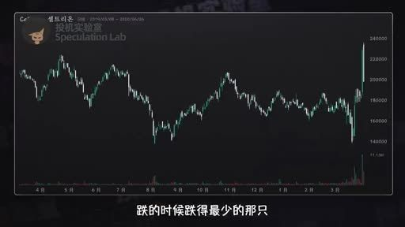

# 公告急拉、審計期與新股上市的股票要避開

講者列出金亨俊要小心的幾種股票：公告出來後急拉的不追，因為訊息一出散戶一窩蜂衝進去容易買在最高點；每年三月韓國公司交審計報告，報告還沒出的公司不做，因為審計意見不好股票會馬上停牌、想賣也賣不掉；收盤買之前還要查隔天會不會有可轉債轉股、增發或送股等大批新股份上市，拿到新股的人一開盤就會賣、股價容易被砸。

> 「公告出來以後急拉的不追」
>
> — [[投機實驗室 - 被稱為韓國股神的超人氣交易員金亨俊，勝率太高了。  做交易賺了1500萬美元，拿過四次實盤大賽第一，15年交易生涯只有兩個月發生過虧損，股...#主題 3：第 1 步：選股（01:23–02:36）|02:12]]

> [!quote]- 前後文（02:01–02:20）
> - [02:01] 放進自選股不馬上買趨勢
> - [02:03] 還要向上股價要一路漲上
> - [02:04] 去首先得站上一百二十日
> - [02:06] 線也就是過去半年的平均
> - [02:08] 價跌勢裡的股票不去猜哪
> - [02:10] 裡是底有幾種股票要小心
> - **[02:12] 公告出來以後急拉的不追**
> - [02:13] 因為訊息一出
> - [02:15] 散戶一窩蜂地衝進去很容
> - [02:17] 易買在最高點每年三月是
> - [02:18] 韓國公司交審計報告的時
> - [02:20] 候報告還沒出來的公司也

**標示：** 講者主張，未查證

## 出處

- [[投機實驗室 - 被稱為韓國股神的超人氣交易員金亨俊，勝率太高了。  做交易賺了1500萬美元，拿過四次實盤大賽第一，15年交易生涯只有兩個月發生過虧損，股...#主題 3：第 1 步：選股（01:23–02:36）|投機實驗室 - 被稱為韓國股神的超人氣交易員金亨俊，勝率太高了。  做交易賺了1500萬美元，拿過四次實盤大賽第一，15年交易生涯只有兩個月發生過虧損，股...]]（02:12）
