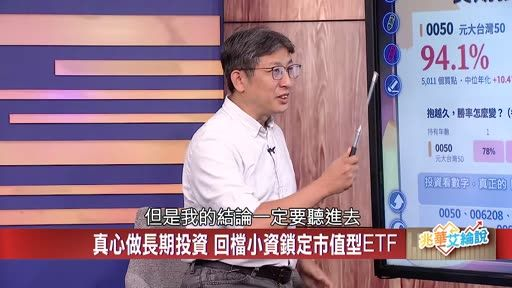

# 市值型持有越久勝率越高

股魚的結論是：不知道買什麼就買市值型，並堅持抱至少三年。他以 0050 每年年初進場的回測（2003–2026）說明，持有 1 年勝率約八成、3 年約九成、5 年以上接近 100%；複雜的運算可以不管，但這個長期投資的結論要聽進去。

> 「然後堅持抱至少三年以上」
>
> — [[【兆華艾綸說】ETF逢低撿 金字塔加碼法 市值、正2、高息型 全都解｜李兆華、艾綸、股魚 2026.10.21 part2#主題 8：小資怎麼選：無聊的市值型 ETF（16:40–20:03）|19:00]] · [▶ 原影片 19:00](https://www.youtube.com/watch?v=LrvC2KNcxYs&t=1140s)

> [!quote]- 前後文（18:46–19:12）
> - [18:46] 是賠錢的
> - [18:48] 所以我們也是說在投資的過程當中
> - [18:51] 複雜的運算你可以不要管
> - [18:54] 但是我的結論一定要聽進去
> - [18:56] 你如果不知道買什麼
> - [18:58] 買市值型的產品
> - **[19:00] 然後堅持抱至少三年以上**
> - [19:03] 你有九成的勝率
> - [19:04] 抱五年以上的話
> - [19:06] 你會拿到接近100%的勝率
> - [19:09] 這個就是投資的一個秘訣
> - [19:12] 長期投資

**標示：** 講者主張，未查證

## 出處

- [[【兆華艾綸說】ETF逢低撿 金字塔加碼法 市值、正2、高息型 全都解｜李兆華、艾綸、股魚 2026.10.21 part2#主題 8：小資怎麼選：無聊的市值型 ETF（16:40–20:03）|【兆華艾綸說】ETF逢低撿 金字塔加碼法 市值、正2、高息型 全都解｜李兆華、艾綸、股魚 2026.10.21 part2]]（19:00）
