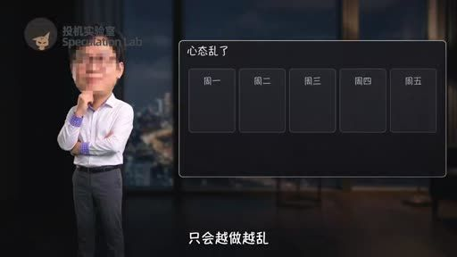

# 心態亂了先停一個星期

講者轉述金亨俊的停手規矩：做錯（例如下錯單、跟著別人亂買）就當天收手，因為急著當天撈回來只會越做越亂；心態亂了就先停一個星期，停下來在旁邊看反而看得更清楚。另外早盤做得不順下午就歇著、大盤天天跌就少留隔夜單、炒股不借錢並一直留著現金，到該買的時候才有錢買。

> 「心態亂了就先」
>
> — [[投機實驗室 - 被稱為韓國股神的超人氣交易員金亨俊，勝率太高了。  做交易賺了1500萬美元，拿過四次實盤大賽第一，15年交易生涯只有兩個月發生過虧損，股...#主題 6：停手規矩與資金管理（04:32–05:00）|04:44]]

> [!quote]- 前後文（04:33–04:54）
> - [04:33] 也不去看它它還有幾個停
> - [04:34] 手的規矩比如早盤做得不
> - [04:36] 順下午就歇著要做也只在
> - [04:38] 收盤前買做錯了比如下錯
> - [04:40] 單跟著別人亂買就當天收
> - [04:42] 手因為急著當天撈回來只
> - **[04:44] 會越做越亂心態亂了就先**
> - [04:46] 停一個星期停下來在旁邊
> - [04:48] 看反而看得更清楚大盤如
> - [04:50] 果天天在跌就少留隔夜的
> - [04:52] 單子真是上漲的行情再留
> - [04:54] 另外炒股不借錢手裡一直

**標示：** 講者主張，未查證

## 出處

- [[投機實驗室 - 被稱為韓國股神的超人氣交易員金亨俊，勝率太高了。  做交易賺了1500萬美元，拿過四次實盤大賽第一，15年交易生涯只有兩個月發生過虧損，股...#主題 6：停手規矩與資金管理（04:32–05:00）|投機實驗室 - 被稱為韓國股神的超人氣交易員金亨俊，勝率太高了。  做交易賺了1500萬美元，拿過四次實盤大賽第一，15年交易生涯只有兩個月發生過虧損，股...]]（04:44）
