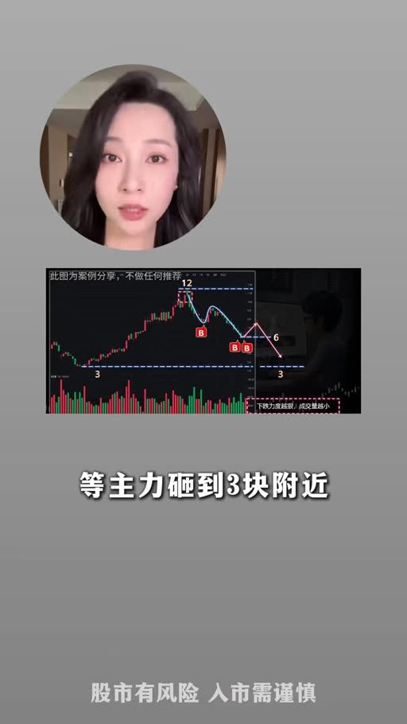

# 散戶滿倉後，沒有做多資金阻擋，主力砸盤成本很低

講者說股價跌得夠深時，散戶已滿倉，要麼割肉、要麼裝死，願意逆勢買進的很少，已沒有做多資金阻擋砸盤，一點小錢就能砸出很大跌幅，所以越往下跌力度越狠、成交量越小（講者主張，未查證）。

> 「已經沒有做多資金來阻擋砸盤資金了」
>
> — [[山姐：主力如何利用散戶抄底心理出貨#主題 5：砸盤收集：散戶滿倉後，主力往下砸、越跌量越小（03:39–04:29）|04:22]]

> [!quote]- 前後文（04:07–04:52）
> - [04:07] 能有錢趁著下跌跟它對著幹
> - [04:10] 買入的這些散戶是非常少的
> - [04:12] 所以主力會肆無忌憚的往下砸
> - [04:14] 這也是為什麼越往下跌力度就越狠
> - [04:18] 成交量越小的原因
> - [04:21] 因為跌得夠深
> - **[04:22] 已經沒有做多資金來阻擋砸盤資金了**
> - [04:26] 這個時候一點小錢就能砸出很大的跌幅
> - [04:29] 等主力砸到3塊附近
> - [04:31] 這個時候的明牌是大部分拋壓在6塊左右
> - [04:35] 3塊附近的只需要反復震盪來消耗散戶的耐心讓受不了長期虧損的散戶在3塊附近去割肉或者說在底部反覆去追漲殺跌交出籌碼比如說在三到四塊之間反覆去震盪
> - [04:52] 這樣不斷去高拋低吸

**標示：** 講者主張，未查證

## 出處

- [[山姐：主力如何利用散戶抄底心理出貨#主題 5：砸盤收集：散戶滿倉後，主力往下砸、越跌量越小（03:39–04:29）|山姐：主力如何利用散戶抄底心理出貨]]（04:22）
