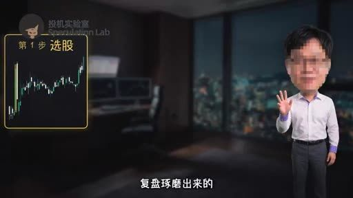

# 新高法：不追當天大陽線，等收陰線回落再買

講者介紹金亨俊的新高法：股票創新高代表上面已沒有等著回本就賣的套牢者，短期容易續漲；但新高大多是一根大陽線拉上去，當天追進去常買在最高處，且很多股票盤中創新高、收盤又跌回去。所以他等收一根陰線回落一下再買。講者說這一招來自他追陽線虧了無數次之後的覆盤。

> 「收一根陰線回落一下再買」
>
> — [[投機實驗室 - 被稱為韓國股神的超人氣交易員金亨俊，勝率太高了。  做交易賺了1500萬美元，拿過四次實盤大賽第一，15年交易生涯只有兩個月發生過虧損，股...#主題 2：新高法的邏輯（00:44–01:23）|01:08]]

> [!quote]- 前後文（00:59–01:19）
> - [00:59] 是一根大陽線拉上去的
> - [01:00] 當天追進去
> - [01:01] 就是買在最高處而且很多
> - [01:03] 股票盤中創了新高收盤又
> - [01:05] 跌了回去追進去的人當天
> - [01:07] 就被套住了所以他要等它
> - **[01:08] 收一根陰線回落一下再買**
> - [01:10] 這一招就是他追陽線虧了
> - [01:12] 無數次以後覆盤琢磨出來
> - [01:14] 的新高法分三步選股等買
> - [01:16] 點賣出看的都是日 K 線他前一天
> - [01:19] 就把第二天要做的股票挑

**標示：** 講者主張，未查證

## 出處

- [[投機實驗室 - 被稱為韓國股神的超人氣交易員金亨俊，勝率太高了。  做交易賺了1500萬美元，拿過四次實盤大賽第一，15年交易生涯只有兩個月發生過虧損，股...#主題 2：新高法的邏輯（00:44–01:23）|投機實驗室 - 被稱為韓國股神的超人氣交易員金亨俊，勝率太高了。  做交易賺了1500萬美元，拿過四次實盤大賽第一，15年交易生涯只有兩個月發生過虧損，股...]]（01:08）
