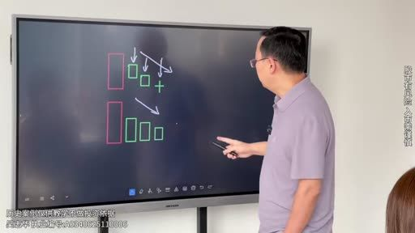

# 最低量加最低價：賣方已無力再往下拋

講者說價縮量縮後，這個位置會出現一個最低的量、同時有個最低的價，說明賣的人已經沒有力量再往下拋，他稱這叫真正的衰竭（講者主張，未查證）。

> 「同時有個最低的價」
>
> — [[股票#主題 4：條件二（二）：成交量同步收縮，出現最低量與最低價（00:48–01:14）|01:05]]

> [!quote]- 前後文（00:38–01:20）
> - [00:38] 第一，價格是連續縮的，比如說，第一根K線跌5個點，第二個K線跌3個點，第三個K線可能跌1個點，價格是越來越跌的
> - [00:48] 第二個條件，量是越來越縮的
> - [00:51] 第二個條件，它的成交量要逐步下跌的，價格連續縮，量也連續縮，說明什麼？
> - [00:57] 說明真正的空方力量開始衰竭了
> - [01:01] 沒有人賣了
> - [01:03] 這個地方出現一個最低的量
> - **[01:05] 同時有個最低的價**
> - [01:07] 說明這個地方賣的人已經沒有力量再往下拋了
> - [01:13] 這叫真正的衰竭
> - [01:14] 第三個衰竭之後最理想的還是一個確認的訊號
> - [01:19] 這一天能不能直接進場呢
> - [01:20] 原則上是可以的

**標示：** 講者主張，未查證

## 出處

- [[股票#主題 4：條件二（二）：成交量同步收縮，出現最低量與最低價（00:48–01:14）|股票]]（01:05）
