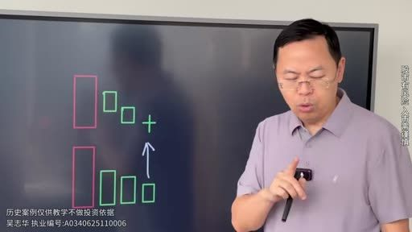

# 最安全的進場：第二天價漲量增的確認陽線

講者說衰竭之後最理想的是一個確認訊號：原則上衰竭當天可以直接進場，但最安全的機會是第二天出現一根確認的陽線，而且是價漲量增的陽線，當它出現時再買，他稱是最安全的低吸機會（講者主張，未查證；非投資建議）。

> 「價漲量增的陽線」
>
> — [[股票#主題 6：進場時機：第二天價漲量增的陽線最安全（01:19–01:45）|01:22]]

> [!quote]- 前後文（00:57–01:35）
> - [00:57] 說明真正的空方力量開始衰竭了
> - [01:01] 沒有人賣了
> - [01:03] 這個地方出現一個最低的量
> - [01:05] 同時有個最低的價
> - [01:07] 說明這個地方賣的人已經沒有力量再往下拋了
> - [01:13] 這叫真正的衰竭
> - [01:14] 第三個衰竭之後最理想的還是一個確認的訊號
> - [01:19] 這一天能不能直接進場呢
> - [01:20] 原則上是可以的
> - **[01:22] 當然最安全機會是第二天出現一個確認的陽線，而且價漲量增的陽線**
> - [01:32] 當這個陽線出來的時候，這一天是最安全的入場機會
> - **[01:35] 當這根價漲量增的陽線出現的時候，你再去買，可以說是最安全的低吸機會**

**標示：** 講者主張，未查證

## 出處

- [[股票#主題 6：進場時機：第二天價漲量增的陽線最安全（01:19–01:45）|股票]]（01:22）
