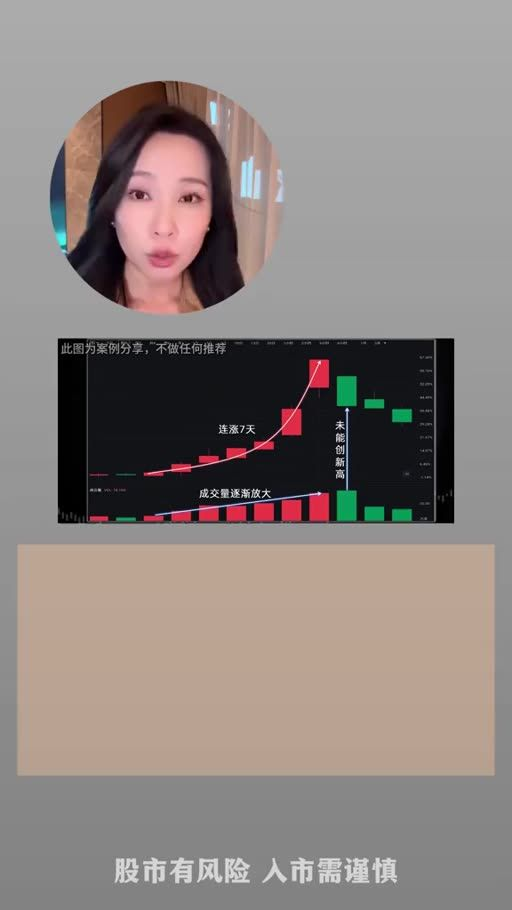

# 梯量柱：連漲後量增價不創新高是拉不動

連續三天成交量逐漸增加（例：50、60、75 萬）為梯量柱，講者認為看似資金進場、實為透支買入。若價格連漲 7 天後出現梯量柱，且收盤價未能創新高，講者解讀為主力拉不動了，接下來可能回調，要提前警惕。

> 「這個就說明主力已經是拉不動了」
>
> — [[成交量六種量柱形態：看懂主力真實意圖#主題 3：第二種：梯量柱——上漲乏力的訊號（01:24–02:00）|01:54]]

> [!quote]- 前後文（01:37–02:05）
> - [01:37] 這樣的情況就形成了一個梯量柱
> - [01:40] 那麼雖然看起來這個資金在持續的進場
> - [01:44] 但實際上是在透支買入的
> - [01:46] 如果說在價格連漲了7天後
> - [01:49] 出現了梯量柱
> - [01:51] 且收盤價未能夠創新高
> - **[01:54] 這個就說明主力已經是拉不動了**
> - [01:57] 接下來還有可能會出現回調
> - [01:59] 需要提前警惕
> - [02:00] 第三種，高量柱
> - [02:03] 高量柱是市場活躍的訊號
> - [02:05] 只要某根量柱比前三天的平均量高出了50%以上

**標示：** 講者主張，未查證

## 出處

- [[成交量六種量柱形態：看懂主力真實意圖#主題 3：第二種：梯量柱——上漲乏力的訊號（01:24–02:00）|成交量六種量柱形態：看懂主力真實意圖]]（01:54）
