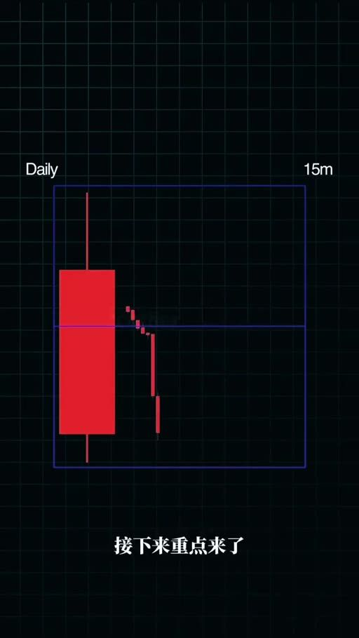

# 止損放低點下方，目標看箱體頂部

講者說確認陷阱的訊號是一根小陽線帶很長的下影線，代表流動性已被製造、買方開始進場；隨後等價格突破前一根 K 線高點就是進場位，止損放在低點下方，目標直接看向箱體頂部，並叮囑存下策略後自己復盤、測試（講者主張，未查證；非投資建議）。

> 「止損放在低點下方，目標直接看向箱體頂部」
>
> — [[5年才學會的交易秘密#主題 5：進場訊號、止損與目標（00:59–01:21）|00:59]]

> [!quote]- 前後文（00:38–00:59）
> - [00:38] 目標看向箱體頂部
> - [00:39] 如果價格處於箱體中間
> - [00:41] 那就什麼都別做
> - [00:42] 這樣一來
> - [00:43] 你交易的就是機構方向
> - [00:45] 而不是隨便亂進場
> - [00:46] 接下來重點來了
> - [00:47] 當價格來到箱體底部時
> - [00:49] 等待市場出現一波強勢下跌
> - [00:51] 大部分交易者這時候會開始恐慌
> - [00:53] 他們會以為市場馬上要崩盤，但實際上，這只是一個陷阱，如何確認這是陷阱？
> - **[00:59] 觀察所謂的雙維candle,也就是一根小陽線，並帶著很長的下影線，這意味著流動性已經被製造出來，同時買方已經開始進場，隨後等待價格突破前一根K線高點，這裡就是你的狙擊進場位，止損放在低點下方，目標直接看向箱體頂部，就這麼簡單，把這個策略儲存下來，自己去復盤，測試並實踐。**

**標示：** 講者主張，未查證

## 出處

- [[5年才學會的交易秘密#主題 5：進場訊號、止損與目標（00:59–01:21）|5年才學會的交易秘密]]（00:59）
