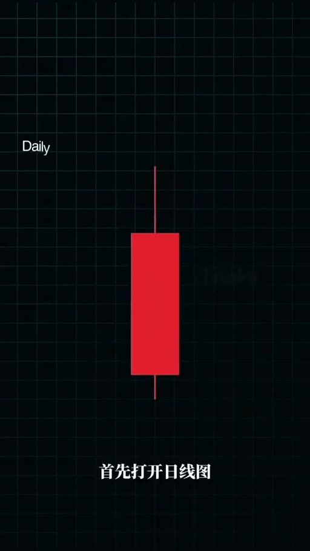

# 箱體理論：把前一日高低點畫成箱體，判斷誰掌控市場

講者說第一步是在日線圖把前一天的高點和低點畫成一個箱體，中間再畫一條中線，不需要絕對精準、目測即可；這個箱體會告訴你當前市場到底是誰在掌控（講者主張，未查證）。

> 「把前一天的高點和低點畫成一個箱體」
>
> — [[5年才學會的交易秘密#主題 2：步驟一：日線畫出前一日高低點的箱體與中線（00:15–00:25）|00:15]]

> [!quote]- 前後文（00:00–00:39）
> - [00:00] 我花了整整5年，才真正掌握這套策略，但今天，我會在60秒內講清楚，這是我那筆最大交易背後的核心秘密，而且它穩定到我每天都會使用，甚至靠它每天從期貨市場提取1000美金，它的名字叫箱體理論。
> - **[00:15] 首先，開啟日線圖，把前一天的高點和低點畫成一個箱體，然後在中間畫一條中線，不需要絕對精準目測即可，這個箱體會告訴你，當前市場到底是誰在掌控。**
> - [00:25] 接下來切換到15分鐘圖
> - [00:27] 如果價格執行在箱體頂部
> - [00:29] 說明賣方掌控市場
> - [00:30] 這種情況下只考慮做空
> - [00:32] 目標看向箱體底部
> - [00:33] 如果價格執行在箱體底部
> - [00:35] 說明買方掌控市場
> - [00:36] 這種情況下只考慮做多
> - [00:38] 目標看向箱體頂部
> - [00:39] 如果價格處於箱體中間

**標示：** 講者主張，未查證

## 出處

- [[5年才學會的交易秘密#主題 2：步驟一：日線畫出前一日高低點的箱體與中線（00:15–00:25）|5年才學會的交易秘密]]（00:15）
