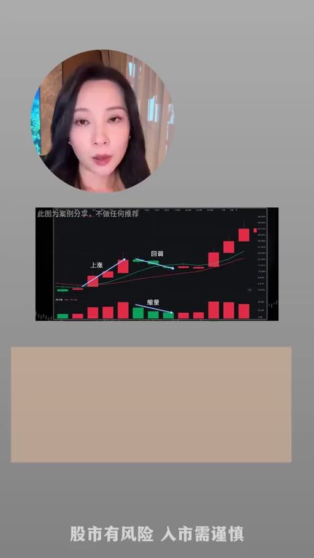

# 縮量柱：上漲回調縮量多是洗盤

講者（珊姐）把連續三天成交量逐漸遞減（例：60 萬、50 萬到 20 萬）稱為縮量柱。下跌中縮量代表拋盤耗盡、賣方力量減弱；上漲回調時縮量往往是主力洗盤，只要均線沒被跌破，通常只是短期洗盤，耐心等反彈即可。

> 「往往是主力在洗盤」
>
> — [[成交量六種量柱形態：看懂主力真實意圖#主題 2：第一種：縮量柱——反彈前的訊號（00:44–01:24）|01:07]]

> [!quote]- 前後文（00:52–01:22）
> - [00:52] 比如說從60萬啊
> - [00:54] 50萬到20萬
> - [00:55] 這就屬於縮量的
> - [00:57] 那麼在下跌的過程當中出現了縮量
> - [01:00] 說明了拋盤已經耗盡了，賣方力量減弱
> - [01:04] 而在上漲回調的時候出現了縮量
> - **[01:07] 往往是主力在洗盤**
> - [01:09] 這個時候不必輕易的被嚇跑
> - [01:11] 比如說某一隻股票在漲了幾天之後出現了縮量回調
> - [01:16] 只要它的均線沒有被跌破
> - [01:20] 這通常只是短期的洗盤
> - [01:22] 耐心等待反彈即可

**標示：** 講者主張，未查證

## 出處

- [[成交量六種量柱形態：看懂主力真實意圖#主題 2：第一種：縮量柱——反彈前的訊號（00:44–01:24）|成交量六種量柱形態：看懂主力真實意圖]]（01:07）
