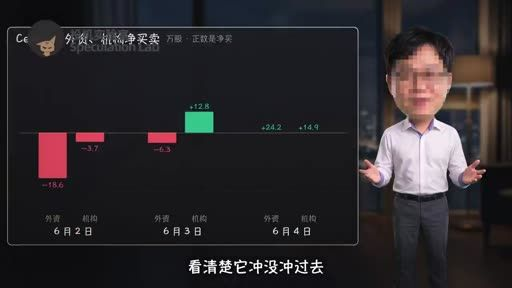

# 買點是上升陰線，且要滿足三個條件

講者說金亨俊等的買點是「上升陰線」（股價往上走途中收出的陰線，十字星也算），最好出在衝過前高之後。買前要同時滿足三個條件：衝上來的一段成交額放到 500 億韓元以上；這根陰線收盤還在五日線（最近五天平均價）上面；先畫出前高壓力線，並看當天機構外資有沒有在買，其中機構更重要。三個條件都對上才在收盤前買進。

> 「五日線就是」
>
> — [[投機實驗室 - 被稱為韓國股神的超人氣交易員金亨俊，勝率太高了。  做交易賺了1500萬美元，拿過四次實盤大賽第一，15年交易生涯只有兩個月發生過虧損，股...#主題 4：第 2 步：等買點（02:36–04:02）|03:17]]

> [!quote]- 前後文（03:06–03:25）
> - [03:06] 股票的例子成交額放到五
> - [03:07] 百多億衝過了一年來的高
> - [03:09] 點他就在它漲上來回撥一
> - [03:11] 下的時候大筆買了進去第
> - [03:12] 二天一早買盤湧進來股價
> - [03:15] 急漲二是這根陰線收盤還
> - **[03:17] 在五日線上面五日線就是**
> - [03:18] 最近五天的平均價收在它
> - [03:20] 上面才安全三是先把上面
> - [03:22] 的壓力線畫出來也就是前
> - [03:23] 面那個高點看清楚它衝沒
> - [03:25] 衝過去再看當天機構外資

**標示：** 講者主張，未查證

## 出處

- [[投機實驗室 - 被稱為韓國股神的超人氣交易員金亨俊，勝率太高了。  做交易賺了1500萬美元，拿過四次實盤大賽第一，15年交易生涯只有兩個月發生過虧損，股...#主題 4：第 2 步：等買點（02:36–04:02）|投機實驗室 - 被稱為韓國股神的超人氣交易員金亨俊，勝率太高了。  做交易賺了1500萬美元，拿過四次實盤大賽第一，15年交易生涯只有兩個月發生過虧損，股...]]（03:17）
