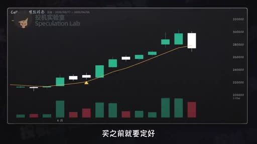

# 賣出：跌破五日線再賣，高位五倍爆量視為見頂

講者說金亨俊的買點買對的話隔天多半往上走，所以開盤一段時間還漲不上去就馬上止損、最晚幾點走買之前就要定好；漲上去的就一直拿著，等跌破五日線再賣，開盤就在五日線下就賣。另一個賣出情況是股價已漲到很高的位置，突然放出的成交量是上漲那幾天的五倍以上，就當成真的見頂，賣掉後再漲也不去看。

> 「跌破五日線再賣」
>
> — [[投機實驗室 - 被稱為韓國股神的超人氣交易員金亨俊，勝率太高了。  做交易賺了1500萬美元，拿過四次實盤大賽第一，15年交易生涯只有兩個月發生過虧損，股...#主題 5：第 3 步：賣出（04:02–04:32）|04:13]]

> [!quote]- 前後文（04:02–04:23）
> - [04:02] 冒險多攢經驗最後是賣出
> - [04:05] 這種買點要是買對了第二
> - [04:06] 天多半會往上走所以開盤
> - [04:08] 一段時間還漲不上去就要
> - [04:10] 馬上止損最晚幾點走買之
> - [04:12] 前就要定好漲上去的就一
> - **[04:13] 直拿著跌破五日線再賣要**
> - [04:15] 是哪天開盤就在五日線下
> - [04:17] 面開盤就賣還有一種情況
> - [04:19] 也要賣就是股價已經漲到
> - [04:21] 很高的位置突然放出的成
> - [04:23] 交量是上漲那幾天的五倍

**標示：** 講者主張，未查證

## 出處

- [[投機實驗室 - 被稱為韓國股神的超人氣交易員金亨俊，勝率太高了。  做交易賺了1500萬美元，拿過四次實盤大賽第一，15年交易生涯只有兩個月發生過虧損，股...#主題 5：第 3 步：賣出（04:02–04:32）|投機實驗室 - 被稱為韓國股神的超人氣交易員金亨俊，勝率太高了。  做交易賺了1500萬美元，拿過四次實盤大賽第一，15年交易生涯只有兩個月發生過虧損，股...]]（04:13）
