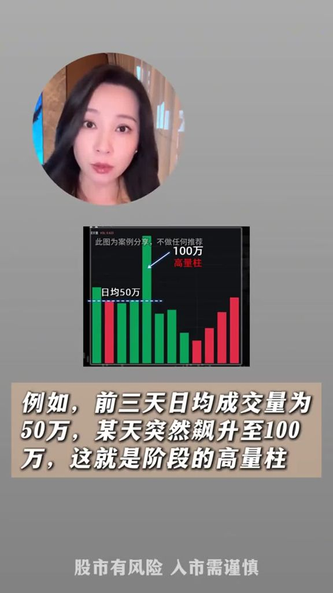

# 高量柱：低位吸籌、高位出貨

某根量柱比前三天平均量高出 50% 以上即為高量柱（例：前三天日均 50 萬、某天飆升到 100 萬）。講者說出現在低位通常是主力吸籌，經過洗盤後有望開啟主升浪；出現在高位則要格外小心，可能是主力拉高出貨。

> 「通常呢是主力吸籌的訊號」
>
> — [[成交量六種量柱形態：看懂主力真實意圖#主題 4：第三種：高量柱——市場活躍的訊號（02:00–02:38）|02:24]]

> [!quote]- 前後文（02:05–02:35）
> - [02:05] 只要某根量柱比前三天的平均量高出了50%以上
> - [02:11] 就可以認定為高量柱了
> - [02:14] 例如說前三天日均成交量為50萬
> - [02:17] 某天突然是飆升出了100萬
> - [02:19] 這就是階段的高量柱
> - [02:22] 如果說高量柱出現是在低位的
> - **[02:24] 通常呢是主力吸籌的訊號**
> - [02:26] 經過洗盤後呢是有望開啟主升浪的
> - [02:30] 但反之呢
> - [02:31] 如果說高量柱出現是在高位的
> - [02:33] 就需要格外的小心了
> - [02:35] 可能是主力拉高出貨的行為

**標示：** 講者主張，未查證

## 出處

- [[成交量六種量柱形態：看懂主力真實意圖#主題 4：第三種：高量柱——市場活躍的訊號（02:00–02:38）|成交量六種量柱形態：看懂主力真實意圖]]（02:24）
