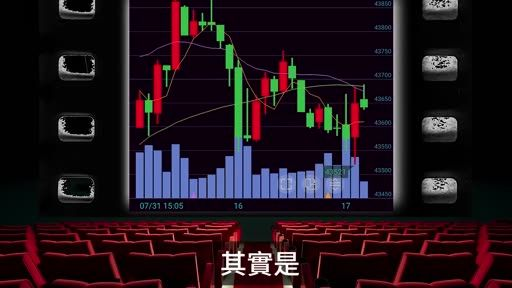

# 夜盤預告開盤方向，不保證收盤結果

講者提醒夜盤不一定能直接告訴收盤結果，有時開盤大漲後收盤跌回去，或開盤大跌後一路反彈，所以實戰要分開判斷開盤偏漲偏跌，以及開盤後方向能否延續。

> 「夜盤比較能告訴你隔天的開盤方向」
>
> — [[臺指期夜盤三個數字判斷隔天台股走勢#主題 2：台指期與夜盤是什麼（00:29–01:42）|01:18]]

> [!quote]- 前後文（00:59–01:27）
> - [00:59] 所以晚上美股發生的事情像是四大指數漲跌、就業資料、通膨資料、戰爭訊息、大型科技股財報
> - [01:06] 這些訊息都會先反映在臺指期的夜盤上
> - [01:09] 你可以把它當作是隔天開盤的預告片
> - [01:11] 很多白天看到的走勢其實是前一天晚上
> - [01:14] 夜盤就已經先演給你看了
> - [01:16] 但有一件事情很重要
> - **[01:18] 夜盤比較能告訴你隔天的開盤方向**
> - [01:20] 但它不一定能直接告訴你收盤結果
> - [01:23] 這兩件事差很多
> - [01:24] 因為有時候開盤漲很多
> - [01:26] 結果收盤反而跌回去
> - [01:27] 或是開盤大跌

**標示：** 講者／作者主張，未查證

## 出處

- [[臺指期夜盤三個數字判斷隔天台股走勢#主題 2：台指期與夜盤是什麼（00:29–01:42）|臺指期夜盤三個數字判斷隔天台股走勢]]（01:18）
