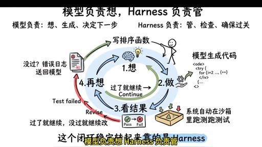

# 模型負責想，Harness 負責管：AI Agent＝大模型＋Harness

講者用馬具比喻（不是讓馬變聰明，而是套上韁繩、修好路）：模型負責想、生成、決定下一步，Harness 負責管、檢查、確保幹完能過關；例如模型寫排序函式後系統在沙箱跑測試，沒過就把錯誤日誌送回讓模型改，形成想—做—看結果—再想的閉環。公式是 AI Agent＝大模型＋Harness，模型以外決定穩定交付的東西都歸 Harness 管。

> 「模型負責想」
>
> — [[什麼是Harness#主題 5：Harness 是什麼：馬具比喻、閉環與三層巢狀（03:15–04:43）|03:36]]

> [!quote]- 前後文（03:27–03:43）
> - [03:27] 修好路
> - [03:28] 讓十匹馬能同時安全的跑
> - [03:30] 放到AI領域
> - [03:31] Harness Engineering
> - [03:32] 就是圍繞大模型搭建的
> - [03:34] 一整套執行和控制系統
> - **[03:36] 模型負責想**
> - [03:37] Harness負責管
> - [03:38] 模型負責生成
> - [03:40] Harness負責檢查
> - [03:41] 模型負責下一步幹什麼
> - [03:43] Harness負責確保幹完了能過關

**標示：** 講者主張，未查證

## 出處

- [[什麼是Harness#主題 5：Harness 是什麼：馬具比喻、閉環與三層巢狀（03:15–04:43）|什麼是Harness]]（03:36）
