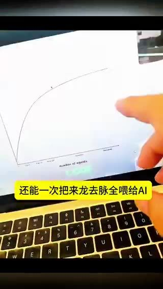

# 用語音下指令，說完請 AI 用自己的話複述

講者說安排任務時用語音，因為打字會想省話、開口就會把客戶是誰、手上有什麼資料、要注意什麼細節與腦中想法一口氣說完；說完再補一句「用你自己的話複述一遍」，就能知道 AI 有沒有聽懂、需不需要補充，不但快、能一次餵完來龍去脈，返工也少（講者主張，未查證）。

> 「用你自己的話複述一遍」
>
> — [[永動之初 - 這個講的太好了 一個不會寫程式碼的女生，憑什麼當上馬斯克AI團隊負責人？#主題 9：方法七：用語音下指令，並要求 AI 複述（03:04–03:35）|03:24]]

> [!quote]- 前後文（03:15–03:35）
> - [03:15] 你一旦張開嘴說就完全不一樣了
> - [03:17] 客戶是誰
> - [03:17] 手上有什麼資料要注意什麼細節
> - [03:19] 腦子裡亂七八糟的想法一
> - [03:21] 口氣全能倒出來全部說完
> - [03:23] 一定再補一句
> - **[03:24] 用你自己的話複述一遍**
> - [03:26] 這樣 AI 到底聽懂沒聽懂你的意思
> - [03:28] 有沒有需要你補充的一下就知道了
> - [03:30] 不但快還能一次把來龍去脈全餵給 AI
> - [03:33] 返工也少了
> - [03:35] 所以你看明白了嗎

**標示：** 講者主張，未查證

## 出處

- [[永動之初 - 這個講的太好了 一個不會寫程式碼的女生，憑什麼當上馬斯克AI團隊負責人？#主題 9：方法七：用語音下指令，並要求 AI 複述（03:04–03:35）|永動之初 - 這個講的太好了 一個不會寫程式碼的女生，憑什麼當上馬斯克AI團隊負責人？]]（03:24）
