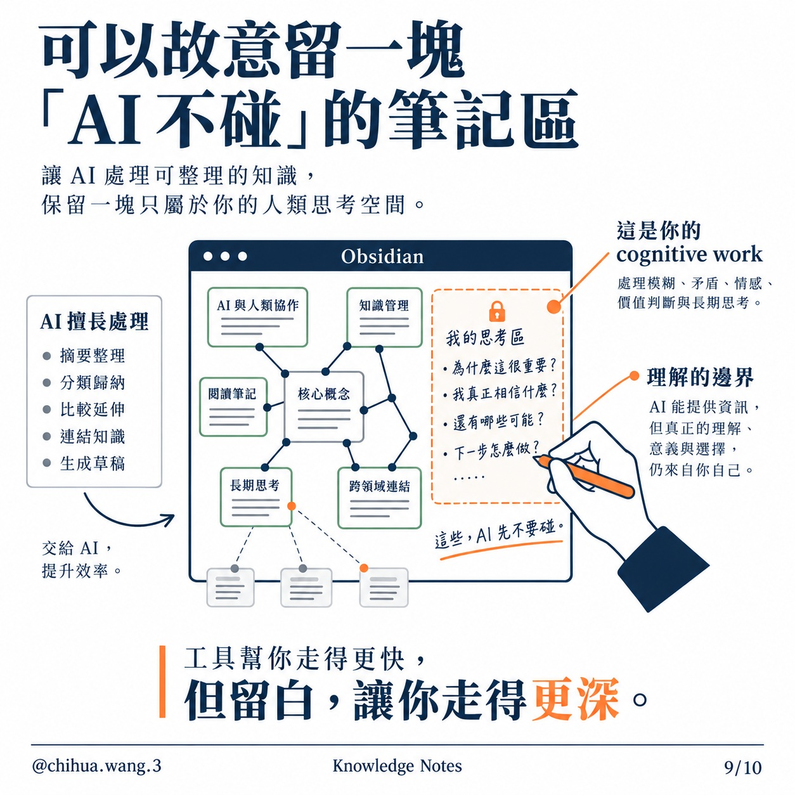

# 留一塊「AI 不碰」的思考區

摘要、分類、比較、連結、草稿交給 AI；模糊、矛盾、情感、價值判斷與長期思考（cognitive work）留給自己。

> 「工具幫你走得更快，但留白，讓你走得更深。」
>
> — [[AI 時代為什麼 Obsidian 反而更重要？#第 9 頁：可以故意留一塊「AI 不碰」的筆記區|第 9 頁]]

> [!quote]- 前後文（第 9 頁）
> - [00:09] 可以故意留一塊「AI 不碰」的筆記區
> - [00:09] 讓 AI 處理可整理的知識，保留一塊只屬於你的人類思考空間。
> - [00:09] 左：AI 擅長處理——摘要整理、分類歸納、比較延伸、連結知識、生成草稿 → 交給 AI，提升效率。
> - [00:09] 右：我的思考區（上鎖的虛線框）——為什麼這很重要？我真正相信什麼？還有哪些可能？下一步怎麼做？旁註：這些，AI 先不要碰。
> - [00:09] 這是你的 cognitive work：處理模糊、矛盾、情感、價值判斷與長期思考。
> - [00:09] 理解的邊界：AI 能提供資訊，但真正的理解、意義與選擇，仍來自你自己。
> - **[00:09] 結語：工具幫你走得更快，但留白，讓你走得更深。**

**標示：** 講者／作者主張，未查證

## 出處

- [[AI 時代為什麼 Obsidian 反而更重要？#第 9 頁：可以故意留一塊「AI 不碰」的筆記區|AI 時代為什麼 Obsidian 反而更重要？]]（第 9 頁）
