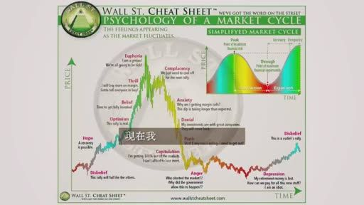

# 知道自己承受不了風險而選擇不參與

講者在第五類評論中舉一位網友：擔心 11 月 17 日輝達財報跳空下跌自己扛不住，所以乖乖待在指數裡。講者認為這位網友是整個評論區最清醒的人之一，因為他知道自己承受不了什麼風險而選擇不參與，這比任何抄底技巧都重要。

> 「承受不了什麼風險所以選擇不參與」
>
> — [[LEI - 這麼多人看好 $NVDA ，這下麻煩了！ 你需要理解市場情緒週期 Psychology of market cycle#主題 7：第五類評論：少數人的焦慮（05:57–06:31）|06:25]]

> [!quote]- 前後文（06:14–06:37）
> - [06:14] 萬一跳空下跌自己扛不住
> - [06:16] 那麼還是乖乖地待在指數
> - [06:17] 裡頭我想說誒
> - [06:19] 這位網友
> - [06:21] 是整個評論區當中
> - [06:22] 最清醒的人之一他知道自己
> - **[06:25] 承受不了什麼風險所以選擇不參與**
> - [06:29] 這比任何抄底技巧都重要
> - [06:31] 所以說到這裡呢我就想來
> - [06:32] 聊一聊市場情緒週期這個話題
> - [06:35] 現在我們看到的這張圖呢
> - [06:37] 描繪的就是市場情緒週期

**標示：** 講者主張，未查證

## 出處

- [[LEI - 這麼多人看好 $NVDA ，這下麻煩了！ 你需要理解市場情緒週期 Psychology of market cycle#主題 7：第五類評論：少數人的焦慮（05:57–06:31）|LEI - 這麼多人看好 $NVDA ，這下麻煩了！ 你需要理解市場情緒週期 Psychology of market cycle]]（06:25）
