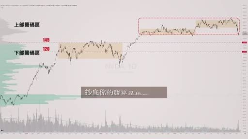

# 籌碼真空：兩個籌碼峰之間沒有阻力

講者（LEI）解釋輝達（NVDA）的籌碼分布：上下兩個籌碼峰之間沒有過渡籌碼，叫做「籌碼真空」，意味著一旦價格跌破上部籌碼峰，就會快速下跌到下方籌碼峰（145 到 120 之間），中間沒有什麼阻力。他說籌碼是直觀、客觀的指標，籌碼密集處就是很多人在此換手，可看作公允價值區間；他強調貼文只是客觀陳述現況而非判斷。

> 「沒有過渡籌碼的我們叫」
>
> — [[LEI - 這麼多人看好 $NVDA ，這下麻煩了！ 你需要理解市場情緒週期 Psychology of market cycle#主題 2：為什麼看 145–120：籌碼區與籌碼真空（00:28–02:12）|01:14]]

> [!quote]- 前後文（01:04–01:22）
> - [01:04] 會越來越大
> - [01:05] 那麼如果說你看好英偉達
> - [01:07] 那麼
> - [01:08] 如果說是在這個位置附近抄底
> - [01:10] 你的勝算是比較大的
> - [01:12] 然而上下兩個籌碼峰之間啊
> - **[01:14] 是沒有過渡籌碼的我們叫**
> - [01:15] 做籌碼真空
> - [01:16] 這意味著一旦價格跌破了
> - [01:19] 上部籌碼峰之後啊
> - [01:20] 就會快速下跌到一百四十
> - [01:22] 五到一百二十之間

**標示：** 講者主張，未查證

## 出處

- [[LEI - 這麼多人看好 $NVDA ，這下麻煩了！ 你需要理解市場情緒週期 Psychology of market cycle#主題 2：為什麼看 145–120：籌碼區與籌碼真空（00:28–02:12）|LEI - 這麼多人看好 $NVDA ，這下麻煩了！ 你需要理解市場情緒週期 Psychology of market cycle]]（01:14）
