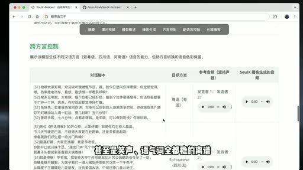

# 跨方言零樣本播客生成

講者示範給模型一句普通話提示，就能生成帶有四川話、河南話等方言特徵的播客對話；專案頁列為三項主要特點之一，稱支援跨不同中文方言的零樣本語音克隆（講者主張，未查證）。

> 「跨方言零樣本播客生成」
>
> — [[Github一開源，就登頂？一口氣合成90分鐘音訊～#主題 3：示範一：跨方言零樣本播客生成（00:35–01:10）|00:35]]

> [!quote]- 前後文（00:13–00:45）
> - [00:13] 不僅能生成單人語音，還能同時支援多人多輪對話
> - [00:17] 也就是說，你拿去生成一個多人小品，電影，播客等等都是沒有問題的
> - [00:22] 中文，英文，甚至是四川話，河南話，粵語等等方言特徵的自然語言
> - [00:27] 也能無壓力輸出音色情緒節奏甚至是笑聲語氣詞
> - [00:32] 全都穩的離譜
> - [00:33] 下面我帶兄弟們一起去體驗一下
> - **[00:35] 跨方言零樣本播客生成**
> - [00:37] 例如我們給他一句普通話提示
> - [00:41] Hello 大家好
> - [00:41] 歡迎收聽我們的節目
> - [00:43] 喂 我今天想問你一樣東西
> - [00:45] 你覺不覺得

**標示：** 講者主張，未查證

## 出處

- [[Github一開源，就登頂？一口氣合成90分鐘音訊～#主題 3：示範一：跨方言零樣本播客生成（00:35–01:10）|Github一開源，就登頂？一口氣合成90分鐘音訊～]]（00:35）
