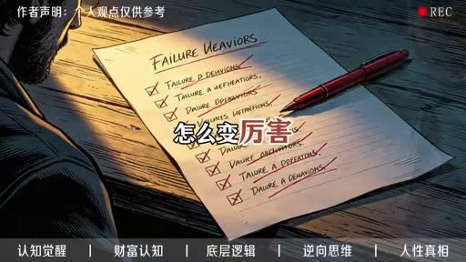

# 逆向思考：先想怎麼會失敗

講者說普通人習慣正向思考「我要怎麼賺錢、怎麼變厲害」，芒格反過來想「我要怎麼才會變窮、怎麼才會失敗」，把所有導致失敗的行為全部剔除就自然走向成功。講者主張避開災難比追求奇蹟更容易獲得財富。

> 「我要怎麼才會變窮」
>
> — [[大鵬財商 - 一個人財富積累最快的方式，不是拼命尋找成功秘訣，而是直接複製查理·芒格的10個終身習慣。  芒格有一句非常經典的話：  “如果我知道自己會...#主題 10：第 9 條：逆向思考（05:00–05:24）|05:08]]

> [!quote]- 前後文（05:00–05:17）
> - [05:00] 逆向思考
> - [05:01] 凡事反過來想
> - [05:03] 普通人習慣正向思考
> - [05:05] 我要怎麼賺錢
> - [05:06] 怎麼變厲害
> - [05:07] 芒格反過來想
> - **[05:08] 我要怎麼才會變窮**
> - [05:10] 怎麼才會失敗
> - [05:11] 把所有導致失敗的行為全部剔除
> - [05:13] 你自然就走向成功
> - [05:15] 很多人天天找暴富捷徑
> - [05:17] 卻從來不思考什麼行為

**標示：** 講者主張，未查證

## 出處

- [[大鵬財商 - 一個人財富積累最快的方式，不是拼命尋找成功秘訣，而是直接複製查理·芒格的10個終身習慣。  芒格有一句非常經典的話：  “如果我知道自己會...#主題 10：第 9 條：逆向思考（05:00–05:24）|大鵬財商 - 一個人財富積累最快的方式，不是拼命尋找成功秘訣，而是直接複製查理·芒格的10個終身習慣。  芒格有一句非常經典的話：  “如果我知道自己會...]]（05:08）
