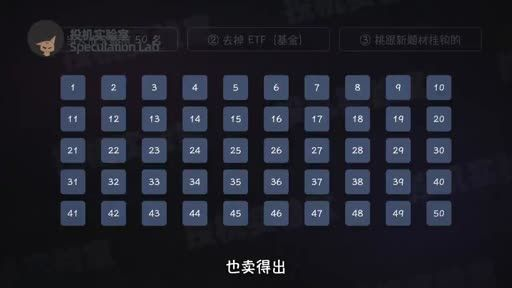

# 選股看成交額而不是成交量

講者說金亨俊選股先看成交額（一天進出多少錢），因為便宜股票的成交量看著很大、錢其實不多；他要的是錢多、人多、買得進也賣得出的股票，所以只看當天成交額排前 50 名、去掉 ETF 等基金類，再挑跟新題材掛鉤的龍頭股。成交額小的股票就算買也只買一點，因為他平時買得多，停損時自己的賣單會把價格砸下去。

> 「他要的是錢多」
>
> — [[投機實驗室 - 被稱為韓國股神的超人氣交易員金亨俊，勝率太高了。  做交易賺了1500萬美元，拿過四次實盤大賽第一，15年交易生涯只有兩個月發生過虧損，股...#主題 3：第 1 步：選股（01:23–02:36）|01:30]]

> [!quote]- 前後文（01:19–01:39）
> - [01:19] 就把第二天要做的股票挑
> - [01:21] 好漲了怎麼賣跌了怎麼止
> - [01:23] 損都提前想好先說選股選
> - [01:25] 股要先看成交額也就是一
> - [01:27] 天進出了多少錢因為便宜
> - [01:28] 的股票成交量看著很大
> - **[01:30] 錢其實不多他要的是錢多**
> - [01:32] 人多的股票買得進也賣得
> - [01:34] 出所以他看的是當天成交
> - [01:37] 額排前 50 名的股票基金類的
> - [01:39] ETF
> - [01:39] 去掉再挑跟新題材掛上鉤

**標示：** 講者主張，未查證

## 出處

- [[投機實驗室 - 被稱為韓國股神的超人氣交易員金亨俊，勝率太高了。  做交易賺了1500萬美元，拿過四次實盤大賽第一，15年交易生涯只有兩個月發生過虧損，股...#主題 3：第 1 步：選股（01:23–02:36）|投機實驗室 - 被稱為韓國股神的超人氣交易員金亨俊，勝率太高了。  做交易賺了1500萬美元，拿過四次實盤大賽第一，15年交易生涯只有兩個月發生過虧損，股...]]（01:30）
