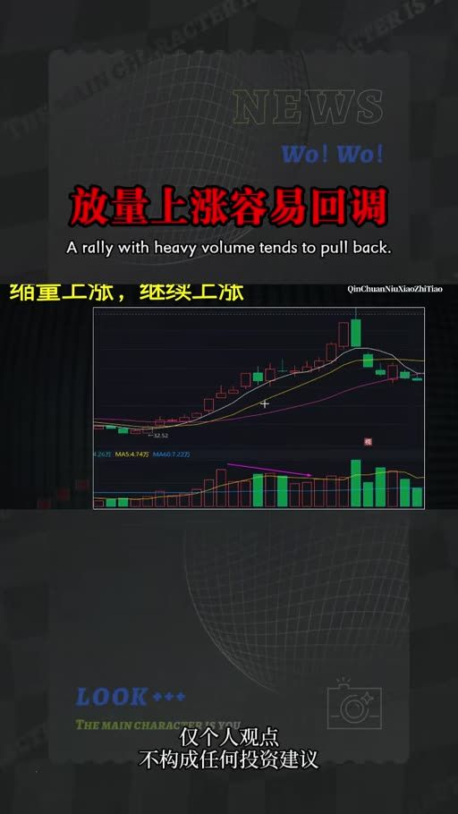

# 縮量下跌還會下跌

價格下跌且成交量縮小，作者認為下跌趨勢還會延續，同樣呼應縮量延續趨勢的說法。

> 「縮量下跌還會下跌」
>
> — [[放量上漲容易回調#主題 4：縮量三句：上漲續漲、下跌續跌、不跌見底（00:24–00:35）|00:28]]

> [!quote]- 前後文（00:00–00:31）
> - [00:00] 只要右邊的柱子比左邊的高就是放量
> - [00:03] 右邊的柱子比左邊的矮就是縮量
> - [00:06] 放量是用來改變趨勢的
> - [00:08] 而縮量是延續趨勢的
> - [00:11] 比如上升趨勢突然放量了可能就是漲到頂了
> - [00:14] 下跌趨勢突然放量了可能就是要反轉了
> - [00:18] 放量上漲容易回調
> - [00:20] 放量下跌容易反彈
> - [00:22] 放量不漲頭部已現
> - [00:24] 縮量上漲繼續上漲
> - **[00:28] 縮量下跌還會下跌**
> - [00:31] 縮量不跌底部已現

**標示：** 作者主張，未查證

## 出處

- [[放量上漲容易回調#主題 4：縮量三句：上漲續漲、下跌續跌、不跌見底（00:24–00:35）|放量上漲容易回調]]（00:28）
