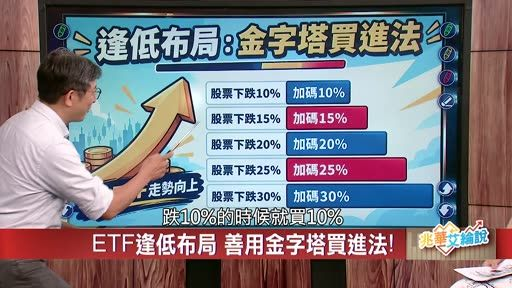

# 金字塔加碼法

跌 10% 買 10%、15% 買 15%、20% 買 20%、25% 買 25%，合計 100%；跌 30% 已近盡頭，忍耐。

> 「跌10%的時候就買10%」
>
> — [[【兆華艾綸說】ETF逢低撿 金字塔加碼法 市值、正2、高息型 全都解｜李兆華、艾綸、股魚 2026.10.21 part2#投影片 7：金字塔加碼法：跌越深買越多（14:41–16:40）|15:48]] · [▶ 原影片 15:48](https://www.youtube.com/watch?v=LrvC2KNcxYs&t=948s)

> [!quote]- 前後文（15:37–15:59）
> - [15:37] 稍微有投一點點
> - [15:39] 整個感受都不一樣了
> - [15:41] 我有參與到
> - [15:42] 回檔的時候我有賺到
> - [15:44] 我們要怎麼確保你有這個感覺
> - [15:47] 來 我就告訴你
> - **[15:48] 跌10%的時候就買10%**
> - [15:50] 跌15%的時候再買15%
> - [15:53] 跌20%的時候再買20%
> - [15:56] 跌25%的時候再加25%
> - [15:58] 我幫你算過了
> - [15:59] 剛剛好100%

**標示：** 講者主張，未查證

## 連結

- [[逢低加碼]]｜實際應用：分批投入，避免回檔最深時沒子彈

## 出處

- [[【兆華艾綸說】ETF逢低撿 金字塔加碼法 市值、正2、高息型 全都解｜李兆華、艾綸、股魚 2026.10.21 part2#投影片 7：金字塔加碼法：跌越深買越多（14:41–16:40）|【兆華艾綸說】ETF逢低撿 金字塔加碼法 市值、正2、高息型 全都解｜李兆華、艾綸、股魚 2026.10.21 part2]]（15:48）
