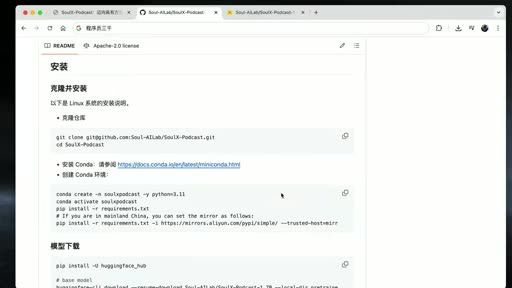

# 開源 TTS 模型可本地部署，文件在 GitHub 與 Hugging Face

講者說部署非常簡單，GitHub 與 Hugging Face 上都有完整的文件和部署教程，感興趣的人可以去體驗；他並稱模型發布第一天就登上 Hugging Face TTS 版本冠軍（講者主張，未查證）。

> 「Github和Hugging Face上都有完整的文件和部署教程」
>
> — [[Github一開源，就登頂？一口氣合成90分鐘音訊～#主題 6：部署與取得方式（02:25–02:33）|02:27]]

> [!quote]- 前後文（02:08–02:30）
> - [02:08] 突然就宣佈分開了
> - [02:09] 然後我點開那個評論區
> - [02:11] 哇滿屏都是那種心疼抱抱
> - [02:14] 姐姐不哭
> - [02:15] 感覺就好像全網的粉絲都跟著一起失戀了一樣
> - [02:18] 確實有這個感覺
> - [02:19] 是吧
> - [02:20] 其實這個現象還挺有意思的
> - [02:22] 它不光是粉絲對偶像的一種
> - [02:25] 部署起來也非常簡單
> - **[02:27] Github和Hugging Face上都有完整的文件和部署教程**
> - [02:30] 感興趣的兄弟們可以去體驗一下

**標示：** 講者主張，未查證

## 出處

- [[Github一開源，就登頂？一口氣合成90分鐘音訊～#主題 6：部署與取得方式（02:25–02:33）|Github一開源，就登頂？一口氣合成90分鐘音訊～]]（02:27）
