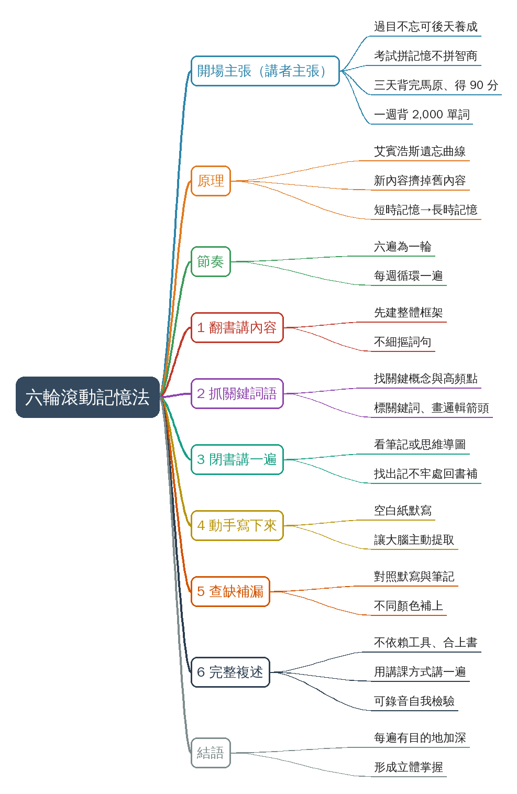

# Threads 讀書上癮的秘訣

## 摘要

**一句話重點**：講者（Threads 帳號 abingbuleng）推廣「六輪滾動記憶法」：依艾賓浩斯遺忘曲線，用六遍遞進的背書流程（翻書講→抓關鍵詞→閉書講→默寫→查缺補漏→完整複述），把短時記憶轉成長時記憶；成效數字皆為講者主張，未查證。

| 時間 | 重點 |
|---|---|
| 00:00 | 開場主張：過目不忘可後天養成、99% 考試拼記憶、背書速度可超越同學十倍、三天背完「馬原」得 90 分、一週背 2,000 單詞過四六級（講者主張，未查證） |
| 00:48 | 「完整版不在此展示，想學敲 666」（引流話術）；用艾賓浩斯遺忘曲線說明：短時記憶容量有限，新內容會擠掉舊內容，需轉成長時記憶 |
| 01:09 | 節奏：六遍為一輪，建議每週循環一遍 |
| 01:17 | 第一輪 翻書講內容：先建立整體框架，不細摳詞句，邊翻邊講給自己聽 |
| 01:34 | 第二輪 抓關鍵詞語：回原文找關鍵概念與高頻點，標記關鍵詞、畫邏輯箭頭，盡量熟練 |
| 01:52 | 第三輪 閉書講一遍：看筆記或思維導圖、合上書說出內容，找出記不牢處再回書補 |
| 02:07 | 第四輪 動手寫下來：空白紙默寫，目的是讓大腦主動提取資訊 |
| 02:23 | 第五輪 查缺補漏：對照思維導圖與默寫內容，用不同顏色補上沒記住的，再複述 |
| 02:40 | 第六輪 完整複述：不依賴工具、合上書用講課方式講一遍（可錄音自我檢驗），求流暢而非完美 |
| 02:59 | 結語：每一遍都有目的、有重點地加深，六遍走完形成立體掌握 |

### 名詞說明
- **六輪滾動記憶法**：講者自創的稱呼（畫面字幕「6轮滚动记忆法」），非通用學術名詞。
- **艾賓浩斯遺忘曲線**：描述記憶隨時間遺忘的曲線；講者以此引出「短時→長時記憶」。
- **馬原**：依畫面字幕「马原」，推測為大陸大學課程「馬克思主義基本原理」，未查證。
- **四六級**：大陸大學英語四級／六級考試。
- **普心**：推測為「普通心理學」，畫面無字幕可核對。

### 轉錄校正備註
- 中文影片，Groq 轉錄，語言自動偵測為 zh；影片有燒錄的簡體字幕，已用來核對（詳見 `meta.json.known_asr_errors`）。
- 主要校正：混動→滾動、馬雲→馬原、46級→四六級、心機收→新吸收、常識記憶→長時記憶、戲口→細摳、高評點→高頻點、公智和上書→工具合上書等。
- 非講座類影片，未去除語助詞。
- 影片來源：yt-dlp 不支援 Threads，影片是從貼文頁面取得的 mp4（`meta.json.source_post`）。畫面右上角的計時（如 05:10）是原片剪輯殘留，與本報告時間戳無關。

## 思維導圖



## 補充資料

### S1｜貼文：Threads 貼文說明文字
- 來源：Threads 貼文頁面（帳號 abingbuleng，約 4 天前發布）；取得日期：2026-10-21；取得方式：Claude 以瀏覽器渲染貼文頁面，讀取頁面文字。
- 為何需要補充：影片本身沒有貼文標題；貼文說明文字交代了這支影片的定位。
### 原文（逐字）
```
一個很變態，但可以讓你讀書上癮的秘訣！
```
### Claude 的對照分析
- 補充直接寫明：貼文用語為「很變態、讓你讀書上癮」，即影片 00:09「越背越上頭」的行銷包裝。
- 與影片一致：貼文主題即影片的六輪背書法。
- 未取得：留言、按讚數；頁面需登入才能顯示完整內容。
### 備註
- 影片中的成效（三天背完馬原 90 分、一週 2,000 單詞過四六級、速度十倍、恢復 300% 記憶力）皆為講者主張，未查證。
- 影片 00:48 的「敲 666」是向觀眾索取完整版的引流話術；完整版未提供，本報告只涵蓋影片所述的六輪流程。

## 來源

- 原始資料夾：`watch-output/身心生活/2026-10-21_Web_Threads-讀書上癮的秘訣__Det4Ya3EyqQ`
- 逐字稿來源：whisper (groq)
