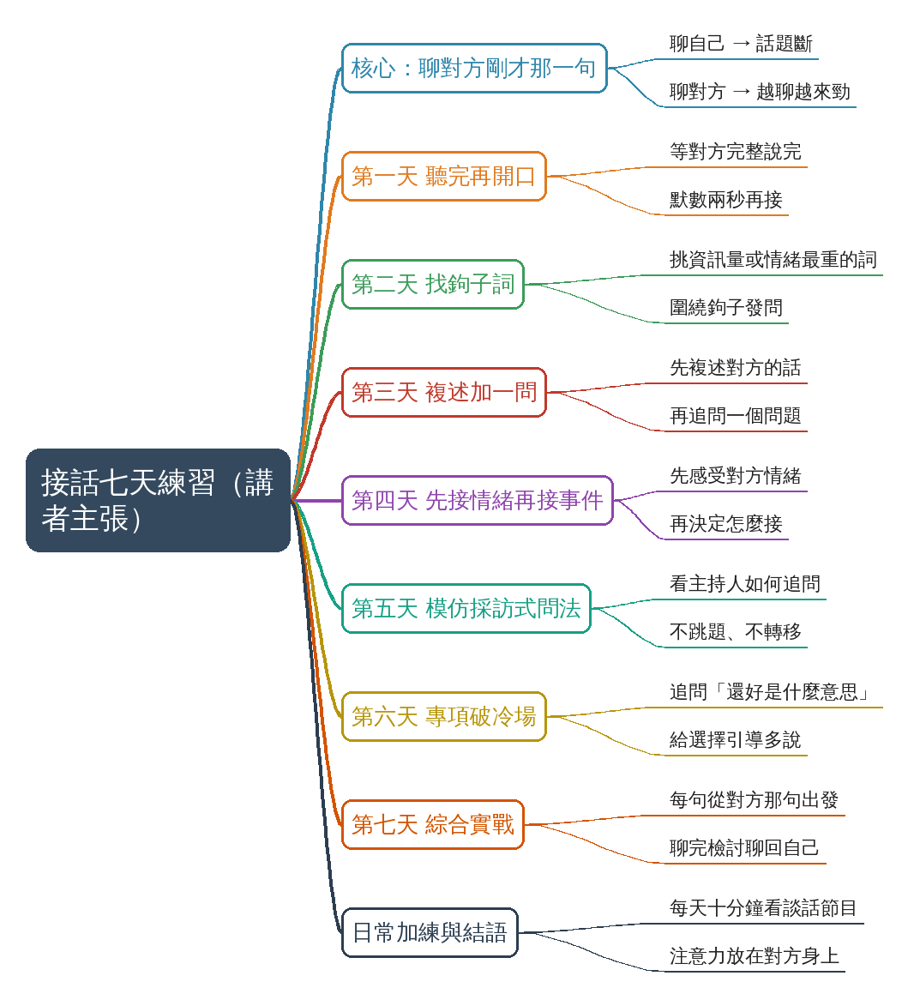

# 聊天不要聊自己，要聊對方剛才那一句

## 摘要

**一句話重點**：講者主張，把注意力放在對方「剛才那一句」上，就能讓話題接得住、拉得長；用七天、每天一個小動作練成（效果為講者主張，未查證）。

- 來源：TikTok（juzhongren33），3:04，中文，Whisper（Groq）轉錄，已轉繁體。
- 影片形式：電影／影集片段混剪＋燒入字幕與標題字，沒有講者出鏡；逐字稿以畫面字幕核對。

### 含時間戳重點

| 時間 | 重點 |
|---|---|
| 00:00 | 對比：回「我也在學、我做了紅燒肉」是聊自己；回「學多久了？」才是聊對方，對方會越聊越來勁 |
| 00:29 | 第一天 聽完再開口：等對方完整說完，默數兩秒再接 |
| 00:46 | 第二天 找鉤子詞：挑出對方話裡資訊量最大或最有情緒的詞，圍繞它發問 |
| 01:07 | 第三天 複述加一問：先複述再追問，對方覺得被聽見、話題自然延續 |
| 01:26 | 第四天 先接情緒再接事件：「被當眾批評，那挺難受的吧？」 |
| 01:51 | 第五天 模仿採訪式問法：觀察主持人如何在對方的話上推進，不跳題、不轉移 |
| 02:09 | 第六天 專項破冷場：對「還好」追問「是什麼意思？比上次好還是差不多？」，給選擇 |
| 02:27 | 第七天 綜合實戰：每句話從對方剛才那句出發，聊完檢討有沒有聊回自己 |
| 02:44 | 日常加練：每天十分鐘看談話節目；結語：底層是把注意力放在對方身上 |

### 名詞說明

- **鉤子詞**：對方話裡資訊量最大或情緒最重的詞，用來當下一句的切入點。
- **聊回自己**：接話時把話題拉到自己的經驗上。

### 轉錄校正備註

- 「順時拉長」→「順勢拉長」、「統治自己的回答」→「組織自己的回答」（畫面字幕）、「莫屬兩秒」→「默數兩秒」（皆記入 `known_asr_errors`）。
- 非講座，未去除語助詞。

## 思維導圖

## 來源

- 原始資料夾：`watch-output/身心生活/2026-11-01_TikTok_聊天不要聊自己-要聊對方剛才那一句__7701873089105186066`
- 逐字稿來源：whisper (groq)
