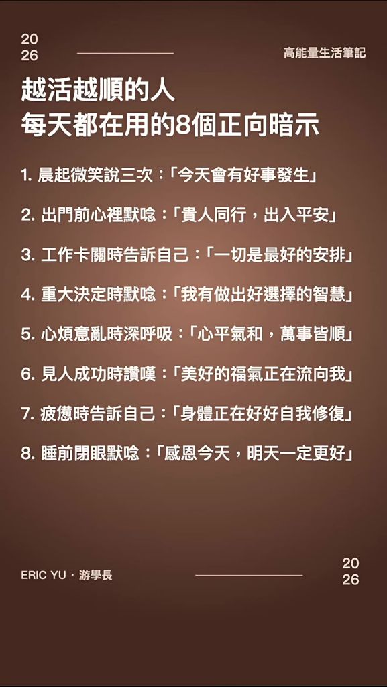

# 越活越順的人，每天都在用的8個正向暗示！

## 思維導圖

- 8 個正向暗示（發文者主張）
  - 早晨與出門
    - 晨起微笑說三次
    - 出門前默唸貴人同行
  - 工作與決定
    - 卡關：一切是最好的安排
    - 重大決定：有好選擇的智慧
  - 情緒與比較
    - 心煩：深呼吸心平氣和
    - 見人成功：福氣流向我
  - 身體與睡前
    - 疲憊：身體正在自我修復
    - 睡前：感恩今天明天更好

## 圖文對照（畫面 + 逐字稿）

### 主題 1：越活越順的人每天都用的 8 個正向暗示（00:00–00:15）



**重點：** 靜態資訊卡，無人聲。8 個日常情境各配一句暗示：晨起、出門、卡關、重大決定、心煩、見人成功、疲憊、睡前。全文見補充資料 S1。成效為發文者主張，未查證。

**標籤：** #正向暗示 #自我對話 #晨間習慣 #睡前感恩

（無人聲；整支 15 秒是靜態資訊卡。Whisper 輸出的「Thank you.」為幻覺，已刪除）。


## 補充資料

### S1｜畫面遺漏：資訊卡上的 8 個正向暗示全文
- 來源：影片畫面（資訊卡，署名「高能量生活筆記」、ERIC YU · 游學長）；取得日期：2026-10-25；取得方式：從 `frames/cue_0000.jpg`（00:01）逐字抄錄，00:01–00:14 各 cue 畫面相同。
- 為何需要補充：影片沒有人聲，整支內容只在畫面上；逐字稿只有 Whisper 幻覺「Thank you.」，沒有任何資訊。

### 原文（逐字）
```
越活越順的人
每天都在用的8個正向暗示

1. 晨起微笑說三次：「今天會有好事發生」
2. 出門前心裡默唸：「貴人同行，出入平安」
3. 工作卡關時告訴自己：「一切是最好的安排」
4. 重大決定時默唸：「我有做出好選擇的智慧」
5. 心煩意亂時深呼吸：「心平氣和，萬事皆順」
6. 見人成功時讚嘆：「美好的福氣正在流向我」
7. 疲憊時告訴自己：「身體正在好好自我修復」
8. 睡前閉眼默唸：「感恩今天，明天一定更好」
```

### Claude 的對照分析
- 補充直接寫明（畫面直接寫明）：8 個情境與對應暗示句，順序即上方編號；署名為「高能量生活筆記」、ERIC YU · 游學長，年份標 2026。
- 與影片一致：影片標題「越活越順的人，每天都在用的8個正向暗示！」與畫面標題相同。
- 據此推定（非畫面直接寫明）：8 句依情境排列——早晨（1）、出門（2）、工作（3、4）、情緒（5）、與他人比較（6）、身體（7）、睡前（8），報告思維導圖據此分支。

### 備註
- 「越活越順的人每天都在用」是講者／發文者主張，未查證；畫面未提供任何研究或出處。
- 暗示句屬正向自我對話的個人習慣，效果未查證，不構成醫療或心理治療建議。

## 來源

- 原始資料夾：`watch-output/身心生活/越活越順的人-每天都在用的8個正向暗示_2026-10-25_Facebook__1172561908430922`
- 逐字稿來源：whisper (groq)
