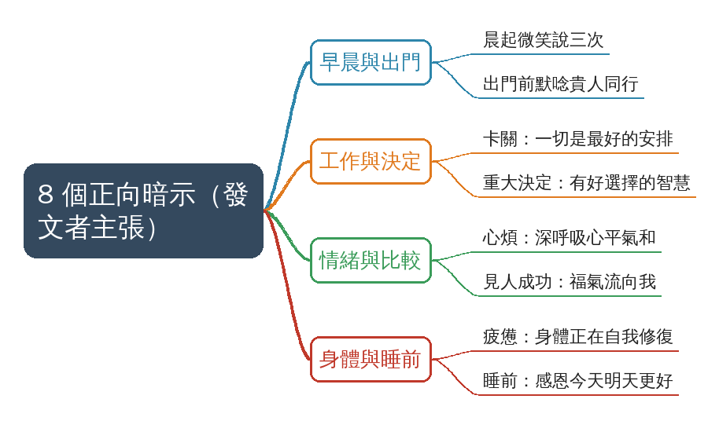

# 越活越順的人，每天都在用的8個正向暗示！

## 摘要

**一句話重點**：15 秒靜態資訊卡（高能量生活筆記／ERIC YU · 游學長），列出 8 個日常情境各配一句正向暗示，從晨起微笑到睡前感恩。

> 影片**沒有人聲**，內容全在畫面上；逐字稿的「Thank you.」是 Whisper 幻覺（已刪除）。「越活越順的人每天都在用」為發文者主張，未查證，畫面無任何出處。

### 重點表

| 時間 | 情境 | 暗示句（畫面原文，見補充資料 S1） |
|---|---|---|
| 00:00–00:14（整支同一畫面） | 1 晨起微笑三次 | 今天會有好事發生 |
| | 2 出門前心裡默唸 | 貴人同行，出入平安 |
| | 3 工作卡關時 | 一切是最好的安排 |
| | 4 重大決定時 | 我有做出好選擇的智慧 |
| | 5 心煩意亂時深呼吸 | 心平氣和，萬事皆順 |
| | 6 見人成功時讚嘆 | 美好的福氣正在流向我 |
| | 7 疲憊時 | 身體正在好好自我修復 |
| | 8 睡前閉眼默唸 | 感恩今天，明天一定更好 |

### 名詞與說明

- **正向暗示**：用簡短肯定句進行自我對話；效果在影片中沒有佐證，未查證。
- **高能量生活筆記／ERIC YU · 游學長**：資訊卡署名；身分未查證。

### 轉錄校正備註

- 轉錄來源：Groq Whisper；語言欄位被幻覺判為 `en`，實際無人聲、畫面為繁體中文，已在 `meta.json` 改標 `unknown`、不需中譯（重跑會被重新判成 `en`，需再改一次）。
- 為核對畫面，以 `--keep-media --timestamps` 重跑；影片檔在 `media/`（已 gitignore，不入庫）。
- 因為沒有講述，「步驟式影片一步驟一段」不適用：8 條在同一張靜態畫面，只切成 1 段，8 條全文放補充資料。

## 思維導圖



## 補充資料

### S1｜畫面遺漏：資訊卡上的 8 個正向暗示全文
- 來源：影片畫面（資訊卡，署名「高能量生活筆記」、ERIC YU · 游學長）；取得日期：2026-10-25；取得方式：從 `frames/cue_0000.jpg`（00:01）逐字抄錄，00:01–00:14 各 cue 畫面相同。
- 為何需要補充：影片沒有人聲，整支內容只在畫面上；逐字稿只有 Whisper 幻覺「Thank you.」，沒有任何資訊。

### 原文（逐字）
```
越活越順的人
每天都在用的8個正向暗示

1. 晨起微笑說三次：「今天會有好事發生」
2. 出門前心裡默唸：「貴人同行，出入平安」
3. 工作卡關時告訴自己：「一切是最好的安排」
4. 重大決定時默唸：「我有做出好選擇的智慧」
5. 心煩意亂時深呼吸：「心平氣和，萬事皆順」
6. 見人成功時讚嘆：「美好的福氣正在流向我」
7. 疲憊時告訴自己：「身體正在好好自我修復」
8. 睡前閉眼默唸：「感恩今天，明天一定更好」
```

### Claude 的對照分析
- 補充直接寫明（畫面直接寫明）：8 個情境與對應暗示句，順序即上方編號；署名為「高能量生活筆記」、ERIC YU · 游學長，年份標 2026。
- 與影片一致：影片標題「越活越順的人，每天都在用的8個正向暗示！」與畫面標題相同。
- 據此推定（非畫面直接寫明）：8 句依情境排列——早晨（1）、出門（2）、工作（3、4）、情緒（5）、與他人比較（6）、身體（7）、睡前（8），報告思維導圖據此分支。

### 備註
- 「越活越順的人每天都在用」是講者／發文者主張，未查證；畫面未提供任何研究或出處。
- 暗示句屬正向自我對話的個人習慣，效果未查證，不構成醫療或心理治療建議。

## 來源

- 原始資料夾：`watch-output/身心生活/2026-10-25_Facebook_越活越順的人-每天都在用的8個正向暗示__1172561908430922`
- 逐字稿來源：whisper (groq)
