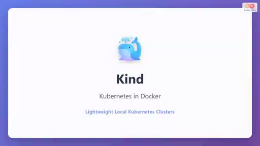
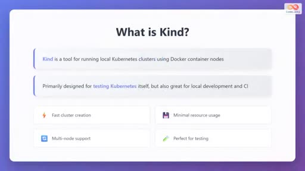
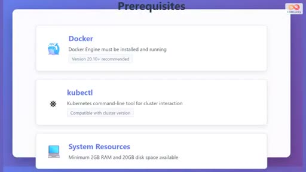
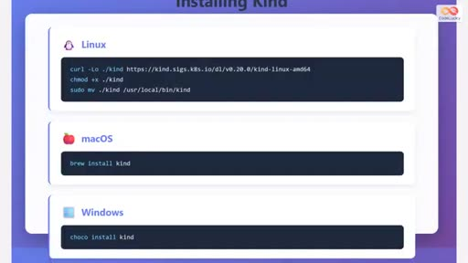
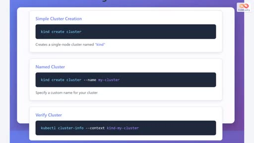
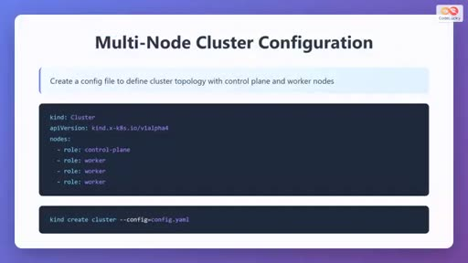
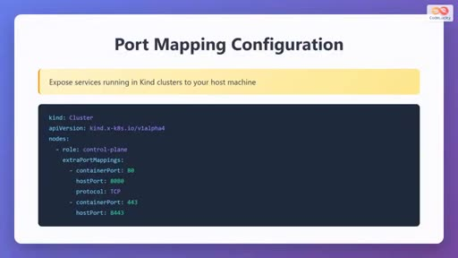
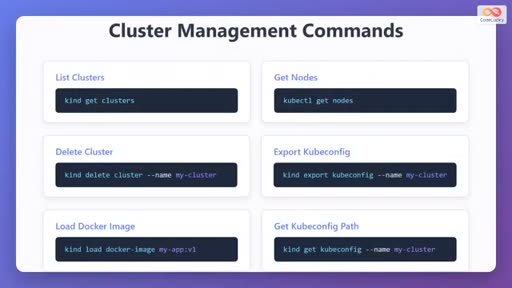
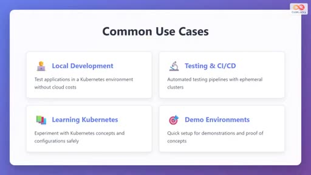

# videoplayback (2).mp4

- 來源：https://drive.google.com/file/d/1bVcAjmgzoAhVKgMyXApHrQSOl-7_ZoGa/view?usp=drivesdk
- 平台 / 上傳者：Drive / 
- 長度：07:55 (475.2s)
- 逐字稿來源：whisper (groq)
- 更新日期：2026-10-11
- **關鍵字：** #Kind #Kubernetes in Docker #kubectl #kubeconfig #多節點叢集 #control plane #worker node #extraPortMappings #kubectl context #CI/CD

## 摘要與名詞說明

**一句話重點：** 這是一支約 8 分鐘的投影片式教學，介紹如何用 Kind 在本機以 Docker 容器建立單節點與多節點 Kubernetes 叢集，並涵蓋安裝、連接埠對應、管理指令與 kubectl context。

| 時間 | 重點 |
|---|---|
| 00:00 | 開場：Kind = Kubernetes in Docker，輕量本機叢集 |
| 00:30 | 什麼是 Kind；優點：建立快、資源少、支援多節點、適合測試 |
| 01:13 | 前置需求：Docker 20.10+、kubectl、2GB RAM、20GB 磁碟 |
| 01:55 | 安裝：Linux（curl/chmod/mv）、macOS（brew）、Windows（choco）；`kind version` |
| 02:36 | `kind create cluster`、`--name`、`kubectl cluster-info --context` |
| 03:21 | 多節點 YAML 設定（1 control-plane + 3 worker）與 `--config` |
| 04:17 | `extraPortMappings`：80→8080、443→8443（TCP） |
| 05:08 | 管理指令：get clusters／get nodes／delete cluster／export 與 get kubeconfig／load docker-image |
| 05:47 | kubectl context：`kind-` 前綴、get/use/current-context |
| 06:45 | 使用情境：本機開發、CI/CD、學習、展示 |
| 07:38 | 片尾按讚動畫（無旁白） |

## 名詞與縮寫
- **Kind**：Kubernetes in Docker，以 Docker 容器當節點的本機叢集工具。
- **control plane／worker node**：控制平面節點／工作節點。
- **kubeconfig／context**：kubectl 連線設定檔／其中的叢集連線組合。
- **extraPortMappings**：把節點容器連接埠對應到主機連接埠，便於從本機存取叢集服務。

## 轉錄校正備註
- 影片旁白為**英文**。初版誤加 `--lang zh`，Whisper 被迫輸出中文而產生大量不通順文字；已改為自動語言偵測重新轉錄，英文逐字稿品質良好（來源：Groq Whisper）。
- 殘留問題僅為指令空格被吞（如 `kindcreatecluster`）與少數缺標點，已由 `glossary/domains/kubernetes.json` 修正並記於 `known_asr_errors`。
- 附完整中譯 `transcript.zh.md`（時間戳沿用英文原文）。
- 影片來源為 Google Drive 檔案（`videoplayback (2).mp4`），無平台字幕與作者資訊。

## 圖文對照（畫面 + 逐字稿＋中譯）

### 投影片 1：Kind：Kubernetes in Docker（00:00–00:30）

**重點：** 在本機用 Docker 建立輕量 Kubernetes 叢集，適合測試、學習與開發。

**標籤：** #Kind #Docker

Welcome to this tutorial on Kind, which stands for Kubernetes in Docker. Kind is a powerful tool that allows you to run lightweight local Kubernetes clusters right on your development machine. Throughout this tutorial, you'll learn how to set up Kind and use it to create Kubernetes clusters inside Docker containers. This is particularly useful for testing, learning, and local development without the need for expensive cloud resources or complex virtual machine setups.

**中譯：** 歡迎收看 Kind 教學，Kind 是「Kubernetes in Docker」的縮寫。Kind 是一個強大的工具，讓你在開發機器上直接執行輕量的本機 Kubernetes 叢集。在這個教學中，你會學到如何設定 Kind，並用它在 Docker 容器內建立 Kubernetes 叢集。這對測試、學習與本機開發特別有用，不需要昂貴的雲端資源或複雜的虛擬機設定。

### 投影片 2：什麼是 Kind（00:30–01:13）

**重點：** 以 Docker 容器節點執行本機叢集；優點：建立快、資源少、支援多節點、適合測試。

**標籤：** #Kind #多節點

Kind is a tool specifically designed for running local Kubernetes clusters using Docker container nodes. Originally created for testing Kubernetes itself, it has become an excellent choice for local development and continuous integration pipelines. Instead of using virtual machines, Kind uses Docker containers to simulate Kubernetes nodes, making it incredibly fast and resource efficient. The key advantages of Kind include fast cluster creation, minimal resource usage compared to traditional virtual machine-based solutions, support for multi-node clusters, and it's perfect for testing your applications in a realistic Kubernetes environment.

**中譯：** Kind 是專為使用 Docker 容器節點來執行本機 Kubernetes 叢集而設計的工具。它原本是為了測試 Kubernetes 本身而建立，後來成為本機開發與持續整合（CI）流程的絕佳選擇。Kind 不使用虛擬機，而是以 Docker 容器模擬 Kubernetes 節點，因此速度極快、資源效率高。Kind 的主要優點包括：叢集建立快速、相較傳統虛擬機方案資源用量極少、支援多節點叢集，並且很適合在接近真實的 Kubernetes 環境中測試應用程式。

### 投影片 3：安裝前置需求（01:13–01:55）

**重點：** Docker Engine 20.10+、kubectl、至少 2GB RAM 與 20GB 磁碟。

**標籤：** #Docker #kubectl

Before installing Kind, you need to ensure your system meets certain prerequisites. First, you must have Docker Engine installed and running on your machine. version 20.10 or higher is recommended for optimal compatibility. Second, you need kubectl, which is the Kubernetes command line tool used for interacting with your clusters. Make sure to install a version compatible with the Kubernetes cluster version you plan to run. Finally, ensure your system has adequate resources, at least 2GB of RAM and 20GB of available disk space. These requirements ensure smooth operation of your Kind clusters.

**中譯：** 安裝 Kind 之前，必須確認系統符合一些前置需求。首先，機器上必須安裝並執行 Docker Engine，建議 20.10 以上版本以獲得最佳相容性。第二，需要 kubectl，也就是用來與叢集互動的 Kubernetes 命令列工具。請安裝與你計畫執行的 Kubernetes 叢集版本相容的版本。最後，確保系統有足夠資源：至少 2GB RAM 與 20GB 可用磁碟空間。這些需求能確保 Kind 叢集順暢運作。

### 投影片 4：安裝 Kind（01:55–02:36）

**重點：** Linux 用 curl+chmod+mv；macOS 用 brew install kind；Windows 用 choco install kind；kind version 驗證。

**標籤：** #brew #choco

Installing Kind is straightforward and varies slightly depending on your operating system For Linux users you can download the Kind binary using curl make it executable with the chmod command and then move it to your local bin directory For macOS users, the easiest method is using homebrew by simply running brew install kind. Windows users can install Kind using Chocolatey with the command choco install kind. After installation, verify that Kind is properly installed by running the kind version command in your terminal. This will display the installed version and confirm that Kind is ready to use.

**中譯：** Kind 的安裝很簡單，依作業系統略有不同。Linux 使用者可用 curl 下載 Kind 執行檔，以 chmod 設為可執行，再移到本機的 bin 目錄。macOS 使用者最簡單的方式是 Homebrew，執行 brew install kind。Windows 使用者可用 Chocolatey，執行 choco install kind。安裝後，在終端機執行 kind version 確認 Kind 已正確安裝。這會顯示已安裝的版本，確認 Kind 可以使用。

### 投影片 5：建立第一個叢集（02:36–03:21）

**重點：** kind create cluster；--name 自訂名稱；kubectl cluster-info --context 驗證。

**標籤：** #kind create cluster

Creating your first Kubernetes cluster with Kind is remarkably simple. The most basic command is kind create cluster, which creates a single node cluster with the default name Kind. If you want to specify a custom name for your cluster, use the dash-dash name flag followed by your desired cluster name, for example, mycluster. Once the cluster is created, Kind automatically configures kubectl to connect to it. You can verify that your cluster is running properly by using the kubectl cluster-info command with the appropriate context. The context name follows the pattern Kind followed by your cluster name. This verification step ensures your cluster is operational and ready for use.

**中譯：** 用 Kind 建立第一個 Kubernetes 叢集非常簡單。最基本的指令是 kind create cluster，會建立一個預設名稱為 kind 的單節點叢集。若想自訂叢集名稱，使用 --name 參數加上你想要的叢集名稱，例如 my-cluster。叢集建立後，Kind 會自動設定 kubectl 連線到它。你可以用 kubectl cluster-info 搭配適當的 context 驗證叢集是否正常運作。context 名稱的格式是 kind- 加上你的叢集名稱。這個驗證步驟可確保叢集已可運作、可以使用。

### 投影片 6：多節點叢集設定（03:21–04:17）

**重點：** YAML 定義 1 個 control-plane 與 3 個 worker；kind create cluster --config。

**標籤：** #YAML #control plane #worker

While single-node clusters are useful, Kind really shines when creating multi-node clusters for more realistic testing scenarios. To create a multi-node cluster, you need to define a configuration file in YAML format. This configuration file specifies the cluster kind and API version, followed by a node section where you define the roles of each node. You can specify one control plane node and multiple worker nodes. For example you might configure one control plane node and three worker nodes to simulate a production environment Once you created your configuration file simply run kind create cluster with the dash dash config flag pointing to your YAML file Kind will then create all the specified nodes as separate Docker containers and configure them into a functioning multi-node Kubernetes cluster.

**中譯：** 單節點叢集很實用，但 Kind 真正厲害的地方，是為了更貼近真實的測試情境而建立多節點叢集。要建立多節點叢集，需要以 YAML 格式定義設定檔。這個設定檔會指定叢集的 kind 與 API 版本，接著是 nodes 區段，在其中定義每個節點的角色。你可以指定一個 control plane 節點與多個 worker 節點。例如，可設定一個控制平面節點加三個工作節點來模擬正式環境。建好設定檔後，只要執行 kind create cluster 並以 --config 參數指向你的 YAML 檔。接著 Kind 會把所有指定的節點建立成獨立的 Docker 容器，並組成可運作的多節點 Kubernetes 叢集。

### 投影片 7：連接埠對應設定（04:17–05:08）

**重點：** extraPortMappings：容器 80→主機 8080、443→8443，協定 TCP。

**標籤：** #extraPortMappings

One important aspect of working with Kind is exposing services running inside your cluster This is accomplished through port mapping configuration. In your cluster configuration file, you can add an extra port mapping section under the control plane node. Here you specify which container ports should be mapped to which host ports. For example, you might map container port 80 to host port 8080 for HTTP traffic and container port 443 to host port 8443 for HTTPS traffic. You also specify the protocol, typically TCP. This configuration allows you to access services running inside your Kind cluster directly from your local machine's browser or other tools, making development and testing much more convenient.

**中譯：** 使用 Kind 的一個重要面向，是讓叢集內執行的服務能對外存取。這是透過連接埠對應（port mapping）設定完成的。在叢集設定檔中，可在 control plane 節點下加入 extra port mapping 區段，在這裡指定哪些容器連接埠要對應到哪些主機連接埠。例如，將容器連接埠 80 對應到主機連接埠 8080 作為 HTTP 流量，容器連接埠 443 對應到主機連接埠 8443 作為 HTTPS 流量。同時也要指定協定，通常是 TCP。這個設定讓你能從本機瀏覽器或其他工具直接存取 Kind 叢集內執行的服務，讓開發與測試方便許多。

### 投影片 8：叢集管理指令（05:08–05:47）

**重點：** get clusters、get nodes、delete cluster、export/get kubeconfig、load docker-image。

**標籤：** #kind load docker-image

Managing your Kind clusters is straightforward with several essential commands. To list all your Kind clusters, use kind get clusters. To view the nodes within a cluster, use kubectl get nodes. When you need to delete a cluster, run kind delete cluster with the dash dash name flag specifying which cluster to remove. The kind export kubeconfig command exports the cluster's configuration to your kubeconfig file, while kind get kubeconfig displays the kubeconfig path. An especially useful command is kind load docker-image, which loads a docker image directly into your cluster nodes without needing to push it to a remote registry.

**中譯：** 管理 Kind 叢集只需要幾個基本指令。要列出所有 Kind 叢集，使用 kind get clusters。要查看叢集內的節點，使用 kubectl get nodes。要刪除叢集，執行 kind delete cluster 並以 --name 參數指定要移除的叢集。kind export kubeconfig 指令會把叢集設定匯出到 kubeconfig 檔，kind get kubeconfig 則顯示 kubeconfig 路徑。特別實用的是 kind load docker-image，可把 Docker 映像檔直接載入叢集節點，不必推送到遠端映像檔倉庫。

### 投影片 9：kubectl context 管理（05:47–06:45）

**重點：** context 以 kind- 為前綴；get-contexts、use-context、current-context。

**標籤：** #context

This is particularly helpful during development when you frequently building and testing container images Understanding kubectl contexts is crucial when working with Kind especially if you manage multiple clusters Kind automatically creates and configures kubectl contexts for your clusters, always prefixing them with Kind followed by the cluster name. To view all available contexts, use kubectl config get-contexts. This shows you all configured clusters and highlights your current context. To switch between different clusters, use kubectl config use-context followed by the context name, such as kind-my-cluster. To quickly check which cluster you're currently connected to, run kubectl config current-context. Managing contexts properly ensures you're always working with the intended cluster, preventing accidental changes to the wrong environment.

**中譯：** 這在經常建置與測試容器映像檔的開發過程中特別有幫助。管理多個叢集時，理解 kubectl context 非常重要。Kind 會自動為你的叢集建立並設定 kubectl context，名稱一律以 kind- 開頭，後面接叢集名稱。要查看所有可用的 context，使用 kubectl config get-contexts。這會顯示所有已設定的叢集，並標示目前使用的 context。要在不同叢集間切換，使用 kubectl config use-context 加上 context 名稱，例如 kind-my-cluster。要快速確認目前連線的叢集，執行 kubectl config current-context。妥善管理 context 可確保你始終操作在預期的叢集上，避免誤改到錯誤的環境。

### 投影片 10：常見使用情境（06:45–07:38）

**重點：** 本機開發、測試與 CI/CD、學習 Kubernetes、展示與概念驗證。

**標籤：** #CI/CD

Kind is incredibly versatile and serves multiple important use cases in the Kubernetes ecosystem. For local development, it provides a complete Kubernetes environment without incurring cloud costs, allowing you to test your applications in conditions that closely mirror production. In testing and continuous integration pipelines, Kind enables automated testing with ephemeral clusters that can be quickly created and destroyed. For learning Kubernetes, Kind offers a safe sandbox environment where you can experiment with various Kubernetes concepts and configurations without fear of breaking anything important. Finally, for demonstrations and proof of concepts, Kind allows for quick setup of working Kubernetes environments that can showcase your applications or ideas effectively. These use cases make Kind an essential tool in any Kubernetes developer's toolkit.

**中譯：** Kind 用途廣泛，在 Kubernetes 生態系中有多種重要用途。本機開發：提供完整的 Kubernetes 環境而不必負擔雲端費用，讓你在接近正式環境的條件下測試應用程式。測試與持續整合流程：Kind 可搭配可快速建立與銷毀的短暫叢集進行自動化測試。學習 Kubernetes：Kind 提供安全的沙箱環境，讓你放心實驗各種 Kubernetes 概念與設定，不怕弄壞重要資源。展示與概念驗證：Kind 可快速建立可運作的 Kubernetes 環境，有效展示你的應用或想法。這些用途讓 Kind 成為任何 Kubernetes 開發者工具箱中不可或缺的工具。

### 投影片 11：片尾（07:38–07:55）

**重點：** 片尾為按讚動畫，無旁白（先前中文逐字稿的宣傳語是 Whisper 在 --lang zh 下的幻聽，已移除）。

## 已知轉錄錯誤

| 時間 | 聽成 | 應為 |
|---|---|---|
| 02:40 | kindcreatecluster / kindversion / KindGetClusters / kubectlGetNodes | kind create cluster / kind version / kind get clusters / kubectl get nodes（指令空格被吞，已由詞典修正） |
| 06:20 | kubectl config use context / current context | use-context / current-context（連字號，已由詞典修正） |
| 05:47 | …building and testing container images Understanding kubectl contexts… | 兩句被合併、缺標點，內容無誤 |
