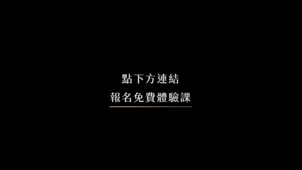

# AI逐字稿怎麼驗收不偷工_2小時免費體驗課

- 來源：https://www.facebook.com/share/v/1Er8dLDmTU/
- 平台 / 上傳者：Facebook / 李佳達
- 長度：01:26 (86.4s)
- 逐字稿來源：whisper (groq)
- 更新日期：2026-10-11
- **關鍵字：** #AI逐字稿 #逐字保留 #分段處理 #雙指標檢查 #行數字數 #不覆寫原檔 #技能包 #迭代優化 #知識庫 #MD檔

## 摘要與名詞說明

**一句話重點：** 講者（李佳達）主張：請 AI 整理逐字稿時，要用「逐字保留、分段處理、雙指標檢查、不覆寫原檔」四道關卡驗收，並把技能包當成持續迭代的版本來優化。

## 重點時間表

| 時間 | 重點 |
|---|---|
| 00:00–00:24 | 提出問題：如何確認 AI 沒有偷工減料？逐字稿要做成知識庫，每個字都重要，細節（故事、例子）最容易被刪掉；轉成 MD 檔時應逐字保留原文。 |
| 00:25 | 投影片「別信『看起來做完了』」：逐字保留、分段處理、雙指標自我檢查、不覆寫原檔。 |
| 00:26–00:37 | 長音檔要分段處理，不一次做一大段；這些規則已寫進技能包。 |
| 00:38–00:51 | 雙指標自我檢查：行數與字數都要達標，依音檔長度估算應有的容量。 |
| 00:52–01:12 | 思維三：第一版不必完美。技能包是「永遠在改的進行式」，發現問題就修改、定稿成下一版，講者稱已做到約 20 版。 |
| 01:12–01:17 | 帶走的流程：先問對問題 → 分工 → 驗收 → 迭代。 |
| 01:17–01:26 | 8 點半文章上線後可下載，找一段自己的音檔測試；結尾為報名免費體驗課的宣傳。 |

## 名詞說明
- **技能包（skill）**：把處理流程與規則寫成可重複使用的指令包。
- **雙指標**：以行數與字數兩個數值交叉檢查完成度。
- **MD 檔**：Markdown 格式文字檔。

## 轉錄校正備註
- 「教稿」→「逐字稿」（畫面標題與 00:25 投影片可交叉確認）。
- 「列帶」→「迭代」（01:14，畫面字幕為「分工、驗收、迭代」）。
- 「英檔」→「音檔」（01:20，依語意推測）。

## 備註
本片為課程宣傳，投影片上的成效數字（例：行數 100%、字數 99%、零摘要；時間戳僅剩 2% 的對照案例）為講者自述，未經查證。

## 圖文對照（畫面 + 逐字稿）

### 投影片 1：AI 交出的逐字稿，你怎麼知道它沒偷工？（00:00–00:04）

**重點：** 提出問題：逐字稿要做成知識庫，每個字都重要，如何確認 AI 沒有偷工減料。

**標籤：** #偷工減料 #知識庫

我們怎麼樣知道AI幫你做完這個逐字稿之後，它沒有偷工減料。

### 投影片 2：別信「看起來做完了」（00:04–00:52）

**重點：** 四道關卡：逐字保留、分段處理、雙指標自我檢查、不覆寫原檔；轉成 MD 檔時要盡量保留原文，長音檔要分段、行數與字數都要達標。

**標籤：** #逐字保留 #分段處理 #雙指標 #不覆寫原檔

我要能夠盡量把原文留下來，既然這個東西它有我做成知識庫的價值，每一個字就是都很重要，很有價值的東西會在某些例子的細節裡面，它可能很多的故事的細節就會被刪掉了，我覺得最厲害、最Juicy的地方就不見了，如果我想要轉成MD檔的東西，我都會希望它盡量保留成原文，一定要逐字保留，這是一個大原則，如果你真的要拿來做很長的檔案的話，後面逐字稿要分段處理，不會一次做一個大段，這東西都不用做，因為我都已經寫在技能包裡面了，這是我的思路，怎麼去拆解這個比較長的音檔，我後面裡面有做的就是雙指標的自我檢查，就是行數跟字數都要達標這個音檔有多長，它應該要有的容量跟行數字數大概是什麼。

### 投影片 3：第一版，就要完美嗎？（00:52–01:09）

**重點：** 技能包不必一次到位，是「永遠在改的進行式」：發現問題就修改，滿意後定稿成下一版。

**標籤：** #技能包 #迭代

這邊另外有一個重點想跟大家分享就是，不要想說一次做技能包就要到位，最棒的技能包就是一個永遠正在改的進行式的技能包，然後你只要一知道他做的哪裡不好就修改他，修改完之後覺得好就叫他把它定稿成為下一個版本，然後就一直不斷最佳化。

### 投影片 4：先求能用，再求完美（01:09–01:12）

**重點：** 講者的技能包不斷最佳化，已做到約 20 版。

**標籤：** #最佳化

其實我們一直不斷的在最佳化好幾個版後來做到20版。

### 投影片 5：帶走：先問對問題，再分工・驗收・迭代（01:12–01:24）

**重點：** 流程為先問對問題 → 分工 → 驗收 → 迭代；挑自己的一段音檔，用同一招跑一次。

**標籤：** #問對問題 #分工驗收迭代

所以大概的流程就會是，先問對問題、分工、驗收、迭代這樣子，8點半大家看到那個文章上線的時候，就可以直接下載下來找一個音檔來自己測試看看。

### 投影片 6：結尾：報名免費體驗課（01:24–01:26）

**重點：** 課程宣傳結尾卡，無語音。

## 已知轉錄錯誤

| 時間 | 聽成 | 應為 |
|---|---|---|
| 00:00 | 教稿 | 逐字稿 |
| 01:14 | 列帶 | 迭代 |
| 01:20 | 英檔 | 音檔（推測） |
