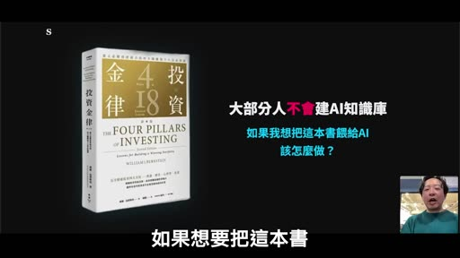
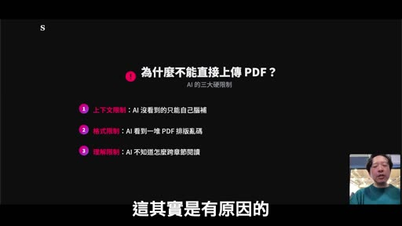
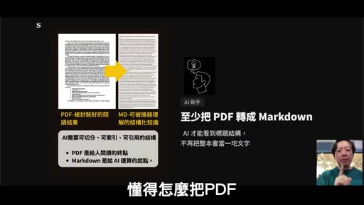
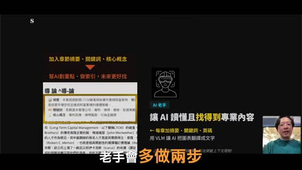
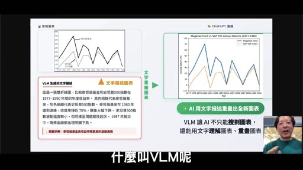
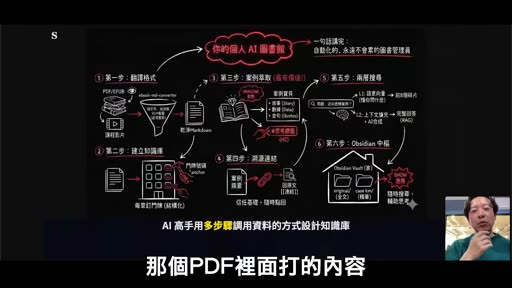
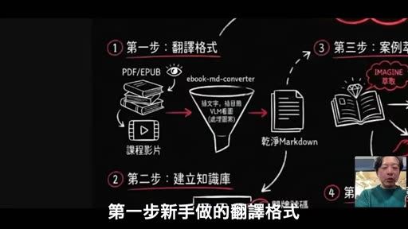
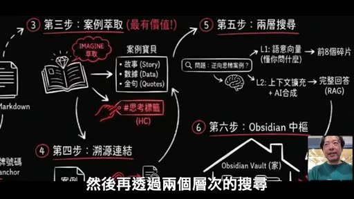
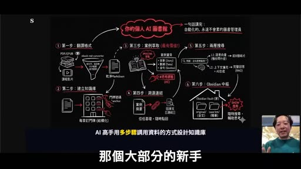

# 不要再把PDF直接丟給AI，多做這3步品質差很多｜AI超級大腦2小時線上講座

- 來源：https://www.facebook.com/share/v/1Bggy9HRKs/
- 平台 / 上傳者：Facebook / 李佳達
- 長度：03:01 (181.3s)
- 逐字稿來源：whisper (groq)
- 更新日期：2026-10-11
- **關鍵字：** #AI知識庫 #PDF #Markdown #VLM #上下文限制 #章節摘要索引 #語意搜尋 #溯源連結 #投資金律

## 摘要與名詞說明

- 來源：https://www.facebook.com/share/v/1Bggy9HRKs/（上傳者：李佳達，長度 03:01）
- 逐字稿來源：Groq Whisper 轉錄（非平台字幕）

## 重點（含時間戳）

| 時間 | 重點 |
|---|---|
| 00:00–00:12 | 問題：整份 PDF 直接上傳，AI 的回答不像作者的原意，也找不到細節 |
| 00:13–00:43 | AI 的三個限制：上下文限制（一次讀不完整本書）、格式限制（PDF 對 AI 是亂碼）、理解限制（難以整合不同章節） |
| 00:45–01:06 | 新手做法：先把 PDF 轉成 Markdown，讓 AI 看得到標題與結構 |
| 01:07–01:23 | 老手第 1 步：在 Markdown 加上章節摘要、關鍵詞、核心概念，等於替 AI 做索引 |
| 01:24–02:09 | 老手第 2 步：用 VLM 把書中的圖表轉成文字描述，AI 才查得到圖的內容，也可用來重新生成圖 |
| 02:10–02:48 | 講者的 6 步流程：轉 Markdown → 建立個別知識庫 → 案例萃取 → 先查精選案例再看原文 → 溯源連結 → 關鍵字＋語意兩層搜尋 |
| 02:49–02:59 | 進階內容留待後續直播課程 |

## 名詞與縮寫說明

| 名詞 | 全名 / 意思 |
|---|---|
| AI | Artificial Intelligence，人工智慧 |
| PDF | Portable Document Format，固定版面的文件格式，適合人閱讀 |
| Markdown | 用簡單符號（`#` 標題、`-` 清單）標記結構的純文字格式，機器容易解析 |
| 上下文限制 | Context window，模型一次能讀入的內容長度上限 |
| 知識庫 | Knowledge Base，整理好、可供 AI 查詢的資料集合 |
| 索引 | Index，事先整理的關鍵詞與章節對照，加快查找 |
| VLM | Vision-Language Model，視覺語言模型，能看圖並用文字描述 |
| Gemini | Google 的 AI 模型，影片中用來依文字描述重新生成圖片 |
| 案例萃取 | 從原文挑出具代表性的案例另存，形成「精選案例」知識庫 |
| 溯源連結 | 精選內容與原文章節的對應連結，可追回出處 |
| 關鍵字搜尋 | 比對字面相同的詞 |
| 語意搜尋 | Semantic search，依意思相近來找，不要求字面相同 |
| ASR | Automatic Speech Recognition，自動語音辨識 |
| Whisper | OpenAI 開源的語音辨識模型 |
| Groq | 提供 Whisper 雲端推論的服務，本次逐字稿由它轉錄 |

## 轉錄校正備註

- 逐字稿 01:24 的「BLM」應為 **VLM**（同一段後文皆為 VLM）。
- 「投資金域」疑為書名誤聽，原書名未能從音訊確認。
- 02:10 的「嘗試」疑為「常識」，00:40 的「誇張解」疑為「跨章節」。

## 圖文對照（畫面 + 逐字稿）

### 畫面 00:00–00:12

**標籤：** #AI知識庫 #PDF #投資金律

如果你想要把這本書變成你的AI知識庫，你會怎麼做，大多數的人都會直接把PDF整個上傳的人，你會發現AI回憶的東西好像不像作者寫的，而且你問他很多書語的細節，AI都找不到。

### 畫面 00:12–00:46

**標籤：** #上下文限制 #格式限制 #理解限制

這其實是有原因的，為什麼你不能直接上傳PDF，因為AI有三個硬限制，第一個叫做上下文限制，AI每次能夠讀的內容其實是有限的，他不可能一次看到整本書，大部分回答你的時候都是用他的嘗試在回答，他不是用他真的看到的東西在回答，另外一個叫做格式限制，各位知道PDF讓我們看很舒服，但AI看到的是一堆格式的亂碼，再來就是理解限制，它沒辦法總結第一章跟第十二章的知識，它是一章一章讀的，它根本不知道怎麼誇張解的閱讀，有理解上的通用限制，如果你是AI新手，你至少做到什麼。

### 畫面 00:46–01:07

**標籤：** #Markdown #PDF轉換

懂得怎麼把PDF轉成Markdown這個格式，這兩個檔名最大的差別是什麼呢，PDF是一種被封裝好的閱讀結果，它是幫你設計好，給人類看起來很舒服的版面，但是Markdown的格式才是可以被機器理解的結構化知識，如果你給PDF的話，他看不到他的標題，看不到他的結構，但在Markdown裡面可以。

### 畫面 01:07–01:28

**標籤：** #章節摘要 #關鍵詞 #索引

老手會多做兩步，就是你會幫他在Markdown的這個格式上面，加上每個章節的摘要，關鍵詞跟核心概念，就好像你幫AI畫重點做索引，未來你問任何問題的時候，AI可以先去找你做過的索引，他將更有機率找到你要的內容，第二個動作就很少人會做的叫做BLM什麼叫BLM呢?讓AI用文字去描述出這本書裡面的所有的圖你可以理解 AI 可以看得到文字對不對AI 看不到圖但是很多專業知識庫裡面。

### 畫面 01:28–02:10

**標籤：** #VLM #圖表轉文字

真正有價值的東西在哪裡，在圖上，所以你要做這個動作叫做 VLM，VLM 的動作就是，讓 AI 幫你用文字去描述一個圖，是什麼意思，比如說這張圖就是，我在剛剛的投資金裡面的，其中的一個圖表，這是 AI 生成的文字描述，這樣生成有什麼好處，第一個是未來AI在查找這個知識庫的時候，他知道有這個圖，所以他知道要看這個章節，第二個好處是什麼，你可以直接拿這個文字去Gemini裡面，再生成一張新的，然後就可以用它剪報裡面，不用再去截圖PDF裡面打的內容，這是我自己在做。

### 畫面 02:10–02:15

**標籤：** #知識庫流程

我自己的AI的知識庫的流程，我至少做了六個步驟，第一步新手做的翻譯格詞。

### 畫面 02:15–02:44

**標籤：** #精選案例 #案例萃取 #溯源連結

先讓AI看得懂我給他的東西，翻譯成Markdown檔，然後我要建立個別的知識庫，然後每個知識庫，還會再做一層案例的萃取，比如說把剛剛的那個，投資金域這本書，來做成一個投資金域的案例，精選案例另外一個知識庫，然後我再做任何搜尋，都會先看那個精選案例，再回去看原文，然後我會做這兩個的溯源連結，所以我在精選案例裡面的任何內容，都可以隨時找到，那個原文裡面在哪一個章節，然後再透過兩個層次的搜尋。

### 畫面 02:44–02:50

**標籤：** #關鍵字搜尋 #語意搜尋

透過關鍵字跟透過寓意搜尋，去得到我想要的東西，我知道那個大部分的新手。

### 畫面 02:50–03:01

**標籤：** #進階課程

我聽到這邊已經通告已經花了，沒有關係，這部分呢，因為比較進階，我們會在後續課程裡面的直播裡面，慢慢跟大家分享，最好的解決方法。

## 已知轉錄錯誤

| 時間 | 聽成 | 應為 |
|---|---|---|
| 01:24 | BLM | VLM |
| 01:46 | 投資金域 | 投資金律（書名，依畫面確認） |
| 00:23 | 嘗試 | 常識（推測） |
| 00:40 | 誇張解 | 跨章節（推測） |
