# 想要學好電路板一定搞透電流電壓電阻

- 來源：https://www.facebook.com/share/v/1DsGxovjKk/
- 平台 / 上傳者：Facebook / 宇智電氣知識精選
- 長度：05:29 (329.2s)
- 逐字稿來源：whisper (groq)
- 更新日期：2026-10-11
- **關鍵字：** #電路板 #電流 #電壓 #電阻 #歐姆定律 #電容 #電感 #來拒去留 #分壓 #新能源汽車維修 #零基礎學電子

## 摘要與名詞說明

- 來源：https://www.facebook.com/share/v/1DsGxovjKk/（上傳者：宇智電氣知識精選，長度 05:29）
- 逐字稿來源：Groq Whisper 轉錄（非平臺字幕）；原文為簡體中文，摘要以繁體整理

## 一句話重點

學電路板先建立「框架」：電壓推動電子形成電流，電阻負責限流與分壓，電容像蓄水池供電並濾波，電感則「來拒去留」讓電流變化更平穩；這些元件都是為了讓電流電壓「該大則大、該小則小、該穩則穩」。

## 重點（含時間戳）

| 時間 | 重點 |
|---|---|
| 00:00–00:10 | 開場：電路板要供電才能工作，需先建立基礎框架認知 |
| 00:11–00:38 | 電流與電壓：自由電子定向移動形成電流；電壓是推動電子的原因，有電壓才可能有電流 |
| 00:41–01:17 | 電阻：為不同元件「私人訂製」所需電壓；電阻阻礙電子移動，使電流變小（限流作用） |
| 01:17–01:50 | 分壓例項：新能源汽車電腦板要監測動力電池包（500～800 伏），須用多個大電阻層層分壓到晶片可承受的電壓 |
| 01:52–02:08 | 電流、電壓、電阻是理解電路的基石，三者關係即歐姆定律 |
| 02:08–02:37 | 電容：像電路板上的「蓄水池」，先儲電、需要時瞬間供電，反應比電池快 |
| 02:32–02:50 | 輸入輸出端常見電容：吸收電壓不穩時的高頻雜波，使訊號更平滑 |
| 02:50–03:06 | 晶片周圍成排電阻與電容：電阻限流、電容保證用電及時、電壓促成電流 |
| 03:06–03:27 | 電感：線圈（可加鐵芯增強磁性），解決供電不穩的問題 |
| 03:28–04:00 | 右手定則：線圈通電產生磁場（電生磁），電流增大時磁場變化 |
| 04:00–04:39 | 變化的磁場感應出反向電場，阻礙電流變化，即電感「來拒去留」 |
| 04:39–05:04 | 水車比喻：起轉需要推力，轉起來後斷力也不會立刻停；電感使通斷電瞬間更平穩 |
| 05:04–05:29 | 結語：電路板分成一塊塊單元電路，原理各不同；後續會繼續講單元電路 |

## 名詞與縮寫說明

| 名詞 | 意思 |
|---|---|
| 電路板（PCB） | Printed Circuit Board，印刷電路板，承載並連線各元件 |
| 電流（I） | 自由電子定向移動形成，單位安培（A） |
| 電壓（U / V） | 推動電子移動的「壓力」，單位伏特（V） |
| 電阻（R） | 阻礙電流的元件，用於限流與分壓，單位歐姆（Ω） |
| 限流 | 用電阻讓電流變小，保護元件 |
| 分壓 | 用多個電阻串聯，把高電壓分成較低電壓 |
| 歐姆定律 | I = U / R，電流與電壓成正比、與電阻成反比 |
| 電容 | 儲存電荷的元件，像蓄水池；可供電、濾除雜波 |
| 濾波 | 吸收高頻雜波，使電壓更平滑 |
| 電感 | 線圈元件，通電產生磁場，抗拒電流變化 |
| 右手定則 | 四指順電流方向，拇指指向 N 極（磁場方向） |
| 來拒去留 | 電感特性（類似楞次定律）：電流增加時抗拒，減少時挽留 |
| 動力電池包 | 新能源汽車的高壓電池組，約 500～800 伏 |
| 單元電路 | 電路板上各有功能的分割槽電路 |
| ASR | Automatic Speech Recognition，自動語音辨識 |
| Groq / Whisper | 本次逐字稿所用的雲端語音轉錄服務 / 模型 |

## 轉錄校正備註

- 「元氣件／元氣架」應為**元器件**；「來聚去流／來具去流」應為**來拒去留**（04:12 畫面字幕可確認）。
- 「物浮」疑為「5 伏」（推測，未能從音訊確認）；「橫定」應為「恆定」；「綜會」應為「綜合」；「一聲令一下」應為「一聲令下」。

## 圖文對照（畫面 + 逐字稿）

### 畫面 00:00–00:06

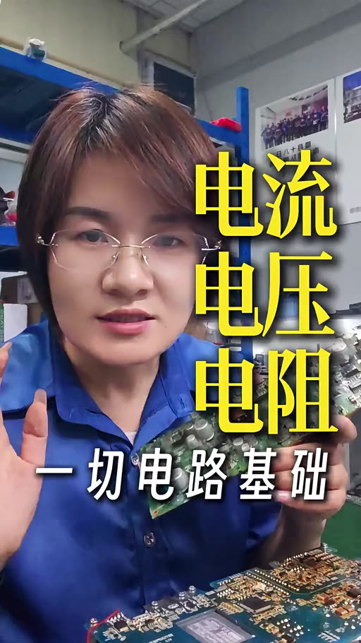

**標籤：** #電路板基礎 #供電

想要真正搞明白不同電路板的工作原理，你需要在腦袋裡建立這樣一個框架認知。

### 畫面 00:06–00:21

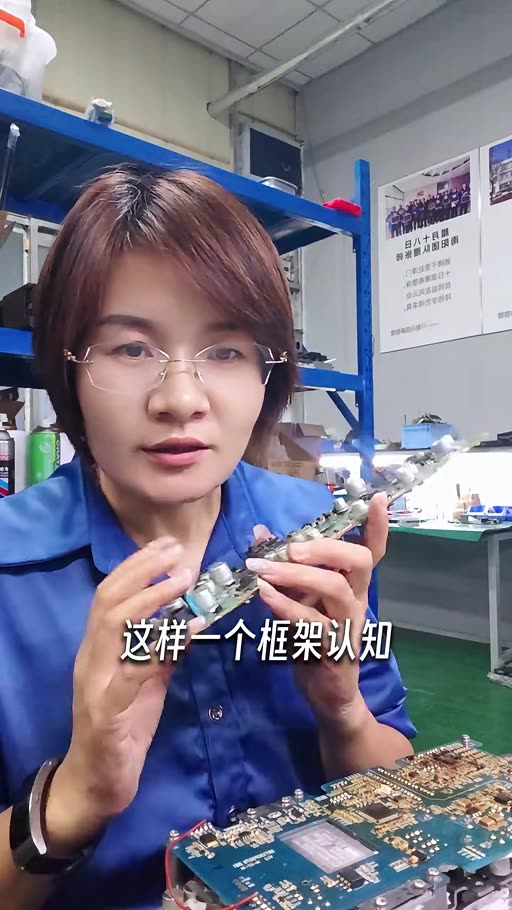

電路板為什麼能夠工作，是因為給它供電它才能工作，那到底什麼是電呢，就是在電路里有自由移動的電子，如果這些自由移動的電子，能夠定向的往一個方向走，就會產生電流，你一摸能感到你身體酥酥麻麻的那個東西。

### 畫面 00:21–00:50

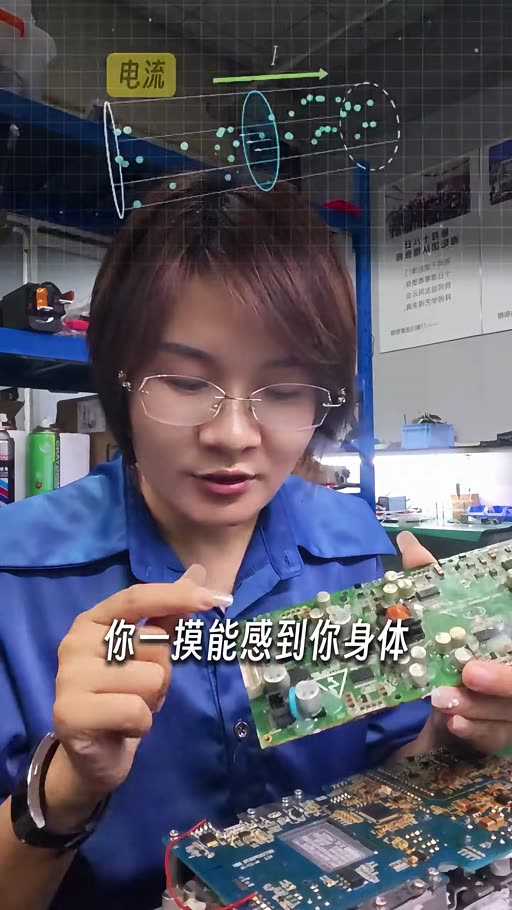

**標籤：** #電流 #電壓

它就叫電，電子要想定向的產生移動，是因為有電壓，電壓壓著電子往前走，然後電路里就有電流了，所以電壓是電流產生的原因，也就是有電壓才可能有電流，有電流那一定有電壓，那電路板上不同的元器件，晶片這些需要的電流大小，它是不一樣的，那我怎麼能夠給它私人定製，需要的電壓呢。

### 畫面 00:50–00:54

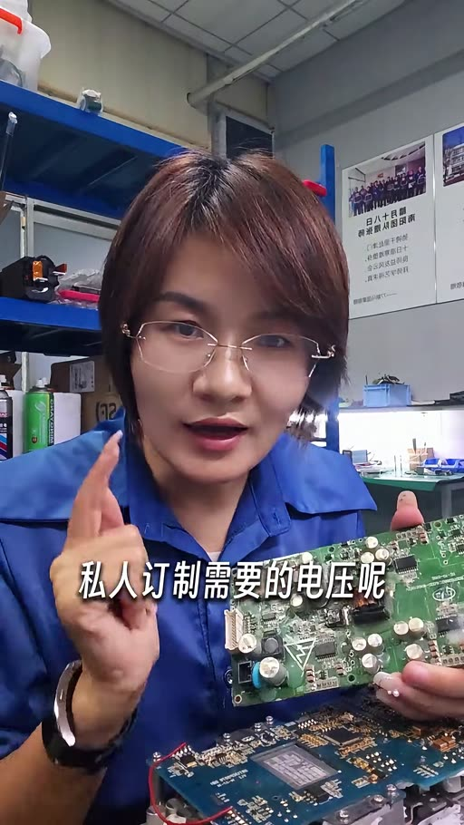

哎，又一個元器件，電阻就誕生了，電阻是所有的電路板上。

### 畫面 00:54–00:58

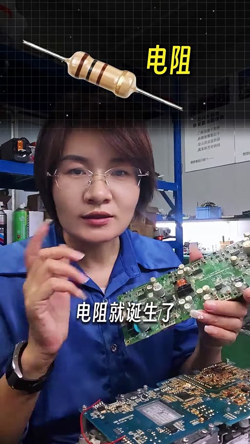

**標籤：** #電阻 #限流

必不可少的元器件，你需要的電壓高。

### 畫面 00:58–01:12

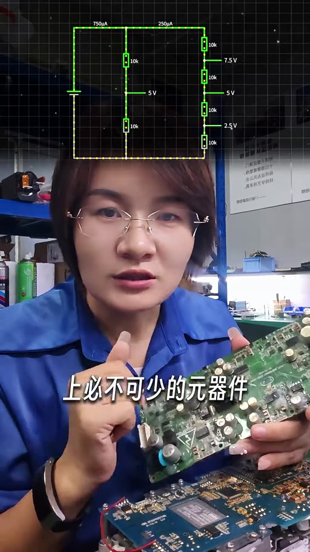

你需要的電壓低,這期間都是電阻在調節的，所謂的電阻就是給電子的移動來產生一些阻力的一個元氣架，你可以這麼理解，電流大是因為定向移動的電子足夠多。

### 畫面 01:12–01:18

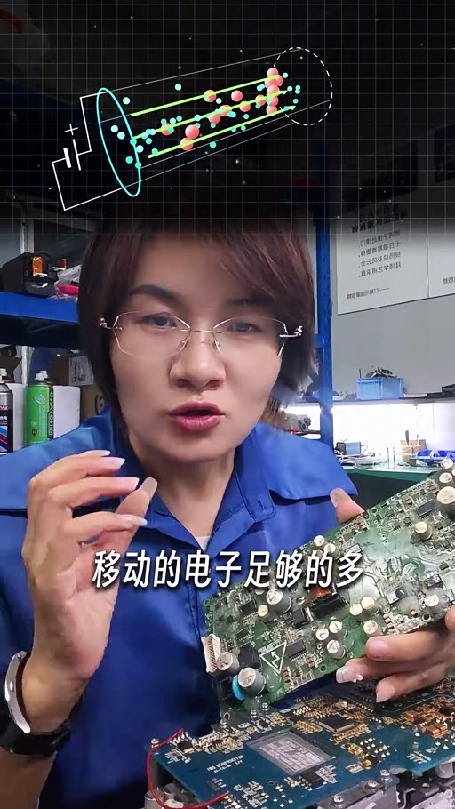

如果讓它定向移動的電子變少，那它的電流就會變小，所以怎麼讓它變少呢就是這個電阻在起作用透過電阻以後的電流會變小這就是電阻的限流作用同樣作為新能源汽車的電腦板它需要時刻來監測動力電池的電池包過來的電壓。

### 畫面 01:18–02:06

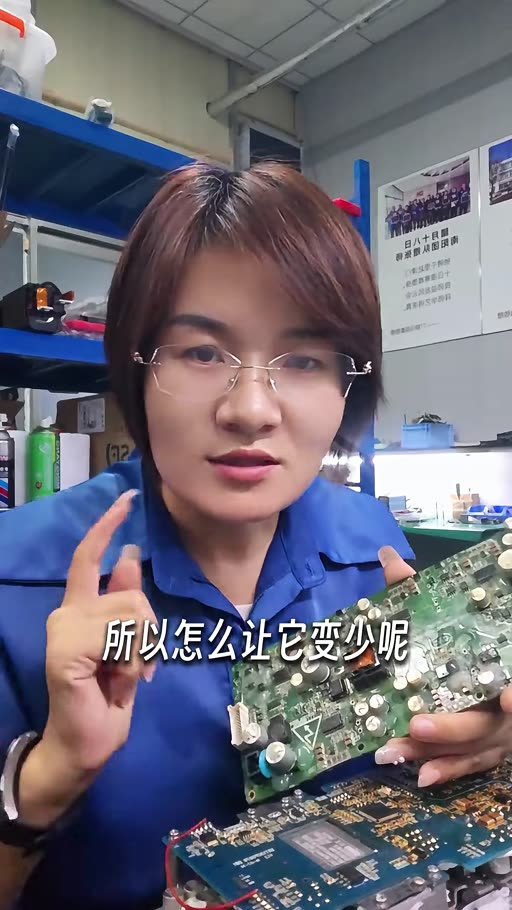

**標籤：** #分壓 #新能源汽車

那電池包有500伏甚至有800伏的電壓，那麼高的電壓，如果直接給到這個電腦板，那麼就炸成灰了，所以怎麼辦呢，還是需要電阻來分壓，把這些800伏的電壓經過幾個大電阻層層的分壓，最後找到一個分壓點，就是我們晶片能接受的，比如說物浮這樣一個分壓點，那這就是電阻的作用，所以以上三個電阻電流和電壓，是構成我們理解整個電路的基石，它們三個之間的關係，有一個非常經典的定律，叫歐姆定律，它幾乎伴隨著你搞電子電路的整個生涯。

### 畫面 02:06–02:09

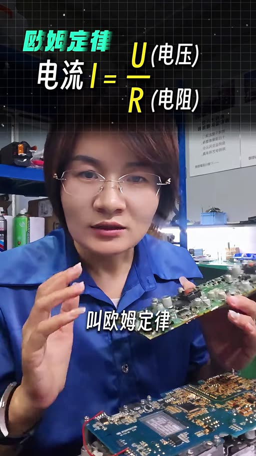

**標籤：** #歐姆定律

那電路板中還有哪些其他的元器件呢。

### 畫面 02:09–02:12

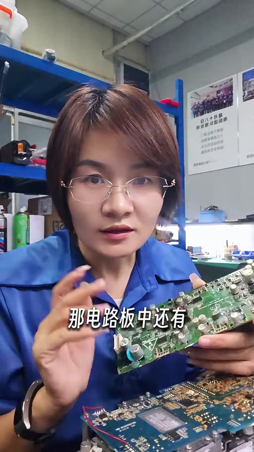

電容。

### 畫面 02:12–02:15

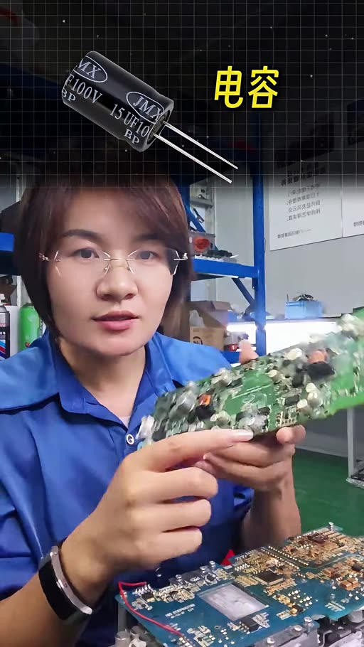

**標籤：** #電容 #濾波

電容呢你在電路板上也能見到很多，它就相當於電路板上的蓄水池。

### 畫面 02:15–02:50

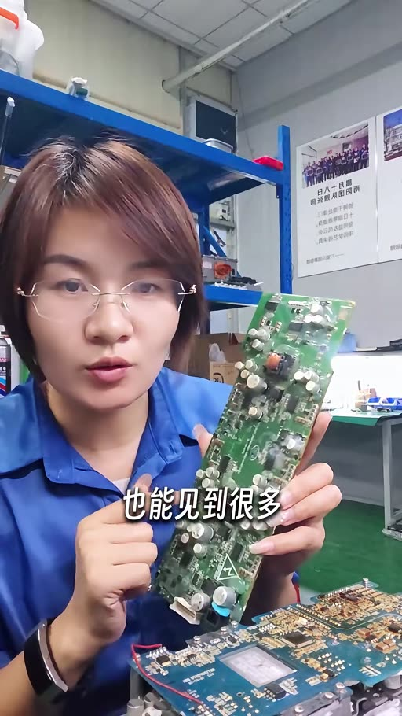

經過它的電會先儲存在它的身體裡邊，然後當你需要用電的時候，一聲令一下，它會搜的一下直接到位，比本身電池供過來的電要快很多，所以在對用電有即時性要求的地方，就會看到電容的身影，而在所有的電路輸入和輸出的部分，你都會看到電容，是因為當電壓不穩的時候，那些高頻的雜波需要先讓它給吸收掉輸出的時候也會有一些雜波同樣也是讓這個電容給接收掉所以才保證了輸入和輸出更平滑。

### 畫面 02:50–02:55

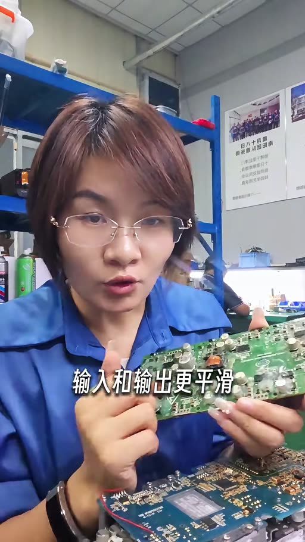

同樣在電路板上的這些晶片是非常高階且脆弱的。

### 畫面 02:55–03:01

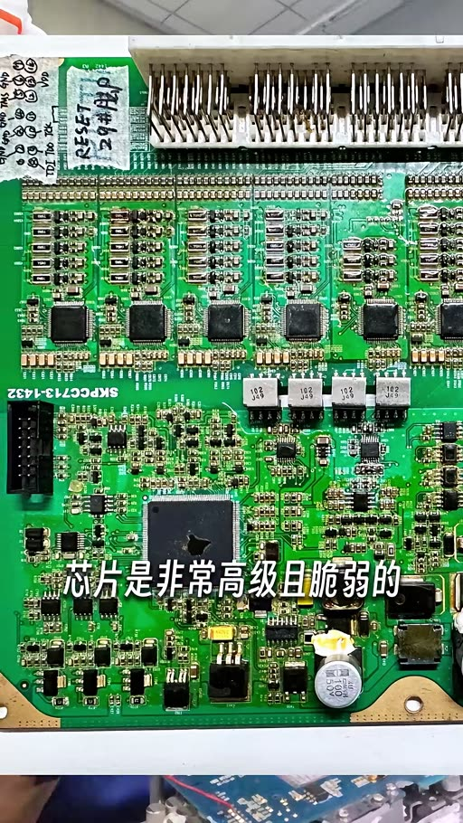

**標籤：** #電阻電容搭配

所以在它的周圍你能看到一排排的電阻，你也能看到一排排的電容，電阻給它限流保證了電流的大小。

### 畫面 03:01–03:14

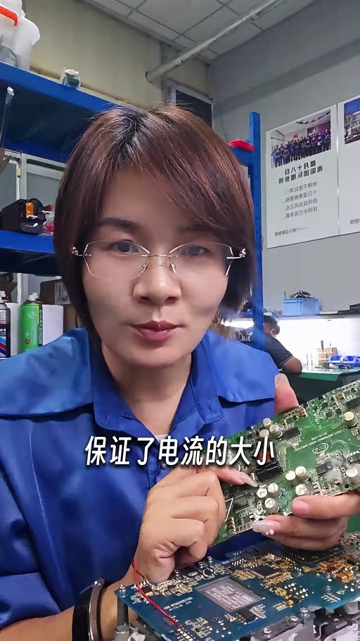

電容保證了用電的及時性，電壓保證了電流的產生，但電路里有時還是出現供電不穩的情況，是什麼原因呢，因為還缺了一個元氣件叫電感。

### 畫面 03:14–03:21

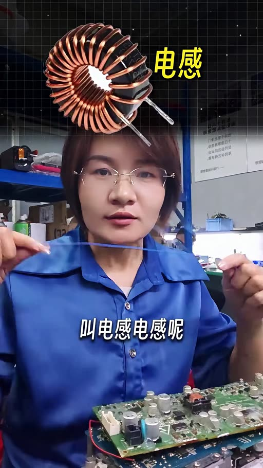

**標籤：** #電感

電感呢其實就是一個線圈，透過這樣的纏纏纏纏纏，在這種方式它就變成了一個電感，如果想讓它的磁性更大。

### 畫面 03:21–03:29

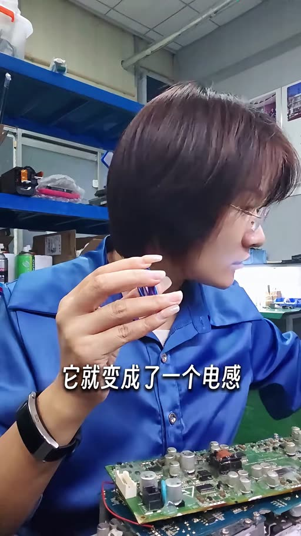

你就再拿一個鐵芯放裡邊，它的磁性是不是就更大了，那這個就是電感，那它有什麼特性呢，我特別確認了一下。

### 畫面 03:29–03:35

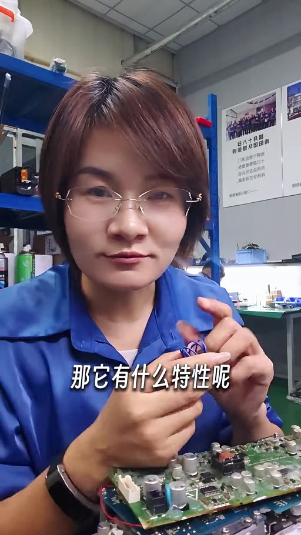

就是初中物理，但是初中沒學也沒關係，其實很簡單的一個定律，就是右手定則。

### 畫面 03:35–03:39

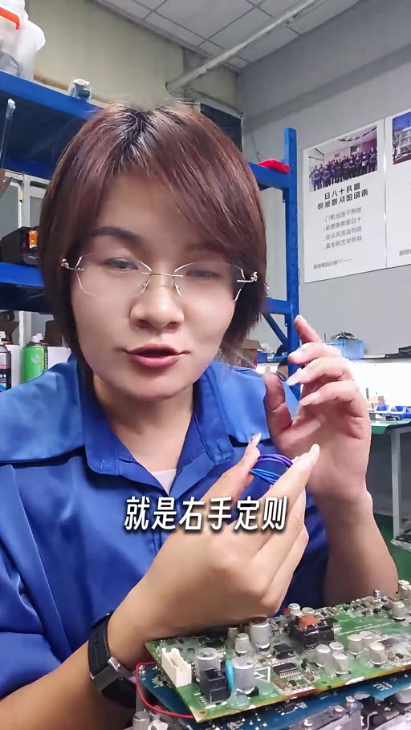

當你給這個線圈通電的時候，電流的方向是往這個方向這一招招的。

### 畫面 03:39–03:42

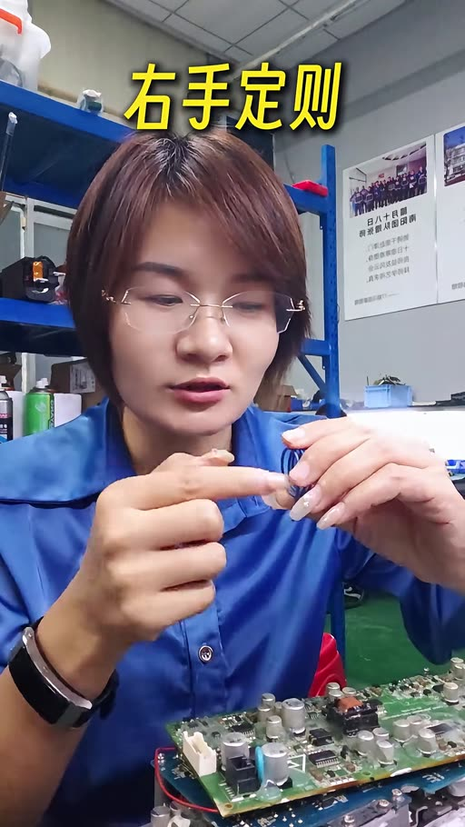

**標籤：** #右手定則

手指的方向跟電流方向一致。

### 畫面 03:42–03:55

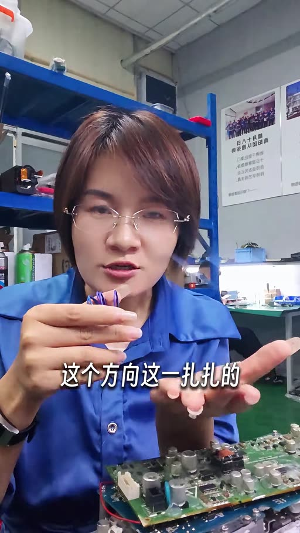

此時大拇指指的方向就是N級，N級就是你產生的那個磁場，磁場有兩級N和S，這就是電生磁，一旦有了這個磁場。

### 畫面 03:55–03:56

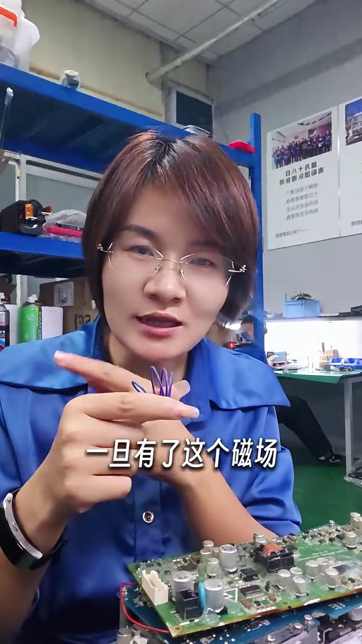

隨著電流的逐漸增大。

### 畫面 03:56–04:12

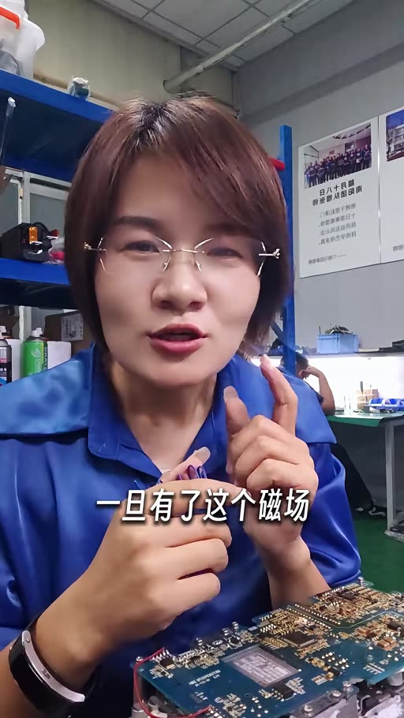

這個變化的磁場會感應出一個電場，而這個電剛好跟原來這個電流的方向是相反的由此就誕生了電感的特性對於電流是來聚去流，當電感開始通電的時候。

### 畫面 04:12–04:16

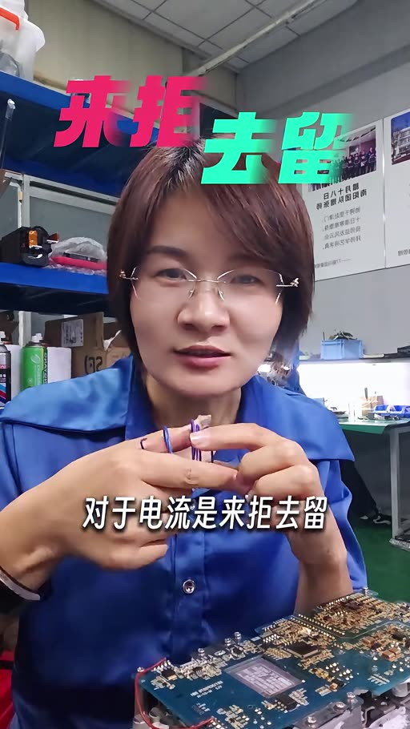

**標籤：** #來拒去留

由於電流在逐漸增大，就是這個變化的電場感應出變化的磁場。

### 畫面 04:16–04:39

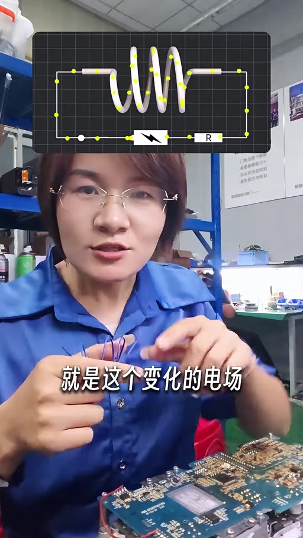

變化的磁場有反向感應出變化的電場，這兩個電場是剛好相互抵消的，所以它會對最初的那個電流有一個反向阻礙的作用，這就是電感對於電流的來聚，那去流又是同樣的意思，當它要逐漸消失的時候，它又會阻礙它消失，所以電感的特性是來具去流。

### 畫面 04:39–05:04

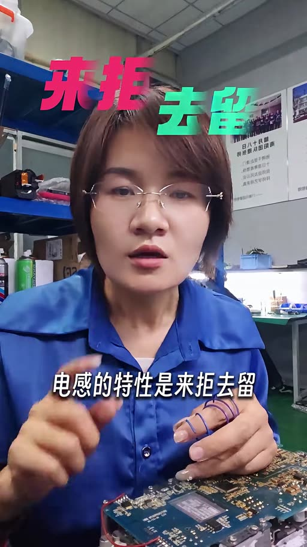

**標籤：** #水車比喻

它有什麼用呢，這就像那個水車，你開始推動它的時候，需要一個最初的推力，去推動它轉動轉動轉動轉動，但一旦轉動起來，這個力橫定了以後，你就不需要再管它了，它會自己轉，然後當這個力突然消失的時候，這個水車也不會說一下停，它還會因為自己的自重和慣性的原因，再轉轉轉轉一會兒再停，它就保證了電路里的元器件在通電和斷電瞬間的一個平穩性。

### 畫面 05:04–05:11

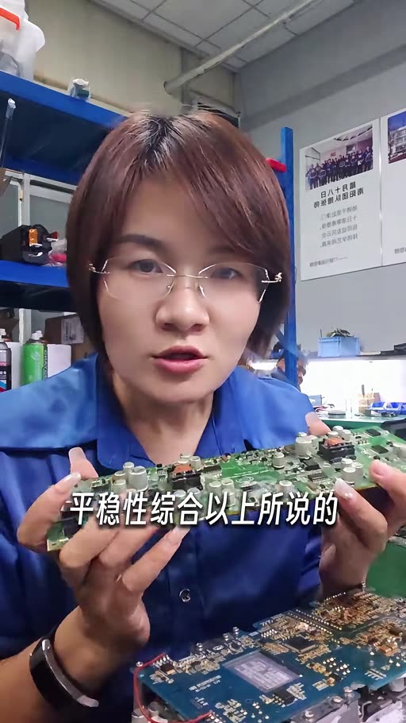

綜會以上所說的其實就是電路板上，它電路都是分一塊一塊的，每一塊的作用和原理是不一樣的。

### 畫面 05:11–05:13

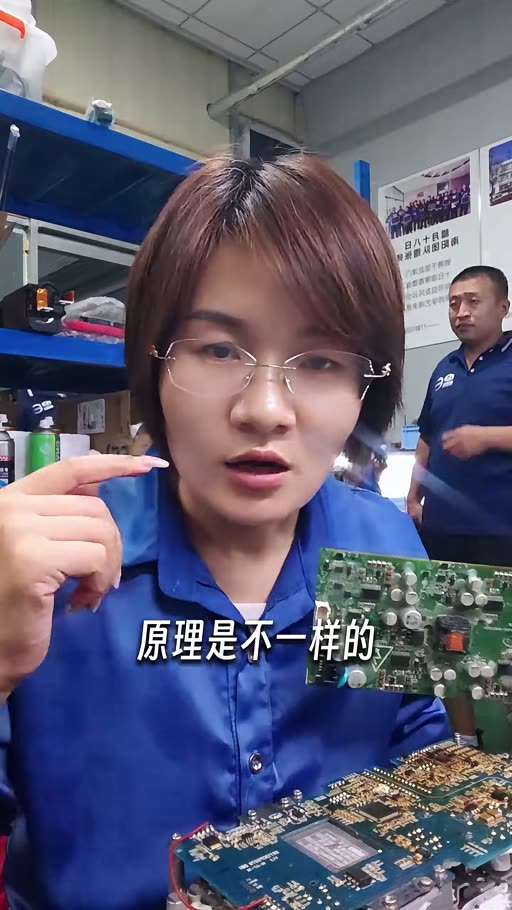

而以上咱們說的所有的元器件都是為了保證電流電壓。

### 畫面 05:13–05:22

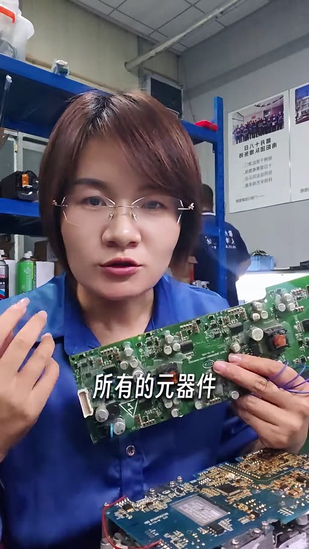

在該大的時候大該小的時候小該穩的時候穩，以此來保證每一部分電路的正常工作，所以千里之行始於足下。

### 畫面 05:22–05:29

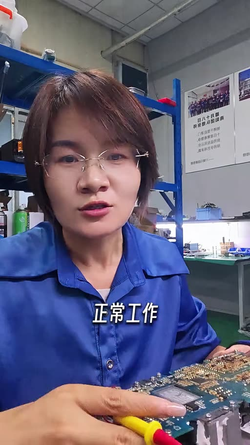

**標籤：** #單元電路

不要放棄，後邊還有單元電路繼續學，點個小星星，下回接著聽。

## 已知轉錄錯誤

| 時間 | 聽成 | 應為 |
|---|---|---|
| 01:02 | 元氣架 | 元器件 |
| 03:11 | 元氣件 | 元器件 |
| 04:11 | 來聚去流 | 來拒去留（04:12 畫面確認） |
| 01:48 | 物浮 | 5 伏（推測） |
| 04:49 | 橫定 | 恆定 |
| 05:04 | 綜會 | 綜合 |
| 02:21 | 一聲令一下 | 一聲令下 |
