# 中國芯 黃仁勳最怕中國AI的事 DeepSeek剛剛做到了

- 來源：https://vt.tiktok.com/ZSbc4mNue/
- 平台 / 上傳者：TikTok / ztwtqgpmnbc
- 長度：05:29 (329.3s)
- 逐字稿來源：whisper (groq)
- 更新日期：2026-10-11
- **關鍵字：** #DeepSeek V4 #華為昇騰 #寒武紀 #黃仁勳 #輝達 #CUDA生態 #開源 #科技普惠 #AI智慧體 #算力 #中國芯

## 摘要與名詞說明

- 來源：https://vt.tiktok.com/ZSbc4mNue/（TikTok，帳號 ztwtqgpmnbc，長度 05:29）
- 逐字稿來源：Groq Whisper 轉錄（非平台字幕）；原文為簡體中文，已轉為繁體
- 影片類型：評論／立場性短影音（開頭標題卡為「梁文鋒 VS 黃仁勳」）。以下為**講者的主張**，數字與說法未經查證

## 一句話重點

講者主張：DeepSeek V4 發布後，因「便宜」、「適配國產晶片」與「開源路線」三點，改變了全球算力與 AI 智慧體的格局，並削弱了對輝達（NVIDIA）生態的依賴。

## 重點（含時間戳）

| 時間 | 重點 |
|---|---|
| 00:00–00:39 | 開場：V4 發布後，輝達黃仁勳先前曾警告「若 DeepSeek 率先跑在華為平台上，對美國是非常可怕的一天」；講者稱不到十天這一天就來了，並稱算力格局與 AI 智慧體時代的規則被改寫 |
| 00:40–00:46 | 預告三個問題：便宜、國產晶片、開源 |
| 00:46–01:27 | 問題一：為什麼便宜是大事。講者舉例：幾萬字資料與 Claude 反覆對話幾十次約需 50 元，用 DeepSeek 約 0.35 元；個人與山區孩子也能用上高階 AI 助手（講者說法，未查證） |
| 01:28–02:06 | 價格背後的邏輯：講者認為美國大模型走「抬高門檻」的資本路線，DeepSeek 走「科技普惠」；V4 上下文達 100 萬 token，可一次處理整套財報、調研與會議記錄，AI 從「會說話」變「會幹活」；成本下降才能讓 AI 成為基礎設施 |
| 02:07–02:37 | 問題二：國產晶片。講者稱 V4 首批即適配華為昇騰與寒武紀；過去模型發布前需先把介面與設備需求交給輝達最佳化，講者稱之為「科技殖民」，這次沒有給輝達留位置 |
| 02:38–03:08 | 黃仁勳緊張的根源：CUDA 生態相當於 AI 界的 Windows，擁有上百萬開發者與全套工具鏈，遷移成本極高；講者認為 DeepSeek 撕開一道口子，往後不怕被制裁、斷供與漲價 |
| 03:09–03:34 | 問題三：開源路線。V4 技術報告使用 Kimi 的 Muon 最佳化器；Kimi K2.6 也採用 DeepSeek 開源的 MLA 注意力機制（壓縮率 93% 以上）；講者稱雙方互相引用、沒有授權談判與專利糾紛 |
| 03:35–04:00 | 對照美國：講者稱 OpenAI 與 Anthropic 互相爭鬥，並限制中國使用者；稱矽谷花 2000 億美元說服投資人，中國只花零頭卻免費開放；主張「競爭的本質是封閉對開放」 |
| 04:00–04:34 | 若此路線走通並成為全球標準，講者預測輝達與矽谷的領導地位將被動搖；稱 V4 是從硬體、運算元到分散式訓練的全鏈路自主化 |
| 04:35–05:10 | 結語：強調不被捧上神壇、不被踩進塵埃的「定力」；引用 DeepSeek 以十六字（疑為《荀子》「不誘於譽，不恐於誹，率道而行，端然正己」）回應外界 |
| 05:11–05:29 | 稱 DeepSeek 背後有華為、寒武紀、阿里、Kimi、智譜與 MiniMax 等支持，以「道阻且長，行則將至」收尾 |

## 名詞與縮寫說明

| 名詞 | 意思 |
|---|---|
| DeepSeek（深度求索） | 中國 AI 公司，開發同名大型語言模型 |
| V4 | DeepSeek 新一代模型版本（畫面字幕為 DeepSeek V4） |
| 算力 | AI 訓練與推論所需的運算能力，通常來自 GPU 等晶片 |
| 英偉達／輝達（NVIDIA） | AI 晶片大廠；「英偉達」為中國用法，台灣譯名「輝達」 |
| 黃仁勳 | 輝達創辦人兼執行長 |
| 華為昇騰（Ascend） | 華為的 AI 加速晶片 |
| 寒武紀（Cambricon） | 中國 AI 晶片公司 |
| CUDA | NVIDIA 的平行運算平台與開發工具，AI 軟體生態的核心 |
| 護城河 | 競爭者難以跨越的優勢，此處指 CUDA 生態 |
| 智慧體（AI Agent） | 能自行規劃並執行多步驟工作的 AI，而非只問答 |
| 上下文／token | 模型一次能讀的內容長度；token 為計算長度的基本單位，100 萬 token 約可容納整套長文件 |
| 開源 | 公開模型或程式碼供他人使用與改良 |
| MLA | Multi-head Latent Attention，多頭潛在注意力，可壓縮記憶體用量的注意力機制 |
| Muon 最佳化器 | 一種訓練模型用的最佳化演算法，由 Kimi 團隊採用 |
| Kimi | 月之暗面（Moonshot AI）的模型 |
| OpenAI／Anthropic | 美國 AI 公司，分別開發 GPT 與 Claude |
| 科技普惠 | 讓一般人也能負擔並使用先進科技 |
| 價效比 | 性價比，效能相對於價格 |
| ASR | Automatic Speech Recognition，自動語音辨識 |
| Groq／Whisper | 本次逐字稿所用的雲端語音轉錄服務／模型 |

## 轉錄校正備註

- 以 Whisper 提示詞（`glossary.json` 的 terms）與固定替換（replace）自動修正：DeepSeek V4、Anthropic、Muon、CUDA、寒武紀、華為昇騰、Claude 4.7、黃仁勳、閉源、矽谷、研報等專有名詞。
- 仍待確認：結語十六字（疑為《荀子》「不誘於譽，不恐於誹，率道而行，端然正己」）、「互飄年輕人」、「傳統跋涉」，詳見 `meta.json` 的 `known_asr_errors`。
- 繁體轉換採台灣用字：「運算元」「最佳化」「智慧體」「價效比」等為簡轉繁後的詞彙，原文分別是「算子」「優化」「智能體」「性價比」，讀技術文件時請留意。

## 圖文對照（畫面 + 逐字稿）

### 畫面 00:00–00:03

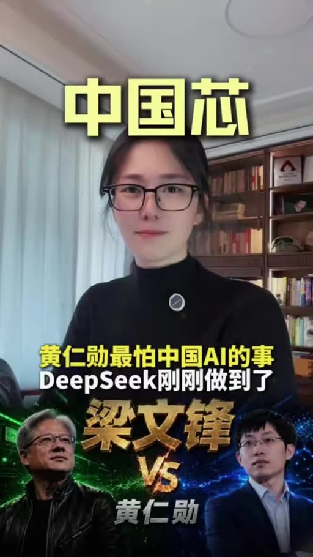

**標籤：** #DeepSeek V4 #黃仁勳

DeepSeek V4發布之後，矽谷很多人可能真的睡不著了。，就在幾天前，英偉達掌門人黃仁勳還公開警告，。

### 畫面 00:03–00:11

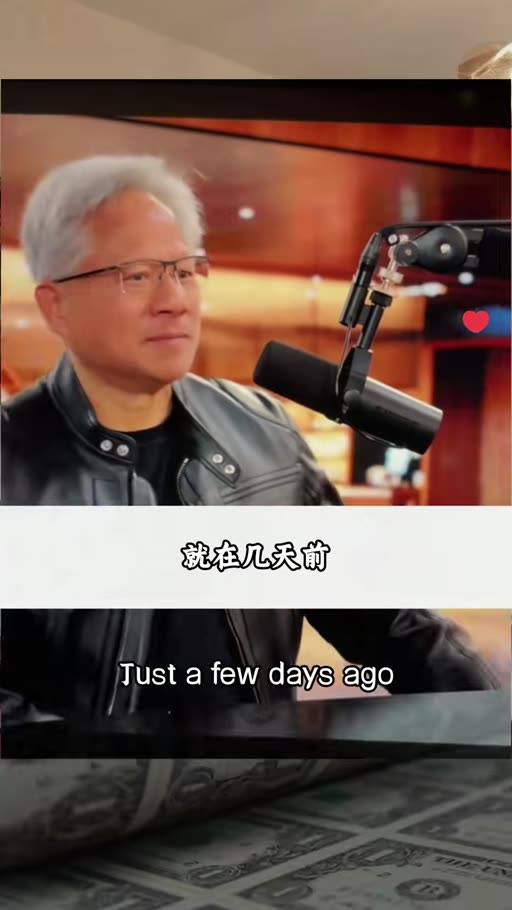

如果DeepSeek率先跑在華為平臺上，對美國來說將是非常可怕的一天。。

### 畫面 00:11–00:21

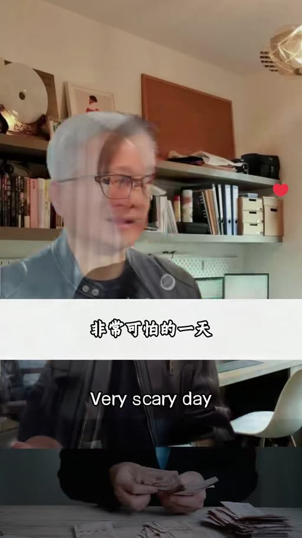

結果不到十天時間，這一天就真的來了。，很多人不理解，想當年DeepSeek憑一己之力打破美國避怨模型霸權，，為什麼苦等了500多天，換來的卻是一個便宜的答案。。

### 畫面 00:21–01:17

**標籤：** #便宜 #科技普惠

但絕大多數人都沒有意識到，這個便宜背後藏著的，，不僅僅是半個包子價格就能買到頂級算力的科技普惠，，更是一個最了不起的技術破局，更別說這裡面藏著的國運級別的勝負手。，毫不誇張的說，從這一刻開始，全球的算力格局和AI智慧體時代的整個遊戲規則都已經徹底改寫。，今天我們不聊資料，不聊技術，聊三個決定咱們每一個中國人未來十年生存的核心問題。，第一個問題，為什麼便宜才是最了不起的事情？，我們天天覺得便宜沒好貨，關於DeepSeek的爭議也從來都沒有消停過。，但是你知道嗎？如果按照西方的路線，算力將是咱們普通人永遠用不起的奢侈。，如果你把一份幾萬字的研報丟給Claude 4.7,反覆地對談幾十次，就可能要花掉你50塊錢。，同樣的場景用在DeepSeek V4,你可能只需要花3毛5分錢。，這意味著什麼？一個互飄年輕人，沒有背景，沒有團隊，沒有融資，，也可以呼叫一個世界級的策劃小組，程式設計助手和研究團隊。，一個山區的孩子，不用產土拔舍，不用砸鍋賣田，也能擁有一個清北水平、隨時線上、反覆培練的AI老師。這不是簡單的降價，這是把改變命運的鑰匙親手交到了咱們普通人的手裡。。

### 畫面 01:17–02:10

**標籤：** #普惠AI

這背後真正的邏輯是什麼？美國大模型在拼命的抬高門檻，本質上是一場資本的生意。，而DeepSeek的路線是相信科技普惠的路線，是公平的路線。，這件事更狠的地方在哪裡？現在用AI已經不是你問我答的聊天工具階段，而是智慧體階段。，DeepSeek V4幹的事就是把AI從會說話變成會幹活。，它把上下文真正拉到了100萬token,一整套的財報，幾十份的調研，一年的會議記錄，你都可以一股腦一次性的交給它。，它能夠持續的處理，持續的執行。，而且更關鍵的是，成本還是普通人可以負擔的價格。，只有成本下降，AI才能變成基礎設施，AI智慧體也才能真正的落到我們的產業和普通人的身上。，第二個問題，這背後藏著什麼更根本的東西？。

### 畫面 02:10–02:30

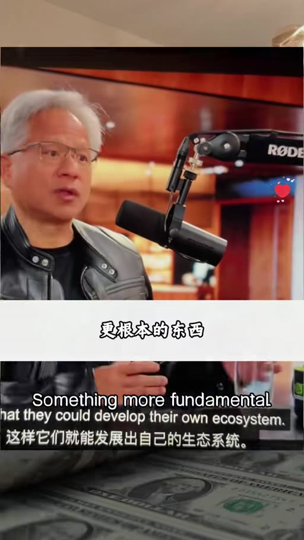

**標籤：** #國產晶片 #華為昇騰 #寒武紀

沒錯，這是黃人馴最害怕的，換了中國芯。，這款頂級大模型第一批就官宣了，適配華為昇騰和寒武紀兩款國產晶片，徹底擺脫了對英偉達的依賴。，過去的十年，所有的大模型公司要發布新產品，都要提前幾個月，乖乖的把底層介面和裝置需求發給英偉達所最佳化。，這麼多年已經成了行業冠頂，其實說白了，這就是一場科技殖民。。

### 畫面 02:30–02:38

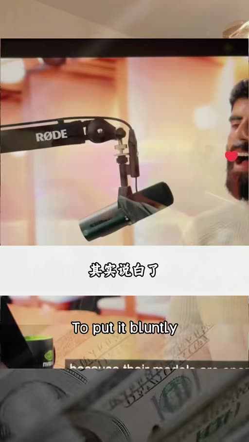

但是這一次，DeepSeek選擇深耕在咱們華為的國產底座上，根本就沒打算給英偉達留任何位置。。

### 畫面 02:38–02:47

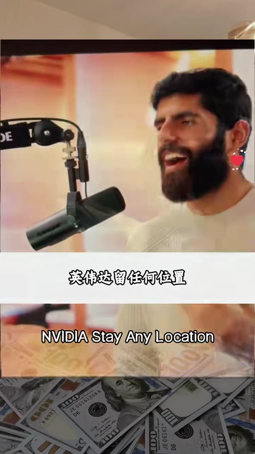

**標籤：** #CUDA生態 #護城河

這才是黃仁勳緊張的根源，他害怕的根本就不是晶片本身，而是整個AI生態的徹底搬家。因為這才是它稱霸全球的根本。英偉達底層的這個CUDA生態，就相當於AI行業的Windows,壟斷了全球AI的軟體生態。。

### 畫面 02:47–03:03

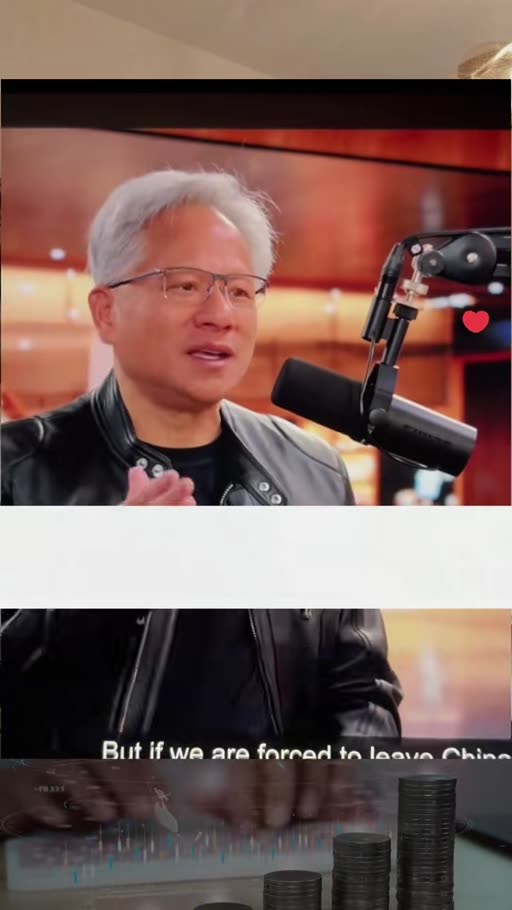

上百萬的開發者，全套的底層工具鏈，所有的大模型都只能跑在它的上面，遷移成本高到幾乎不可能。，但是現在DeepSeek直接把英偉達的護城河硬生生的撕開了一個口子。。

### 畫面 03:03–03:15

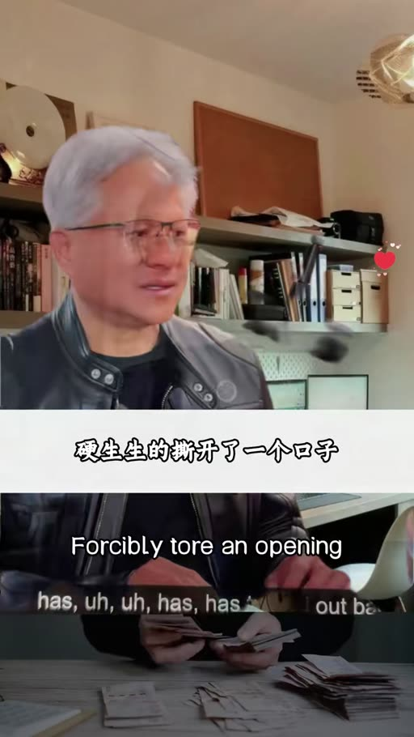

從此我們再也不用擔心人家隨意的制裁、斷供和漲價。，中國AI正式進入科技自主時代，第三個問題更狠的是什麼？，咱們的開源路線，很多人不知道開源意味著什麼，你看DeepSeek V4的技術報告最佳化器那一節。

### 畫面 03:15–03:19

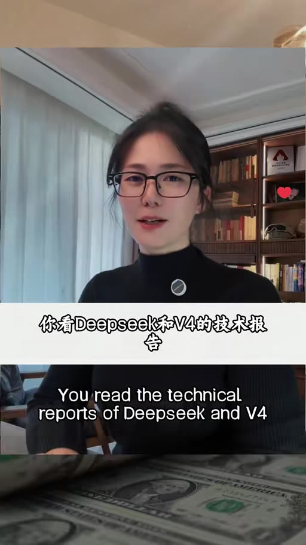

**標籤：** #開源 #MLA #Muon

我們的最佳化器用的是Kimi的Muon。

### 畫面 03:19–03:23

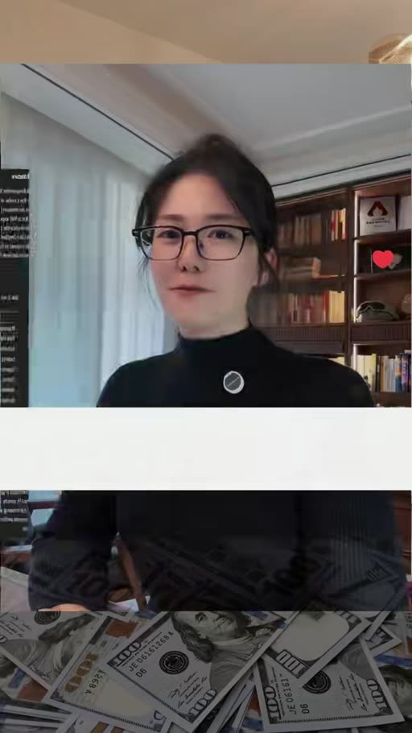

反過來，Kimi K2也用了DeepSeek開源的MLA注意力機制。

### 畫面 03:23–03:36

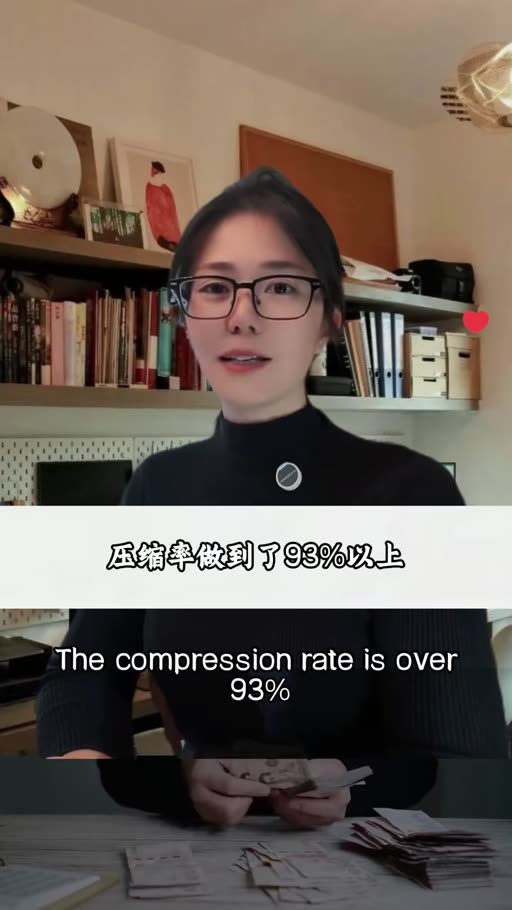

壓縮率做到了93%以上，已經從DeepSeek原創變成了行業標準，你用我的架構，我用你的最佳化器，沒有授權談判，沒有專利糾紛，兩篇論文相互引用，技術就這麼流動了，反觀大洋彼岸。

### 畫面 03:36–03:46

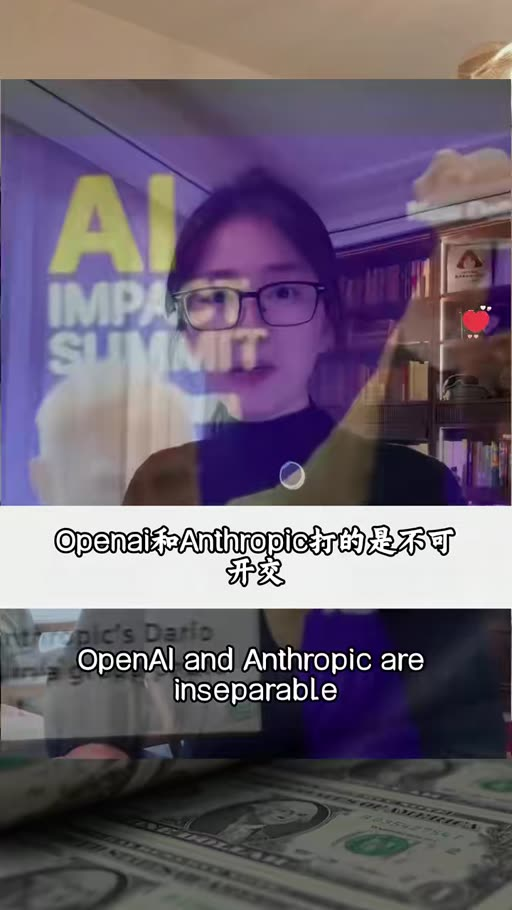

**標籤：** #OpenAI #Anthropic #封閉vs開放

OpenAI和Anthropic談的是不可開交，挖人起訴，相互拆臺，他們還限制中國使用者使用。，Claude封了中國區的IP,OpenAI也對中國開發者做了防汙限制。。

### 畫面 03:46–03:48

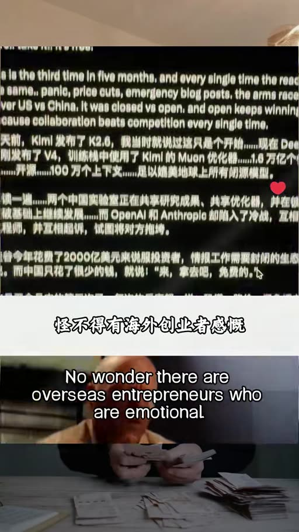

**標籤：** #矽谷2000億美元

怪不得有海外創業者感慨，矽谷今年花了2000億美元，說服投資人，智慧離不開圍牆，。

### 畫面 03:48–03:55

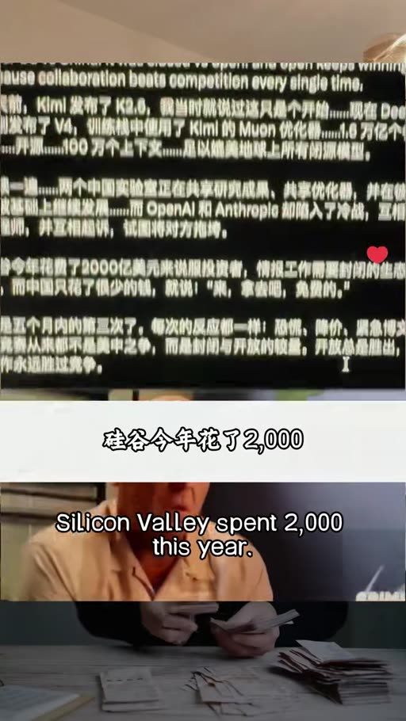

而中國只花了一個零頭，然後說拿去吧，免費用。。

### 畫面 03:55–04:04

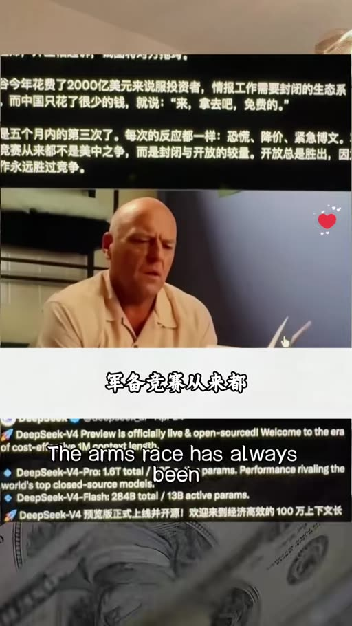

軍備競賽從來都不是美國和中國，而是封閉和開放。，而開放之所以持續勝出，是因為協作每次都會比競爭更強。當DeepSeek這條完全不同的技術路線走通，而且成本更低，效果更好時，那麼不僅在中國，未來全球市場都會跟著這條新的路線。。

### 畫面 04:04–04:16

到那時候，中國技術戰就會成為全球標準，英偉達乃至整個矽谷的行業領導地位就會被連根拔起，從基礎價格治理平權到底層喚星擺脫依賴，再到中國路線開放共贏。。

### 畫面 04:16–05:29

**標籤：** #全球標準

DeepSeek V4的發布絕不只是價效比的突破，它是從硬體架構到運算元最佳化再到分散式訓練的全鏈路自主化，從此中國AI正式告別看別人臉色過日子的時代，當初他們以為卡住晶片 管住生態就能把中國人擋在原地，但現在國產模型 國產算力用實力證明，中國人從來都不是這樣擋得住的，前面有山我們就把它移走 前面有海我們就把它填平，這就是中國人自古以來的倔強，DeepSeek V4不是終點 是我們奔向星辰大海的起點，外面的局勢很複雜，外界的聲音很嘈雜，但DeepSeek的回應只有16字，，不右於喻，不恐於匪，率道而行，端然、正極。，中國也真正需要的不是被捧上神壇，也不是被踩進塵埃，而是這份不疾不徐的定力。，更重要的是，DeepSeek從來都不是孤軍奮戰，它的背後是華為、是寒武紀、是阿里、是Kimi、是智普和MiniMax,，是從晶片到模型，從架構到生態，億萬個把肩膀借給彼此的中國人。道足且長，行則將至，行而不錯，未來可見。。

## 已知轉錄錯誤

| 時間 | 聽成 | 應為 |
|---|---|---|
| 04:54 | 無用於欲，不恐於肥。帥到而行，端然正極 | 不誘於譽，不恐於誹，率道而行，端然正己（推測，出自《荀子》） |
| 01:08 | 互飄年輕人 | 未能確認（疑為「一個普通年輕人」） |
| 01:16 | 傳統跋涉 | 未能確認 |
