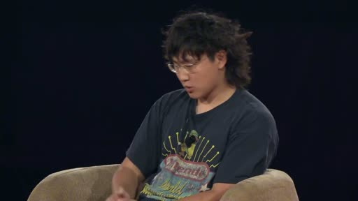
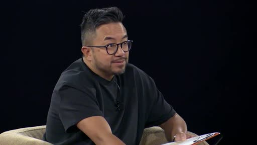

# AYi - Scale 創始人，現在在 Meta 帶超級智慧實驗室的 Alexandr Wang，說了句很顛覆的話，他說現在是人類歷史上建十億美元公司...

- 來源：https://x.com/AYi_AInotes/status/2109141804620619953
- 平台 / 上傳者：X / AYi
- 長度：02:40 (160.2s)
- 逐字稿來源：captions (en, manual, unknown)
- 更新日期：2026-10-11
- **關鍵字：** #Alexandr Wang #Meta Superintelligence Labs #Scale AI #AI Agent #新創 vs 大公司 #個人超級智慧 #agency expansion #AI 擴散

## 摘要與名詞說明

**一句話重點**：Meta Superintelligence Labs 負責人 Alexandr Wang（Scale AI 創辦人）主張，AI 的瓶頸已是「擴散與社會適應」而非模型進步；有了 AI Agent，新創可從「David vs Goliath」變成「Goliath vs Goliath」，並說明 Meta 以「個人超級智慧」擴張個人能動性為目標。

| 時間 | 重點 |
|---|---|
| 00:00 | 瓶頸不在模型進步，而在擴散與適應；模型即使停滯，經濟仍將動盪數十年 |
| 00:29 | 這是「文明級僅此一次」的造夢機會 |
| 00:47 | 10 年前新創是以小搏大；現在有 Agent 加持，近乎巨人對巨人 |
| 01:32 | 善用 AI Agent 的新創可輕鬆勝過既有大公司 |
| 01:48 | 主持人問：「超級智慧」在 Meta 內部的實際意義 |
| 02:00 | Zuckerberg 一年前的備忘錄：人人擁有量身打造的個人超級智慧 |
| 02:27 | 重點是 agency expansion：幫人完成過去想都不敢想的事 |

## 名詞說明
- **Superintelligence（超級智慧）**：能力超越人類的 AI；Meta 的說法偏向「個人化」。
- **Agency expansion**：擴張個人的行動與達成目標的能力。
- **Mecha Goliath**：字幕作「Mecca Goliath」，推測為「機械巨人」比喻。

## 備註
逐字稿為 X 提供的英文人工字幕，非 Whisper 轉錄，也非中文；畫面無字幕文字可交叉核對。內容為講者主張，未經查證。

## 圖文對照（畫面 + 逐字稿）

### 投影片 1：AI 瓶頸在擴散，而非模型進步（00:00–00:29）

**重點：** Wang 主張：瓶頸不是模型進步，而是讓 AI 擴散到世界並協助世界適應；即使模型今天停止進步，經濟仍將動盪數十年。

**標籤：** #AI 擴散 #經濟變革

I think we're at this like，amazing moment in the world where，the bottleneck is not the progress of the AI models，the bottleneck is，diffusing that through the rest of the world and，and helping the world adapt to this amazing，technology that already exists. Like I think if，the models didn't improve at all from today，there would still be like，decades and decades of like total upheaval and，change in the economy and how the world operates and，and everything around us. And。

### 投影片 2：「千載難逢」的造夢機會（00:29–00:47）

**重點：** 他稱這是文明級的機會：有願景與野心的人，可以用打造產品來塑造未來世界的樣貌。

**標籤：** #願景 #野心

so I think it's as a result，it's like one of the most incredible，it's probably a，like once in a civilization opportunity to，be a dreamer and to have a vision，and to have ambition and to，impose a view of how the future world，should look by building something amazing。

### 投影片 3：新創從 David vs Goliath 變成 Goliath vs Goliath（00:47–01:48）

**重點：** 10 年前創辦 Scale 時新創是以小搏大；如今有 Agent 與 AI 加持，新創像「被大幅強化的機械巨人」，擁抱 AI Agent 就能輕鬆勝過既有大公司。

**標籤：** #新創 #AI Agent #競爭

you know, one of the things that we were，we were chatting about，you know, backstage is, you know, when，when I started scale or，you know, 10 years ago, if you start a company，you had to be，you know, it was like David versus Goliath，And you had to be clever and you，had to find like an angle into the，market and you had to sort of like，you know, figure out，a way to compete even though you had，much fewer resources，And now I actually think with the power of agents，and AI broadly speaking，it's much closer to Goliath versus Goliath，Like I think，but，maybe the startup is like a Mecca Goliath，that is like，vastly enhanced by the power of agents and AI，And, you know, the，the large companies are the sort of like more traditional Goliath，so to speak. But I think that startups now，like if you properly embrace AI agents and，figure out the way to leverage their strengths，in the most like ambitious ways，you can easily outcompete incumbents。

### 投影片 4：Meta 內部的「超級智慧」意涵（01:48–02:40）

**重點：** 主持人提問；Wang 提到一年前 Mark（Zuckerberg）寫的「個人超級智慧」備忘錄，每個人都有為自己量身打造、了解其情境的超級智慧，目標是 agency expansion（擴張個人能動性）。

**標籤：** #個人超級智慧 #agency expansion

So let's talk about superintelligence，because that's clearly，that's even in the name of your lab，what does superintelligence mean operationally inside Meta right now?，Yeah, I think that，you know, we, a year ago, Mark wrote this, memo about personal superintelligence，which I think actually is very similar to，your concept of personal AGI，But, you know, we believe that everybody in the world，you know，all，the billions of people in the world are，going to have a superintelligence that is，adapted and tailored to them，that is, enables them to accomplish their goals，knows their context，and ultimately is an expander of their own agency，Like，I think the thing that we think a lot about is，is agency expansion. How do we help people，accomplish things that，they couldn't have ever dreamed of before?，And，what would everyone in the world do，if everything was just easy?。

## 已知轉錄錯誤

| 時間 | 聽成 | 應為 |
|---|---|---|
| 01:22 | Mecca Goliath | Mecha Goliath（機械巨人，推測；來源為英文人工字幕） |
