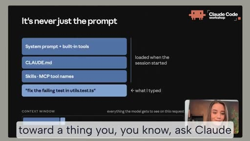
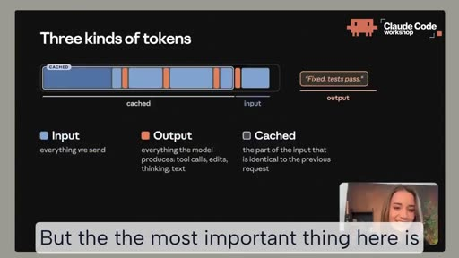
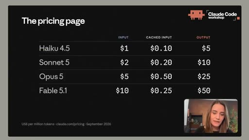
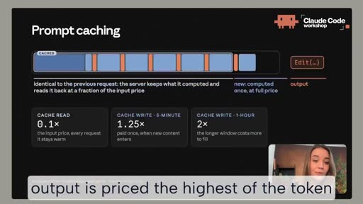
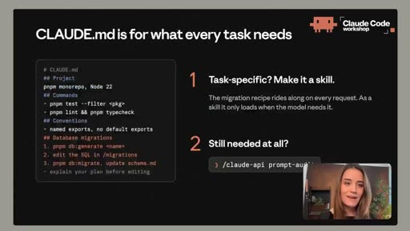
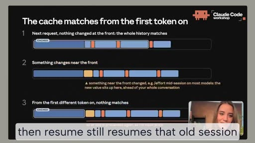
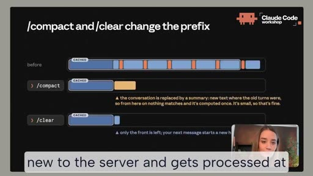
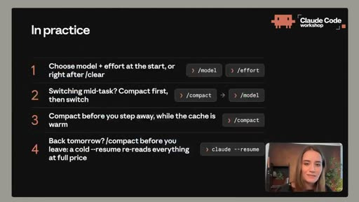

# Ryan Carter - An Anthropic Engineer Just Revealed How Advanced Users Are Unlocking ...

- 來源：https://x.com/Grow_withAI/status/2109089199014220129
- 平台 / 上傳者：X / Ryan Carter
- 長度：26:36 (1595.6s)
- 逐字稿來源：captions (en, manual, unknown)
- 更新日期：2026-10-11
- **關鍵字：** #Claude Code #token #提示快取 #prefix #CLAUDE.md #skills #MCP #effort #compact / clear #sub-agent #managed settings #OpenTelemetry

## 摘要與名詞說明

**一句話重點：** 一場約 26 分鐘的網路研討會，用「一個提示 = 很多個請求，每個請求都帶著整段對話」的心智模型，說明 Claude Code 的 token 花在哪、如何靠提示快取（prompt cache）與良好習慣降低成本，最後介紹管理者可用的團隊設定。

| 時間 | 重點 |
|---|---|
| 00:00 | 開場與議程；agentic 時代按「工作」付費，token 是單位，目標是建立心智模型 |
| 02:23 | 一個提示並非只有提示：系統提示、內建工具、CLAUDE.md、skills／MCP 名稱一併送出；模型以工具呼叫迴圈運作，每次來回上下文都變長 |
| 04:52 | 三種 token：輸入、輸出（含工具呼叫、編輯、思考）、快取 |
| 05:21 | 價格頁；輸入可平行處理故便宜，輸出逐 token 生成故最貴 |
| 06:16 | 提示快取：相同前綴以約 0.1 倍輸入價讀回；健康工作階段多數輸入來自快取（用 usage 檢查） |
| 07:32 | 選對模型：不要對不需要的任務用最大模型；小模型不等於差模型 |
| 08:56 | 給對上下文：用 @ 直接帶入檔案；用 context 檢視載入內容 |
| 10:09 | CLAUDE.md 只放每個任務都需要的；任務專屬流程改成 skill；用 /claude-api prompt-audit 清理過時指示 |
| 11:35 | 關閉閒置 MCP 或改用 CLI；留意低於門檻的大量指令輸出（改用安靜回報器、把常用指令寫進 CLAUDE.md、吵雜工作交給子代理） |
| 13:06 | effort：不必一直開最高；「不夠懂」是模型問題，「不夠努力」是 effort 問題 |
| 14:34 | 上下文只增不減：任務間 /clear、必要時 /compact、/rewind；先改名再 clear 可日後 resume |
| 15:51 | 快取從第一個 token 開始比對，一個 token 不同則其後全價 |
| 16:14 | /compact、/clear、中途換模型、（多數模型）換 effort 都會破壞快取；快取視窗約 1 小時（方案）或 5 分鐘（API／雲端），可設 TTL，但長視窗寫入較貴 |
| 18:36 | 四守則：開始時選好 model＋effort；中途換模型先 compact；離開前趁快取熱時 compact；隔天回來前先 compact，冷的 --resume 會全價重讀 |
| 19:53 | 子代理：在獨立上下文做吵雜研究，只回傳結論；自身仍耗 token，但主對話更精簡；可指定不同模型與 effort |
| 21:12 | 管理者：managed settings（起始模型／effort、快取 TTL、允許的 MCP、組織 CLAUDE.md）、分析與 OpenTelemetry 監控、用量點數與支出上限、達上限自動繼續 |
| 24:42 | 結語三原則：開始時選好設定後別動；刻意決定放進對話的內容；保持工作階段專注（clear／趁熱 compact） |

## 名詞與縮寫
- **token**：模型處理的最小計量單位；分輸入、輸出、快取三類。
- **提示快取／前綴（prompt cache／prefix）**：請求開頭與上次完全相同的部分可被重用，以低價讀回。
- **compact／clear／rewind／resume**：壓縮對話為摘要／清空／回退幾輪／接續舊工作階段。
- **sub-agent（子代理）**：有獨立上下文的代理，完成工作後只回傳結論。
- **managed settings**：管理後台定義、全團隊強制套用的設定檔。

## 轉錄校正備註
- 語言：英文（`detected_language: en`）；來源為 X 平台人工字幕（非 Whisper），已補完整中譯 `transcript.zh.md`。
- 字幕常把 Claude 寫成 "Cloud"（含 CloudMD），已由 `glossary/domains/claude-code.json` 與一次性修正處理；另修正 buyer→bar、retool→tool、ride→write、cash→cache 等，詳見 `known_asr_errors`。
- **講者身分**：X 貼文標題與上傳者為「Ryan Carter」，標題寫 “An Anthropic Engineer…”；但影片畫面名牌看起來是另一個名字（Lydia Hallie），講者自述為 Anthropic 團隊成員。這段身分資訊我無法獨立查證，請以原影片為準。
- 價格、倍率（0.1×／1.25×／2×）與「快取視窗約 1 小時／5 分鐘」皆為影片畫面或講者所述，反映錄影當時（畫面標示 2026 年 9 月）的情況，**未經查證，之後可能變動**（講者也提醒價格與功能會持續變動）。
- 約 21:12 起至結尾無對應投影片截圖。

## 圖文對照（畫面 + 逐字稿＋中譯）

### 投影片 1：開場與主旨（00:00–02:23）

**重點：** 講者開場、說明議程；強調在「按任務付費」的 agentic 時代，token 是成本單位，目標是建立心智模型而非清單。

**標籤：** #token #心智模型

Hi, everyone I hope that you can hear me I'm not sure team here in Anthropic and today I want to talk about how you can get the most value out of your Claude Code sessions And just a quick bit of housekeeping first because I know there are so many of you here today which is great but it also means we won't be able to get to every question live So drop your questions in the Q&A as we'll go and we'll, you know answer as many as we can at the end And the ones we don't get to we'll follow up on afterwards together with the recording and the links But just so you know what this is about this session is about how Claude Code actually spends tokens when you work with it what you control about that so your own habits and set settings in a session and at the end also just the levers that you have if you set it up for a team I want you to walk out of this session here feeling in control of how efficiently you work in Claude Code and also with a good mental model of what a task ends up costing and and why And again if you're the person who sets up Claude Code for your whole team I hope you stay till the end because I'll also go through some of the levers that you have in our dashboard And I kind of want to show the mental model on purpose because I feel like we often just give you a checklist like, hey, do, do these things but that tends to go stale the moment we ship something new and personally, I think if you understand the mechanism behind something you can just work out the right move yourself for your environment in your context, all that kind of stuff And honestly I think this is a new skill for engineers You know software used to be a flat fee We used to pay for the tool or for the seats but in the era of agentic coding we're paying for the work itself right, task by task, you're paying per prompt So understanding how to be efficient with that is just part of the job now And the unit we're going to talk about most pretty much the whole time is tokens If your company runs Claude Code on API billing or through a cloud provider you're paying per token. So this table I'm sure you're familiar with this table you know tokens already But if you are on Pro or Max or Team or Enterprise you have these five-hour windows or a weekly window instead but also those windows are measured in tokens So whichever way you're set up tokens are the unit and how many tokens go into a task is what we're going to get better at today And this isn't about sending fewer of them or using Claude less we just want to make sure that the tokens that do go into a session actually go toward a thing you you know, ask Claude to do.

**中譯：** 大家好，希望你們聽得到我。我是 Anthropic 團隊的一員，今天想談談如何從你的 Claude Code 工作階段中獲得最大價值。先說一點行政事項：今天來了很多人，所以沒辦法現場回答每個問題。請在 Q&A 中提問，我們會盡量在最後回答，沒答到的會連同錄影與連結在會後跟進。這場主題是 Claude Code 實際上如何消耗 token、哪些部分由你控制（你自己的習慣與工作階段設定），最後也會談如果你是為團隊設定，有哪些可調整的槓桿。我希望你離開時，能掌握自己在 Claude Code 中的工作效率，也對一個任務最終花多少錢、為什麼，有清楚的心智模型。如果你是負責為整個團隊設定 Claude Code 的人，請留到最後，我會介紹管理後台中的幾個槓桿。我刻意先講心智模型，因為我們常只給你一份「照著做」的清單，但清單在我們推出新東西的那一刻就過時了。我個人認為，理解背後的機制，你就能自己為你的環境推導出正確做法。老實說，我認為這是工程師的一項新技能。軟體過去是固定費用，我們為工具或席位付費；但在代理式（agentic）寫程式的時代，我們是為「工作本身」付費，一個任務一個任務地、按每個提示付費。所以懂得如何有效率，現在是工作的一部分。我們整場最常談的單位就是 token。如果你的公司以 API 計費，或透過雲端供應商使用 Claude Code，就是按 token 付費（這張表你一定很熟）。如果你是 Pro、Max、Team 或 Enterprise，則是五小時視窗或每週視窗，但這些視窗同樣以 token 衡量。所以不論你怎麼設定，token 都是單位。今天要變得更好的，就是一個任務用掉多少 token。這不是要你少送一些，或少用 Claude，而是希望進入工作階段的 token 真正用在你要 Claude 做的事情上。

### 投影片 2：It's never just the prompt（02:23–04:52）

**重點：** 一個提示實際會連同系統提示、內建工具、CLAUDE.md、skills／MCP 名稱一起送出；模型以工具呼叫迴圈運作，每次來回上下文視窗都變長。

**標籤：** #上下文視窗 #工具呼叫

So let's take a step back real quick and look at what actually happens behind the scenes when we send a prompt to Claude So say that I have a failing test and I type fix the failing test in utils.test Yes, I press enter Now Claude Code doesn't just send that one prompt to the model When I started this session it already loaded a bunch of things for me Claude's own instructions, the system prompts the definitions of the built-in tools so read, edit, batch, and so on my environment, current working directory, git, everything We also have my CLAUDE.md file and I have some skills in here an MCP server set up and it will also include a short like name and description for all these things as well So all the way at the end is our message So all of this this entire bundle goes to the model as one request So that's already the first thing to understand It's never just the prompt And this bar down here as we're walking through this this is the context window So everything the model gets to see in this request and I'll keep this on the screen here because honestly this bar is what this talk is about. So our request arrives at the model but the model doesn't just read this as text it first goes through a tokenizer So this splits everything we send including the system prompts dot md, everything, into tokens, which are just small chunks roughly word sized, and the model processes those I won't go too deep into that today but it's important to understand that the input into the model is tokens and also whatever the model generates afterwards is also tokens. So from here on everything in this bar everything that comes back is token So the request arrives at the model the model reads all of it gets to my message and goes, okay, you want me to fix something but I only have a file name you didn't send the actual file So while it comes Back is not a fix it's just a tool call like hey, read utils.test.ts Claude Code or the harness then performs that it reads the file and sends this result back to the model and so on. Now I'm not going to walk through every step here that's not the point The point is the loop here The model decides that it needs to do something it sends a tool call back Claude Code performs it and then sends this result back to the model But notice that I didn't do anything here in the CLI it's the model choosing these tool calls and on every one of those round trip the bar grows So as we keep watching this you'll see a few things in the bar So there's a couple colors but two of these Whenever we send to the model I've marked blue, and whenever or whatever the model sends back is orange There's also this container around the beginning of the request that just keeps getting longer I'll get to that in a second.

**中譯：** 讓我們退一步，看看送出提示時幕後究竟發生什麼事。假設我有個失敗的測試，我輸入「修好 utils.test 裡失敗的測試」並按下 Enter。Claude Code 不會只把這一句提示送給模型。工作階段啟動時，它已經幫我載入了很多東西：Claude 自己的指令（系統提示）、內建工具的定義（讀取、編輯、批次等）、我的環境（目前工作目錄、git 等）。還有我的 CLAUDE.md、一些 skills、設定好的 MCP 伺服器，並且會附上這些東西各自的簡短名稱與說明。我的訊息在最末端。這整包東西作為一個請求送給模型。所以要先理解：它從來不只是你的提示。下方這條橫條就是「上下文視窗」，也就是模型在這個請求中能看到的一切，整場我會一直放在畫面上，因為這條橫條就是這場演講的主題。請求抵達模型，但模型不是直接把它當文字讀，而是先經過分詞器（tokenizer），把我們送出的一切（包含系統提示、.md 檔等）切成約略一個字大小的小塊，即 token。我今天不深入細節，但要知道：輸入模型的是 token，模型之後產生的也是 token。從這裡開始，橫條裡的一切、以及回傳的一切，都是 token。模型讀完全部，看到我的訊息，心想「你要我修東西，但我只有檔名，你沒有送實際檔案」。所以它回傳的不是修正，而是一個工具呼叫，例如「讀取 utils.test.ts」。Claude Code（也就是 harness）執行它，讀檔後把結果送回模型，如此反覆。我不會逐步走完，重點是這個迴圈：模型判斷需要做某件事，送回工具呼叫，Claude Code 執行後把結果送回模型。請注意我在 CLI 裡什麼都沒做，是模型自己選擇這些工具呼叫，而每一次來回，橫條都會變長。繼續看你會在橫條中看到幾種顏色：送給模型的我標成藍色，模型送回的標成橘色。請求開頭還有一個不斷變長的「容器」，稍後說明。

### 投影片 3：三種 token（04:52–05:21）

**重點：** 輸入、輸出（含工具呼叫、編輯、思考）與快取 token，對應價格頁的欄位。

**標籤：** #輸入 #輸出 #快取

But the most important thing here is what we're looking at is three kinds of tokens So first we have the input tokens which is everything we send to the model so everything in the bar We have output tokens which is everything the model sends back And that's not just the summary at the end. It's also the tool calls the edit, the thinking, everything the model did And everything inside this container these are cached tokens So we have three types We have input, output, and cached.

**中譯：** 最重要的是，我們看到三種 token：輸入 token（我們送給模型的一切）、輸出 token（模型送回的一切，不只是最後的摘要，還包括工具呼叫、編輯、思考，模型做的全部），以及容器內的快取 token。

### 投影片 4：價格頁與為何價格不同（05:21–06:16）

**重點：** 畫面價格表（每百萬 token，2026 年 9 月）：Haiku 4.5 $1／$0.10／$5、Sonnet 5 $2／$0.20／$10、Opus 5 $5／$0.50／$25、Fable 5.1 $10／$0.25／$50（輸入／快取輸入／輸出）。輸入可平行處理故便宜；輸出逐 token 生成故最貴。

**標籤：** #價格 #輸出最貴

And you might recognize this from the pricing page because that's exactly how it's laid out right? Like we have a price per token per model, and then separate columns for the input cached input, and output Now I just want to quick take a quick look at why these are priced so differently First input. So whenever we send something to the model the model still has to process every input token But it can do all of them together like in one pass So GPUs are extremely good at that So per token, the input is pretty cheap but output is different. So the model writes one token at a time So to write something seemingly simple like const x equals one it does a full pass over everything in the context just to produce const appends it, does another full pass just to produce x and another one for equals and everything else So, so there's a lot more compute behind every output token and that's also why output is priced the highest of the token types.

**中譯：** 你可能會在價格頁認出這個分類，因為價格頁正是這樣排的：每個模型每個 token 的價格，並分成輸入、快取輸入與輸出幾欄。我們快速看看為什麼它們定價差這麼多。先看輸入：我們送出任何東西，模型仍要處理每個輸入 token，但可以一次平行處理，而 GPU 非常擅長這件事，所以每個 token 的輸入價格相當便宜。輸出就不同了，模型一次只寫一個 token。寫出看似簡單的「const x equals one」，它要對整個上下文做一次完整運算才能產生 const，接上後再做一次完整運算產生 x，再來是 equals，依此類推。所以每個輸出 token 背後的運算量大得多，這也是輸出是各類 token 中價格最高的原因。

### 投影片 5：提示快取（Prompt caching）（06:16–10:09）

**重點：** 相同的前綴以約 0.1 倍輸入價讀回；寫入快取 5 分鐘為 1.25 倍、1 小時為 2 倍。用 usage 檢查快取占比；並談選對模型與給對上下文。

**標籤：** #prompt cache #前綴 #選對模型

And then there's cache tokens which is the cheapest one So a big part of the request is the same every time right? Like on every round trip we're only appending to the end But everything before that the model has already processed on the previous request. So the server doesn't treat that part as as brand new. It just keeps the internal state that it built up last time and only does all the recomputation or the computation on the point where this request starts to differ from The previous one. And that's the prompt cache So the identical part at the front is called the prefix and that's the container that you saw growing And this is read back for just a small fraction of the normal input price So the new part pays your full price once and then from the next request on it's inside the container Now, Claude Code sets this all up for you automatically but cache here, honestly, I think is your biggest lever because look at the bar again like a lot goes in and a very little comes out and nearly everything that goes in is inside that container. So in a healthy session most of your input is the cheap cached kind And you can check for that on your own session with usage So there's a line here for the prompt cache and that shows you exactly how much of your input came from cache In a healthy session that number should be high But there are a few things to keep in mind here because what we just saw is you know a list of things that we get to optimize. So how many tokens go in how many come out and how many of those are cached There's also one more thing is whether the model that's running all of this is actually the right model for the task Because we saw that the model has to process every single one of these tokens and a larger model like Opus or Fable is more expensive simply because per token it does a lot more computation And that's great for a lot of tasks but you might not need it for yours And because it applies to every token both in and out it directly multiplies everything else we're about to look at. So that's the first thing to get right Don't run the biggest model on a task that that just doesn't need it And also to be clear a smaller model is not a worse model The way I like to think about it is Sonnet is a really good generalist Opus is the expert and Fable is the specialist who's seen the problems no one else has And Haiku is just like a quick assistant Like an edit that you can describe precisely or a mechanical change or a question about the code that's already in the context that's great for generalist work and Sonnet gets you there perfectly paying way less per token But if there's like a subtle bug or just unfamiliar territory something you don't really know what's going on then Opus is a great expert and it's worth paying a bit more for that But that's not for every task right? The next thing is to give Claude the right context. So it needs fewer tool calls and fewer of these round trips to figure out what you're actually trying to do And some of that is in your prompt and some of this is having the right environment the right ClaudeMD skills set up And a really small one is you can actually add the file to the prompt. So in this case we could have said fix the failing test in at utils.test.ts So then before the request even goes to the model Claude Code already puts the contents of that file in So that first tool call just never happens because the model already has all the context Small one, of course, over a large session but I still like it Then it's also it's also important to make sure that there's not a bunch of stuff in your context that you don't need for this specific task And you can see what's in your context by typing context in a fresh session and you see exactly that So you see the system prompt you see the tools that are loaded your CLAUDE.md, how many tokens everything is using as well your skills, your MCPs So this is always worth doing before you start a new session just to make sure like okay, am I adding stuff that is unnecessary? Can I make my prompt more more lean?

**中譯：** 然後是快取 token，最便宜的一種。請求的大部分每次都相同：每次來回我們只是附加到結尾，前面的部分模型在上一個請求已處理過，所以伺服器不把它當全新內容，而是保留上次建立的內部狀態，只對與上一個請求開始不同的地方做計算。這就是提示快取（prompt cache）。前面相同的那一段稱為「前綴（prefix）」，也就是你看到的那個容器。它以一般輸入價格的一小部分被讀回。新的部分第一次付全價，從下個請求起就進入容器內。Claude Code 會自動幫你設定這一切，但老實說我認為快取是你最大的槓桿：看橫條，進去很多、出來很少，而且進去的幾乎都在容器內。所以在健康的工作階段中，大部分輸入是便宜的快取輸入。你可以用 usage 檢查自己的工作階段：那裡有一行提示快取，會顯示你的輸入有多少來自快取。健康的工作階段中這個數字應該很高。還有幾點要留意，因為剛才看到的是一串可以最佳化的東西：多少 token 進去、多少出來、多少被快取。還有一件事：運行這一切的模型，是否真的適合這個任務。因為模型要處理每一個 token，像 Opus 或 Fable 這樣較大的模型，每個 token 做的運算更多，所以更貴。這對很多任務很好，但你的任務可能不需要。而且因為它適用於每個輸入與輸出 token，它會直接乘上我們接下來要談的一切。所以第一件要做對的事：不要在不需要的任務上跑最大的模型。也要說清楚，小模型不是比較差的模型。我喜歡這樣想：Sonnet 是很好的通才，Opus 是專家，Fable 是見過別人沒見過的問題的專家型人才，Haiku 則像個快速助理。能精確描述的編輯、機械性修改、或對已在上下文中的程式碼提問，用 Sonnet 就很適合，而且每個 token 便宜得多。但如果有細微的 bug 或陌生領域、你不確定發生什麼事，Opus 這位專家值得多付一點。不是每個任務都需要。下一件事是給 Claude 正確的上下文，讓它需要更少的工具呼叫與來回就能弄清楚你要做什麼。一部分在你的提示裡，一部分在於擁有對的環境與對的 CLAUDE.md、skills。有個很小的做法：你可以直接把檔案加進提示，例如「修好 @utils.test.ts 裡失敗的測試」。這樣在請求送到模型之前，Claude Code 就已放入該檔內容，第一次讀檔的工具呼叫根本不會發生。對大型工作階段來說是小事，但我仍喜歡。此外，也要確保上下文裡沒有你這個任務不需要的東西。在新的工作階段輸入 context 就能看到：系統提示、已載入的工具、你的 CLAUDE.md、每項用了多少 token、你的 skills 與 MCP。開始新工作階段前都值得做一下，檢查是否加了不必要的東西、提示能不能更精簡。

### 投影片 6：精簡上下文：CLAUDE.md、skills、MCP、指令輸出、effort、clear／compact（10:09–15:51）

**重點：** CLAUDE.md 只放每個任務都需要的內容；任務專屬流程改成 skill；用 /claude-api prompt-audit 清理過時指示；關閉閒置 MCP 或改用 CLI；注意測試輸出量；effort 不必一直開最高；上下文只增不減，任務間 clear、必要時 compact／rewind。

**標籤：** #CLAUDE.md #skill #MCP #effort #clear

Now after seeing those insights there's a couple of things you can do The first one is CLAUDE.md Generally just don't keep anything in here that doesn't serve every task You might look at yours and find something like for database migrations, do this, do this, and do that but that doesn't apply to every task but we are still sending it on every prompt Those things usually you want to move to skills The nice thing about a skill is that they only load whenever the model decides that it actually needs them for this task it only sends by default the name and the description and based on the description the model can pick like okay this skill makes sense to load now because we are asking for a database migration But by default you don't want to add this to every single task if you're just asking for I don't know, a, a file rewrite or something something that has nothing to do with the database migration So a CLAUDE.md generally is just what applies for every task. And then second still in your CLAUDE.md is check if you still need all of this information Models have gotten really really good and instructions that you had to give the model maybe three months ago just might not apply anymore We have a skill for this now called /claude-api prompt-audit and this goes through all your instructions or your CLAUDE.md your skills and checks whether this is still relevant also for newer models And if not it proposes a diff with what you can Remove or refine for this model So that alone already takes a good chunk out of your input tokens and the same idea here for MCP server So you might have a lot of MCPs connected to your session and their full tool definitions load on demand these days So an idle server is pretty cheap but it's still not nothing So run MCP switch off whatever you're not using in that session or maybe use a CLI instead like the GitHub CLI AWS CLI, all of that stuff Claude can just run it and nothing you know, loads up front at all And then one other thing that also fills this bar is command output So whenever a command prints goes into this conversation exactly like a normal you know, file that Claude read and it stays there for the rest of the session Now a really big output is already handled by Claude Code. With past a certain size Claude Code writes it to a file and then only puts a short preview of the path in the conversation But a thing for to watch for is everything under that So a test runner that prints like one line for each of your 400 passing tests can come under that limit So all 400 lines are now part of every request after it So a quiet reporter that only prints the failures is also a tiny fraction of that And Claude will often add the quiet flag itself but the reliable way is to put the like two or three commands that you run all day in your CLAUDE.md also written exactly how you would run them So like run a single test with npx retest run filename and then reporter dot That's just once it's committed it's a team-wide setting or for something super noisy just have it run in a sub-agent which we'll get to in a moment Then in some cases you'll also notice the model reaches a lot further than you expected. It does a lot more more thinking, more tool calls, more file edits all that stuff In some session, you'll You, you, you can say, you know, make the button green and one time it just changes the color and another time it'll try to understand your whole code base and your design system everything And most of that is related to effort So effort goes along with your request and it just tells the model how thorough it should be before it calls the job done And the default that we set is usually fine but I also get that it's tempting to run on extra high or max because you you care about the task but that's really not always necessary And higher effort means more output tokens which then also means more input tokens everything else We see that with large larger models like Fable 5.1 medium effort is excellent and even though the name medium might not sound like that that'll give you enough effort for the task you're doing lower effort levels are sometimes just as good as previous models on higher effort levels And this also gives you kind of a a nice rule of thumb when a result misses is Did it not know enough or did it not try hard enough? If it didn't know enough that's a model question. You might want to up the model If it skipped a file or it was lazy it didn't run the test or stopped halfway that's effort. And that also goes the other way right? Like if you notice that it's doing too much dial down the effort Now, now before we get to the cache one more thing about the amount of tokens the model only ever adds to your context It never removes anything. So in a long session everything we've talked about so far is still there on every request And even though most of it is cached cached is not zero So the model is still processing it and for most of the time you don't need it anymore So here, like in the top row I ran clear between the tasks so every task starts small again and the bottom row is a long session where every column still carries the task before it and then it just keeps getting taller Now the bottom session uses twice the amount of tokens as the top session just because task two and three were still carrying task one around the whole time So there's a couple things you can do here. The first is compaction So you can run compact while it replaces the whole conversation with a summary by the way you can also give it hints about what to remember and what to prioritize you can run rewind to drop the last few turns and run clear when you're starting something new And that's a top road that I kept doing there. So if you think you'll want the old conversation back later you can actually rename it first so rename the session then clear, and then resume still resume that old session if you want.

**中譯：** 看過這些洞察後，有幾件事可以做。第一是 CLAUDE.md：不要放不適用於每個任務的內容。你可能會發現裡面有「做資料庫遷移時，做這、做這、做那」，但那不適用每個任務，卻在每個提示都被送出。這類內容通常應移到 skills。skill 的好處是，只有在模型判斷這個任務需要時才載入，預設只送名稱與說明；模型可依說明判斷「現在要做資料庫遷移，載入這個 skill 合理」。但如果你只是要改寫檔案、與資料庫遷移無關，預設就不該帶上它。所以 CLAUDE.md 通常只放適用於每個任務的東西。第二，仍在 CLAUDE.md 裡：檢查你是否還需要這些資訊。模型進步很多，三個月前你得給模型的指示，現在可能已不適用。我們現在有一個 skill 叫 claude-api prompt-audit，會檢查你所有指示（CLAUDE.md、skills）是否對較新的模型仍然有效；若否，它會提出 diff 建議移除或調整。光這樣就能從輸入 token 中削掉一大塊。MCP 伺服器也是同樣的想法：你可能連了很多 MCP，但現在它們的完整工具定義是「按需載入」，所以閒置的伺服器相當便宜，但不是零。執行 /mcp，把這個工作階段沒用到的關掉，或改用 CLI（如 GitHub CLI、AWS CLI），Claude 直接執行，完全不必預先載入。另一個會填滿橫條的是指令輸出：指令印出的內容會像 Claude 讀過的檔案一樣進入對話，並在該工作階段剩餘時間都留著。過大的輸出 Claude Code 已有處理：超過某個大小，它會把輸出寫入檔案，只在對話中放短預覽與路徑。但要留意低於那個門檻的輸出：一個為 400 個通過的測試各印一行的測試執行器，可能剛好低於上限，那 400 行就成了之後每個請求的一部分。只印失敗的「安靜」回報器則只佔一小部分。Claude 常會自己加安靜旗標，但可靠的做法是把你整天要跑的兩三個指令，照你實際執行的寫法放進 CLAUDE.md，例如用 npx 執行單一測試的指令加上 reporter 參數。一旦提交，就成為全團隊的設定；若某件事特別吵，就讓它在子代理中執行（稍後說明）。有些情況你也會發現模型做得比預期更多：更多思考、工具呼叫、檔案編輯。例如你說「把按鈕改成綠色」，有時只改顏色，有時它會想理解你整個程式碼庫與設計系統。這大多與 effort（投入程度）有關。effort 隨請求一起送出，告訴模型在宣告完成前要多徹底。我們預設的值通常就好，但我也理解人們會因為在乎任務而想開到 extra high 或 max，這其實不一定必要。更高的 effort 代表更多輸出 token，進而也帶來更多輸入 token 等。我們看到像 Fable 5.1 這樣較大的模型，medium 就很出色，雖然名字聽起來不像，但足夠完成你的任務；較低的 effort 有時和前代模型的高 effort 一樣好。這也給你一個經驗法則：結果不如預期時，是它「不夠懂」還是「不夠努力」？如果是不夠懂，那是模型的問題，也許該升級模型；如果它漏了檔案、偷懶、沒跑測試或做到一半就停，那是 effort 的問題。反過來，如果你發現它做太多，就調低 effort。接著在談快取之前，再說一件關於 token 量的事：模型只會往你的上下文「新增」，從不移除。所以在長工作階段中，我們到目前為止談過的一切，每個請求都還在。雖然大多是快取的，但快取不是零，模型仍在處理它，而且大多時候你已不需要。看這裡：上排是我在任務之間執行 clear，所以每個任務都從小的開始；下排是一個長工作階段，每一欄都還背著前一個任務，而且越來越高。下排用掉的 token 是上排的兩倍，只因為任務二和三一直在背著任務一。你可以做幾件事。第一是 compaction（壓縮）：執行 compact，會用一份摘要取代整段對話；順帶一提，你也可以給它提示，說明要記住什麼、優先保留什麼。你可以用 rewind 丟掉最近幾輪，開始新工作時用 clear。若你覺得之後可能想找回舊對話，可以先重新命名該工作階段，再 clear，之後還能 resume 那個舊工作階段。

### 投影片 7：快取從第一個 token 開始比對（15:51–16:14）

**重點：** 只有與上一個請求從頭完全相同的前綴能被重用，只要有一個 token 不同，其後全部以全價處理。

**標籤：** #prefix #快取失效

Now getting back to that cached prefix that we talked about earlier it's important to remember that the server can only reuse the part of the request that's identical to the previous request starting from the very first token And again that identical front part is called a prefix But the moment that one token is different everything after that point is new to the server and gets processed at full price.

**中譯：** 回到前面談過的快取前綴：要記得，伺服器只能重用與上一個請求「從第一個 token 起完全相同」的部分。這段相同的前面部分稱為前綴。但只要有一個 token 不同，那一點之後的所有內容對伺服器都是新的，並以全價處理。

### 投影片 8：/compact 與 /clear 會改變前綴；換模型、換 effort、快取存活時間（16:14–18:36）

**重點：** compact／clear 會破壞快取；中途換模型或（多數模型）換 effort 也會；快取約 1 小時（方案）或 5 分鐘（API／雲端），可用 TTL 設定，但長視窗寫入較貴。

**標籤：** #compact #TTL #換模型

So that's important to remember here with compact and clear we changed the prefix There's no way around that because we just changed everything that leads up to this point so it breaks the cache And then on the next request you pay the full price for whatever's in there now And after a compact that's just a small summary so that's usually pretty fine but everything else that's in this prefix is also good to know So this also includes the tool definitions and your system prompts the system prompt includes things like your working directory and the snapshot of your Git state when the session started then your CLAUDE.md and then the conversation so far And this is also why the same thing happens when you change models mid-session because the cache is that model's own internal state. So a different model has nothing to reuse and it just reads your whole conversation fresh once When you change the effort level on most models because that also sits in front of your request with fable five one being the exception you'll also break prompt cache when you change effort level We we do warn you a lot of the time before this happens so if you run model or effort while the cache is still warm Claude Code will ask you to confirm first And there's also plenty of things that are totally fine to change mid-session by the way, like editing files, changing permission mode that's all on the Claude Code side this never touches your request And your CLAUDE.md is only read once at session start so even if you edit this mid-session nothing changes it just shows up in your next session or after you clear Now, time is the next thing because we don't cache forever The server just keeps this prefix around for a limited amount of time and then every request you send resets this timer So while you're working the cache is still warm Today, that window is about an hour on the plan within your plan's usage and about five minutes on API billing or a cloud provider Sub-agents also get five minutes every on any plan or API but, but you can change that So there's a prompt cache TTL setting for the main conversation and also a matching one for a sub-agent But you don't always want to do this because the long window also isn't free Writing tokens into a one-hour cache is built at a higher rate than writing them into a five-minute one So if you work in like steady bursts and rarely pause for more than a few minutes the short window is usually cheaper because you'd be paying extra for the time that you never use So the long window pays off if you do step away maybe a meeting or a lunch or a long build and, you know, come back to the same session.

**中譯：** 這點與 compact 和 clear 有關：我們改變了前綴，這無可避免，因為我們改變了通往這一點之前的一切，所以會破壞快取，下一個請求你要為裡面的內容付全價。compact 之後那只是一份小摘要，所以通常沒問題。前綴裡的其他東西也值得知道：它包括工具定義與系統提示；系統提示包含你的工作目錄與工作階段開始時的 Git 狀態快照，然後是你的 CLAUDE.md，再來是到目前為止的對話。這也是為什麼在工作階段中途換模型會發生同樣的事：快取是該模型自己的內部狀態，另一個模型沒有可重用的東西，只能把你整段對話重新讀一次。在大多數模型上，改變 effort 等級也一樣，因為它同樣位於請求的前面（Fable 5.1 是例外）；你更改 effort 時會破壞提示快取。我們多半會在發生前警告你：快取還熱時你執行 model 或 effort，Claude Code 會先請你確認。也有很多事中途改變完全沒問題，例如編輯檔案、更改權限模式，這些都在 Claude Code 這一側，不會碰到你的請求。你的 CLAUDE.md 只在工作階段開始時讀一次，所以中途編輯不會有任何變化，要到下個工作階段或 clear 之後才生效。接著是時間，因為我們不會永遠快取。伺服器只會把這個前綴保留一段有限時間，而你每送出一個請求就會重設計時器。所以你工作時快取一直是熱的。目前在方案用量內，這個視窗約一小時；在 API 計費或雲端供應商上約五分鐘。子代理在任何方案或 API 上也都是五分鐘，但你可以更改。有提示快取 TTL 設定，主對話一個、子代理也有對應的一個。但你不一定想這樣做，因為長視窗並非免費：把 token 寫入一小時快取，收費比寫入五分鐘快取高。所以如果你是穩定地連續工作、很少停超過幾分鐘，短視窗通常更便宜，因為你會為從未用到的時間多付錢。長視窗則適合你會離開（開會、午餐、長時間建置）然後回到同一個工作階段的情況。

### 投影片 9：In practice：實務四守則與 Sub-agent（18:36–21:12）

**重點：** 1) 開始或 /clear 後選好 model＋effort；2) 中途換模型先 compact；3) 離開前趁快取熱時 compact；4) 隔天回來先 compact，冷的 --resume 會全價重讀。另介紹以子代理隔離吵雜的研究工作。

**標籤：** #sub-agent #compact #resume

Okay, so practically, TLDR what does this mean and what can you do? Well, first don't break the cache yourself or try to avoid it Make the model an effort choice at the start of a session or right after you clear so there's nothing cached to lose Now if you do want to switch model in the middle of a task maybe compact first and then switch so that the new model only has to read a short summary instead of your entire conversation And also make sure that you compact while the cache is still warm because compacting means that the model will read your entire conversation one more time to write that summary So if the cache is still warm that read is pretty cheap But if you wait until after the window Say you come back after an hour and then compact that same read is now full price full input price So try to compact your change before you step away not when you come back And it's the same story when you resume an old session So by then, in most cases, the cache has already expired or at least mine has My sessions are long and I I take breaks So that first session or that first message back sends the whole conversation to the model again and none of it is cached So it's all just plain input And if you need that full context that's fine. It's only once but if you know that you'll come back tomorrow maybe it's better to run like compact first before you leave so that what you resume the next day is just a shorter summary And one more tool for keeping what's in your session useful is subagent So sometimes Claude needs to kind of research something bigger to answer your question maybe a long log a whole repo, a full test run something. And you really only want the conclusion but not all these thirty files that it read to get there And that's what a subagent is for So this runs in its own context which is own small system prompt your CLAUDE.md file and just a task And it does all the reading and all the tool calls over there and it only sends you the final conclusion back into the main conversation but everything else that it read dropped Now, token-wise, to be clear a sub-agent isn't free. It still has its own input and output tokens its own cache, and again that cache is that five-minute window so the total for that one job can even be a bit higher at some points but what you win is that your main conversation stays small and optimized for the task that you actually want Claude to do so every turn after that is cheaper And your context window is also not full of all these log files and you actually have a lot of control on sub-agents so you can run a different model than your session so a haiku or sonnet sub-agent for digging you can set the effort level and if you have any custom sub-agents just know that you can also set the model and effort level for that sub-agent.

**中譯：** 好，實務上的 TL;DR，這代表什麼、你能做什麼？第一，不要自己破壞快取或想辦法規避：在工作階段開始時、或 clear 之後立刻選好模型與 effort，這樣就沒有快取可損失。如果你真的要在任務中途換模型，也許先 compact 再換，這樣新模型只需讀一份短摘要，而非整段對話。也要在快取仍熱時 compact，因為 compact 代表模型要再把整段對話讀一次來寫摘要：快取還熱時這次讀取很便宜；若等視窗過了（例如一小時後回來才 compact），同樣的讀取就是全額輸入價。所以要在離開之前 compact，而不是回來時。resume 舊工作階段也是同樣的故事：到那時大多數情況快取已過期（至少我的是，我的工作階段很長，也常休息）。所以回來的第一則訊息會把整段對話再送一次，且完全沒有快取，全是一般輸入。如果你需要完整上下文，沒問題，只有一次；但如果你知道明天要回來，也許離開前先 compact，隔天 resume 的就只是較短的摘要。另一個讓工作階段內容保持有用的工具是子代理（sub-agent）。有時 Claude 需要研究較大的東西才能回答你，可能是長日誌、整個儲存庫、完整的測試執行，而你其實只想要結論，不想要它為此讀的三十個檔案。這就是子代理的用途：它在自己的上下文中執行，有自己的小型系統提示、你的 CLAUDE.md 與一個任務，所有讀取與工具呼叫都在那邊完成，只把最終結論送回主對話，其餘讀過的都被丟棄。以 token 來說要講清楚：子代理不是免費的，它仍有自己的輸入與輸出 token、自己的快取（也是那個五分鐘視窗），所以該項工作的總量有時甚至會更高。但你換到的是主對話保持小而精簡、專注在你真正想讓 Claude 做的事，因此之後每一輪都更便宜，你的上下文視窗也不會塞滿這些日誌。你對子代理有很多控制：可以使用與你工作階段不同的模型（例如用 Haiku 或 Sonnet 子代理去挖資料），可以設定 effort 等級；如果你有自訂子代理，也可以為它們設定模型與 effort 等級。

### 投影片 10：給團隊管理者：managed settings 與監控；結語（21:12–26:36）

**重點：** 起始模型／effort、快取 TTL、允許的 MCP、組織層級 CLAUDE.md、分析與 OpenTelemetry 監控、用量點數與支出上限；結語三原則。此段無對應投影片截圖（畫面為結尾標題卡）。

**標籤：** #managed settings #OpenTelemetry #三原則

So far, everything here was about your own sessions but if you're the person who sets Claude Code up for a whole team there's also an admin side to all of this. And it's really the same levers set once just for everyone And most of this lives in one place managed settings And this is a settings file that you define in the admin console so every install on your team picks it up at startup and users cannot override it There's a couple things that you can configure here. So first is the starting model and also which models people can pick at all So when a team spend is unexpectedly high this usually traces back to just the biggest model just being left on as a default You may not need that so you may just pick a smaller model That's just one line and it's the highest leverage thing here Second is the starting effort level and it's the same story as earlier People tend to leave it on highest because they care but you definitely don't always need the highest effort level So you can set the default once and still raise it for a task if you want to And on enterprise you can also cap the max Maximum per model. And third is the cache window if your team is on API or cloud So that's the prompt cache TTL from earlier You can just set it once for your whole team So if your developers tend to work in like steady bursts you can leave the short window but if they tend to disappear into meetings and come back to the same session you can set this to like an hour and just accept the higher write price You can also set which MCP servers are allowed so there isn't just a pile of idle ones sitting around And there's an organization-wide CLAUDE.md that you can ship to every machine So every session on the team starts with them Then you can also see what's happening So the console has this analytics view for adoption and a spend report per user and per model when you've turned on usage credits Another useful one is OpenTelemetry You just set it with two environment variables in that same manage settings file and then every install reports input output, cache reads, and cache writes per person And you can see the cache reads here as a share of all the input per user and that should be by far the biggest chunk because that means that their sessions are staying warm If someone's share for these cache tokens is low that means they're breaking the cache somewhere And, you know, as we talked about before maybe it's a model switch an effort switch And you can also see the input tokens per session over time. And what you want to see here is a line that climbs during a task but then drops back every time Clear or start a new session If it only ever climbs then someone, you know, is just living in one endless session and maybe resuming an older session when cache had already expired You can also see the cost by model per user. So this tells you which people have a bigger model for everything So those are kind of exactly the habits from this talk per person and each one is just you know, a one message fix Like, hey, I notice you've been doing that And last is limit. So on team and enterprise the seed's five hour and weekly window is the ceiling. So no one gets past that by accident But if you do want your people to keep working you can turn on usage credits and put a spend limit on it either per organization, per group, or per person And one related setting here is auto continue at usage limit And this defines whether a session that hit that window just waits but then automatically picks the task back up when the window resets So this matters for these long unattended runs So one prompt is many requests and every request carries the entire conversation And the cache makes that history cheap as long as the front or the prefix of the cache stays the same and you keep moving So ultimately what you should remember is three things One is to pick your model your effort level and your MCP servers at the start of a session and leave them alone You can change your effort level if you're using Fable 5.1 but that's the only model that doesn't break prompt cache But by not changing any of these settings the front of every request keeps matching the one before it so it doesn't break prompt cache So Claude can keep reading from the cache instead of having to reprocess the whole conversation And two is to be deliberate about what you put into the conversation right? So point Claude at the files you already know about keep your command output quiet and send the really noisy digging into a subagent and so that way only the summary comes back into your main conversation And the third one is to make sure your session stays focused so clear whenever you start a new task So you're not, you know paying for task one during task three all that And try to compact if you're doing that before you step away while the cache is still warm. And remember that Resuming an old session or coming back after a long break after the cache expired means means one full read of everything And the model is a multiplier of all of this. So pick the model that's right for your task And for a team you can make those same choices in managed settings. So using Claude Code efficiently doesn't mean using fewer tokens You just want the ones that you do use going towards the thing you actually asked it Prices and features will keep changing but hopefully that part won't I hope this helped kind of demystify where tokens go at least a little bit appreciate you coming to this webinar Let me know if you have any questions.

**中譯：** 到目前為止都是關於你自己的工作階段。但如果你是為整個團隊設定 Claude Code 的人，管理端也有同樣的槓桿，一次設定、套用給所有人。大多數在同一處：managed settings（受管理的設定）。這是在管理後台定義的設定檔，團隊中每個安裝在啟動時都會套用，使用者無法覆寫。可以設定的有幾項。第一是起始模型，以及人們可以選哪些模型。團隊支出意外偏高時，通常追溯到只是把最大的模型留作預設；你可能不需要，也許選較小的模型就好。這只是一行設定，卻是這裡槓桿最高的一項。第二是起始 effort 等級，故事和前面一樣：人們因為在乎而習慣留在最高，但你不一定需要最高。你可以一次設好預設，需要時仍可為某任務調高；在 Enterprise 方案，還可以為每個模型設定上限。第三是快取視窗（如果你的團隊使用 API 或雲端）：就是前面的提示快取 TTL，可為全團隊一次設定。若開發者習慣穩定連續工作，可維持短視窗；若他們常消失在會議中又回到同一個工作階段，可以設為一小時並接受較高的寫入價格。你也可以設定允許哪些 MCP 伺服器，避免一堆閒置的伺服器；還有可以發佈到每台機器的組織層級 CLAUDE.md，讓團隊每個工作階段都以它起步。你也能看到發生了什麼：後台有採用狀況的分析檢視，並在開啟用量點數後有每位使用者、每個模型的支出報告。另一個有用的是 OpenTelemetry：在同一個 managed settings 檔裡用兩個環境變數設定，之後每個安裝都會回報每個人的輸入、輸出、快取讀取與快取寫入。你可以看到每位使用者的快取讀取佔所有輸入的比例，那應該是壓倒性的最大一塊，因為代表他們的工作階段保持溫熱。若某人的快取 token 占比低，表示他們在某處破壞了快取，如前所述，可能是換模型或換 effort。你也能看到每個工作階段隨時間的輸入 token：你希望看到一條在任務中上升、但每次 clear 或開新工作階段就掉回來的線；若它只升不降，表示某人活在一個永無止境的工作階段裡，也許在快取已過期時 resume 舊的工作階段。你也能看每位使用者依模型的成本，這能告訴你誰「什麼都用大模型」。這些就是本場談到的習慣，落到每個人身上，而每一項都只是一則訊息就能提醒：「嘿，我注意到你一直這樣做。」最後是上限：在 Team 與 Enterprise，席位的五小時與每週視窗就是天花板，沒有人會意外超過。但如果你希望人們能繼續工作，可以開啟用量點數並設定支出上限，可按組織、按群組或按個人。一個相關設定是「達用量上限時自動繼續」：它決定撞到視窗上限的工作階段是單純等待，還是在視窗重置時自動接續任務，這對長時間無人看管的執行很重要。所以：一個提示是很多個請求，每個請求都帶著整段對話；只要前綴保持不變、你持續往前，快取就讓這段歷史變得便宜。最終你該記住三件事。第一，在工作階段開始時選好模型、effort 與 MCP 伺服器，然後不要動它們。你可以在使用 Fable 5.1 時更改 effort，但那是唯一不會破壞提示快取的模型。不更動這些設定，每個請求的前面就會與前一個相符，不會破壞提示快取，Claude 可以持續從快取讀取，而不必重新處理整段對話。第二，要刻意決定放進對話裡的東西：把 Claude 指向你已知的檔案、讓指令輸出保持安靜、把真正吵雜的挖掘交給子代理，這樣只有摘要會回到主對話。第三，讓工作階段保持專注：開始新任務就 clear，這樣你就不會在做任務三時還在為任務一付費。如果要 compact，請在離開前、快取還熱時做；並記得 resume 舊工作階段或長時間休息、快取過期後回來，就意味著把一切完整讀一次。模型是所有這一切的乘數，所以請為你的任務選對模型；對團隊來說，這些選擇都能在 managed settings 中做。所以有效率地使用 Claude Code 不代表使用更少 token，而是讓你用掉的 token 都用在你真正要求的事情上。價格與功能會持續變動，但希望這一點不會。希望這場多少幫你釐清了 token 都去了哪裡。謝謝大家參加這場網路研討會，有任何問題請告訴我。

## 已知轉錄錯誤

| 時間 | 聽成 | 應為 |
|---|---|---|
| 05:02 | everything in the buyer | everything in the bar（橫條）；推測 |
| 09:26 | first retool call | first tool call |
| 11:47 | run MCP | run /mcp（斜線指令被吞）；推測 |
| 18:13 | built at a higher ride price | billed at a higher write price；推測 |
| 17:55 | Anywhere planner API | on any plan or API；推測 |
| 23:42 | cash had already expired | cache（已由詞典修正） |
| 00:03 | I'm not sure（自我介紹被截斷） | 字幕在開場自我介紹處不完整，講者姓名以畫面名牌為準 |
