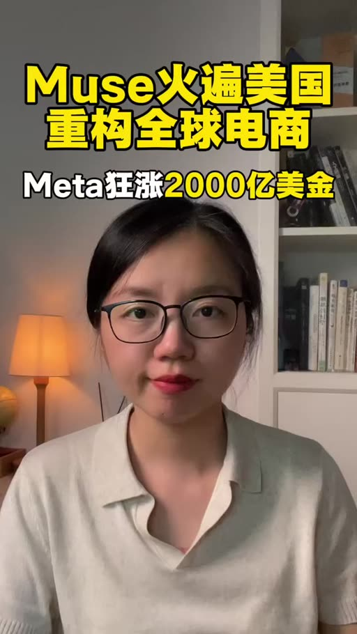
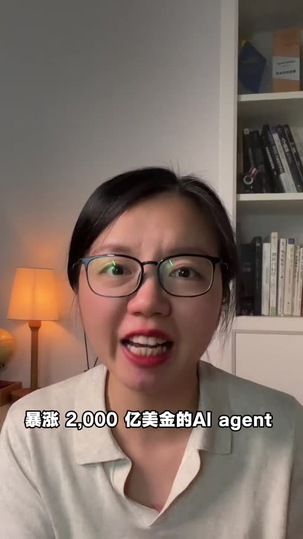
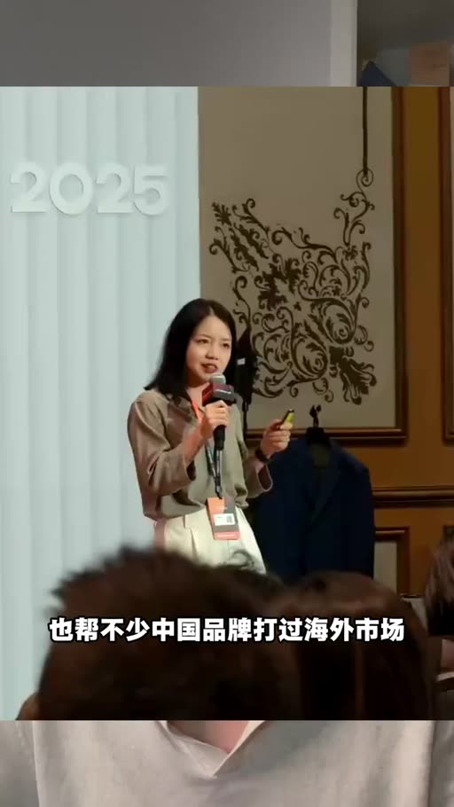
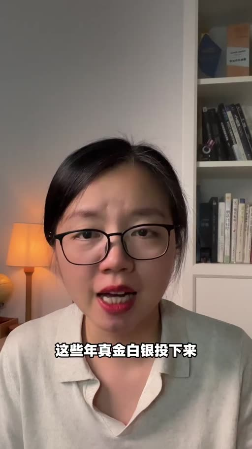

# Muse爆火！傳統電商、短影片電商徹底坐不住了

- 來源：https://www.xiaohongshu.com/discovery/item/6aba671a000000001a029fd4?app_platform=android&ignoreEngage=true&app_version=9.48.1&share_from_user_hidden=true&xsec_source=app_share&type=video&xsec_token=CBKmcgdvZ7q2qqZm5oTh81hJgAS0RVz8JBeiSnqbnGkT0%3D&author_share=1&xhsshare=&shareRedId=ODY2Rjo8PEs2NzUyOTgwNjY0OThIOkhC&apptime=1791724640&share_id=7c0d1fe1211e46aab9c6b49a0d355f81&share_channel=copy_link
- 平台 / 上傳者：Xiaohongshu / 
- 長度：01:45 (105.2s)
- 逐字稿來源：whisper (groq)
- 更新日期：2026-10-11
- **關鍵字：** #Meta #Muse #AI Agent #電商 #出海 #代理購物 #社交網路 #Agent 選擇權 #SEO

## 摘要與名詞說明

**一句話重點**：講者主張 Meta 的 AI Agent「Muse」將從「給建議」進化為「直接代購下單」，出海商家的競爭焦點將從搶消費者注意力轉為爭奪 AI Agent 的選擇權。

| 時間 | 重點 |
|---|---|
| 00:00 | Muse 讓 Meta 市值暴漲約 2000 億美金；不是 Meta 版 ChatGPT，而是直接替你做 |
| 00:16 | 對比：ChatGPT 給方案，Muse 直接下單；已有美國消費者省下上千美元 |
| 00:30 | 講者為出海從業者，認為 Meta 真正優勢是 Instagram、Facebook、WhatsApp 社交網路 |
| 00:48 | 從「知道你喜歡什麼→推廣告」到「知道你要買什麼→AI 比較並成交」 |
| 01:10 | 對出海商家：問題不再是怎麼用 Muse，而是怎麼讓產品被 AI 選中 |
| 01:24 | SEO、廣告、社媒＝搶注意力；Agent 時代＝爭奪 Agent 選擇權 |

## 名詞說明
- **Muse**：影片所稱 Meta 的 AI Agent。
- **Agent**：可自主執行任務（如比價、下單）的 AI。
- **出海**：中國商家拓展海外市場。

## 備註
數字（市值 2000 億、省 1156 美元）為講者／畫面所述，未經查證。轉錄校正見 meta.json `known_asr_errors`。

## 圖文對照（畫面 + 逐字稿）

### 投影片 1：開場：Muse 讓 Meta 市值暴漲（00:00–00:04）

**重點：** 標題卡「Muse火遍美國 重構全球電商」；Muse 是 Meta 的 AI Agent，不只回答，而是直接替用戶下單。

**標籤：** #Muse #Meta #Agent

一夜之間讓Meta市值暴漲2000億美金的AI Agent Muse有多牛。

### 投影片 2：Agent 直接替你做：車險案例（00:04–00:30）

**重點：** 畫面為量子位報導：用戶把車險帳單丟給 Muse，15 分鐘後保費省下 1156 美元（講者轉述，未經查證）。

**標籤：** #代理購物 #省錢

很多人以為Muse不就是Meta版的ChatGPT嗎，還真不是，ChatGPT呢更多的時候是告訴你怎麼做，而Muse這類的Agent真正想幹的是直接替你做，比如你想買個東西，ChatGPT只會給你一堆方案，還得你自己比較選擇，但是Muse是直接幫你下單，已經有不少老美消費者用Muse省了上千美刀，但這還不是Meta最可怕的地方。

### 投影片 3：講者背景與對 Meta 的觀察（00:30–00:48）

**重點：** 講者從事出海多年、協助中國品牌打海外市場；Meta 的真正優勢是 Instagram、Facebook、WhatsApp 等社交網路。

**標籤：** #出海 #社交網路

我是做了十多年會計，也幫不少中國品牌，來過海外市場，這些年真金白銀投下來，我對Meta最大的感受是，它從來不只是一個投廣告的平臺，它真正厲害的是，手裡握著像Instagram，Facebook，WhatsApp，這些全球超級社交網路。

### 投影片 4：從推廣告到完成交易（00:48–01:10）

**重點：** 過去靠按讚、瀏覽推廣告；未來可能知道你要買什麼、由 AI 比較並完成交易。

**標籤：** #廣告 #交易

過去Meta透過你的點贊，關注，瀏覽，知道你喜歡什麼，然後再給你推廣告，那未來呢，他可能不僅是知道你喜歡什麼，還知道你準備買什麼，然後AI直接幫你篩選比較，甚至是完成交易，如果這件事真的跑通，對於我們做出海的商家來說，影響就非常大了。

### 投影片 5：對出海商家的影響：爭奪 Agent 選擇權（01:10–01:45）

**重點：** 講者主張：過去做 SEO、投廣告、社媒是搶注意力；Agent 時代要爭取被 AI 選中。

**標籤：** #SEO #Agent 選擇權

因為接下來，真正值得研究的問題，可能已經不是，我們怎麼用上MUSE，而是當越來越多的海外消費者，開始讓MUSE這樣子的AI agent，替自己做購物購物，我們怎麼才能讓自己的產品，被AI選中，過去做出海，我們研究SEO，投廣告，做社交媒體營銷，本質上都是在搶消費者的注意力，但是agent時代，遊戲規則可能會變，接下來我們很可能還要爭奪，Muse這樣子的AI agent的選擇權，這個變化，我覺得所有做出海的人，都值得提前關注。

## 已知轉錄錯誤

| 時間 | 聽成 | 應為 |
|---|---|---|
| 00:04 | XGPT | ChatGPT |
| 00:24 | 美當 | 美刀（畫面字幕） |
| 00:30 | 做了十多年會計 | 做了十多年（出海／跨境）業務（推測，畫面字幕為「幫不少中國品牌打過海外市場」） |
| 01:20 | 購物學測試 | 購物（推測，語意不清） |
| 01:41 | 所有做出來的人 | 所有做出海的人 |
