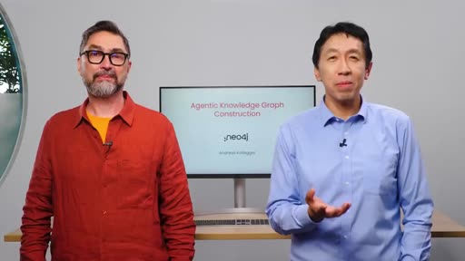
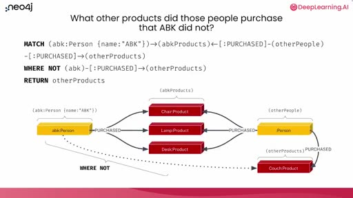
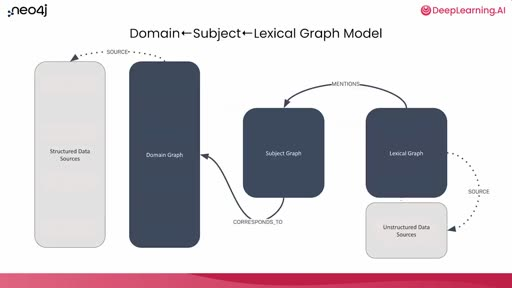
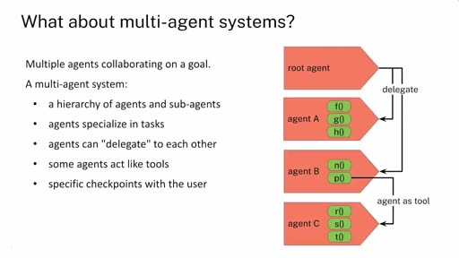
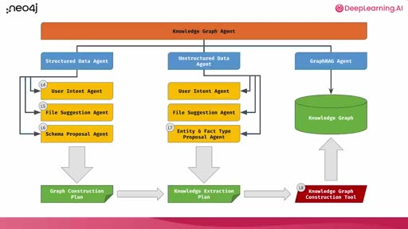
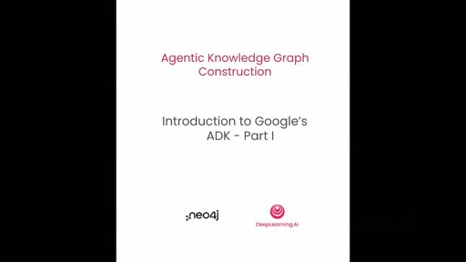
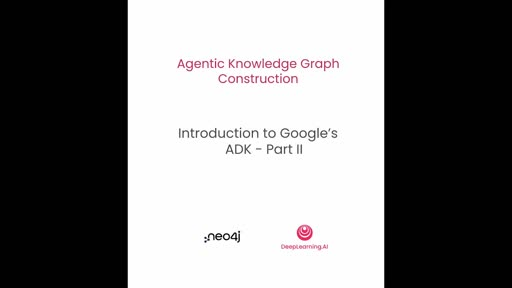
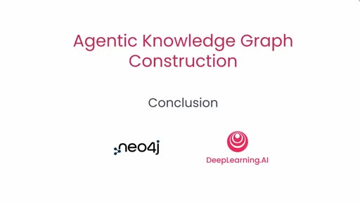

# Ryan Carter - Andrew Ng just released a 1-hour course on building Agentic Knowledge...

- 來源：https://x.com/Grow_withAI/status/2108904705854411211
- 平台 / 上傳者：X / Ryan Carter
- 長度：1:04:46 (3885.8s)
- 逐字稿來源：captions (en, manual, unknown)
- 更新日期：2026-10-12
- **關鍵字：** #知識圖譜 #Neo4j #Cypher #多代理系統 #Google ADK #GraphRAG #領域圖／詞彙圖／主題圖 #LiteLLM #tool context #session state

## 摘要與名詞說明

**一句話重點：** 約 65 分鐘的課程影片，介紹如何用 Google ADK 設計多代理系統，把結構化資料（CSV）與非結構化資料（Markdown）轉成知識圖譜；內容從知識圖譜概念與 Cypher，到多代理架構，再到用 ADK 建單一代理與多代理團隊的實作示範。

| 時間 | 重點 |
|---|---|
| 00:00 | 課程簡介：Neo4j 合作；ADK 多代理系統；講師為 Neo4j 的 Andreas Kollegger |
| 03:13 | 知識圖譜概念：從關聯式 join 對比圖；Cypher 樣式比對與「推薦沒買過的商品」範例；節點／關係／屬性 |
| 09:37 | 根因分析情境（家具製造商客訴）；目標資料模型：領域圖＋詞彙圖＋主題圖 |
| 13:41 | 代理與多代理系統：迴圈＋LLM＋工具；委派與「代理當工具」 |
| 16:31 | 要建的架構：結構化／非結構化／GraphRAG 三條流程；圖建構計畫與知識抽取計畫 |
| 23:17 | Lesson 3 Part I：用 ADK 建代理、定義工具、Runner 與事件迴圈、agent caller |
| 44:47 | Lesson 3 Part II：根代理＋子代理、委派、session state 與 tool context |
| 63:58 | 結語 |

## 名詞與縮寫
- **知識圖譜（knowledge graph）**：以節點與一等公民的關係表示資訊的資料庫，可同時結合圖樣式比對與向量相似度搜尋。
- **Cypher**：Neo4j 的圖查詢語言；`$` 開頭是查詢參數。
- **領域圖／詞彙圖／主題圖**：結構化資料建成的圖／文字塊及其結構／從文字抽出的實體與事實，並連回領域圖。
- **Google ADK（Agent Development Kit）**：建構代理的框架；**LiteLLM** 是讓 ADK 呼叫 OpenAI 的封裝。
- **root agent／sub-agent／delegate**：根代理、子代理、委派（對話控制權交給子代理）。
- **tool context／session state／output key**：工具取得與更新共享狀態的方式／跨代理共享的狀態字典／把代理最終回應存進狀態。
- **ABK**：講師名字縮寫（Andreas B. Kollegger），範例中的使用者名稱。

## 轉錄校正備註
- 語言為英文（`detected_language: en`，來源是 X 平台人工字幕、非 Whisper）；已附**重點式**中譯 `transcript.zh.md`：因課程影片很長，中譯是各段重點的摘譯，不是逐句翻譯；要查原話請看英文逐字稿。
- 字幕把 Neo4j 寫成 "new for j"、Cypher 寫成 "cipher"、LiteLLM 寫成 "light LLM"，講師姓氏拼成 "Colliger"（畫面為 Kollegger），已由 `glossary/domains/neo4j.json` 修正；其餘不確定處記在 `known_asr_errors`。
- **身分與出處**：X 貼文標題為「Ryan Carter - Andrew Ng just released a 1-hour course…」，上傳者顯示 Ryan Carter；影片本身有 DeepLearning.AI 與 Neo4j 標誌，字幕出現 Andrew 與 Andreas 的名字。「這是 Andrew Ng 的新課程」是貼文的說法，我沒有獨立查證，也沒有用外貌辨識人物。
- 影片中關於代理的優缺點（慢、貴、token 成本快速累積）與 GPT-4o 的使用皆為講者說法，**未經查證**。
- 後半段（Lesson 3）多為 Jupyter notebook 的程式碼示範，畫面截圖大多是標題卡或空白的 notebook；程式碼細節以逐字稿為準，此報告未擷取到可讀的程式碼畫面。

## 圖文對照（畫面 + 逐字稿＋中譯）

### 投影片 1：課程簡介（00:00–03:13）

**重點：** Neo4j 合作；用 Google ADK 設計多代理系統，把結構化與非結構化資料轉成知識圖譜；講師為 Neo4j 的 Andreas Kollegger。

**標籤：** #Neo4j #多代理 #知識圖譜

As a partnership with Neo4j In this course you design a multi-agent system that transforms your structured and unstructured data into a knowledge graph I found knowledge graphs really useful for high-stakes applications where accuracy of the information we store and retrieve is important This course will teach you why and also give you a great set of tools for building these knowledge graphs I'm delighted the instructor for this course is Andreas Kollegger who is a developer evangelist for generative AI at Neo4j Thanks, Andrew I'm excited to be back here to work with you on this course Similar to RAG a knowledge graph system splits your text documents into chunks and stores them in a vector database But in addition to that it places the chunks into a graph structure which is chunk is linked to entities extracted from the chunks For example a text chunk from a product review can contain entities such as product orders or delivery issues or product defects To build a knowledge graph you extract the relevant entities from the chunks then connect the chunks and the entities in the graph through edges Here, each edge represents a relationship For example maybe it represents that this chunk mentioned a certain product or that that product has an issue The entities are retrieved alongside the relevant chunks to provide more relevant context to the LLM to generate more precise and accurate answers You can also connect this type of graph to another graph containing additional information extracted from structured data such as CSV files In this course engineers will walk you through how to build a multi-agent system that helps you do all this work of constructing this type of knowledge graph To transform your structured and unstructured data into a knowledge graph you first need to decide on the graph schema meaning what types of entities or nodes you can extract from the data and what relationships exist between them Once you have the schema defined you can construct the actual graph and store it in a graph database Instead of mainly looking at your data to find the graph schema you'll design a multi-agent system for doing that using Google's ADK or Agent Development Kit After you learn the basic syntax with ADK you'll design your system one agent at a time The first agent will converse with you to extract the goal and type of graph you want to build Then given that goal a group of agents will specialize in extracting the entities and relationships from your structured data and another group of agents will handle your unstructured data Finally a final set of agents will connect the two models and construct the graph accordingly Many people have worked to create this course I'd like to thank from Neo4j Martin O'Hanlon, and Adam Cowley From deeplearning.ai Christopher Polycastro and Hara Salami also contributed to this course. In the first lesson you'll learn more about the underlying structure of knowledge graphs and how you can build one and use it to identify root causes of product issues Sounds great Let's get started Go through what a knowledge graph means and how they help represent and retrieve relationships from your data You'll then explore the data set you'll work on to build a knowledge graph Let's dive in.

**中譯：** 這門課與 Neo4j 合作：你會設計一個多代理（multi-agent）系統，把結構化與非結構化資料轉成知識圖譜。主持人認為知識圖譜特別適合重視資訊準確度的高風險應用，課程會說明原因，也提供建置工具。講師是 Neo4j 的生成式 AI 開發者布道師 Andreas Kollegger。知識圖譜和 RAG 類似：先把文件切成片段、存進向量資料庫；不同的是，它還把片段放進圖形結構，並連結到從片段中抽出的實體（例如商品評論片段裡的商品、訂單、配送問題、瑕疵），實體與片段之間以「邊」表示關係。檢索時，實體會連同相關片段一起取回，讓 LLM 得到更精準的上下文；圖也能再連接從 CSV 等結構化資料建立的另一張圖。要把兩類資料轉成知識圖譜，必須先決定圖的結構（schema）：有哪些類型的實體／節點、彼此有什麼關係。本課程不是靠人看資料決定，而是用 Google 的 ADK（Agent Development Kit）設計多代理系統，一次建一個代理：先與使用者對話釐清目標與圖的類型，再由一組代理處理結構化資料、另一組處理非結構化資料，最後由一組代理把兩邊的模型接起來並建圖。感謝 Neo4j 與 deeplearning.ai 參與製作的人員。第一堂課會介紹知識圖譜的底層結構，以及如何用它找出產品問題的根本原因。

### 投影片 2：什麼是知識圖譜：從 join 到圖與 Cypher（03:13–09:37）

**重點：** 以「推薦某人沒買過的商品」對比關聯式 join 與圖樣式比對；畫面為 Cypher 查詢（含 WHERE NOT 否定樣式）。節點、關係（一等公民）、鍵值屬性、標籤。

**標籤：** #Cypher #圖樣式比對 #推薦查詢

So, what is a knowledge graph? We're going to take a step back for a moment And reflect on relational databases and what a relational schema looks like We all probably are familiar with some scenario like this where there'll be some table on the left and some table on the right and this table in the middle that is the join table that allows for multiple connections between the persons and the products in this particular example So let's think about these two tables with the join table If you ask a question like what products has this person purchased? You'd first start with the person table and select this person here it's identified by ABK And of course you do a join over to the person product table and you'd see that the person product table has a join between the ABK and some chair ABK and a lamp ABK and a desk Fantastic One more join across from the person to the person product to the product table Now you've got a complete answer where from ABK you can see that here's the products that ABK has purchased this chair, lamp, and a desk and you can get the details about those purchases What if you extended that question and you asked, who else bought products that ABK bought? Well, you start with the same joins going from ABK to the products and then you would join back to the person product table and from there, back to the person table and now you would get this person EE who has bought some products that ABK also bought But notice that EE has also bought one extra product that's interesting So we could probably extend this one more step and ask well, what product should we recommend that ABK buy next? Now this is kind of the basics of doing a recommendation query If you've got some purchase pattern from ABK that matches a purchase pattern from some other person or other group of people the thing you want to recommend to ABK is what that other group of people bought that ABK has not So the same joins apply from ABK through to the products back to the other people that have bought those products There's too many joins. It's getting a little confusing There's actually a nicer way to actually think about this and to query this Let's turn this into a graph The first step is to just drop all the records that don't matter all those gray records that weren't part of the original query Let's put those aside for the moment and focus on the records that we know about that are part of the data set so far that matters for this query about recommending something to ABK Get rid of all the join table records in the middle turn those into arrows connecting ABK directly over to the products that he's purchased and the same thing for EE over to the products that they have purchased And now just rearrange the records a little bit. So you've got ABK on one side EE on the other side and now it looks much nicer It's much easier to understand what's going on Both ABK and EE are connected to these products in the middle but then also this person EE is connected to another product that has no connection to ABK You can start to turn this into a query by rephrasing it as a pattern match Starting with A B K on the left side you can describe a query in a query language called Cypher where it looks a little bit like SQL if SQL had pattern matching abilities So here we're going to describe a pattern that describes the data records that you want to find We're going to match from the data record that we're going to call A B K that has a label of person and that has a property with the name key where the value of it is A B K So that's in round parentheses we know that that's a node in graph terms And then we kind of have this right facing arrow with colon purchased in there That's a relationship type that is the purchased So match a pattern where A B K purchased over to some other parentheses that we're going to call A B K products That's going to be a pattern match from A B K to the products that A B K matched We can return those directly and that's going to be the products in the middle there We can extend that pattern to include the other people who bought those products Since we went from ABK to the products that ABK purchased we can also have relationships going in to those products and say okay there's some other people who bought those products This pattern will find all of the products that people have in common with ABK We can extend it a little bit more to ask that recommendation question problem where instead of saying that we just want to find these other products The other products have a unique property where they're actually something that ABK does not have So we have the same pattern match from ABK to some products to some other people and then extend that to other products and now we include a predicate saying we actually want a negative pattern to be true that ABK has not purchased those other products So we're not ABK purchased those other products So down there on the bottom that dotted line from ABK to the couch we want that to not exist Now we're describing a pattern that both has records that should exist something that should not exist The other products now will be reduced to only products that ABK has not purchased That's what we're going to use as a recommendation that he buy So what really is a knowledge graph? It's a kind of database that represents information as nodes representing things like people products, blogs whatever you might want to have as records in a database But then also relationships that aren't simply a convention of using a join table but that are first-class citizen They're actually data records inside of the database that have a semantic meaning They actually represent how two nodes are connected and they add information about those two nodes So both the nodes and relationships have key value properties they have multiple labels on nodes relationships always have a direction and they have a single type And the query language that you use for doing pattern matching is called Cypher And it turns out that this is super nice for mapping to natural language and really convenient for working with Gen AI and LLMs because LLMs are really good at natural language If we go back for a moment here And just look at that query at the top You can read that out loud and make sense of it Match ABK who's a person whose name is ABK that bought some products that some other people have bought They bought some other products where ABK has not purchased those other products The other thing that's interesting about knowledge graphs is that they're really convenient for combining unstructured data along with that structured data whether that was some products that we have or people whatever it might be in structured data you can then add any kind of chunked text do a vector representation of that store that in the database as well and combine both vector similarity search and pattern matching together for all kinds of powerful access patterns.

**中譯：** 知識圖譜是什麼？先回頭看關聯式資料庫：人表、商品表，中間用「關聯表」連接。問「某人買過哪些商品」要做兩次 join；問「誰也買過同樣的商品」要再 join 回來；若要「推薦他下一個該買什麼」（找買過類似商品的人，再找出他們買過而此人沒買過的商品），join 愈來愈多、愈難讀。改成圖：丟掉無關的紀錄，把關聯表的列變成直接連接人與商品的箭頭，重新排列後就一目了然。這可以改寫成圖形樣式比對，用查詢語言 Cypher 描述（有點像具備樣式比對能力的 SQL）：圓括號是節點，帶冒號的箭頭是關係類型；先比對某人買過的商品，再延伸到也買過這些商品的其他人，再延伸到他們買的其他商品，並加上「否定樣式」，只留下此人沒買過的商品，作為推薦。所以知識圖譜是把資訊表示成節點（人、商品、部落格…）與關係的資料庫；關係不是 join 表的慣例，而是資料庫中的一等公民，有語意、有方向、只有單一類型，節點與關係都能有鍵值屬性，節點可有多個標籤。Cypher 的寫法貼近自然語言，適合與生成式 AI 搭配，因為 LLM 擅長自然語言。知識圖譜也方便把非結構化資料與結構化資料結合：文字切塊、做向量表示後同樣存進資料庫，就能同時使用向量相似度搜尋與樣式比對。

### 投影片 3：根因分析情境與三個子圖（09:37–13:41）

**重點：** 家具製造商的客訴根因分析；CSV 物料清單成為領域圖、Markdown 評論成為詞彙圖，中間以主題圖連接（畫面：Domain←Subject←Lexical 模型）。

**標籤：** #領域圖 #詞彙圖 #主題圖

So for example, if you want to do root cause analysis and you imagine that you're a furniture manufacturer looking to understand customer complaints about your products so you turn to your team of experts you know, data engineering, data analysis team, and say, hey could you do some root cause analysis? I've heard a lot of complaints out on the internet about our products Let's try to figure out what's going on So the root cause analysis would include questions like which products have the most issues? And then based on those products well what part of the product is the actual problem? And then you might want to ask a question like is there a problem with the part itself? Perhaps there are other things that are going on people just don't like the product But if you can take corrective measures it would be because there's something either in the manufacturing process What you're looking for here is for corrective measures that you can take Do root cause analysis for something you can improve So if it's a design problem you could turn that over to the design team They could take a look at what people's complaints are about But if it's a manufacturing problem or a problem with a part somewhere you can do some analysis on that find the part problem and either swap out the part for a new one or figure out how to improve the process itself So as a data engineer if you were handed this task you would start with the usual thing ask some clarifying questions Why are we really doing this? You want to be able to understand that there's possible manufacturing problems in the supply chain Cool. Okay Second question is or if that's what we want to find out what data is available that we can do this analysis with? So it turns out in this scenario we've got a bill of materials some CSV files that connect the product all the way to the suppliers from those products Maybe it came from some spreadsheets maybe it came from some relational database that isn't really suited for doing analysis That's okay too And you also have some data from user reviews that you script from some websites on the internet You want to be able to combine those into one data set that you can then do some analysis on So to do that analysis you're going to build a knowledge graph that connects all the data So here's what the target data model is going to look like On the left, in the sort of beige boxes over there you see the CSV files that are available Each one of those is going to turn into nodes in the graph or relationships in the graph That's going to be the kind of what we're going to call the domain graph On the right-hand side on the bottom there you'll also see some beige boxes that represent Markdown files Those Markdown files are going to be chunked up they're going to create some documents inside of the graph as well and then all of this is going to get connected We'll look at some of the details as we actually go through doing the agent descriptions themselves But what I want to call out here for you right now is that these are really very connected but also very distinct parts of the graph We've got the data sources the structured data on the one side there that's going to turn into what we call the domain graph So that's the structured data that we know that we can query with pattern matching On the other side the unstructured data sources are not going to be queried in the same way and they're not going to be imported in the same way either So they're going to turn into what we call the lexical graph which represents the original textual data plus also the structure around that textual data To connect those two pieces the unstructured data and the structured data we've got this part in the middle that we're going to call the subject graph The subject graph is going to be subjects or entities that we pull out of the chunks so the chunks will have some text they'll be talking about products maybe they'll be usernames and things all of those things might be entities We're going to find those call those things subjects and those subjects are going to be connected to objects so the subjects talk about something So some user, let's say that it's me user ABK, loves this table And so there'll be a subject predicate object in the subject graph that talks about ABK loving some table That also, because ABK loves a table the table can correspond with the product that we have in the structured data If ABK mentions a table and the table is a product that exists in the structured data we can then connect the entities that we've extracted from the text all the way over to the structured data that we've got in from the CSV files Don't worry we're going to do this step by step On a high level this is what you're going to end up with a graph with subgraphs within it a domain graph, a subject graph and a lexical graph. All of the knowledge graph you'll build.

**中譯：** 範例情境是根因分析：你是家具製造商，想了解客戶對產品的抱怨。要回答的問題包括：哪些產品問題最多？問題出在零件本身還是別處？若是設計問題交給設計團隊；若是製造或零件問題，則換零件或改善流程。做法是先問清楚目的（可能是供應鏈製造問題），再盤點可用資料：把產品連到供應商的物料清單（CSV）、以及從網路抓取的使用者評論。目標資料模型：每個 CSV 變成圖中的節點或關係，構成「領域圖（domain graph）」；Markdown 檔切塊後成為「詞彙圖（lexical graph）」，代表原始文字及其結構；兩者之間以「主題圖（subject graph）」連接——從文字塊抽出的主題／實體（例如某使用者喜歡某張桌子，形成「主詞—謂詞—受詞」），若該桌子對應結構化資料中的產品，就能連到領域圖。最後得到由三個子圖組成的知識圖譜。

### 投影片 4：什麼是代理與多代理系統（13:41–16:31）

**重點：** 代理＝迴圈＋LLM 呼叫＋工具；優缺點（慢、貴、非確定性為講者主張）；多代理：階層、專精、委派、代理當工具、與使用者的檢查點。

**標籤：** #agent #委派 #子代理

let's go through the details of the multi-agent system you'll design to first find the graph model and then construct the graph. There are lots of definitions for an agent Here's my definition I like to think about agents from an engineering perspective and for me it's a fancy new kind of control flow operator Basically, you have a loop and inside of the loop there's a call to an LLM that then figures out what it wants to do and then based on what it wants to do passes that back over to the computer side to the client side and really runs into a switch statement that performs potential actions So in this loop this is really just intelligent behavior that's happening because of the LLM call but the execution of that intelligent behavior is still happening through code What's great about this architecture of course is that agents are really powerful because you've got an LLM there to do some reasoning and call out to tools that can do anything you can do with code And it's adaptive because the LLM is given memory so it can learn what's happened either through the conversation or through things that you've saved into memory that are important for it to decide future outcomes And it's pretty easy to get started because you're really just doing natural language descriptions through the prompts about what the agent should do But all this power and ease comes with some downsides It can be slow working with an agent because the calls out to a remote LLM is a bit expensive and slow It's also non-deterministic, well, because LLMs are non-deterministic And, you know token cost over time can really add up quite a lot So if you're running an agent over time in production for thousands and thousands of calls the token cost gets really expensive really quickly That's one of the advantages of moving to a multi-agent system is that you can actually improve some of the downsides here So what is exactly a multi-agent system? It is, of course just a system where you have multiple agents working collaboratively on a single goal The agents interact in a couple different ways There's a main conversational thread that's basically happening with the user where the user might have some message that they kick off to work with and then each of the agents can decide is this work that I can do or something that somebody else should do? So can I delegate this to a different agent? So you can see in this illustration here that the root agent is able to delegate to either agent A or agent B Internally agent A and agent B can do some work using the tools that they've been given One of the tools in Agent B is unique This P agent here this P function, is actually going to be an agent itself but being called as if it were a tool So there's two ways for tools to interact either agents delegating to each other or an agent that's behaving as a tool being called by another agent And along the way you've got specific checkpoints with the user that are possible whenever you have any of these transitions.

**中譯：** 接著說明要設計的多代理系統。講師從工程角度把「代理（agent）」看成一種新的控制流程運算子：一個迴圈，裡面呼叫 LLM 決定要做什麼，再交給用戶端像 switch 那樣執行動作；智慧行為來自 LLM，執行仍透過程式碼。優點是有推理能力、可呼叫任何程式能做的工具、有記憶而能調適、只用自然語言提示就能上手；缺點是慢且貴（遠端 LLM 呼叫）、非確定性、正式環境中 token 成本會快速累積（講者主張）。多代理系統能改善其中一些缺點。多代理系統是多個代理協作完成同一目標：有代理與子代理的階層、各自專精任務、可互相「委派」，有些代理被當成工具使用，且在轉換處可設與使用者互動的檢查點。圖中根代理可委派給代理 A 或 B，B 的某個工具其實是另一個代理。

### 投影片 5：要建的知識圖譜代理架構（16:31–23:17）

**重點：** 三個工作流程代理（結構化、非結構化、GraphRAG）；使用者意圖→檔案建議→結構提案（提案者＋批評者）→圖建構計畫；實體與事實類型提案→知識抽取計畫；建圖工具。

**標籤：** #圖建構計畫 #知識抽取計畫 #GraphRAG

So what is the multi-agent system that you'll build? You'll build parts of a knowledge graph agent focusing on the sub-agents that perform knowledge graph construction You'll learn the basics of building an agent using Google's ADK You'll learn what memory is and how to use it for recording critical information You'll define some tools. And of course all of this will converge from open-ended conversation to executable code This beautiful diagram are all the agents and the flow of agents and their interactions Let's walk through this a little bit at a time At the top level this is the agent that manages the overall introduction of the user to what's possible what the agent's responsibility is and helping the user understand what's the workflow that's possible here from knowledge graph construction all the way to doing graph retrieval So this is really a conversational agent that itself is not going to do any work but it's going to guide the user through the different phases of work that are going to occur It's this next level of agents down that are really going to manage the individual workflows And there are three major workflows If really on the left we've got two workflows the structured data agent and the unstructured data agent These are responsible for taking the user through the idea of like what they might want to do all the way to constructing a graph And then if those have done their job this third agent, the graph rag agent on the right side is responsible for helping the user actually answer questions using that graph Both the structured data agent and the unstructured data agent are workflow agents They perform their work by interacting with the user and helping them go through the steps of what needs to happen from the idea of what they want to do all the way to describing the graph And they do that by delegating to sub-agents that specialize in each phase of the workflow You'll see some replication here that both the structured and unstructured data have some agents that are in common and I'll touch on those as we get into the one level down Okay so here's the sub-agents that are actually doing the workflow for structured data Let's walk through these one at a time and also what's important to note here is the output of actually these agents doing their work If you think about yourself as being a data engineer that's been given the task of actually performing this work each of these agents are kind of what you would do yourself you're engaging in the work This first one, the user intent agent is what you would do when you've been asked to do some task for data analysis and whoever asked that you respond to with some questions Hey could you clarify what you want me to do? Give me, you know what are the goals you're after? What kind of analysis do you want me to perform? And it's really important to nail that down up front. This is the kind of the requirements or the direction overall of what the job is So this user intent agent even though it's collaborative and kind of conversational the output of this is really important We're capturing what is the user goal and what are they trying to get out of this work Based on that user goal then this next agent down the file suggestion agent is going to take into account what has been established through the user intent agent as the direction and the goal of what the work is and then it's going to look at the data files that are available and try to find from those data files which ones are useful for actually achieving that goal There might be more files that are available there might be even multiple data sources that are available Here we're simplifying it down to just making suggestions for files that are available on disk The output of that ends up being a list of suggested files that have been approved by the user and then that gets input into the next agent which is the schema proposal agent The schema proposal agent is actually a pair of agents formed in a critic pattern where one of the agents is responsible for making a proposal about what the schema could look like and the next one is going to be a critic saying well, maybe that's not quite so right Think about changing it in this way or that way We'll look at the details in a later lesson But the idea here is that this pairing of agents internally will loop through what's possible self-criticize itself and the outcome of that should be a good graph schema that uses the files that were approved from the previous agent and also in compliance with user goals that were set by the first agent producing a graph schema that can answer questions that are useful for the user So the output of all of that we're calling a graph construction plan It's not a graph itself but it's a description about how to construct that graph The second workflow in the middle the first two parts of that workflow are the exact same as the structured data workflow Here in the middle we're dealing with unstructured data but it still begins with understanding what is the user intent for bringing in the unstructured data and here that's Markdown files And then, okay if you understand why the user wants to bring in some Markdown files you can identify which files are relevant Again, a file suggestion agent would do that Similar behavior to the structured data but this third step is different In the third step rather than designing a schema based on some CSV files all you have is text And from that text how do you create a graph? Well the approach here is that we're going to have two specialized agents that look through the text and identify what are called entities so people, places, and things that occur within the text and also for those entities that identifies what facts are describing those entities within the text So let's say that it was you know I was in the text and I had some reviews of local coffee shops it might reveal that you know, ABK really loves to store coffee from Phil's because who doesn't? So those are facts that could be extracted from the text The goal of this agent is actually to find out what kinds of facts can be extracted and not do the extraction but simply describe what's possible And so that we're going to be calling a knowledge extraction plan The knowledge extraction plan paired with the graph construction plan from the structured data together give all the rules that we need using the graph construction plan and the graph extraction plan This red box down in the corner then is just a single tool that has multiple tools internally that actually can take those plans and do the extraction itself and do the construction itself It'll loop over all the construction rules to create a domain graph loop over all the markdown files chunk them up, do the vector embedding of those and then also extract entities and the facts and then connect those to the structured data In lessons four through eight you'll go through the entire workflow for structured data from user intent, file suggestions to the schema proposal Then we'll skip over to the unstructured data just the entity and fact type proposal and then finally we'll look at the particular tool in lesson eight that does the graph construction itself It does all the hard work that the previous agents really did the reasoning about what the work should be In the next lesson we'll actually get into doing some coding building your first agent. We're going to be using Google's ADK If you're already familiar with Google ADK you could skip over that lesson and move on to actually building the multi-agent system but I think it's a really good overview and also it helps you understand how I think about it and how I've implemented it in this particular multi-agent system so it's nice to walk through I'll see you there.

**中譯：** 本課程建構的是知識圖譜代理的一部分，聚焦在負責建圖的子代理：會學用 Google ADK 建代理、什麼是記憶與如何記錄關鍵資訊、如何定義工具，並把開放式對話收斂成可執行的程式碼。架構由上而下：最上層是對話式代理，引導使用者了解流程但自己不做事；下一層有三個工作流程代理——結構化資料代理、非結構化資料代理，以及負責用建好的圖回答問題的 GraphRAG 代理。前兩者各自委派給負責各階段的子代理。結構化資料流程：使用者意圖代理（釐清目標與要做的分析）→ 檔案建議代理（依目標從可用檔案挑出有用的，經使用者核可）→ 結構提案代理（由「提案者」與「批評者」兩個代理組成，反覆自我批評，產出符合使用者目標的圖結構），最終輸出稱為「圖建構計畫」，它不是圖本身，而是如何建圖的描述。非結構化資料流程的前兩步相同（針對 Markdown 檔）；第三步不是依 CSV 設計結構，而是由兩個專門代理從文字中找出實體（人、地、事物）以及描述它們的事實，只描述「可以抽取什麼」而不做抽取，輸出稱為「知識抽取計畫」。兩份計畫合在一起就是建圖規則；一個內含多個工具的單一工具會依規則迴圈建立領域圖、把 Markdown 切塊並做向量嵌入、抽取實體與事實，並連回結構化資料。第四到第八課會走完結構化流程、非結構化的實體與事實類型提案，以及第八課的建圖工具。下一課開始寫程式：用 Google ADK 建第一個代理；已熟悉 ADK 的人可以跳過，但講師建議看一遍，了解他的實作想法。

### 投影片 6：Lesson 3 Part I：用 Google ADK 建第一個代理（23:17–44:47）

**重點：** LiteLLM＋OpenAI（GPT-4o）；Neo4j for ADK 輔助庫；工具＝函式＋docstring；Cypher 查詢參數避免注入；Agent 五要素；Runner、session、事件迴圈；agent caller 工廠函式。畫面為標題卡。

**標籤：** #Google ADK #tool #Runner

To build the multi-agent system you'll use Google's ADK or Agent Development Kit which is a framework for developing agents In this lesson you'll learn how to create and run one agent as well as a team of agents All right, let's go In this lesson, you'll familiarize yourself with Google's Agent Development Kit and you'll use that for building agents throughout this multi-agent system In this lesson you'll learn how to create and run an agent using ADK and the imports that we're doing here of course, the standard OS and then a bunch of stuff from Google ADK itself We're going to import this agent which is going to be the key thing for actually describing what an agent is For interacting with an LLM we're going to be using the LiteLLM library so we're going to import that here and this is a little wrapper for letting Google ADK talk to OpenAI And then we're also going to need some memory for the agent For the memory, we're going to use the memory session service and then finally, the agent also needs a way to run so we're going to import a runner We also have some typing stuff here that's not really so important for how all this works Let's go ahead and make sure that all that imports Great, all the libraries are imported So the next part then let's just start defining the models that we're going to use We're going to be using OpenAI for this course so let's go ahead and import we'll define what the model is going to be itself is OpenAI's GPT-4o. Again we're going to be using LiteLLM for actually reaching out to the OpenAI API and we're just going to go ahead and try a sample execution of completing a chat with that So if you look at the chat here you'll notice that we're just setting up a message that we're going to send to OpenAI and we're going to ask it the question are you ready? So if that all works successfully we'll get a good message from OpenAI letting us know that this works Looking at the model of response there's a lot of information here but the key part is that the response includes a message from OpenAI saying yes, I'm ready how can I assist you today? OpenAI is all set to go We're also using Neo4j today so we're going to import a helper library that combines Neo4j with Google ADK in a nice way And that library is something we can take a look at to see the details of what's going on The import that we're going to use is just from Neo4j for ADK import the GraphDB library Let's take a look at those details Okay, now we're inside of Neo4j for ADK and you can see it starts off pretty simply. We import some stuff from the operating system We, of course, load up the environment And then from Neo4j the Python package, we load up the graph database and you also get a result class definition Now a bunch of these functions that are in here are just really nice for just wrapping up how you interact with Neo4j and presenting the results from Neo4j in a way that Google ADK likes to see things One of the key things is that results should come back either as a dictionary with a status that is a success or a status that is an error These two helper functions help do that You can call tool success or tool error along with some extra arguments and actually get a nicely formatted result from any kind of call To that we then go ahead and also integrate a helper library Results that are handled by Google ADK need to be easily persisted so this function call here to Python basically goes through all the different kinds of results you can get back from Neo4j and makes them easily serializable and a nice format for Google ADK. You can look The details if you want to see what's going on here The key part, of course, is this function It takes the Neo4j result your pass in it as just a result basically calls it to Python package packages all that up into a result that is easily used by Google ADK Each of those helper functions is then also used by this upper level class called Neo4j for ADK and this is really a wrapper that combines a Neo4j driver initializes the environment variables used there allows access to the driver and then has a special function here for sending queries and it'll send any kind of query you'd like to but then uses those helper functions for actually reformatting those results into a nice Google ADK result At the end then because we're just going to have one driver and one connection that we're using we're going to have a singleton of this class that we use This is the graph DB that we're going to actually expose as a variable and use that through all the notebooks Okay we took a look at Neo4j for ADK Let's continue with the notebook So now we've got everything set up and we can start to define an agent itself Okay, with our Neo4j wrapper ready let's go ahead and give it a try You can just send in kind of Neo4j query that you'd like to as long as it's valid Cypher Here the Cypher that we're sending is a very simple Cypher statement that doesn't do any work other than directly return a result Here, the result is a string Neo4j is ready passing that back aliased as a message variable So if we run this and then print the result you'll see that it's been packaged up into this nice little dictionary with a status success and then the query result containing an array of all the rows returned from the database Great, with OpenAI ready and Neo4j ready we can start to define our tools themselves and the agent eventually Tool definition is an important part in actually defining an agent Without tools, an agent can do a lot of thinking maybe have some chats but it can't really do any interactions with the environment or with the world around it So we're going to find a very simple tool just to kind of illustrate what kind of things an agent can do Hello World is the classic of course. So we're going to develop the Hello World version of for an agent's tool and we're going to call it SayHello So tools can be simply defined as functions Here the function is just say hello it takes a single argument person name as a string and it returns a dictionary Of course that dictionary is the Google ADK dictionary that it likes to see all results in And it also has a couple of important parts here There's a doc string that's here which is always nice when you're writing code It's also especially critical when you're developing tools for Google ADK This doc string is what lets Google ADK understand what actually this tool does This gets passed along to the LLM when the LLM is told here's all the tools that are available and also here's what those tools are described as doing So this is a couple of important parts that we should go through here You describe what the tool does Here it just formats a welcome message to a named person of course passed in as a person name You describe the arguments that are being passed in and also the result The result here is consistent through all of the tools because the result is a dictionary that Google ADK likes to see But you can add a little extra detail if you want to here For instance if you know the kinds of errors that might come back you could explain that here as well Inside, the function is incredibly simple All we're doing is using Neo4j again to actually do a hello world We're going to call out to Neo4j sending a query where we're still going to return a hello to you but then we're also going to concatenate that with this person name which is passed in as an argument to the function That's going to get passed in as a query parameter to this query Whenever you see that dollar sign in a Neo4j Cypher statement that means here's a query parameter So here in this array in this dictionary that's being passed in you'll see the person name is being passed in as person name That'll get substituted in as this variable here not as a template substitution but as the value gets passed in And then this whole query will get executed So let's define that function And of course, because this function is just a normal function we can try to run it So we can print saying hello to A B K and expect to see a very nice Google ADK formatted result that was successful where the query result that was sent off to Neo4j has the reply hello to you ABK during that concatenation Fantastic Now, just a side note here about query parameters part of why we're doing that this is good discipline for any kind of query language they're using Most query languages have the ability to have query parameters and one of the reasons you do that is to avoid injection attacks right? So that people can't pass in values that look like SQL statements or Cypher statements or any other query language statement as a value and have that concatenated into a string that can cause all kinds of mayhem So instead, you pass in a query parameter and here, for instance if I pass in the name and say actually, the name's going to be hey, return some string here this could be some malicious code instead that gets passed in as the person's name If you just concatenated that as a string all kinds of bad things can happen Instead because it's a query parameter that still disbehaves as a variable it gets passed in it gets concatenated as a string with the other string and the result is simply hello to the somewhat friendly and malicious injection attack And, of course, it's been avoided now We have a basic tool available Now we can define an agent that's going to use that tool Now there are a couple of components of defining an agent. It's common across all frameworks They all do some variations of the same idea Let's take a look at what's happening inside of Google ADK to define an agent Now if you recall earlier we had imported this agent class from Google ADK So we're going to make an instance of that class and it takes a bunch of parameters So the first thing that's important is that every agent is given a name Here we're going to call it hello agent underscore v1 This is in case you have multiple versions of the agent that you want to have at the same time or if you want to actually have different versioned instructions as well Having an idea of what the version of this agent is is very helpful for debugging later on You also pass in the model that you want to use or if you've called we defined LLM before as being a call through LiteLLM out to OpenAI so we're going to use that here And these next two are pretty critical for how the Google ADK actually orchestrates and executes agents The first part is this description of the agent This is a little bit like the doc string of the tool what describes what does this agent do This lets Google ADK and also the other agents understand what is the purpose of this agent and is there occasions when I should call this agent rather than doing something myself what's called agent delegation So that's for other agents to know what to do with the agent here Then for the agent itself you provide some instruction And the instruction is basically the same kind of thing you would have done with when you're doing prompt engineering and you're defining the system prompt for the LLM This is the same kind of thing that you would do there This is a hello world agent so it is, of course, very helpful It's a helpful assistant that's going to chat with the user and it really only has one tool that it wants to use So you describe that tool here so that the agent understands not just from the tool definition but also from your instructions that you're giving it how to think about that tool and when to use that tool So here, if the user provides their name you know use the say hello tool to give them a custom greeting And then the final part of course is we have to make those tools available The tools get passed in as an array of just the function names themselves So we're going to pass in say hello and then the agent then has access to that tool It knows what to do with that tool because we give it instructions and other agents, if there are other agents know what this agent's role is Now that we have an agent and the agent has the tool and it has instructions about how to use that tool now we need to run the agent This is the final part in creating a very basic agentic system An agent has to have an execution environment So if you look at this diagram here you'll see that inner box here this is the execution environment that happens There's a runner class that actually manages all the event loops basically, for calling out to the LLM passing results from the LLM to particular agents and coordinating all the agents themselves and how they execute Each of those runners also has access to various services whether that is in-memory services for like, doing actual memory. Memory could be in-memory or it could be you could use a database like Neo4j for memory as well That gets you access to storage Then there's the execution logic that inside of the execution loop here are the steps for actually running things and coordinating the agent whether agents are running in parallel or in sequence or in a loop This altogether actually is the execution environment for the agent Okay We're going to do this by hand first and then show how we can wrap this up to a little convenience method When you're doing your own development with Google ADK Google ADK has really great tooling for just defining an agent and then using the tooling for actually just running that agent. Providing it the full execution environment that it needs We're going to be doing that by hand inside of the notebook so let's do that one step at a time and then wrap it up into a little helper So there are a couple of things you're going to need to actually set up the execution environment Every runtime actually runs within a session You could, of course have multiple sessions that are running in some production environment. Here we're going to have a single session where we're going to go ahead and just set up the in-memory service which provides context and state for the agent as it's running We're going to create the session service based on that memory and also for the particular agent that we're writing and also assuming that we have a user we're going to assume that we have a single user a single application that we're running and a single session All that is going to be used here in the create session to actually create a single executable state to actually be run and then the runner is going to run that state given the agent that it has So here the runner combines the agent that we want to run our hello world agent the app name is going to be the same as we passed into the session here and also the session Service is going to be the session within which this agent runs Again, in a production environment there might be multiple sessions there might be multiple applications that are using this agent That's why these are all different arguments to run Okay now there's a lot to walk through just to actually do the running of the agent as well. So let's go through this step by step and take our time We know that we just have this runner available that we just defined and we're going to do just a single loop through with a single user message and allow the runner to execute the agent reacting to that message from the user So we're going to define a user message and I'm simply going to say hello, I'm ABK and we'll go ahead and print that message out in a friendly way so we ourselves can see as this is running what's going on That message that is just a string has to get packed up into a data structure that Google ADK the runtime environment expects Usually this is handled behind the scenes for you of course but we're going to do this by hand So we're going to create this content class here and the role of the content that we're creating is from the user This is a user message Content can have multiple parts so we're going to create an array of parts where one of the parts is has some text where the text is a user message This is all bundled up to do more complex things. Here we're just trying to run a single message from a single user but this gives you lots of flexibility when you have lots of extra things going on and this is basically creating a content event that then has to get processed by the agent runtime system Also we're going to go ahead and set up a response from the agent system in case it doesn't do anything So after you pass in a message we're going to actually go through running that message and letting the agent get a chance to respond but it's possible that the agent doesn't respond There's this notion of having a final response which is a flag that an agent can set in different ways to actually indicate okay, I'm done thinking about this or I'm done processing this so you can go on and go back to the user In case the agent does nothing a final response may not get set So we preset it here with a default value to let us know that nothing has happened We're going to run through without any verbose output right now and you can see in a second what the verbose output might look like This is the event loop itself Well, one step I should say of the event loop you know, for this one message where given the user message we're going to asynchronously use the runner and call out to the LLM using the message that was passed in the agent that was defined to use that model and all the instructions that we had given it So the first thing that you'll notice is that when we call this async we also pass in all the same information we had for creating the session This is because you can run things again, there could be multiple sessions going on so you have multiple event loops running around And asynchronously, you pass in here's the context that I'm currently operating in It's for this user in this session and here's the content that's getting passed in Go ahead and execute this once Let the LLM do some work on this This is inside of a for loop because this is an agentic system So once the agent is given this message it might do a bunch of things before actually having that final response So the event loop here pulls out events from the asynchronous running of the agent Every event is some update from the agent itself As the events come in if the verbose mode is turned on we'll print out, here's an event that happened here's who created that event The initial event, of course should be that the user message was passed in so we should see the event author was the users themselves and you'll see the content of the event as well You can take a look at what's happening here in the debug statement A bunch of things get printed out which are helpful to understand what's going on And then this is the key concept for keeping the event loop running for as long as you'd like it to run Hopefully the agent will run only as much as it needs to But as each event comes in there's a flag that says okay, this is the final event I'm done processing this. The agent is done processing If it has set this then you know that okay, the processing is over You can take a look at the content decide what the final response might be Here we're taking a look at the content if they have some multiple parts So if it's a non-zero array of text that'd come back we're going to take the first message back from the parts zero here grab the text from that and here we're making some assumptions that the text response in the first part is actually the right one Turn that into the final response text Alternatively, the agent could have decided this is my final response and by the way I don't have actually a response What I've asked the runtime system to do is actually to escalate Now here escalation ends up meaning the agent is running knows that it's a sub-agent and it can't handle or it can't do any more work with what's currently available So it's basically saying hey, escalate this to somebody else either my parent or to some other agent that might be appropriate In that case the final response text that we're going to set is based on that We're going to say that the agent has decided to escalate the current handling of the message and that we don't have any specific message or there's an error message if there is one there and return that as the final message All that is to continue to run through one round through the event loop instigated by a single user message and then at the end we'll go ahead and print out the final agent response That's kind of a lot to go through but keep that in your heads a little bit as you're going through all the notebooks Internally this is really what's happening to actually make all the machinery run For all that work there we go Simple chat Hello, I'm ABK Hello to you, ABK Of course because we're going to be doing a lot of calling to agents manually we're going to set up a helper class to actually let us do that a little bit more easily And I'm going to call that helper class agent caller This agent caller basically wraps up those functions that we went through each one at a time here and also the event loop itself into one class And if you look through the details it is doing all the things that we'd seen above It's saving the single user ID the single session ID the current agent that we're going to be running and also the runner that's been set up It has access to getting the session that it uses internally for actually managing stuff And this call function here is what actually instigates one round trip through the event loop based on a user message So it does just what we saw above takes the user message packages it up so that it's available as content to be processed by the agent and then it runs through the event loop Same kind of debug options are available as well And this is really a stylistic choice I'm not a native Python developer and so this is the way I like to do things. I prefer having factory methods for things that are a little bit complex to construct So rather than having a complex constructor inside of that class I created a separate class that actually does the construction And this here, this utility function, make agent caller is will create an instance of the agent caller You will be passing into it all the necessary information that it has What's the agent that you want to be running? And also what is the initial state of that agent? Where the state is the agent's internal memory All of this should look just like what we had run through before but now packaged up into here's the different elements the major components that should be combined into the agent caller What is the current app the user, the session ID create a session service for both memory and also for managing the session itself And then finally, also create a runner Then having constructed all those things pass those into the agent caller which wraps those all up into an execution loop Okay now that we have some utility functions for running an agent we can run a conversation with the say hello agent that we said bef- that we created earlier So to create a new agent caller for our Hello Agent we're going to actually call out the helper function to make agent caller passing in the Hello Agent itself and we'll just call that the Hello Agent caller Then to run a conversation we're going to have an asynchronous function that has multiple user messages that we're going to pass in to the agent caller using the call method First I'll say, hello, I'm ABK, and then I'll say I am excited We'll go ahead and run that conversation and see what that looks like Awesome. We have created a friendly chat agent Good work So now that you've gotten this far you know the basics about using Google ADK how to create an agent how to give that agent tools that it can use then also how to create an execution environment for that agent Finally, with all that in hand you can script interactions with the agent here in the notebook passing in user messages that lets you then test out how the agent's going to work So, this fantastic agent caller class that we created and then this construction method the factory method called make agent caller we're going to be using that through all the other notebooks to make it easy for once we've defined an agent we can easily create a runtime environment using that function So you'll get a lot of use with that.

**中譯：** Lesson 3（Google ADK 介紹，第一部分）：先匯入函式庫，用 LiteLLM 讓 ADK 呼叫 OpenAI（本課程使用 GPT-4o），並做「are you ready?」的連線測試；再匯入 Neo4j 與 ADK 結合的輔助函式庫（把查詢結果包成 ADK 偏好的 success／error 字典），建立單一連線；用只回傳一個字串的簡單 Cypher 測試連線。工具（tool）就是函式：寫一個 Hello World 的 say_hello 工具，接受人名、回傳 ADK 偏好的字典。函式的 docstring 很關鍵，會交給 LLM 讓它知道工具做什麼、參數與回傳；在 Cypher 中以 $ 表示查詢參數，用參數而非字串串接可避免注入攻擊。定義代理要有：名稱（可加版本以便除錯）、模型、description（讓其他代理知道何時該委派給它）、instruction（相當於系統提示，說明用途與如何使用工具）、工具清單。要執行代理需要執行環境：Runner 管理事件迴圈、與 LLM 的呼叫、代理間傳遞與協調，並可使用記憶體（可放在記憶體內或 Neo4j 等資料庫）。本課手動建立 session 服務、使用者與應用程式，把使用者訊息包成 ADK 的 Content 結構；事件迴圈逐一取出事件，直到收到「最終回應」旗標，若代理「升級（escalate）」則代表子代理無法處理、交回上層。最後把這些包成輔助類別 agent caller 與工廠函式 make_agent_caller，後續各課都會用到，並跑出簡單對話。

### 投影片 7：Lesson 3 Part II：多代理團隊與記憶（44:47–63:58）

**重點：** 根代理＋問候／道別子代理；description 與 instruction 的寫法；委派時對話控制權一併交出；逐事件除錯；session state、tool context、output key；有狀態工具示範。畫面為標題卡。

**標籤：** #委派 #session state #tool context

In the previous lesson you learned how to create an agent using Google ADK and now we're going to create multiple agents a team of agents working together We're going to have a root agent and then two sub-agents We'll build on what we did previously where we had a say hello agent We'll introduce a new agent that can say goodbye and then we'll have another agent that puts them together into one multi-agent system As usual we'll go ahead and start with importing the libraries that we need And then, of course we'll go ahead and set up the LLM that we're going to use Again, this is OpenAI. We'll define the LLM and we'll also go ahead and do this quick sanity check by passing out a message to make sure that it's ready Always fun to see what OpenAI might say on any given day Usually with friendly messages it's pretty good about saying friendly things back Next, you can set up the agent caller We're going to use the same class that we defined before in lesson three part one Rather than defining all that again we're just going to import the tool that we need If you remember from part one we had this helper function make agent caller That's going to create the agent caller class with all that it needs to run Okay, with everything ready you can now begin to create the multi-agent system You're going to create multiple specialized agents each designed for a specific capability You'll create one agent in charge of handling greetings. That's the say hello agent we had before The new agent is going to take charge of saying goodbye To combine those you're going to have what's called a root agent and you'll hear terms like orchestrator or coordinator top-level agent It all really means having an agent that's going to wrap up two other agents and then manage their execution That root agent is going to receive the initial user request the hello or whatever the user decides to say and then decide how to process that either itself or by what's called delegating handing off to one of the sub-agents So the root agent this top-level orchestrator is going to be delegating both hello and goodbye hopefully, to the sub-agents that specialize in those tasks Okay, let's start to assemble our multi-agent system Again we're going to have the say hello agent that we had before we're going to add a say goodbye agent and then we'll combine them together First, we'll define the tools for our sub-agents The first tool is the same say hello tool that we had from the previous lesson This is the hello world function takes in a person's name and creates a hello world message as a response To that, we're going to include a say goodbye function Now this tool is going to be even simpler than the say hello because it doesn't accept any arguments whatsoever It has a constant reply goodbye from Cypher no matter what you want to do this is what you're going to get as a response saying goodbye to the user With those two tools defined we can now define some agents that will use those tools Now we're going to have a special agent for greeting and a special agent for farewell but you'll see it's pretty straightforward Now, as we're defining these sub-agents I really want to emphasize the best practices here and how important it is to have really good descriptions of each of these agents and also instructions that you're handing to them You're going to spend most of your time once you've set up any kind of multi-agent system most of your time is going to be spent actually optimizing these instructions This is back to classic prompt engineering and also this description To repeat what I had said in the previous lesson the description is what allows other agents to know what does this agent do and when should I use this agent That's called delegation And the instructions are for the agent itself to understand what is its purpose what is it trying to do and what tools does it have available and when to use them So this is our greeting sub-agent It's the say hello agent that has access to only the say hello tool And then we'll add our farewell agent The farewell agent is pretty straightforward It's similar to the hello agent You can look through the description here of what the instructions are And these instructions are actually useful to take a closer look at It seems obvious Okay your job as the farewell agent is to respond whenever a user says goodbye in some kind of way Well, people say goodbye in lots of different ways so this is a very small example of how to do some few-shot learning within the agent instructions So here we have in parentheses some examples like when the user uses words like bye goodbye, thanks, bye, or see you those are all ways of saying goodbye Now, most LLMs don't need this extra bit of examples but this is a good practice to have overall is to think how can I help the LLM understand what this agent's purpose is and actually when to execute and what to do in in its role? And of course we're going to hand it the say goodbye tool that we defined earlier Great You know, I have two sub-agents ready to go and now we need to combine them We're going to do that by defining the root agent which is going to understand both of these sub-agents and when to delegate a task to them It's similar to doing tool calling but the agent knows that it's talking to another agent so the entire conversational history gets passed along and actually control of the conversation gets passed along to the sub-agent So it's a little bit different than tool call But the same idea is current workflow is going to go from the agent who is in charge here the root agent to one of the sub-agents So this is similar to tool calling but let's take a careful look at how agent delegation works here We know that the agents themselves have described what their role is like the say hello agent versus the say goodbye agent both have some understanding about what it is they're supposed to do and their descriptions describe to other agents what it is their job is We're going to double down on that in the instructions that we give to the root agent The root agents will be told your job is to coordinate a team of sub-agents So you can see that in the instructions here and that its primary goal is to be friendly In order to be friendly it has actually two specialized sub-agents So we describe what those are so that the agent understands when it actually should use the sub-agents This is like describing when you should use particular tools The greeting agent should be used for handling simple greetings like hello or hi and of course the farewell agent should be used for saying goodbye whether that's bye, see you, or anything else And we're explicit here about saying when those messages are received from the user go ahead and delegate to the sub-agents to actually respond to the user rather than responding directly as the coordinator So if this works well the coordinator shouldn't do anything other than answer general questions and when you say hello or goodbye it should delegate to the sub-agents for actually executing a response or generating a response to the user This top-level coordinator doesn't have any tools to use whatsoever. It can only chat or delegate to the sub-agents We're also going to hand it the list of sub-agents here and the sub-agents key So the sub-agents are the greeting sub-agent and the farewell sub-agent Now that we have a team of agents all put together into a multi-agent system let's go ahead and interact with it This is similar to what we did in part one of lesson three where we had an asynchronous function that managed a conversation So here the conversation is going to be just what we did before Hello, I'm ABK And then later, rather than saying I'm excited this transcript is going to say thanks bye. This is going to be the second user message We've also added this true here So if you look at the call to this agent caller the second argument that's passed in is whether or not to be verbose in responses We're going to turn on verbosity here so you can see all of what's going on beyond the scenes so you can understand both the user message going in see the delegation, see the tool calls and also see the responses It's a lot to walk through but it's worth walking through at least once to get familiar with what you can see when you're debugging an agent interaction All right, this starts off innocently enough We get the user's message Hello, I may be K And you can see that the initial event comes from the friendly agent team So this is the top-level coordinator so the team coordinator that's going to call the sub-agents And you can see the first action that it takes is that it wants to transfer to agent So transfer or delegating to a sub-agent and it's going to transfer to the greeting sub-agent So that's perfect. In response to hello I'm ABK, the top-level coordinator realized I've got an agent who's really good at saying hello Let me transfer control over to that agent So the transfer of response doesn't have any you know, value whatsoever. It's just a none What we should see next is that the greeting sub-agent takes control. So here's another event but now from the greeting sub-agent And it's going to look at the transcript and see the user's message and realize that okay it's now my job to actually do something about this And the greeting sub-agent is going to respond by making a tool call You can see this function call here and the name of the function that it wants to call is called say hello and it's going to pass in some arguments where the one argument that it's passing in is the person name is ABK So the agent has realized that from the statement here of course, hello, I'm ABK it was able to extract that ABK must be the person's name and it's going to make a function call to the tool passing in that name And then you can receive the response Here's the function response and the response is hello to you ABK Perfect Now, the greeting subagent is done It goes ahead and you can see that the final message is true so that's the flag that says I'm done processing this message. We can go ahead and terminate this particular event loop and the final agent response ends up being the response that came back from the tool hello to you, ABK We send in the second query then or message from the user and the user says thanks bye And again, the top-level agent is going to go ahead oh, actually, no it's still in the control of the greeting subagent So the greeting subagent itself is going to realize okay, this is not something I should use Please transfer this to the farewell subagent So it's aware of the other agents that are available transfers to the farewell subagent and that is the end of that function response Here you can see then a message from the farewell subagent itself It again is going to look at the transcript now that it's been given control of the current conversation The first thing it's going to do is realize okay, the user said goodbye Let me go ahead and call the say goodbye tool to figure out how to respond to them And so here's the function call to say goodbye And of course it takes no arguments as expected But the response to it is the constant that we saw earlier in the tool definition It's going to get a farewell that is goodbye from Cypher And that again is the final response for this event loop And so that is going to be the final agent response goodbye from Cypher Okay, that was a lot to walk through It's worth taking the time to do that for anything else we do in these notebooks You can really see all of the interactions about tool calls agent delegation and also the responses and the changes in state overall So really useful to do We're not going to do that for every notebook but if you'd like to on your own time please do take the time to really understand what's happening behind the scenes because what's happening behind the scenes is going to affect of course how you do the overall agent definitions and also the agent orchestration You're going to take one more step in this multi-agent system We have an execution environment for agents We've got a team of multiple agents that can work together. They can delegate tasks to each other and then each of those agents also has tools that they can use The last important component for all agent systems is having memory Memory is just internal state happening for a particular session across any agents that are involved in that session and of course, the user themselves What is session state really? Session state in Google ADK by default is really just a dictionary that's available that you can update keys within that dictionary And when you update values of those keys Google ADK tracks those changes it tracks deltas to the state basically and updates the overall session state to keep it consistent across all agents whether they're running in parallel or running sequentially because it's an asynchronous system at its heart it manages all the state updates Agents have a few different ways of interacting with state One way the way that I prefer and the primary method for interacting with state is through the tool context So whenever a tool is called there's an extra parameter that's available that is the context within which that tool has been called Given that tool context the tool itself then has access to the current state or the current memory of the agent and it can use that memory for actually making either different decisions creating different output whatever is appropriate for the memory The other way that agents can interact with state is by using an output key So rather than using a tool call for updating some memory or for accessing memory you can take the actual output from an agent that final response and rather than just turning that back as the response from the agent you can save that into state by defining an output key So when you see this final true the message related to the final true here it'll be the text goodbye from Cypher could get used for updating state itself That's very convenient sometimes and we'll do a little bit of that later on in some of these notebooks Okay, in this next step we're going to set up some memory We always have the in-memory session that we're using right now so the memory is saved just within RAM that's not being persisted to a database Of course that's the best thing to do for a production system but for convenience having in-memory state is perfectly fine We're going to update both of our tools to actually take advantage of using that in-memory state So both for say hello and say goodbye we're going to update those tools to take advantage of the tool context to update session state or memory You should do this one at a time and take a careful look at the differences here You'll notice that we're importing tool context from Google ADK Tool context is the class that takes care of keeping track of the session state in addition to other things that is useful for tools to have access to So we're going to update the say hello function to be say hello stateful It still accepts an argument for the user's name but it now has this extra argument called tool context It's the tool context that's going to let us get access to the tool context passed in for the session by the execution environment So in the tool context there's this state dictionary and we're just going to update the username key and the name that was passed into the function we're going to use for updating the session memory or the session state for the username key So this is pretty straightforward username, username Now we have a dictionary that is shared across all agents and across all tools that will have that value that was passed into this function This is a way of sort of keeping track of things by natural use of functions and also then preserving them for later use For debugging purposes, when this tool is called we'll go ahead and print out the update to the session state particularly to the username key And then, of course we'll do what we had done in the previous say hello. We'll send a query off to Neo4j using a query parameter that is the username So let's go ahead and define that Now that you've defined that you can define the same thing for the say goodbye And again, as you're defining this this is just an update to the say goodbye that we had before Now the difference is that this say goodbye even though it doesn't take an argument for anything related to the person it has no custom arguments here it does get this tool context passed in And I should mention that this is something that Google ADK does automatically When it sees a tool with the last argument to the tool is tool context it automatically injects that to the tool call So when say goodbye stateful is called here it's going to get tool context but nothing else But because say hello stateful has set this state the username into the state say goodbye can actually access the username So now we have remembered what the user's name is We can access the state for the state key username and then have a default value in case the user didn't identify themselves But we can get that from the dictionary the username or default assign that to the username and then use that for actually generating a goodbye statement You can then define a new stateful agent for farewell And again that's going to be the same as we had as the previous farewell agent but now it's going to call the say goodbye stateful tool As before you can combine those into a multi-agent system by having a root-level agent a coordinator agent that's going to use both of those as sub-agents and this is exactly the same as the other root agent that we had but now it's just using all the sub-agents that have ultimately down at their core these tools that are stateful-based You now have a multi-agent system that takes advantage of memory You can give it a try You will use our friend the make-agent-caller passing in that new root agent stateful that is the top-level coordinator create a caller for that and to see the change in the session we'll go ahead and get the session directly from the caller. Remember there is a utility function for getting that if you look back at the agent-caller class We'll go ahead and get the session and then based on that session we'll print out the initial state when this is created and we should see that there's nothing in the current state As expected, the initial state is empty You can now define a conversation It's the same conversation that we've been having Say hello, say goodbye, and let's see what happens Actually, I'm going to take out these verbose statements right now and you can decide to keep those in or add them if you'd like Run it either way But just to keep the output to a minimum we'll go ahead and run this without the debugging statements And what's really important here is that we saw that the initial state was empty and we expect that once these calls are done the initial state should turn into a final state Here we're going to get it again and that the final state should actually have the user's name as defined by the call to say hello Awesome So our utility functions printed out this update to the user name here and we also see when we get the session and then get the state from that session that the final state Includes the username ABK Fantastic. Everything's working as expected Now, if you'd like to you can actually run this in an interactive environment even within this notebook You can set up a small helper function that's going to have a loop for getting messages from the user and then just calling our caller passing in that message This will run as long as the user doesn't pass in a message that says exit When you set that up and then run it you'll see a little box appear So when you run the interactive session you can type in a message and just see what happens And I'll start by not revealing my name see what happens Okay, that's kind of funny So the LLM decided that my name is there based on this message That's not really great Let's correct it. Let's say and you can see just by passing in my name is ABK That the tool contacts actually updated with ABK So there's a tool call still to say hello to ABK and because of that the LLM correctly identified my name is ABK save that into memory this is fantastic, if I say goodbye again we should now get a nice message by ABK as before Give this a try interact with it and see what you can come up with And of course, if you'd like to change any of the code and see what the impact is of that.

**中譯：** Lesson 3 第二部分：建立多代理團隊——一個根代理（也稱協調者、orchestrator）加兩個子代理：問候代理（say_hello 工具）與道別代理（say_goodbye 工具，無參數、固定回覆）。重點是為每個代理寫好 description 與 instruction：描述讓其他代理知道「何時該用這個代理」（委派），指示讓代理自己知道目的與工具；建好多代理系統後，多數時間會花在優化這些指示（回到傳統提示工程）；道別代理的指示還示範了少量範例（few-shot）：bye、goodbye、thanks bye、see you 都算道別。根代理負責協調並委派：委派與呼叫工具類似，但整段對話歷史與對話控制權都會交給子代理。根代理沒有工具，只能閒聊或委派；指示中明確要求遇到問候或道別要交給對應子代理，而不是自己回答。開啟詳細輸出後可看到：根代理收到「Hello, I'm ABK」後轉交給問候子代理，子代理呼叫 say_hello 並從訊息中抽出人名；下一句「thanks, bye」時，問候子代理自己判斷該轉給道別子代理，後者呼叫 say_goodbye，得到最終回應。這種逐事件的輸出對除錯代理互動很有用。最後一個重要元件是記憶：session state 預設就是一個字典，ADK 會追蹤其變動並在各代理間（無論平行或循序）保持一致。互動方式有兩種：透過 tool context（工具被呼叫時多帶一個參數，可讀寫狀態；ADK 會自動注入最後一個名為 tool context 的參數），或用 output key 把代理的最終回應存進狀態。示範在記憶體內保存。把兩個工具改成有狀態版本：say_hello_stateful 把使用者名稱寫進 state，say_goodbye_stateful 讀出名稱（沒有則用預設值）；再建立有狀態的子代理與根代理。測試結果：一開始狀態為空，對話後最終狀態包含使用者名稱；在互動模式下，若沒報名字，LLM 會自己猜一個名字（講者覺得好笑也不理想），改說「my name is ABK」後工具才正確更新記憶。

### 投影片 8：結語（63:58–1:04:46）

**重點：** Lesson 3 與整門課的總結：已具備建立知識圖譜多代理系統的基礎。

**標籤：** #總結

Okay you've gotten all the way to the end of lesson three You've created a basic agent that is a single agent that says hello and then you created a multi-agent system with two sub-agents specialized in saying hello or saying goodbye and then a root agent that coordinates their interactions with the user With this in hand you're ready to continue into actually doing agentic knowledge graph construction In this course you learned how to build a multi-agent system that transforms your structured and unstructured data into a knowledge graph You learned how to set up each specialized agent in your system what prompt to use and what tools to define and how to share context among the agents Congratulations on completing this course and I'm looking forward to seeing what you'll build on your own.

**中譯：** Lesson 3 結語：你建了單一代理、再建了含兩個專長子代理與一個協調根代理的多代理系統，已準備好進入真正的代理式知識圖譜建構。課程總結：你學會如何建立把結構化與非結構化資料轉成知識圖譜的多代理系統、如何設定各專門代理（提示與工具）、以及代理間如何共享上下文。

## 已知轉錄錯誤

| 時間 | 聽成 | 應為 |
|---|---|---|
| 00:22 | Andreas Colliger | Andreas Kollegger（畫面螢幕上寫 Andreas Kollegger；已由詞典修正） |
| 26:34 | new for J / NewForJ / nufer J | Neo4j（已由詞典修正） |
| 27:33 | cipher | Cypher（Neo4j 查詢語言；已由詞典修正） |
| 32:19 | light LLM | LiteLLM（已由詞典修正） |
| 24:31 | GPT-4.0 | GPT-4o（推測） |
| 16:10 | This P agent here | 圖中 B 代理的工具 p()（推測，指「被當成工具的代理」） |
| 02:46 | Christopher Polycastro / Hara Salami | 人名拼法無法由字幕確認（推測為其他拼法） |
| 00:00 | （字幕不含講者名字標示） | 字幕只出現 Andrew 與 Andreas 的名字；開場者與講師的對應以字幕內容為準，未以外貌辨識身分 |
