# 淨土安心法門(一)

- 來源：https://www.youtube.com/live/QzMjB2LDdOk?si=igEimY2h_-4mj2i4
- 平台 / 上傳者：YouTube / 臺中蓮社
- 長度：49:55 (2995.0s)
- 逐字稿來源：whisper (groq)
- 更新日期：2026-10-12
- **關鍵字：** #淨土安心法門 #雪公（李炳南） #觀無量壽佛經 #第十四觀 #三心 #至誠心 #深心 #迴向發願心 #欣厭（總安心） #善導大師觀經四帖疏 #印光大師 #平實事相法門

## 摘要與名詞說明

**一句話重點**：台中蓮社講座，帶讀雪公（李炳南老居士）晚年所講的〈淨土安心法門〉。內容依據《觀無量壽佛經》第十四觀與善導大師《觀經四帖疏》：淨土的總安心是「欣、厭」，別安心是至誠心、深心、迴向發願心三心。本集講到至誠心的「辨真偽」，也就是身口意三業修善、以清淨心作。

> 以下是講者的講述與詮釋（宗門內的教學觀點）；經論出處與歷史細節未逐一查證。

## 重點（含時間戳）

| 時間 | 重點 |
|---|---|
| 00:00 | 開場：研讀雪公往生前一年所講的淨土安心法門。 |
| 02:40 | 因緣：民國 74 年 6 月 12 日華嚴經講座講到法界無量迴向的「二十種梵行」，在第十六種「安住梵行」處另闢淨土安心法門。心不安住，信不深、願不切、行不緊實；能安住才能念佛得一心不亂。 |
| 06:02 | 十迴向的名稱；雪公講華嚴經將近十八年，往生前一個月仍在講經。 |
| 09:04 | 觀經緣起：韋提希夫人與阿闍世王（未生怨）的故事，韋提希厭離娑婆，選擇往生極樂。 |
| 13:00 | 第十四觀：凡生西方有九品；上品上生要發至誠心、深心、迴向發願心，具三心者必生彼國。前十三觀是定善，十四至十六觀是散善。 |
| 15:52 | 讀經要看古註，避免望文生義。觀經古註有智者大師疏與善導大師疏；善導疏稱「四帖疏」（玄義分、序分義、定善義、散善義），三心在散善義。 |
| 19:14 | 善導大師作疏時每日誦《阿彌陀經》三遍、念佛三萬聲。四帖疏「專言因地，較為易解」；知禮大師的《妙宗鈔》講因、緣、果，玄妙但難讀。 |
| 22:43 | 雪公的看法本於印光大師：善導以「平實事相法門」接引末世凡夫，不用觀心約教；凡夫業識未消、三昧未成，空談理性終成畫餅。 |
| 26:06 | 總安心＝欣、厭：欣求極樂、厭離娑婆，兩者合起來就是信願行的「願」。厭的對象是現代人的「吃喝玩樂睡」。 |
| 30:14 | 別安心＝三心。性不動，能修的是心，「集起為心」；心如游魂，四處遊蕩便會投胎，所以要讓心安住。 |
| 33:54 | 欣靠常讀誦佛經、常念佛培養；厭不是厭世，世間事視為過眼雲煙。蓮社重視家庭，敦倫盡分之後才能安心念佛。 |
| 36:24 | 從反面看三心：至誠心的反面是「輕」（輕率），深心的反面是「忽」（忽視），迴向發願心的反面是「將」（將就）。 |
| 40:03 | 雪公講表〈觀無量壽佛經三心〉：至誠心分「辨真偽」「明兩利」。偽是夾雜惡性的「雜毒善」；至者真、誠者實，「出場常如在場時」。 |
| 43:40 | 真＝三業修善、清淨心作。身業不殺、不盜、不淫。 |
| 46:06 | 口業：不惡口、不兩舌（見未真，勿輕言）、不綺語、不妄語。意業：不貪（苟非吾之所有，雖一毫而莫取）、不瞋、不癡（相信因果，不怨天尤人）。勸大家多念佛，三業就不會造惡，也就是清淨心。 |

## 名詞說明

- **雪公**：李炳南老居士（號雪廬），台中蓮社創辦人，講者說他在民國 75 年 3 月往生。原講〈淨土安心法門〉共十七次，文字紀錄見明倫月刊（鍾清泉敬記），詳見補充資料 S1。
- **觀經**：《觀無量壽佛經》，共十六觀；第十四至十六觀講九品往生。
- **四帖疏**：唐朝善導大師的《觀無量壽佛經疏》，分四帖。**妙宗鈔**：北宋知禮大師為智者大師疏所作的《觀無量壽佛經疏妙宗鈔》。
- **總安心／別安心**：淨土的總安心是欣厭（願），別安心是三心。
- **雜毒善**：外表行善，內心夾雜貪瞋邪偽的善行。
- **敦倫盡分**：敦睦人倫、盡自己的本分（淨土宗常用語）。

## 轉錄說明

- 逐字稿來源是 Groq Whisper（強制 `--lang zh`），並套用新建的 `pure-land` 詞典。第一次本地 WhisperX 自動偵測成日文，把中文講座翻成日文，結果不能用，所以改用 Groq。
- Groq 有 11 處約 30 秒的區段沒轉出文字。這些段落用第一次 Groq 轉錄的內容補上，原標「轉錄缺漏」的 07:53–08:21 與 41:06–41:34 兩段，已另下載該段音訊單獨重送 Groq 補入（依第二次轉錄補入，時間戳為估計），目前沒有剩餘的轉錄缺漏。
- 「欣、厭」被聽成「心、願」，三心反面的「輕、忽、將」被聽成「親、呼、將」（投影片寫明「輕心、忽心、將就心」），都已依投影片與上下文手動校正。推測性的修正記在 `meta.json.known_asr_errors`。
- 40:25 講表的朗讀依截圖 `frame_0024.jpg` 校正，並與雪公原講稿（補充資料 S1）二次核對：講表文字、欣厭、游魂為變、辨真偽／明兩利都一致。
- 「輕、忽、將」（投影片有寫）、印光大師「平實事相」、敦倫盡分、至心念佛能消八十億劫等，原講稿（一）～（七）沒有，屬主講者自己的補充，無法用原稿校對，維持依上下文的推測。
- 2026-10-13 再以每 20 秒字數密度掃描，把偏低的窗格（00:00、06:30、09:40、16:00、26:00、36:40、48:40）單獨重送 Groq 比對：48:41–49:05 漏約 25 秒、16:08 漏一小句，已補入；其餘窗格內容完整（差異僅字詞寫法；00:30、01:30 的日文為片頭音樂幻覺，已忽略）。
- 2026-10-13 以 `scripts/clean_fillers.py` 去除無意義語助詞（呢、啊、句尾的啦／嘛／喔／哦／囉）；`transcript.raw.md` 與影片原話不變。載入 pure-land 詞典的歸檔現在會自動去除語助詞，重跑也不必再手動執行。

## 補充資料（影片未呈現的資訊）


### S1｜連結：雪公〈淨土安心法門〉原講文字紀錄（二次校對依據）
- 來源：明倫月刊網站〈淨土安心法門〉，雪公講述、鍾清泉敬記（https://www.minlun.org.tw/1pt/1pt-2-1/books2/1025.htm）；取得日期：2026-10-12；取得方式：使用者提供連結，由 Claude 下載網頁比對。
- 為何需要補充：影片是主講者帶讀雪公講稿，轉錄有許多誤聽；用原講稿核對講表文字與雪公原話。對應段落：投影片 2（02:40）、9（26:06）、10（30:14）、13（40:03，`frame_0024.jpg` 講表）、15（46:06）。
**原文（逐字）**
```
民國七十四年六月十二日的華嚴經講座，雪公老恩師講到第十回向的安住梵行，老恩師根據善導大師的觀無量壽經四帖疏，講述淨土宗的安心法門，勸所有淨業蓮友，一起把心安住在「至誠心、深心、迴向發願心」。這是  雪公老恩師往生前一年所做的一篇完整開示，前後總共十七次，可以視為是他老人家一期教化的最後囑咐。
```
```
易經上就有談到靈魂，所謂「精氣為物，游魂為變」
```
```
總安心分「欣厭」……「欣」是對事情希望，心裡喜歡這個事情，專門喜歡這一條，凡是極樂世界的事情沒有一條不好的，羨慕到這個樣子。「厭」呢？除了極樂世界，外頭這一些都討厭，都不愛它，即使是當了全球大總統，那全球大總統也跟大糞坑裡那個蛆是一樣
```
```
至誠心分兩項：「辨真偽」和「明兩利」。
丙一、三業修善「清淨心」作
丁（一）不善三業必須真實心中捨
丁（二）若起三業必須真實心中作
丁（三）、不簡內外明闇皆須真實
……下頭兩句乃總結「心既無染，即感真如」
丙二、夾雜惡性名「雜毒善」
丁（一）外現賢善精進之相
丁（二）內懷虛假貪瞋邪偽
丁（三）奸詐百端惡性不改
```
```
你的三業不幹壞事，就是清淨心。
```
**Claude 的對照分析**
- 與影片一致：講座因緣（民國 74 年 6 月 12 日華嚴經講座、第十迴向的安住梵行）、總安心「欣厭」與全球大總統之喻、別安心三心、至誠心分「辨真偽」「明兩利」、講表丙一至丙二的文字、四帖疏「單講往生極樂的原因」與妙宗鈔「什麼因、什麼緣、什麼果」的比較、「三業不幹壞事，就是清淨心」。
- 補充直接寫明（影片沒有的）：原開示前後共十七次；「游魂為變」出自易經「精氣為物，游魂為變」；蕅益祖師稱妙宗鈔「一字不許動」。
- 據此推定（非補充直接寫明）：逐字稿的「由魂／遊魂為變」應作「游魂為變」，已改；影片主講者另外補充的「輕、忽、將」、印光大師「平實事相法門」、敦倫盡分、「至心念佛能消八十億劫生死重罪」等內容，原講稿（一）～（七）中沒有，屬主講者的延伸講解，無法用原稿校對。
**備註**
- 原講稿是聽講紀錄（敬記），不是雪公手稿；影片主講者的講法與原稿的對應關係是依內容比對，未經主講者確認。
- 韋提希意譯「思勝」、「信不深、願不切、行不緊實」等推測性修正，原稿沒有對應文字，仍維持推測。

## 圖文對照（畫面 + 逐字稿）

### 投影片 1：開場：研讀雪公《淨土安心法門》（00:00–02:40）

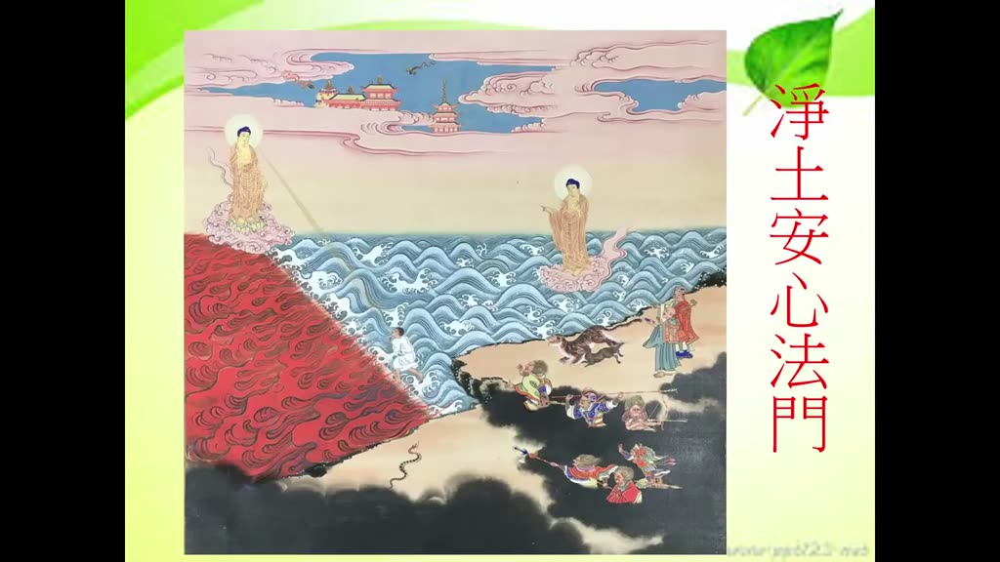

**重點：** 片頭後主講者問候蓮友，說明本課研讀雪公老師晚年（往生前一年）所講的淨土安心法門。

**標籤：** #淨土安心法門 #雪公

（片頭音樂），各位老師、各位蓮友大德，阿彌陀佛。阿彌陀佛。今天由末學來跟大家一起來研讀雪公老師的淨土安心法門。這個淨土安心法門，這是雪公老師往生前，前一年開始的。那這個雪公老師講這個淨土安心法門，講這個三心的因緣，我們稍微跟大家提一下。稍微提一下，講三心的因緣是在民國，我們請問一下雪公老師幾年往生的？民國七十五年三月往生。所以這個是雪公老師在往生前一年，七十四年六月十二。這個時候雪公老師還是正在講華嚴經，講華嚴經講到哪裡？講到十迴向品。我們都知道菩薩的階位有十信、十住、十行、十迴向，就是每一個階位有十個階位，所以叫十信、十住、十行、十迴向。雪公老師講到十迴向法門的最後一個迴向，叫做法界無量迴向。

### 投影片 2：雪公講三心因緣：法界無量迴向與二十種梵行（02:40–06:02）

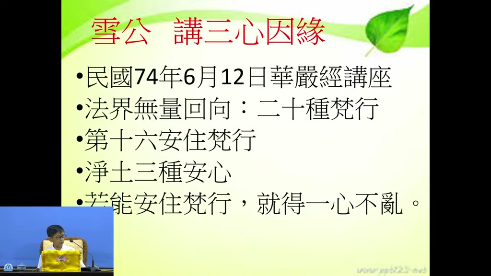

**重點：** 民國74年6月12日華嚴經講座講到十迴向品最後的法界無量迴向，其中提到二十種梵行；講到第十六種「安住梵行」時，雪公另闢「淨土安心法門」：信不深、願不切、行不緊實是因為心不安住，能安住梵行才能念佛得一心不亂。

**標籤：** #華嚴經 #法界無量迴向 #安住梵行 #一心不亂

那在講這個法界無量迴向，所以這個十迴向法門講完以後就要講十地、初地。所以講法界無量迴向的時候，裡面剛好有提到叫做二十種梵行。二十種梵行，所以二十種梵行就是，這二十種梵行都有名字，你在經典裡面查不難查得到，這個是在《華嚴經》當中。也就是說這個梵行是什麼？這就是守戒清淨。守戒清淨，你修菩薩道當然就是要守戒，要能夠清淨，所以叫梵行，總共有二十種梵行。那十種、二十種梵行當中，這個第十六種梵行，這個第十六種叫做安住梵行。安住梵行，那雪公老師講到這個安住梵行的時候，雪公老師就另闢一個天地，安住。雪公老師就想到說，我們修淨土法門，要怎麼樣能夠安住在我們的信願念佛。就是你平常人也都會信願念佛，但是你不安住。你不安住的話，信不深，願也不切，行也怎麼樣？行也不緊實，所以信願行為什麼沒有安住？所以雪公老師就是看到我們很多蓮友，雖然會信願念佛，但是信心不深，願力不切，念佛不緊實。所以不緊實，所以念佛上面怎麼樣？鬆鬆、稀稀鬆鬆的。那老師就特別在這個地方，特別開闢了一個單元叫淨土安心法門。淨土安心法門，淨土有三種安心。就是你修淨土法門，修這個信、修這個願、修這個行，怎麼樣能夠把這個信心，能夠建立一種很深的信心，願力怎麼能夠建立到很切的願力，那行上面怎麼樣能夠見到怎麼樣，能夠淨念相繼的行。這個必須就是要安心。所以一個人如果不安心，信願行是上不來的。所以一定要安心。所以老師這邊講到淨土三種安心，所以他就做一個結論：若能安住梵行，如果一個人能安住在清淨的行為上面，就能念佛得一心不亂。所以反過來講，你的心如果沒有安住的話，是〔達不到〕一心不亂。一心不亂當然是我們信願念佛人的一個目標。那你如果心不安住的話，是達不到這個一心不亂。所以能夠達到一心不亂，這個念佛就是有成就了，往生就是沒有問題了。我們稍微看、瞭解一下這個三心的一個因緣。那你說這個十迴向，法界無量迴向是長在哪個地方？

### 投影片 3：十迴向的名稱；雪公講華嚴經十八年（06:02–09:04）

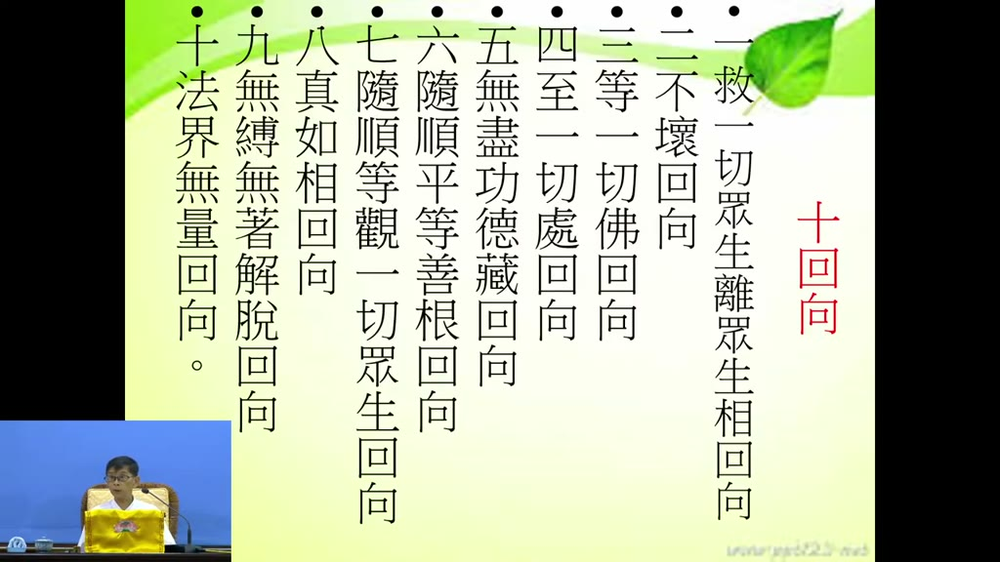

**重點：** 逐一念出十迴向的名稱（救護一切眾生離眾生相迴向……法界無量迴向），說明這是菩薩修十信、十住、十行後把功德迴向法界、不分怨親的平等迴向；雪公往生前一個月仍在講經，華嚴經講了將近十八年。

**標籤：** #十迴向 #華嚴經

我稍微跟大家透露，稍微說一下，這個法界十個迴向當中，十個迴向，十個十迴向，名字知道就好了，因為這個內容非常的廣泛，稍微知道就好。第一個迴向叫做救護一切眾生離眾生相迴向。救護一切眾生離眾生相迴向，我把名字念一下就好了，這個內容我們不說了。第二種迴向叫不壞迴向。第三個迴向叫等一切佛迴向。第四個叫做至一切處迴向。所以你就要看像這些都是那種菩薩經過了十信、十住、十行，他已經修了很多功德，然後他這個功德要怎麼樣迴向到法界，迴向到所有眾生身上，他就是有做這種迴向。這個你看這個名字就知道，這個迴向是非常的遼闊的，非常平等無礙的。那第五個叫做無盡功德藏迴向，無盡功德藏迴向。第六個叫隨順平等善根迴向，名字你稍微聽了就好了。第七個就是隨順等觀，等觀一切眾生迴向。能夠平等觀，能夠觀一切眾生都能夠迴向，所以你迴向的時候是不分怨親債主的，不分怨親債主，所有眾生都要迴向。那第八個叫做真如相迴向，真如相迴向。我還記得我們那時候剛來臺中，剛來臺中雪公老師就是講到這個真如相迴向，真如相迴向，民國差不多七十年的時候。然後接下來就是無縛無著解脫迴向，這個地方雪公老師就講得非常的多，內容講得很慢，但是內容講得非常的豐富，那花了很多時間講。無縛無著解脫迴向。那最後一個，第十個就叫法界無量迴向，法界，實法界，無量的法界，都把它迴向。所以我們這邊淨土安心法門，就是雪公老師講到法界無量迴向的時候，第十六個安住梵行，總共有二十種梵行，講到第十六種安住梵行的時候來講到淨土安心法門。雪公老師他隔年就往生了，隔年，民國七十五年三月就往生，所以雪公老師在往生前一個月還講經，前一個月講經就是講到法界無量迴向，法界無量迴向有講完，講完迴向。所以雪公老師是把華嚴經當中十信、十住、十行、十迴向這些都有講到，講了將近十八年，講了十八年的時間。這個是我們講到十迴向。

### 投影片 4：觀經緣起：韋提希夫人與阿闍世王（09:04–13:00）

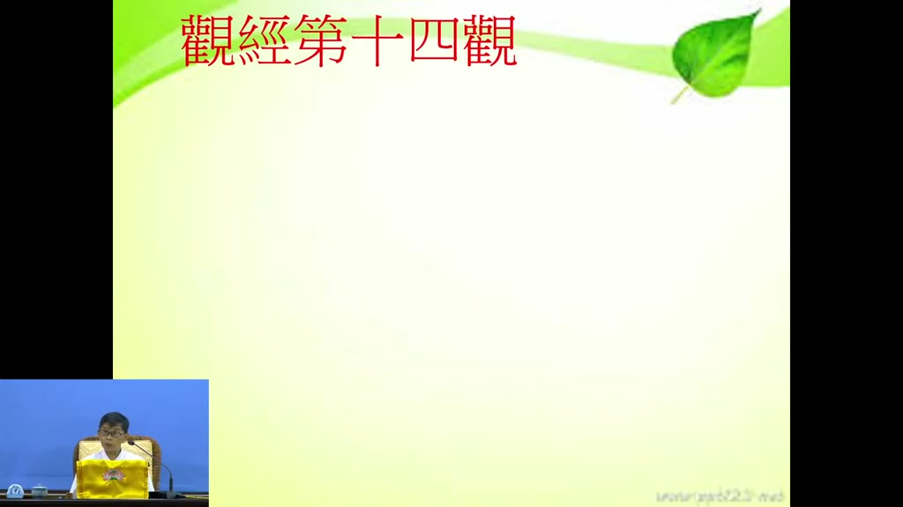

**重點：** 淨土安心法門出自《觀無量壽佛經》第十四觀。講述王舍城國王與韋提希夫人求子、修行人投胎報仇成為阿闍世王（未生怨）、幽禁父王又欲殺母、大臣勸阻，韋提希厭離娑婆，經目連尊者與佛示現各清淨佛土後，選擇往生極樂世界。

**標籤：** #觀無量壽佛經 #韋提希 #阿闍世王 #王舍城

那這個十迴向當中，雪公老師特別開闢出來一個就是淨土安心法門。淨土安心法門，這個淨土安心法門從哪裡出來？是從觀經，觀無量壽佛經，簡稱觀經，觀無量壽佛經當中的第十四觀。這個第十四觀，我們先稍微說一下，觀無量壽佛經就是王舍城，在釋迦牟尼佛那時候有一個王舍城。王舍城國王、皇后韋提希夫人結婚很久都沒生小孩，他們就一直求能夠得一個小孩。有一些人跟他說，山裡面有一個修行的外道，很有修行，我們讓他投胎，當國王、王后的孩子。但是這個修行人很有修行，他也不太會死，不太會死你怎麼能夠叫他能夠投胎？所以〔有人〕出一些主意，把這個修行人害死。修行人害死以後，這個修行人就發了一個惡願，惡願怎麼樣？就是我要投胎到王舍城的國王、王后當兒子，要做什麼？報仇。阿闍世王，阿闍世王翻譯成中國話為未生怨，就是還沒出生心裡就有怨恨。（10:35–11:46 依第二次轉錄補入），還沒出生就心裡面怨恨這個父母親。所以他長大以後就怎麼樣，把國王把他幽禁起來，關到怎麼樣，希望把國王關到餓死。那後來發現那個國王也沒有餓死，因為這個韋提希夫人王后不斷的去私下去救濟、去幫忙，國王沒有餓死。那後來這個阿闍世王這個太子就把這個連皇后都想要怎麼樣，連媽媽都想要殺。大臣看到他把國王父親幽禁起來，大家還睜一隻眼、閉一隻眼。聽說他要害母親，害母親是天理不容。你如果要害母親，我們這些人都不當你的臣子了。你看連印度都有這個概念，不能夠殺父殺母，殺母是天理不容，我們都要退休。所以阿闍世王就害怕，害怕他們會〔離去〕，〔不敢〕加害這個韋提希夫人。韋提希夫人生了一個大逆不道的兒子，心裡面是非常的難過，難過到很想要脫離娑婆世界。那他剛好有一個認識釋迦牟尼佛的弟子，就是目連尊者。所以透過目連尊者，釋迦牟尼佛就派目連尊者不斷的來安慰、來說法，來安慰這個韋提希夫人。後來甚至釋迦牟尼佛都示現，來怎麼樣，來安慰韋提希夫人。那韋提希夫人說，我這個娑婆世界，我再也不想待下去。能不能夠讓我趕快能夠有一個清淨的佛土，能夠讓我離開，能夠去那邊。釋迦牟尼佛就示現各個清淨佛土，給韋提希夫人來觀察，看她願意生哪一個清淨國土。韋提希夫人參觀了很多清淨佛土以後，她說其他我都不去，我就是要去極樂世界。因緣〔成熟〕，釋迦牟尼佛就跟他講了去極樂世界的方法，就是要觀，修觀。

### 投影片 5：觀經第十四觀：九品往生與三心（13:00–15:52）

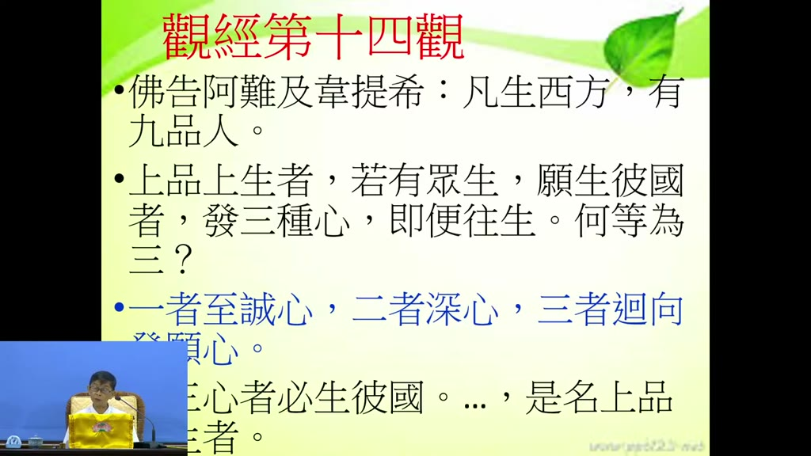

**重點：** 觀經十六觀中前十三觀為定善、第十四至十六觀為散善，不必禪定。韋提希（意譯思勝，善於思惟）隨文入觀證無生法忍。佛告阿難及韋提希：凡生西方有九品；上品上生須發至誠心、深心、迴向發願心，具三心者必生彼國。

**標籤：** #第十四觀 #九品往生 #散善 #三心

觀經總共有十六種觀，前面十三種觀都是要修禪定，戒定慧，修禪定當中才能夠來觀。第十四、十五、十六叫做散善觀，不必要求一定要禪定。所以我們這個淨土安心，這種三種安心就是在觀經當中的第十四觀。所以這個韋提希夫人，佛告阿難及韋提希，佛就告訴阿難尊者和韋提希夫人。韋提希翻成我們中國話叫什麼？叫思勝。所以釋迦牟尼佛講經那個都是契機說法。思勝是什麼？很善於思惟，很善於思考。所以這個韋提希夫人的翻譯，就是他的名字就是思勝。所以釋迦牟尼佛就知道韋提希夫人是一個很善於思考的、一個很特殊的、一個很有善根的善女人，所以他才會跟她講觀，十六種觀法。所以韋提希夫人確實他就按照釋迦牟尼佛講的隨文入觀，隨文入觀以後，釋迦牟尼佛講完了觀經以後，他就證得無生法忍，就證得無生法忍，所以這個程度是非常高的。韋提希夫人，釋迦牟尼佛在第十四觀的時候，佛就教他說：阿難及韋提希，凡生西方有九品，生西方極樂世界有九品往生。上品上生、上品中生、上品下生、中品上生、中品中生、中品下生、下品上生、下品中生、下品下生。其中上品上生要怎麼修？釋迦牟尼佛說，若有眾生願生彼國，你有發願要生到極樂世界的話，要發三種心，即便往生，就能往生。那釋迦牟尼佛就問：「你知不知道哪三種心？何等為三？」，第一個，至誠心；第二個，深心；第三個，迴向發願心。至誠心、深心、迴向發願心，如果你能夠按照三心都能夠具足，必生彼國，一定能夠生到極樂世界，而且上品上生。所以這個三心我們都可以看，所以雪公老師特別提這個三心，是幫助我們往生極樂世界取法乎上的一個方法。

### 投影片 6：研讀三心要看古註：善導大師《觀經四帖疏》（15:52–19:14）

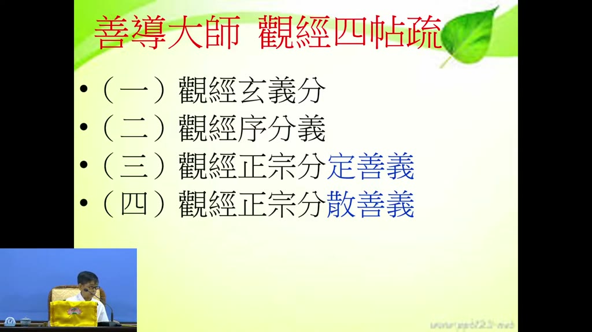

**重點：** 以現代眼光讀經容易望文生義（「看古人註解頭痛心不痛，看現代人註解頭不痛心痛」）。觀經古註有隋智者大師與唐善導大師兩部《觀無量壽佛經疏》；善導疏稱四帖疏：玄義分、序分義、定善義、散善義，三心即在正宗分的散善義。

**標籤：** #四帖疏 #智者大師 #善導大師 #散善義

這個三心我們先來跟大家介紹一下。這個三心你要看這個佛經，你用我們現在的眼光、你的能力來看佛經，很多地方會望文生義。你看不清楚，比如說什麼叫至？什麼叫誠？如果你用我們現在的程度，什麼叫至？什麼叫誠？你就很隨意的解釋過去了。為什麼？我們的程度就是這樣。（16:09–16:38 依第二次轉錄補入），所以一定要怎麼樣？看註解。而且這個註解你不能看現代人的註解。這個以前雪公老師講，你看現代人的註解，不會頭痛，很好看，白話文。看古人的註解怎麼樣？很頭痛，但是心不痛。看現代人註解，頭不痛，但是心痛。因為很多地方都錯解，望文生義。所以我們如果像你要看這個佛經，我們坦白說，我們以我們現在的國文能力，你要看這個佛經，你光是這樣看，光是不看註解，你能夠看得懂，很少。一定要怎麼樣？要有古代的註解。所以你看深心，為什麼用深來形容？這些地方我們看不出來，祖師、那個證果的祖師他就看得出來。所以雪公老師他告訴我們說，你要研究觀經這個三心，你要看什麼？要看觀經的註解。觀經的註解有兩本，第一個是隋朝的智者大師，隋朝智者大師有觀無量壽佛經疏，另外一個就是唐朝的善導大師，他的註解也叫做觀無量壽佛經疏。但是因為這兩個名字會雷同，所以我們後來人就把它簡稱為善導大師的觀無量壽佛經疏，我們給它一個名稱叫四帖疏。善導大師他的觀經〔疏〕總共有四帖，四個要點。第一要點是觀經的〔玄義〕，〔類似〕五重玄義，把觀經玄妙的義理提綱。第二帖是序分，觀無量壽佛經的序分，這是第二大類。第三大類是正宗分，正宗分就是從第一觀到十三觀，叫定善。由禪定當中來修這個善根、善法。這是第三帖。第四帖就是散善，從第十四、第十五、第十六，這也是正宗分，叫做散善、散善義。所以我們四帖疏，我們講的，現在我們研究的淨土三心法門，就是在這個第四個，在這個第四個當中的，這個正宗分的散善義。

### 投影片 7：善導大師的功夫；四帖疏與妙宗鈔（19:14–22:43）

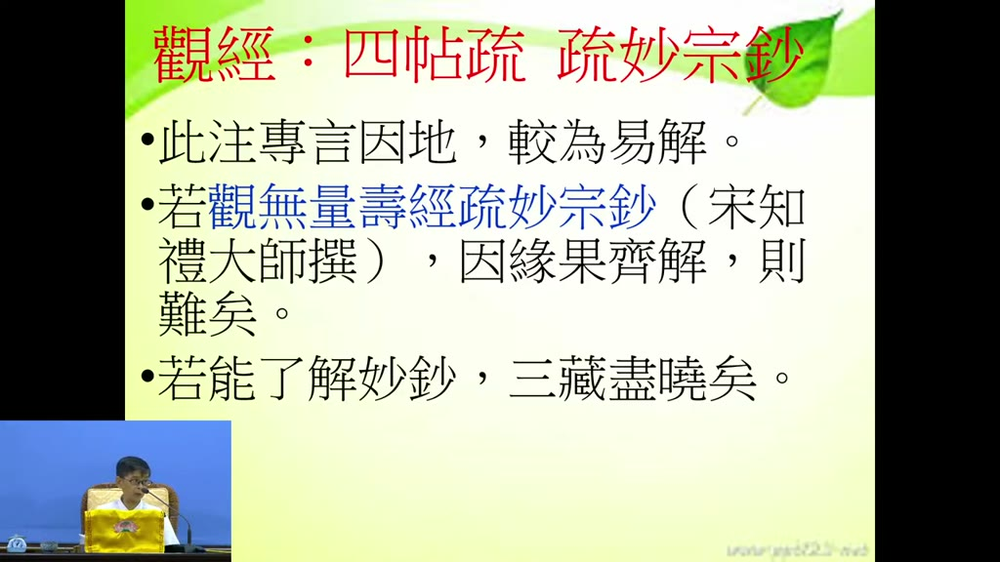

**重點：** 善導大師作疏時每日誦《阿彌陀經》三遍、念佛三萬聲，至心發願，以求註解不錯（講者以此勉勵組長以上散課念萬聲）。雪公比較：四帖疏「專言因地，較為易解」；北宋知禮大師《觀無量壽佛經疏妙宗鈔》講因、緣、果，點出觀經最玄妙的宗趣，但不易讀。

**標籤：** #念佛三萬聲 #四帖疏 #妙宗鈔 #知禮大師

善導大師他為了要註解這個觀無量壽佛經，你看他下了多大功夫。每天要註解的時候，每天善導大師每天都額外誦阿彌陀經，（19:14–19:37 依第二次轉錄補入），〔誦〕三遍，把阿彌陀經誦三遍，然後念佛念幾聲？念佛念三萬聲，每天念佛念三萬聲。所以我們請大家，你做散課怎麼樣？我們這次要求一些組長以上的，你做散課能夠念萬聲的話，這個來講，那個都是人家的三分之一而已。他念三萬聲就是為了希望註解的時候不要註解錯，念三萬聲然後至心發願往生極樂世界。所以這個是善導大師的註解。那善導大師註解這個有什麼特別的地方？這個四帖疏有什麼特別的地方？雪公老師這麼說。因為觀無量壽佛經的，智者大師的觀無量壽佛經疏，到了北宋的時候，有一位天台宗的大師叫知禮大師，知禮大師，他做了就是觀無量壽佛經疏妙宗鈔，就是特別對智者大師的疏做一個妙宗，他的微妙、微妙的宗趣的地方特別註解。善導大師註解觀無量壽佛經的疏，這兩本都是註解觀經的，有什麼特別？雪公老師曾經分析：此注，就是四帖疏，觀無量壽經的四帖疏，專言因地，就是專門講我們現在還沒往生的時候，還沒往生前，我們怎麼樣用功，因地，較為易解，比較容易瞭解。所以等一下我們會介紹至誠心、深心，至誠心又分成兩種，辨真偽、明兩利，深心怎麼樣，迴向發願心，這個都是來描述，（21:23–22:22 依第二次轉錄補入），我們在要準備往生的人，你要怎麼樣做準備，因地上面。那妙宗鈔就不一樣了，這個觀無量壽經疏妙宗鈔，宋朝知禮大師寫的，講因、講緣、講果，因緣果具解。就什麼因、什麼緣、什麼果，生到西方極樂世界，什麼是得哪一品？這個在妙宗鈔當中都寫得非常的齊全。雪公老師說這個有點難，這個對我們來講有點難。有點難，所以雪公老師叫我們瞭解，如果你能夠，我們程度如果真的是夠的話，你來讀妙宗鈔，你讀妙宗鈔的話，那三藏經典大概都曉得了。因為妙宗鈔就是把這個怎麼樣，把這個觀經當中的最玄妙的宗趣把它點出來。不太容易看，你看了多遍，你看多遍也不一定能看得懂。所以這兩種，那雪公老師對這個四帖疏和妙宗鈔的分析。

### 投影片 8：本於印光大師：平實事相法門（22:43–26:06）

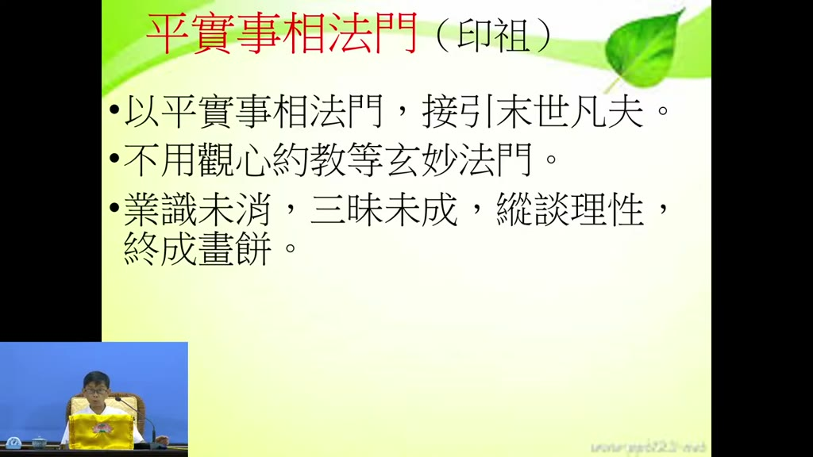

**重點：** 雪公的看法本於印光大師：善導大師以平實事相法門接引末世凡夫，不用觀心約教等玄妙法門；因為凡夫業識未消、三昧未成，縱談理性終成畫餅。至誠心就是在生活與四威儀中真實念佛、真實做功德，不裝模作樣。

**標籤：** #印光大師 #平實事相 #業識未消 #畫餅充飢

我們來看雪公老師是有本的，本於什麼？本於印光大師。那印光大師曾經這樣開示：善導大師以平實事相法門來接引末世凡夫。善導大師也懂得淨土法門的微妙宗趣，他為什麼不這樣註解？為什麼？他是以很平，平就是很平常，實就是很實在，然後就是事相而不是理體，很平常、很實在的事相的法門來接引末世凡夫。你看這個雪公老師這個表上面，你看一看就知道，他教我們就怎麼樣？什麼叫做至誠心？什麼叫至誠心？你心裡面做一個善事，或心裡面念佛念到怎麼樣？心不要怎麼樣，能夠很真實的來念這聲佛號，很真實的做每一件功德，就能夠和真如佛性能夠感應。所以你要怎麼樣能夠和佛性感應？從怎麼樣？從生活當中，從你生活當中的各種的一舉一動，你的威儀當中，你的四威儀當中，念佛當中，怎麼樣，你能夠很真實的，不要什麼裝模作樣，不要裝模作樣，不要虛假的。能夠很真實的來做這些事情，你就能夠和本性能夠相應。所以，善導大師他就是用平實的事相法門教我們。那印祖他這個有研究過的人他就知道，所以不用觀心約教等玄妙法門。他不會像妙宗鈔，他用就是要觀這個心性、心念，觀這個起心動念，然後約這個教理。約這個教理，你斷了什麼惑、證了什麼果，從觀心、約教上面來怎麼樣，去研究這個觀經的玄奧、那個妙趣，他不用這個。那為什麼這樣？你說善導大師為什麼不用像妙宗鈔這麼樣的玄妙的方式來解釋？因為印光大師的理解是這樣，我們凡夫業識未消。我們第八阿賴耶識裡面有善念、有惡念、有無記念。善、惡、無記，大部分都是惡念，然後大部分都是無記念。善念很少，淨念更少。所以業識未消。我們的八識裡面，阿賴耶識裡面的業識沒有乾淨。三昧未成，三昧就是定功。（25:23–25:51 依第二次轉錄補入），我們念佛很少人得到一心不亂。三昧未成，你要觀怎麼觀？縱談理性，終成畫餅。你談按照教理上面斷什麼惑，然後往生到極樂世界，證什麼果，那個你做不到。我們做不到，做不到就是畫餅充飢。所以你說印光大師他這個有經驗的人，他就是這樣，所以特別很推崇，很推崇善導大師這套方法。這套方法能夠讓我們從平實的方法中瞭解安心。

### 投影片 9：淨土的總安心：欣、厭（26:06–30:14）

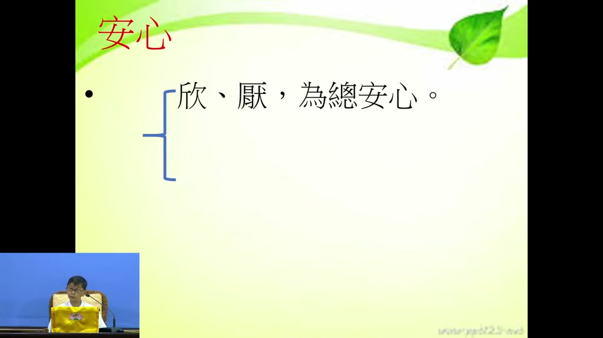

**重點：** 八宗都有安心法門；淨土分總安心與別安心。總安心就是欣、厭兩字：欣求極樂（對極樂依正莊嚴看了、聽了、想了就歡喜），厭離娑婆（吃喝玩樂睡都不愛，連全球大總統也視如糞蛆）。欣厭合起來就是信願行的「願」。

**標籤：** #總安心 #欣求極樂 #厭離娑婆 #信願行

好，這個是我們來看這個安心，淨土安心法門的安心。這個安心，這任何我們佛門當中，八宗，八宗當中，禪律淨密，禪宗、律宗、淨土宗、密宗、天台、賢首、唯識、三論，哪一個宗都是要安心，哪一個宗都有他的不同的安心法門，每一個都有他的安心法門。所以你看我們淨土法門的安心是甚麼？分總安心和別安心。我們淨土法門的總安心是甚麼？就是兩個字，一個欣、一個厭。這個沒有安心，念佛念不出來，你也不會念佛。欣是對極樂世界的一切一切，你都怎麼樣？看了、聽了、想了就歡喜。所以為什麼要誦彌陀經？誦彌陀經就是常常對極樂世界的依報環境、正報環境，極樂世界的殊勝，沒有一樣不歡喜的。這就是我們所謂的欣。所以，你有這樣的一個欣，欣喜心，你怎麼不會念佛？不會想念佛？有這種欣喜心就是想盡辦法趕快去極樂世界。所以，這個叫欣。第二個是厭。你要欣求極樂，第二個是厭，厭娑婆世界。我們娑婆世界的所有一切，外頭的一切，雪公老師就講得很明白，外頭這一切都討厭他，討厭他而且不愛他。你說外頭哪些東西？吃喝玩樂，吃喝玩樂睡。現在不要講財色名食睡，程度不夠了。你講財色名食睡，現在人我也不貪財，我也不求名，對不對？對這個來講，他不會認為這個叫什麼慾望，現在人的慾望叫吃喝玩樂睡。你這個吃喝玩樂睡上面，如果你厭的話，對這些都沒有什麼興趣。所以老師就說，這些外面的一些東西，討厭他，不愛他，甚至老師講的一個更、更，即使現在全世界人把你推崇為一個什麼，全球的大總統。全球大總統他看起來，如果一個厭娑婆的人，你給他一個當全世界的一個大總統，他都看成什麼？看成了糞坑裡面的蛆，一文不值，糞坑裡面的蛆一文不值。你聽到這個你想看看，我們能做得到嗎？不要說大總統，一個微末的名利，可能我們捨不得。微末的稍微有一點吃喝玩樂睡，我們稍微有一點不足的話，我們心裡面感覺今天好像白過了。所以我們的，像雪公老師講的這個，坦白說我們的厭離娑婆的心是沒有發出來的。你如果對娑婆世界一切東西不愛它、討厭它的話，恨不得怎麼樣，趕快能夠離開娑婆世界。那對娑婆世界的東西當然就是沒有什麼興趣。那這個如果我們的心如果能安住在這兩個，極樂世界一切東西我們都欣，娑婆世界的一切東西我們都厭，這個這種人來信願念佛，就會成功。這個叫總安心，總安心。這個是所以，欣和厭合起來是什麼字？欣和厭合起來是什麼字？信願行的願。信願行的願就是要這兩個字，一個是欣求極樂，一個是厭離娑婆。

### 投影片 10：別安心三心；心與性、集起為心、游魂為變（30:14–33:54）

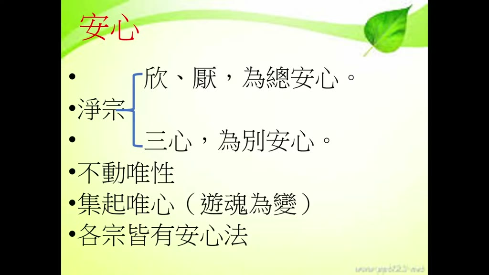

**重點：** 別安心是至誠心、深心、迴向發願心，學了修淨土更保險、更紮實。性不動、不必修也無法修；能修的是心，「集起為心」——心不斷收集見聞覺知的種子、遇緣現行，所以《易經》說「游魂為變」；心若遊蕩失念便會投胎，各宗了生脫死都在讓心安住。

**標籤：** #別安心 #集起為心 #游魂為變 #種子現行

那別安心是什麼？別安心是這個。別安心就是三心：至誠心、深心、迴向發願心。這個三心是特別淨土法門的，特別對淨土法門上面我們要怎麼樣，要學三種安心。除了欣極樂、厭娑婆之外，我們還要特別學至誠心、深心、迴向發願心。我們修淨土法門就更保險了。修淨土法門，你走起路來，修淨土法門更為紮實。這個特別安心的心，雪公老師這邊特別有跟我們提。這個安心，我們講的安心的心，我們學佛都知道，學過唯識我們都知道，心和性這個是不太一樣的。我們講本性是不動的，它是沒辦法修的。本性本來就是如如不動，如如不動的話它是不必修的，你也沒辦法修。那我們能夠修的是什麼？修這個就是心。集起為心。我們這個集起，集就是集合，把所有每天當中，你看今天，你從早上到現在，你看了多少的人，聽了多少的聲音，想了多少事情，這些都變成種子。它能夠通通把它收集集合起來，很自動化的，很自動化，不需要怎麼樣什麼開關，也不需要什麼機器，我們心裡面就有一個功能，有一個功能怎麼樣，能夠把你所見所聞所想的，通通把它變成種子集起來，然後嘛集合起來，然後起，起什麼？哪一天，哪一時，哪一日，它就怎麼樣，有緣的時候讓它怎麼樣，這個種子讓它開發，讓它冒芽。所以我們心裡，我們每個眾生的心當中就有這個功能，能夠集合各種的業力種子，能夠讓所有的業力種子能夠發作。所以這個佛法講的因果就是這樣來的，因果的原理就是這樣。你種了因以後就能夠結果，為什麼？就是這個道理。所以你要注意看，這個心是隨時在變的，這個心是隨時在收集種子，隨時在怎麼樣讓種子能夠現行發芽。所以我們中國易經當中叫做游魂為變。我們這心就像什麼？像游魂一樣常常變來變去。所以一個人如果游魂為變，這個就會投胎，你沒辦法往生極樂世界，會投胎。那怎麼辦？要把它安住。游魂不能讓它游了，要把它安住，讓它安住下來。安住下來，所以，各個宗都有這種安心方法，每一個宗都有他安心的方法。他就知道你如果讓這個魂魄，讓這個心，這個魂是我們中國人講的，其實就是心，你讓這個心到處的去遊蕩、失念，遊蕩、失念，不念佛的話，以後怎麼樣？那就是，就去投胎，那個毫無疑問的。所以每一個宗他要了生脫死，他的方法就是讓這個心、這個魂能夠安住下來，這個叫做安心法。所以這個安心，我們講總安心、別安心這兩種。

### 投影片 11：欣厭的落實：過眼雲煙與敦倫盡分（33:54–36:24）

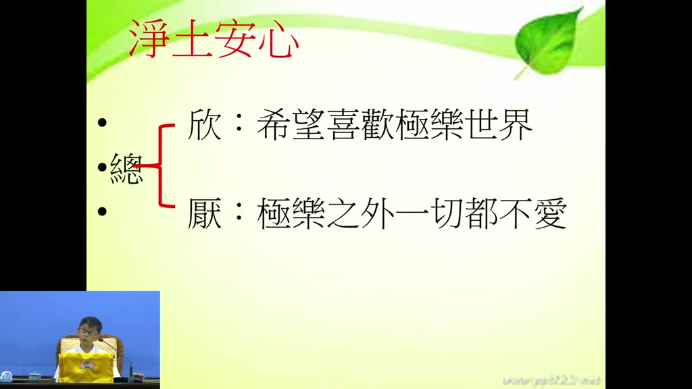

**重點：** 欣要靠常讀誦佛經、常念佛，越念越親切；厭是極樂之外一切不愛，但不是厭世：讀書、工作、成家都要經過，只是視為過眼雲煙、如幻如化。蓮社重視家庭，敦倫盡分之後念佛才能安心，觀念失之毫釐，差之千里。

**標籤：** #欣 #厭 #如幻如化 #敦倫盡分

那我們再看下面，瞭解一下淨土的安心當中，淨土的安心當中，欣就是希望、喜歡極樂世界。講明白就是對極樂世界的一切一切你都希望也喜歡。這個不容易，這要常常讀誦佛經，常常怎麼樣？能夠第一個常常讀誦佛經，你慢慢才能夠起這種希望歡喜。第二個常常念佛，你佛號如果常常念的話，越念就越親切，越念就越熟，越熟就越親切，你對阿彌陀佛就越親切。你對極樂世界的正報、依報就欣喜。（34:35–35:03 依第二次轉錄補入），第二個是厭：極樂之外一切都不愛。極樂世界一切之外，我們都討厭它，都不愛它，因為那些東西都不值得我們去追求的。當然你說現在這個話，我們很多人聽來，那我都不必讀書了嗎？那我也不必工作了嗎？那我也不必成家立業了嗎？不是這樣。你要把它想，這些都是過眼雲煙。都要做過，都要經過，但是你要把它當作過眼雲煙，那個都不會長久的。你在娑婆世界所做的一切，那都不是長久的，都是短暫的一個娑婆過客。短暫的娑婆過客，你把它當作永遠，那就糟了。它是短暫的娑婆，娑婆世界的一個過客而已，不要把它當作永遠，但是都要怎麼樣，都會經過這個歷程。但心態上面就是要把它視為怎麼樣，如幻如化的，如幻如化，這個就是厭的一個心態。所以厭並不是說我們講的厭世，所以我們修淨土法門不是說我討厭這個世間，不是這樣。你看我們蓮社，我們蓮社強調怎麼樣，家庭很重要，家庭一定要什麼？敦倫盡分。你家庭照顧好以後來念佛怎麼樣？你念佛當然就能安心。所以不是說我們討厭家庭，然後拋棄家庭，不是這個意思。這個反而要敦倫盡分，你唯有敦倫盡分以後，你才能念佛，念得安心，安心念佛。所以這個觀念當中，這個是有一點失之毫釐，差之千里，要留意一下。

### 投影片 12：從反面看三心：輕、忽、將（36:24–40:03）

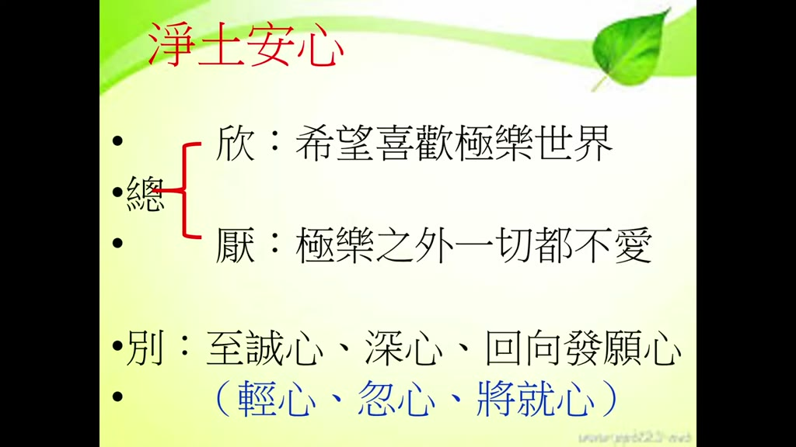

**重點：** 三心從反面看更清楚：至誠心的反面是「輕」（輕率、飄浮、不落實），深心的反面是「忽」（忽視、不當真），迴向發願心的反面是「將」（將就、遷就、無所謂）。講者引蕅益大師之說，請大家回去參究如何對治。

**標籤：** #輕 #忽 #將就 #蕅益大師

那我們來看淨土法門這個，剛才講的總安心就是欣極樂、厭娑婆，別安心，至誠心、深心、迴向發願心。這三個心你要從反面去看，（36:35–37:00 依第二次轉錄補入），你從反面看你才會知道這三個心有什麼特別的地方。至誠心的反面是什麼？你如果一件事情念一聲佛號，或者做每一件事情，你如果不是真真實實的去做，而是什麼心？輕，輕是什麼？輕率。就是你做任何事情都是怎麼樣？飄飄浮浮的。做任何事情怎麼樣？就是我聽聽就好了，看看就好了，也不落實。那個叫輕心，很輕略的心。同樣是念佛，同樣做一件事情，別人怎麼樣？能夠做得有成果。你做的不會有成果，什麼原因？輕心、輕率、輕忽略。第二個？深心的反面是什麼？深心的意思就是說我對這個淨土法門是怎麼樣信得非常深，而不是忽，忽就是忽視，忽視到不是把它當真，就是有那麼一回事，但是不能把它當真，所以怎麼樣？我們就，所以你看電腦當中常常怎麼樣叫你的忽略過去，這個過程不必留意，忽略過去。你如果忽略過去的話，你這個修淨土法門當然不可能成功。所以深心的反面〔是〕忽。那什麼叫迴向發願心？迴向發願心是說把你整天怎麼樣，你信願、念佛、做種種功德，都迴向極樂世界，發願往生極樂世界。這個是一個迴向發願心，這個也是要訓練的。那麼它的反面是什麼？將就。將就是什麼？就遷就、無所謂。就說這也沒什麼了，對不對？我念了一場佛也沒什麼，我做的功德，反正我也是馬馬虎虎做的，所以也沒有什麼好迴向。所以你就怎麼樣，會將就，將就是勉強，就是很勉強、很遷就、不在意。這個就是蕅益大師說的，蕅益大師他就教我們了，如果你學佛的話是一種輕、一種忽、〔一種將〕：輕〔就是〕忽略，然後忽就是一種忽視它、不重視它，然後勉強的話，這樣的學習不可能安心。所以這三種心你如果從反面來看，你就知道這三種心的重要性。這個是這三心。你可以回去想看看，輕，對任何事情很輕，輕視很忽略，這要怎麼對治？對任何事情怎麼樣忽略馬虎，這幾個字要怎麼對治？然後很多事情怎麼樣？很遷就，遷就無所謂，怎麼對治？這個人家講出弊端來，就有他的方法，就有他的方法。這個方法，其實你懂了就很重要。這個你如果有興趣，你回去自己去參一參、學一學。

### 投影片 13：雪公講表：至誠心——辨真偽（40:03–43:40）

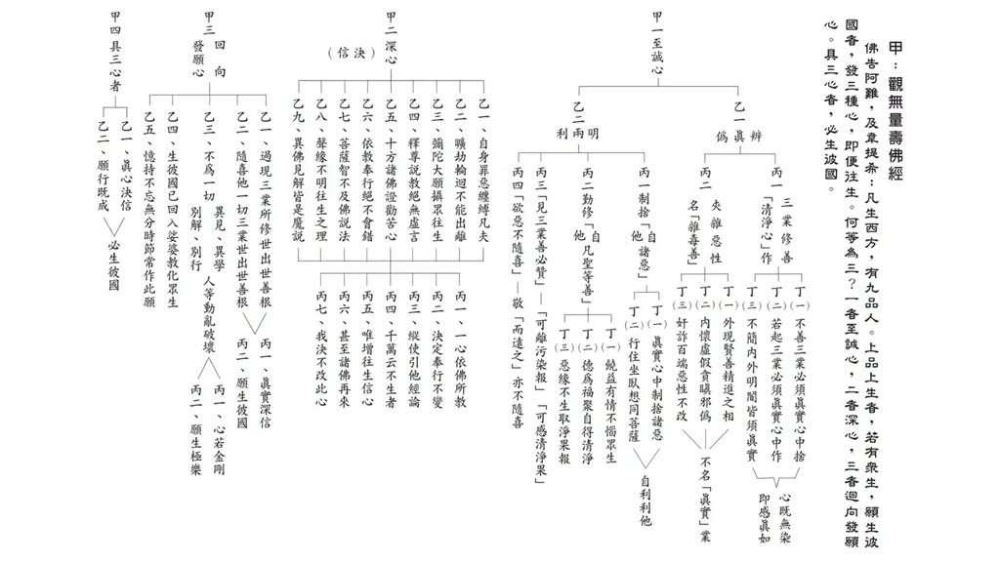

**重點：** 依雪公「觀無量壽佛經三心」講表朗讀：甲一至誠心，乙一辨真偽；真是三業修善清淨心作（不善三業真實心中捨、若起三業真實心中作、不簡內外明闇皆須真實，心既無染即感真如）；偽是夾雜惡性的雜毒善。並以「至心念佛，能消八十億劫生死重罪」「出場常如在場時」說明至者真、誠者實。

**標籤：** #講表 #辨真偽 #雜毒善 #出場常如在場時

好，這個是我們來看。那麼我們來看這個下面這個，這個，這個，從這個至誠心開始來，來跟大家來報告。這張表上面有甲一至誠心、甲二深心。我們來念一下。甲一至誠心，乙一辨真偽，丙一，三業修善清淨心作；丁一，不善三業必須真實心中捨；若起三業必須真實心中作；不簡內外明闇皆須真實，心既無染，即感真如。夾雜惡性，名雜毒善：外現賢善精進之相，內懷虛假貪瞋邪偽，奸詐百端，惡性不改，不名真實業。我們先念到這邊。這個至誠心，我們來看這個大標題，至誠心，至這個字，這個字我們都認識，沒問題。我們說至心念佛，什麼叫至心念佛？至的意思，按照祖師解釋就是很真，不虛假，不假的意思，真就不假。就是你念佛的時候為什麼叫至心念佛，能消八十億劫生死重罪，就是很真心念佛。就念這聲佛號你就相信，阿彌陀佛聽得到，阿彌陀佛看得到，阿彌陀佛想得到。你如果真的有這樣的一個心，你念佛的時候，阿彌陀佛如在目前，把它當真，這個叫至心。這樣念佛效果就很大，就是能消八十億劫生死重罪。所以至是真，那誠是什麼？實，實的意思就是不虛妄，不虛不妄。為什麼這樣說？因為有很多事情，我們很多人都會做表面的事情，說表面的話，做表面的事情，那表面後面都是虛妄不實，都是空的，虛妄不實。你說我們都說我也會念佛，你說怎麼樣會念佛？在佛堂裡面會念佛，出了場你會念佛嗎？在佛堂裡面正常人都會念佛，那出了場會念佛嗎？為什麼出了場就不會念佛？可見怎麼樣？我們念佛不實。你在佛堂上面會念佛，出了場就不會念佛。所以雪公老師才會教我們說，出場常如在場時。出場的時候常如在場時，這個才叫實在的。你實實在在會念佛的人，不僅是在道場裡面會念佛，你出了場也會念佛，這個才是把念佛當作很落實、很實際的東西，不是虛假的。所以這個是至者是真、誠者是實。所以真實義就是不是虛假、不是虛妄、做假的。明明就是要做一件事情，明明都是要做一件功德，明明做一件善事，但是內心當中是希望做假的，何苦來哉？做了以後沒有什麼功德，同樣都要做這件事情，為什麼不老老實實、真真實實去做？

### 投影片 14：至誠心兩大段；真＝三業修善、清淨心作（43:40–46:06）

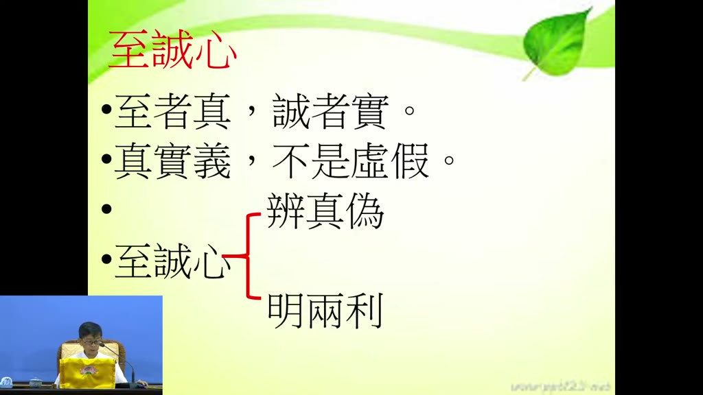

**重點：** 雪公依四帖疏的旨趣自編講表，把至誠心分成「辨真偽」「明兩利」兩大段。真就是身口意三業修善、以清淨心作；身業不殺、不盜、不淫，不妨害眾生。

**標籤：** #明兩利 #身口意三業 #不殺盜淫

所以這個地方，至誠心，雪公老師，他是按照四帖疏，按照四帖疏當中把它編成兩大段。至誠心當中編成，所以有些人說，好像這個表上面寫的，我們在四帖疏裡面都沒看到。雪公老師他教學就是有這個特色，他是從經典當中，能夠把經典的怎麼樣，得其旨趣。能夠把經典當中的旨趣怎麼樣，把它能夠提煉出來，然後按照自己的構想把它做出來，做一個講表。所以雪公老師按照四帖疏的裡面的內涵，第一個要辨真偽，至誠心就是第一個辨真偽，第二個明兩利。這從這兩個方面來看，否則你讀四帖疏的時候，你也看不出來哪個地方辨真偽，哪個地方明兩利，你也看不出來，但是雪公老師這個表上面就列得很清楚。至誠心，那怎麼樣做才叫做真實不虛假？（44:39–45:07 依第二次轉錄補入），所以要辨別什麼是真、什麼是偽。第一個，真。真的話是什麼？真的話就是三業修善、清淨心作。三業，身口意三業，身業、口業、意業，三業，身業作善，口業講好的話，心裡面想好的念頭，都要清淨心作。清淨心作，那你說什麼叫清淨心？講清淨心，下面雪公老師就分析得很清楚。清淨心，第一個我們先看身。身是什麼？就是我們的行為上面會妨害眾生的大概就三件事情。第一個殺，殺害他，殺害他的生命，這個會妨害生命，妨害眾生。第二個就是偷了眾生的財物，盜。你偷了，沒有經過允許，你就拿了人家的財物，這個會妨害眾生。第三個淫，不尊重人家，妨害、非禮人家，這是對眾生很大的妨害。

### 投影片 15：口業四種、意業三種與三業不幹壞事（46:06–49:55）

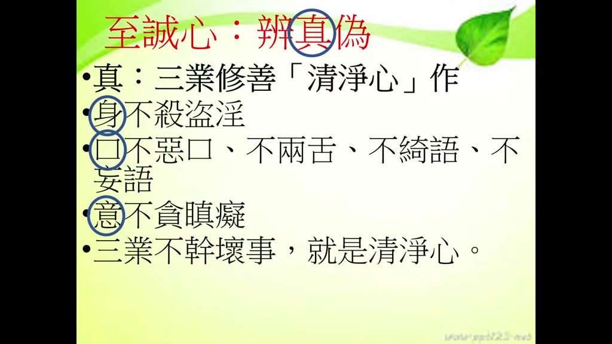

**重點：** 口業：不惡口、不兩舌（見未真，勿輕言）、不綺語、不妄語；意業：不貪（苟非吾之所有，雖一毫而莫取）、不瞋（逆境控制情緒）、不癡（遇逆境意外相信因果，不怨天尤人）。講者建議多念佛，時間都拿來念佛就不會造惡，三業不幹壞事就是清淨心。

**標籤：** #口業 #意業 #貪瞋癡 #清淨心

口業，我們口業當〔中〕很多善的口業，但是我們歸納成四種，不要說一些粗惡的、難聽的、粗暴的言語。所以像我們在蓮社裡面，你再怎麼樣生氣，大概都不會說一些粗話，因為我們有這個習慣，不惡口。第二個，不要兩舌，你如果對很多事情見不真，勿輕言。這弟子規裡面講，見未真，勿輕言。你如果見不真輕言，就是兩舌。你看見東西沒有看見清楚，然後就這裡說那裡說，見不真，那就是怎麼樣？而輕言就會兩舌，輕易的說，輕易的判斷，這個就是兩舌。所以我們不兩舌就是要抓住這個原則，見未真，勿輕言。沒有看見這個真實的面向，你不要輕易的下判斷，好或壞也都輪不到我們來下判斷。所以這樣就不會有兩舌，不會兩舌，不會挑撥是非。第三個不綺語，不說一些讓人想入非非的話，那些話我們都不應該說，講一些八卦的，講八卦講緋聞的，這些也輪不到我們說，你說那幹什麼，說那個也是沒有價值的。不妄語，不打〔妄語〕、不騙人。口業，四個就是清淨。意業，不貪、不瞋、不癡。不貪愛，不貪愛就是廉潔，很廉潔。對任何事情，苟非吾之所有，雖一毫而莫取。苟非吾之所有，雖一毫而莫取。你要學蘇東坡就是這樣。任何一樣東西如果不是我們的，我們都不要取，這個就不貪。第二個不瞋。不瞋就是能夠遇到逆境，遇到逆境的時候能夠控制住我們的情緒，不要瞋。癡是什麼？不癡就是遇到逆境、遇到意外，要相信因果。遇到逆境、遇到意外要相信因果，這個叫不癡。所以你那癡的人是什麼？遇到逆境、遇到意外的時候，怨天尤人。怨天尤人那個就是癡，所以意要能夠不癡。（48:41–49:05 依 2026-10-13 單獨重轉補入），那這三個，三業不幹壞事。這個雪公老師說，這個三業，身口意三業，如果你沒有做些壞事，這個就叫做清淨心。這個表示，所以這個要隨時留意，每天我們，因為身口意都跟著我們，每天都跟著你，到哪裡他都跟著你，隨時都會造業，所以常常要警覺。說實話也不容易。說實話你說要每天警覺，我身不要做什麼惡業，口不要說什麼惡話，意不要什麼貪瞋癡，很難。所以我建議大家念佛，你就是念佛，常常有時間就念佛。你還會去殺盜淫妄嗎？你還會去那麼惡口、兩舌、綺語嗎？你還有時間去貪瞋癡嗎？如果你能夠把很多額外的時間都拿來念佛，就不會幹這些事情。這個叫三業不幹壞事，三業不幹壞事就是清淨心。

## 已知轉錄錯誤

| 時間 | 聽成 | 應為 |
|---|---|---|
| 26:52–36:31 | 心、願／心極樂、願說佛／心和厭 | 欣、厭／欣極樂、厭娑婆（投影片「欣、厭，為總安心」） |
| 37:12–39:41 | 親、清心、清略、親慮、侵略、呼吸 | 輕、輕心、輕略、輕率、輕、（反面是）忽（投影片「別：至誠心、深心、回向發願心（輕心、忽心、將就心）」證實） |
| 38:59 | 偶一大師 | 蕅益大師（推測；雪公原講稿未見「輕、忽、將」之說，屬主講者補充） |
| 13:47–14:00 | 思聖／思甚 | 思勝（推測；韋提希的意譯，講者解釋為善於思惟） |
| 04:13–04:29 | 謹時／謹實 | 緊實（推測） |
| 24:08 | 恆馬本性，能夠相親 | 和本性能夠相應（推測） |
| 25:09 | 忌念更少 | 淨念更少（推測） |
| 35:23–35:33 | 娑婆活跡／說服世界的一個活跡 | 娑婆過客（推測） |
| 40:25–41:05 | 假一至誠心以一辯真為秉一、假責惡性、心計無然、己感真如 | 甲一至誠心、乙一辨真偽、丙一；夾雜惡性；心既無染，即感真如（依講表截圖 frame_0024，並與雪公原講稿 S1 核對一致） |
| 44:16–44:25 | 明兩立／明兩列 | 明兩利（依講表截圖 frame_0024） |
| 47:44 | 四個就是親近 | 四個就是清淨（推測） |
| 14:44 | 下品上生（第二次出現） | 下品下生（講者口誤或誤聽） |
| 00:00–01:08 | 明星大跟班 上海當代表／明天見 | 片頭音樂（Whisper 幻覺，已刪除） |
| 多處 | 30 秒區段缺漏（07:53、10:35、16:09、19:14、21:23、25:23、34:35、36:35、41:06、44:39、48:37） | 依第一次 Groq 轉錄補入；其中 07:53–08:21 與 41:06–41:34 兩處原標「轉錄缺漏」，2026-10-13 另下載該段音訊單獨重送 Groq 補入（依第二次轉錄補入，時間戳為估計，約 ±3 秒）；原始輸出見 transcript.raw.md |
| 32:48–33:07 | 由魂為變／遊魂為變 | 游魂為變（易經「精氣為物，游魂為變」，依雪公原講稿 S1 用字） |
| 48:41–49:05 | （原只剩「三業不幹壞事」一句，漏約 25 秒） | 那這三個，三業不幹壞事。這個雪公老師說，這個三業，身口意三業，如果你沒有做些壞事，這個就叫做清淨心……每天都跟著你，到哪裡他都跟著你，隨時都會造業，所以常常要警覺（2026-10-13 另下載該段音訊單獨重送 Groq 補入；時間戳為估計） |
| 16:08–16:22 | （漏「你看不清楚，比如說什麼叫至啊」一小句） | 依單獨重轉補入；「至／智」依上下文（至誠心）取「至」 |

## 補充資料連結

- 補充資料檔：[supplement.md](supplement.md)（與本報告同資料夾；內容已收錄於上方〈補充資料〉）
