# 淨土安心法門(二)

- 來源：https://www.youtube.com/live/pukUhT6JmFw
- 平台 / 上傳者：YouTube / 臺中蓮社
- 長度：50:15 (3015.0s)
- 逐字稿來源：whisper (groq)
- 更新日期：2026-10-12
- **關鍵字：** #淨土安心法門 #雪公 #至誠心 #辨真偽 #清淨心 #輕慢厭捨 #誠於中形於外 #葛繁 #斌宗法師 #即感真如 #雜毒善 #善導大師

## 摘要與名詞說明

**一句話重點**：台中蓮社講座第二講，接續帶讀雪公（李炳南老居士）〈淨土安心法門〉的至誠心「辨真偽」。講述丙一「三業修善、清淨心作」的三條：不善三業要真實心中捨（口業毀厭、身業輕慢厭捨、意業輕賤厭捨），善的三業要真實心中作，不論內外明暗都要真實；做到了「心既無染，即感真如」。最後進入丙二「夾雜惡性，名雜毒善」，講到第一條「外現賢善精進之相」。

> 以下是講者的講述與詮釋（宗門內的教學觀點）；人物事蹟、經論出處與歷史細節都是講者主張，未查證。

## 重點（含時間戳）

| 時間 | 重點 |
|---|---|
| 00:00 | 回顧：三業不幹壞事就是清淨心。蕅益大師詩「名譽及利養，愚人所愛樂，能損害善法，如劍斬人頭」：貪名聞利養，功德只剩人家讚嘆完就沒了的「陽德」；清淨心作的才是「陰德」。 |
| 03:26 | 丁一 不善三業必須真實心中捨：不善三業就是貪著娑婆的依報（環境）與正報（身體）。口業要毀厭，佛法把身體說成「革囊臭穢」。 |
| 07:10 | 身業輕慢厭捨：講者說印光大師在普陀山酷熱的藏經樓閉關，拒絕到天目山避暑，說越熱越能寫信回覆眾生。 |
| 09:12 | 意業輕賤厭捨：講者說雪公任職孔奉祀官府時，只要開口孔祥熙就會給官做，雪公卻視官位一文不值。捨就像千年暗室點了一盞燈。 |
| 12:47 | 丁二 若起三業必須真實心中作：「起」是誠於中、形於外。孔子「溫而厲，威而不猛，恭而安」是修出來的；真實要學曾子「吾日三省吾身」。 |
| 16:33 | 讚歎眾生三業所為善：葛繁太守日行眾善（《淨土聖賢錄》），雪公讀後作詩「安得金鋪祇樹園，檢書驚喜獲佳言，利人何患阮囊澀，此後心香輪葛繁」。雪公對蓮友的小善「不吝讚嘆」，所以人人歸心。 |
| 21:06 | 合掌禮敬四事（衣服、飲食、臥具、湯藥）供養：供養是「敬我之心，竭我之誠」，是種自己的福田。梁武帝前世以斗笠為佛像遮雨的故事。意業要常思想、觀察、憶念阿彌陀佛及依正二報。 |
| 25:26 | 丁三 不簡內外明暗皆須真實：有沒有人看到都一樣。引《大學》「小人閒居為不善……揜其不善而著其善」。 |
| 28:35 | 斌宗法師的例子：請雪公題書名一定要楷書；有顯要要受戒，法師只問「是自願的嗎？」 |
| 31:19 | 心既無染，即感真如：三句真實都做到心就清淨；夾雜見思惑（貪瞋痴慢疑）的善是有漏的，不能了生脫死。 |
| 33:42 | 至之言專，誠之言實；《妙宗鈔》「非念真如，豈名專實」；《彌陀疏鈔》「一心無虛妄即真，無遷流即如」。念佛字字清楚、不被妄念牽走；講者說雪公認為五分鐘一心不亂就開智慧，先練「百八聲不亂」。 |
| 37:52 | 善導大師入佛堂合掌胡跪念佛，冬天也汗流浹背；絕意名利、遠諸戲笑、獨行念佛。答問「如汝所念，遂汝所願」，念一聲佛口出一道光明（講者展示日本畫作）。以身證法 vs 以身謗法。 |
| 42:21 | 丙二 夾雜惡性名雜毒善：四帖疏「事同蛇蠍，雖起三業，名為雜毒之善，亦名虛假之行」。 |
| 44:28 | 雪公比喻「牛乳雜驢乳」：牛乳攢則成酥，驢乳攢則成尿；過去惡業習氣摻入現在的善，就不純粹。要隨緣消舊業，降伏習氣。 |
| 47:32 | 丁一 外現賢善精進之相：縱使苦勵身心、日夜急走急作如炙頭燃，內心如蛇蠍仍是雜毒善；人之視己如見其肺肝，瞞不過人。下次續講。 |

## 名詞說明

- **依報／正報**：依報是眾生所依的環境（國土、器物），正報是眾生的身心。「自他依正二報」指自己與他人的身體和環境。
- **陽德／陰德**：講者的說法：為求名利而做的善，受人讚嘆後福報就用完了（陽德）；不求人知的善才會開花結果（陰德）。
- **革囊臭穢**：以皮袋裝臭穢之物比喻身體，用來對治貪愛色身。
- **輕慢厭捨／輕賤厭捨**：善導大師《觀經四帖疏》對身業、意業的捨法：對娑婆享受輕看、厭離、捨棄。
- **見思惑**：見惑（錯誤見解）與思惑（貪瞋痴慢疑等煩惱），夾雜就是「染」。
- **專實**：至誠心的「至」是專一，「誠」是真實；知禮大師《妙宗鈔》用「專實」解釋至誠。
- **雜毒善**：外表行善、內心夾雜惡性的善，四帖疏比作蛇蠍。
- **葛繁**：講者說是宋朝鎮江太守，《淨土聖賢錄》有傳，以日行眾善著稱（未查證）。
- **斌宗法師**：講者說是鹿港人，曾到大陸學天台宗，民國四十幾年回台，著有心經註解（逐字稿依此推定為《般若波羅蜜多心經要釋》，未查證）。

## 轉錄說明

- 逐字稿來源是 Groq Whisper，自動偵測為中文，套用 `pure-land` 詞典。
- Groq 有 9 個 30 秒窗格漏轉：整段只剩一句標題，或吐出提示詞「阿賴耶識、敦倫盡分」。這次的空白被一個長段落蓋住，`whisper.py` 的自動補漏沒有偵測到；已把這 9 段單獨重送 Groq（不帶提示詞）補回約 4 分半的內容，接縫處的重複句已刪除。
- 校稿依投影片截圖校正，例如「讀宋鎮江葛太守小傳」「此後心香輪葛繁」「牛乳攢則成酥」「染即不淨，即是惑」。這次新增的 64 條穩定專名已寫入 `pure-land` 詞典（如依報正報、雪公老師、輕慢厭捨、雜毒善、斌宗法師）；只對這支影片成立或推測性的修正記在 `meta.json.known_asr_errors`。
- 已用雪公原講稿〈淨土安心法門（二）〉二次校對，原稿與影片的對應見補充資料 S1。

## 補充資料（影片未呈現的資訊）


### S1｜連結：雪公〈淨土安心法門〉原講文字紀錄（二次校對依據）
- 來源：明倫月刊網站〈淨土安心法門〉，雪公講述、鍾清泉敬記（https://www.minlun.org.tw/1pt/1pt-2-1/books2/1025.htm）；取得日期：2026-10-12；取得方式：Claude 以 curl 下載全文比對（網址沿用第（一）講歸檔時使用者提供的連結）。
- 為何需要補充：影片是主講者帶讀雪公講稿，逐字稿有許多同音誤聽；用原講稿核對講表文字與雪公原話。影片（二）涵蓋原講稿（一）後半的丙一三條與總結，以及原講稿（二）的丙二「雜毒善」與丁（一）。對應段落：投影片 2–11（03:26–37:52）、13–15（42:21–50:15）。
**原文（逐字）**
```
丁（一）不善三業必須真實心中捨
……不善的三業，真實心中捨，若不真實也不是清淨心，一下子就放下……
放下如何就行呢？金剛經中有比喻，一座黑屋子，多少年不見陽光，你拿著一支蠟燭進去，千年萬年的黑屋，進去一支蠟燭、一屋子皆放了光明。
```
```
丁（二）若起三業必須真實心中作
……若起三業的「起」是心裡一動，身口意要幹好事，必須真實心中作……儒家大學有云：「小人閒居為不善，無所不至；見君子而后厭然，揜其不善，而著其善。」……然而「人之視己，如見其肺肝然則何益矣？此謂誠於中，形於外。」……曾子云：「吾日三省吾身」……「為人謀而不忠乎」……「與朋友交而不信乎」……
```
```
丁（三）、不簡內外明闇皆須真實
第三條「不簡內外明闇皆須真實」。簡—挑選。在內在外，乃至明顯或暗處，幹一切事情皆須真實，真心誠意絕不欺騙人。
如此三條後，下頭兩句乃總結「心既無染，即感真如」—染是不乾淨，有了見思惑就是不乾淨。「即感真如」—凡事由真心實意顯出來，就能明心見性見了真如。
```
```
淨土安心法門（二）
丙二、夾雜惡性名「雜毒善」
……善性夾雜惡性名雜毒善，在譬喻經有一個比喻，其牛奶中摻了驢奶，這奶就雜了。……我們過去造的惡業，摻入現在所作的善，就好比把驢奶摻入牛奶，名為雜毒善，雖然是作善但不純粹。雜毒善下面列有三條，只講事不講理。
丁（一）外現賢善精進之相
```
**Claude 的對照分析**
- 與影片一致：丁一至丁三的標題文字；「簡」是挑選、「在內在外，乃至明顯或暗處」；《大學》「小人閒居為不善……揜其不善而著其善」「人之視己，如見其肺肝然，則何益矣，此謂誠於中，形於外」；曾子三省；「心既無染，即感真如」與「凡事由真心實意顯出來，就能明心見性見了真如」；牛奶摻驢奶「雖然是作善但不純粹」。
- 補充直接寫明（影片沒有的）：「千年暗室」的比喻雪公說出自金剛經（影片只說「千年暗室點一盞燈」）；牛奶摻驢奶的比喻原稿說出自「譬喻經」，影片主講者說「大智度論」（45:48）；原稿把《大學》引文放在丁二，影片主講者則在丁三（26:59）與丁一外現賢善（49:10）引用。
- 據此推定（非補充直接寫明）：逐字稿依原稿改正「不檢→不簡」「民案→明暗」「心即無染 己感真如→心既無染，即感真如」「曾子三省」各句；「染即不淨」依投影片改正。
- 原稿沒有、屬影片主講者延伸的內容（不能用原稿校對）：蕅益大師詩與陽德／陰德、口業毀厭的「革囊臭穢」、身業輕慢厭捨與意業輕賤厭捨的分項說明（依四帖疏與投影片）、印光大師拒避暑、雪公與孔祥熙、論語「子溫而厲」、葛繁太守小傳與雪公詩、四事供養與梁武帝、斌宗法師、妙宗鈔「專實」與彌陀疏鈔「真如」、百八聲不亂、善導大師念佛出光。這些依投影片與上下文校正，推測處記在 `known_asr_errors`。
**備註**
- 原講稿是聽講紀錄（敬記），不是雪公手稿；影片與原稿的對應是依內容比對，未經主講者確認。
- 人物事蹟（印光大師、孔祥熙、葛繁、斌宗法師、梁武帝前世）都是講者主張，未查證。

## 圖文對照（畫面 + 逐字稿）

### 投影片 1：回顧至誠心辨真偽：三業修善「清淨心」作（00:00–03:26）

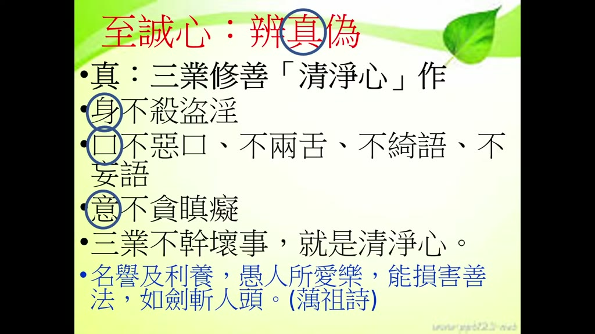

**重點：** 承上一講：身口意三業不幹壞事就是清淨心。蕅益大師詩「名譽及利養，愚人所愛樂，能損害善法，如劍斬人頭」：貪名聞利養，功德就變成人家讚嘆完就沒了的「陽德」；不求名利、清淨心作，才是有後福的「陰德」。三業清淨心作，才能迴向發願、莊嚴佛淨土。

**標籤：** #清淨心 #名聞利養 #陽德／陰德 #蕅益大師

至誠心，好，我們上一節跟大家報告至誠心當中辨真偽，這個真就要做身口意修各種善業，都要清淨心來做，那清淨心就是身口意善業都要清淨，三業都要清淨，以前那個蕅益大師他曾經做一首詩，他說什麼叫清淨心呢，他不清淨心，用這首詩我們就看得出來，他說名譽及利養，我們在世間的你都被人家讚嘆，被人家稱頌，這是名譽，然後世間當中你做了一件事情，然後有一點什麼，有一點利益，有一點供養，那這些對學佛人來講，修道人本來就是一文不值，根本不在眼內，但是愚人所愛樂，一般愚痴的人就是你做了任何善事，善事怎麼樣就要怎麼樣，能夠想能不能讓人家稱讚，能不能讓人家讚嘆，能不能讓人家怎麼稱頌，甚至還有等而下之，就是說能不能有一點利益，那這個都是一般人愚人所愛樂，所以能損害善法，就是你如果做任何善事，修各種善業，但是有這種貪愛名譽及利養的心，就會把你的善業怎麼樣，善法能夠折損，能夠損害善法，就是明明是做很多佛法的功德，很好的功德，但是因為就是貪在這個過程當中，貪這個名聞利養，貪名聞利養以後，讓你的功德變成什麼？不叫做功德了，叫變成陽德，陽德不是陰德，變成陽德，陽德的意思是什麼？就是人家讚嘆完畢，你就沒有了，然後你得到好的利益以後呢，就沒有功德了，後面呢，以後沒有好的結果了，不會有好的結果，反過來講，這個我們要了解，同樣做一件善事，如果我們不要求什麼名聞利養，就是能夠做這個，做這個老老實實清淨心來做功德，這個功德以後會變成什麼，變成陰德，以後變成陰德，而且以後會怎麼樣開發結果，結果呢是非常好，就是那個是就近的，所以同樣是做一件事情，你的居心不一樣，做出來的結果就不一樣，所以如劍斬人頭，所以如果你能夠同樣是做一件身口意，做一件善事，但是如果當中貪著名聞利養，那就像斬人頭，像劍一樣，把人頭殺死，用劍把人砍死，所以很不值得，所以雪公老師這邊特別講，我們修行淨土法門，你身口意三業一定要清淨心作，作以後才能夠迴向發願，以後迴向發願就能夠莊嚴佛淨土，否則你如果是貪愛名聞利養，怎麼樣莊嚴佛淨土，莊嚴佛淨土，就是要清淨功德才能夠莊嚴佛淨土。

### 投影片 2：丁一 不善三業必須真實心中捨：口業毀厭（03:26–07:10）

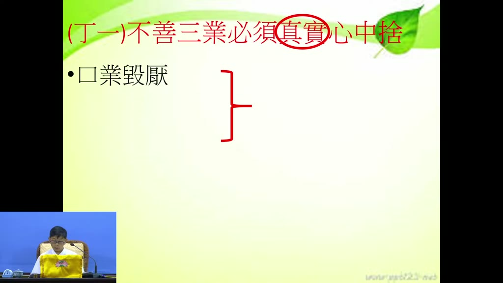

**重點：** 不善三業指貪著娑婆世界的依報（環境）與正報（身體）。口業要毀厭：佛法不讚美色身，而說「革囊臭穢」，皮革袋子裝著臭穢之物；常這樣想，貪愛心自然下降。

**標籤：** #口業毀厭 #革囊臭穢 #依報正報

好這是我們講第一個我們先把標題，丙一這個至誠心，辨真偽三業修善必須清淨心中作，那下面有分成三個，丁一不善三業必須心中捨，不善三業就是身口意不善的三業，不善三業必須心中捨，心中捨，書裡面他教我們怎麼樣啊，你看他說口業要毀要厭，必須心中捨，心中就是我們要怎麼樣啊，不善三業就是這個不善三業就是針對我們娑婆世界的依報，對娑婆世界的正報，對娑婆世界的依報正報，如果你去貪戀去貪著，這個就是不善三業，要真實要真實，真實的不要做虛假的，真實的從心中把它捨棄，那怎麼要捨棄呢，善導大師教我們第一個口業要毀要厭，口業要毀要厭，怎麼口業毀厭，口業毀就是你嘴巴裡面，我們口裡面，不要讚嘆這個娑婆世界的正報和依報，我們世界你看那個賣化妝品的，賣那個什麼健身的，賣那個養生的，那個都是怎麼樣，吃了他那個什麼好的東西，到他那個什麼健身房去運動以後，能夠養成什麼，身體能夠多麼樣的健康，能夠多麼好看，那就是在讚歎，讚歎這個什麼，依報正報，娑婆世界的正報依報，但是祖師教我們要，我們要口業毀厭，口業毀厭，毀就是毀謗，厭就是厭惡，我們在娑婆世界的依報、正報呢，我們要怎麼樣？要能夠毀厭，毀厭，毀謗、厭惡，講毀謗、厭惡可能聽不太懂，我們舉一個例子，比如說佛法，從來不會用怎麼樣？用說你這個是帥、很帥的美男子、很美的美人，不會用這個方式來形容一個人，佛法用什麼方式形容人的身體啊？革囊臭穢，對啊，以前就有一個啊，說有一個天上的美女啊，來給釋迦牟尼佛看啊，那釋迦牟尼佛看，這個就是革囊臭穢啊，革是什麼啊？皮革，皮革啊對不對？囊是什麼啊？皮囊啊，就是用皮革做成的一個怎麼樣？袋子盛著臭穢用皮革做的一個布袋裡面裝著臭的東西 汙穢的東西，他說的是什麼啊，說的就是身體啊，就是我們眾生 我們叫臭皮囊啊，我們佛法就是把我們每一個眾生的身體，我們就是這樣說啊 毀厭，每一個人的身體就像臭皮囊，所以大家如果想看看，如果你把每一，你那種貪著哪一種人，貪著對方物件，你把它天天想做口業毀厭，這個就是革囊臭穢，大概你那個貪戀心都不太有了，愛著心就會下降，革囊臭穢，確實是這樣，我們每個人的身體，就是一層皮怎麼樣，包了一些臭的東西，糞啊尿水，包了一堆東西，然後血啊汙穢東西，污穢東西。

### 投影片 3：身業輕慢厭捨：印光大師拒避暑（07:10–09:12）

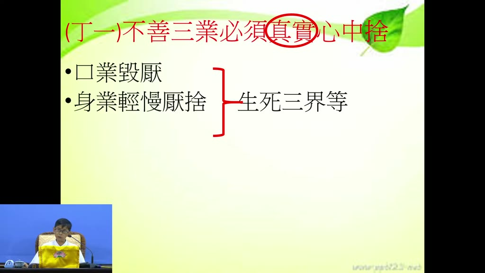

**重點：** 身業對娑婆享受要輕慢厭捨。印光大師在普陀山藏經樓閉關，樓上酷熱，有士紳邀他到天目山避暑山莊，大師呵斥：越熱越能寫信回答眾生的問題，對清涼享受毫無興趣。

**標籤：** #身業輕慢厭捨 #印光大師 #普陀山

所以叫口業毀厭，第二個呢，身業怎麼樣，也是輕慢厭捨，身業呢，身業輕慢厭捨，就是我們的，我們的身業怎麼樣輕慢厭捨呢，這個像這個地方，我們身業就是輕慢，輕視他，慢就是看不起他，討厭他，捨棄他，你說這個怎麼樣，對這個生死三界怎麼樣輕慢厭捨呢，輕慢厭捨，就是對娑婆世界的享受，對娑婆世界的依報、正報的享受，你就用這種態度 叫輕慢厭捨，我們以前舉個例，比如說印光大師在普陀山閉關的時候，普陀山是很熱，尤其像現在 它是海島，那個地方 然後那個閣樓，閣樓是說 那個藏經樓嘛，藏經樓是閣樓 非常的熱，我們上去就知道 你去上去五分鐘，全身都是汗，印光大師就住在那個地方，所以當時就有一個浙江有一個士紳，很有錢的士紳，他在天目山，天目山他有避暑聖地，有避暑山莊，他就特別好心好意邀印光大師說，我們是不是到我們的避暑山莊，我們去避暑一下，印光大師就痛斥他，呵斥他說，我在這個地方越熱越能夠寫信，因為印光大師都寫信，我越熱越能夠寫信來回答眾生的問題，解答問題，我對這種清涼的享受，我怎麼樣一點都沒興趣，你從這個地方體會一下，什麼叫輕慢厭捨，印祖就是對生死三界等自他依正二報，就是這樣輕慢厭捨，所以如果輕慢厭捨，就是真實心中，三道心理念，輕慢厭捨你還會去貪著嗎。

### 投影片 4：意業輕賤厭捨：雪公視官位一文不值（09:12–12:47）

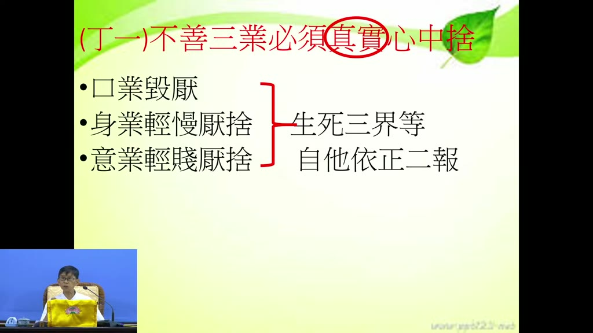

**重點：** 意業對生死三界自他依正二報要輕賤厭捨。雪公在孔奉祀官府任主任秘書，講者說當時只要開口，孔祥熙就會給官做，雪公卻把官位看得一文不值。捨就像千年暗室點一盞燈，醒過來就看開了。

**標籤：** #意業輕賤厭捨 #生死三界 #千年暗室

然後第三個意業，意業怎麼樣 叫輕賤厭捨，輕賤厭捨，在心裡面就看不起，就怎麼樣啊，看不起這個娑婆世界的生死三界的自，自自己還有別人的依報、正報，依報就是環境，正報就是身體，對自己的身體 對別人的身體，對別人的身體，自己的環境對別人的環境完全沒有怎麼樣，完全沒有什麼興趣，這個叫輕賤厭捨，所以像雪公老師為什麼，雪公老師曾經這樣說過，他在孔奉祀官府裡面當主任秘書，孔奉祀官府孔德成先生，他有一個親戚叫孔祥熙，我不知道大家知不知道孔祥熙是誰啊，孔祥熙是我們民國時代的財政部長，後來曾經當過行政院長，所以孔祥熙是和孔德成他們是有那個有姓孔都有關係，所以雪公老師曾經這樣說，他只要能夠開口，說要什麼樣的官，孔祥熙怎麼樣，二話不說就會撥一個官給雪公老師做，那雪公老師就他說，我只要開口我要到什麼山東省省長，山東省主任秘書，這個孔祥熙是行政院長啊財政部長，他就能夠馬上就能夠決定，那雪公老師說，我把那些官位呢，看什麼，一文不值。把那些官位呢，在我看來是一文不值的東西。你說多少人是拼著命要去搶那些位置啊，但是雪公老師就是什麼，輕賤厭捨，娑婆世界，生死三界的，自他依正二報。所以雪公老師他也都能夠當這個官員啊，但是為什麼不當啊，就是輕賤厭捨。所以如果我們內心當中如果身口意這麼樣的毀厭、輕慢厭捨、輕賤厭捨，這個叫做真實心中作，我們也反省自己啊，遇到好處，遇到名利，我們能夠這樣嗎，真實心中捨嗎，能夠真實心中捨嗎，可能真是不容易啊，這個你如果檢驗自己就知道，所以什麼叫捨呢，捨的意思啊，就是你捨的意思，雪公老師用一個比喻，就是本來我們都是因為我們如果不學佛，我們對這些生死對三界的自他依正二報都是怎麼樣？迷戀，非常迷惑、愛戀、捨不開，但是現在怎麼樣？要捨的時候就像怎麼樣？突然醒過來了，你對這個娑婆世界、對這個自他依正都怎麼樣？輕賤厭捨，甚至輕慢厭捨，那就像千年暗室，上千年的一個黑暗房子裡面，從來一絲光明都沒有，現在點一盞燈，它就亮，只要能醒過來，這些你就看開了，所以我們要能夠學這個，不善三業必須真實心中捨，尤其特別要注重真實兩個字真實兩個字，這不是說虛假，不是嘴巴說說而已，不是文章寫一寫而已，那是從內心當中拔除掉輕賤厭捨，然後輕慢厭捨，然後毀厭，這個是不善三業必須真實心中捨。

### 投影片 5：丁二 若起三業必須真實心中作：誠於中，形於外（12:47–16:33）

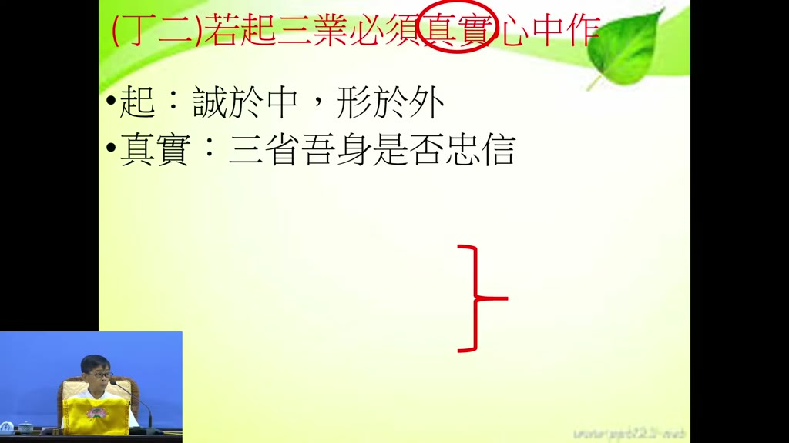

**重點：** 「起」是誠於中、形於外，不是故意表現。論語述而篇「子溫而厲，威而不猛，恭而安」是孔子數十年修為自然顯現，學不來。真實要學曾子「吾日三省吾身」：為人謀而不忠乎？與朋友交而不信乎？傳不習乎？

**標籤：** #誠於中形於外 #子溫而厲 #曾子三省

然後若起三業必須真實心中作，若起三業，這個起啊，起是什麼意思啊，起就是你真實的內心當中做了以後就能夠形於外，所以起這個意思，不善三業，若起三業必須真實心中作，起的意思就是誠於中形於外，這個起不是說故意表現出來，你內心當中如果真的身口意，對這個娑婆世界的依正二報，如果真實心中，如果對若起三業必須真實心中作，如果能夠真實心中作，就能夠現於外，所以以前雪公老師講論語的時候，曾經講到一章經文，述而篇最後一章經文，述而篇最後一章經文叫什麼，子溫而厲，威而不猛，恭而安，雪公老師說，這個不是學啊，這學不來的啊，這是孔子怎麼樣，這是孔子誠於中形於外的，他經過了幾十年的修為才能夠顯出一個子溫而厲，溫和又嚴厲，威嚴又不會剛猛，恭敬又能夠怎麼樣，很安寧，心又怎麼樣，能夠身口意都能夠很安寧，威而不猛，威而不猛，恭而安，溫而厲，威而不猛，恭而安，這不是修養 這不是說你要學就學得出來的，這個是要誠於中形於外，你內心當中真的是這樣，那個若起三業 如果真實這樣做，你就會現出在行為上面，很自然的表現在行為上面，所以這個真實是什麼，那雪公老師就教我們說，你如果真的是想要學這個，三業必須真實心中作，你就要學曾子，曾子怎麼樣 吾日三省吾身，吾日三省吾身，我每天用很多事情來反省自己，為人謀而不忠乎 與朋友交而不信乎 傳不習乎，所以曾子為什麼能夠成為宗聖，曾子能夠成為宗聖，他是每天常常來反省自己，我為人謀有沒有忠，我和朋友交往有沒有守信啊，我傳授學問有沒有先練習啊，有沒有先練習啊，所以常常這麼樣反省，這個叫真實，所以我們說什麼叫，如果你反過來講，你像教學這樣就好，你教學當中，如果教學的內容，平常怎麼樣，平常完全怎麼樣，不會去摸，也不會去看，也不會去接觸，而且不會去溫習。等到要上場的時候呢，現在很方便了，網路上面破銅爛鐵，破銅爛鐵 蒐集蒐集就可以上場了，那個就不是真實，真實是什麼，就是你如果為人，傳不習乎，你要傳授一種學問的話，你平常就要常常在這門學問上面怎麼樣，溫習、練習、熟悉，那以後你在傳授學問的時候呢，你就心安理得，李炳南、李德，哦，這個才叫真實，所以這個像這些地方啊，我們很容易犯的，很容易犯，你有做，但是不真實，所以真實是這樣。

### 投影片 6：讚歎眾生三業所為善：讀宋鎮江葛太守小傳（16:33–21:06）

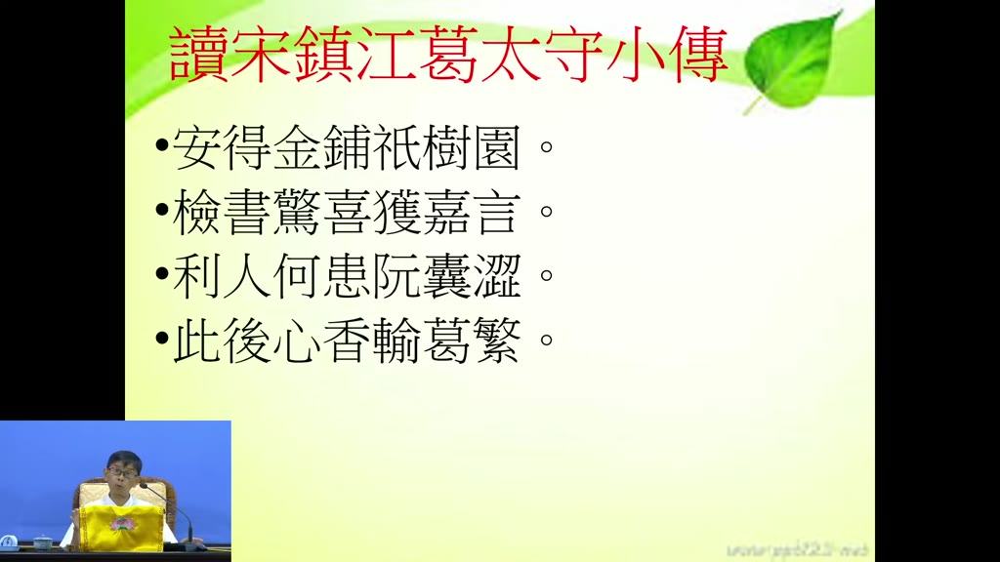

**重點：** 看到別人做善、說好話、存好念就讚歎。淨土聖賢錄的葛繁太守日行眾善，連擺正腳踏墊、拖鞋都做，連閻羅王都敬重他。雪公讀後作詩「安得金鋪祇樹園，檢書驚喜獲佳言，利人何患阮囊澀，此後心香輪葛繁」：沒有須達多布金的財力，也能學葛繁隨手行善。

**標籤：** #讚歎眾生 #葛繁 #淨土聖賢錄 #雪公詩

那我們來看這個，真實怎麼樣真實呢，讚嘆眾生三業，讚嘆眾生的三業，我們讚嘆眾生，他的身口意三業，讚嘆眾生的三業，這個在四帖疏裡面講，讚嘆眾生，每個眾生他都有身口意啊，他也都會做善啊，那要讚嘆他，怎麼樣讚嘆啊，讚嘆的話，讚嘆，就別人你看到別人啊，做善事，說好話，心裡面存好念啊，你能夠讚嘆他，讚嘆他，這個要，所以這個，你看雪公老師曾經，就曾經，我覺得像這個，我們也讀了讀了，我們也讀過啊，但是我們也沒什麼經驗啊，我們讀淨土聖賢錄裡面，都有讀過什麼葛太守的小傳啊，葛太守小傳就是這個人在地獄裡面是受閻羅王怎麼樣，閻羅王每天都跟他頂禮 跟他膜拜，所以可見葛繁在連地獄裡面的閻羅王對他都很尊敬，你說閻羅王怎麼會對葛繁這麼尊敬呢，他這個有一個小 有一個在淨土聖賢錄有一個傳記，那雪公老師就讀了這個宋鎮江葛繁小傳以後，他就覺得說這個我們就要來學啊，我們就要來啊，你看他說葛太守他有一個很好的一個優點是嗎，每天都不是日行一善啊，日行眾善，不是日行一善啊，他不只只有一善，每天當中大大小小的善事只要看到就去做，這樣的一個行為一個小小這麼樣一個動作，比如說他到人家的家裡面，看人家那個腳踏墊沒有擺整齊，他就會幫人家腳踏墊怎麼樣擺整齊，人家拖鞋沒有擺整齊，他幫人家拖鞋擺整齊，你說這些我們一般人都有看到，但是我們就不會做，他看到以後他會去做，所以他每天就是怎麼樣，尋尋覓覓做善事，所以連閻羅王對他都尊敬有加，雪公老師就讀了這個葛太守葛繁的小傳以後，雪公老師有感而發，他說安得金鋪祇樹園，就是說我們哪一個人有那個像這個，祇樹給孤獨園，這個祇樹這個，祇什麼，須達多尊者，須達多長者，我們哪有這麼多黃金來鋪這個，來幫釋迦牟尼佛建祇樹，祇樹給孤獨園，我們沒有這樣的能力啊，但是，檢書驚喜獲佳言，我看了淨土聖賢錄葛繁的小傳以後，我心裡面就很高興，得到一個好的佳言方法，然後怎麼樣 利人何患阮囊澀，我們要利益眾生啊 你何必怕，我沒有錢 我財務不夠 何必擔心這個呢，何必憂愁這個呢，此後心香，一半心香書葛繁，一半心香就怎麼樣 像葛繁來舒陳，一半心香像葛繁舒陳就是學葛繁，就是每天當中不論大善小善大善，看到好利益眾生的事情我們就做，所以這個我們就說這個叫做讚嘆眾生的三業，所以你看雪公老師就是有這樣的一個修養，有這樣的修養 他看到每一個尤其像我們來蓮社，雪公老師來蓮社以後，每一個蓮友為什麼，這麼歸心啊，雪公老師曾經說過，只要跟他說過話，很少會離開的，只要跟雪公老師說過話，很少人會離開，為什麼，雪公老師叫他就能夠，比如你做一點善事，雪公老師就怎麼樣，就不吝讚嘆，你寫書法會寫書法，雪公老師不吝讚嘆，你買了一個放學買一個，鳥放生，雪公老師不吝讚嘆，你做事情很認真，雖然做的不是很好，但是很認真做，雪公老師不吝讚嘆，所以很多人為什麼能夠歸心在雪公老師的座下，雪公老師就有這個本事，讚嘆眾生，所以這個叫讚嘆眾生，三業所為善。

### 投影片 7：合掌禮敬四事供養、意業思想觀察憶念（21:06–25:26）

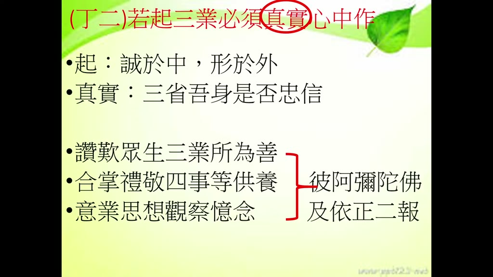

**重點：** 四事供養是衣服、飲食、臥具、湯藥。佛與天人不需飲食，供養是「敬我之心，竭我之誠」，佛一定看得到，是在種自己的福田；講者感嘆有人來蓮社二三十年吃飯仍不供養。梁武帝前世為樵夫，以斗笠為淋雨佛像遮雨，果報無盡。意業要常想阿彌陀佛、念極樂依正，這些都是生活中做得到的平實事。

**標籤：** #四事供養 #敬我之心竭我之誠 #梁武帝 #憶念彌陀

第二個呢，合掌，我們在這個四帖疏裡面講，合掌禮敬四事，供養阿彌陀佛，教我們要供養阿彌陀佛，四事在佛門當中供養出家僧眾衣服，他們的衣服沒有錢，所以我們供養衣服，第二個供養飲食，他們吃的東西也靠我們在家人供養，飲食還有臥具，睡的床、棉被、臥具，第四個，四事供養湯藥，人們會想到佛怎麼還需要湯藥？佛怎麼還需要吃什麼東西？雪公老師曾經這樣分析，不要說佛不需要吃飯，也不會生病要你的湯藥幹什麼，不要說佛，連天上的人都不需要吃飯，不要吃飯了，那你說，為什麼我們每天吃飯都要供養啊，供養佛、供養法、供養僧啊，為什麼每天吃飯供養，那個供養是什麼啊，就是敬我之心，竭我之誠，敬我們，所以每一餐，你中餐、早餐和中餐，我為什麼要供養呢，就敬我之心，敬我們這個三寶弟子的一個心，竭我之誠，竭盡我這個對三寶的一個誠心，敬我之心，竭我之誠，佛的智慧一定看得到，我們每餐早餐吃飯供養，中餐吃飯供養，晚餐不要了，早餐吃飯供養，中餐吃飯供養，佛一定看得到，你說你不會有福報嗎，當然有福報啊，對不對，這種就是種我們的福田，所以我們很多人都，很可惜啊，我們很多人來蓮社，來蓮社連了二三十年了，吃飯不會供養，你來蓮社，這個來蓮社，當然你這個來蓮社就過客而已，如果你真的在蓮社，你回去以後自己怎麼樣，早餐吃飯中餐吃飯，那很自然就供養，倒不是說佛要我們供養，是種我們的福田，這是對我們有好處，所以你看梁武帝都這樣，梁武帝生前是一個樵夫，砍柴的，你說他後來為什麼能當皇帝啊，他就做了一件小動作，當樵夫的時候怎麼樣啊，遇到下雨，下雨的時候呢，看到有一尊佛啊，被這個雨啊，被雨這個淋濕了，他就把自己的斗笠怎麼樣，把自己的斗笠呢，把它蓋在那個佛上面，就這麼樣的一個因緣以後，他怎麼樣，果報無盡，等我當上當上還有皇帝，說這個像這些地方，你看如果沒有看佛法，沒有看佛書確實就是不知道有這樣的一個事情，所以我們說合掌，合掌的意思就是恭敬，合掌、禮敬、四事供養，那這些都是要真實心中作，然後第四個呢，意業思想觀察憶念，意業思想觀察憶念，就是我們心裡面的意業呢，要思想阿彌陀佛，觀察阿彌陀佛，其實就是念佛了，你就是常常怎麼樣啊，心裡面常常想阿彌陀佛，然後常常念阿彌陀佛，念阿彌陀佛，念極樂世界的依報正報，那這個呢，那都是，如果你能夠怎麼樣，讚歎眾生三業所為善，禮敬四事供養，意業思想觀察憶念，這個叫三業真實心中作，像這些都是很平時的，你生活當中，你要做不做而已，你要做就有功德，不做就沒有，這個是都是很自然的，是啊，生活當中天天都可以做得到的事情，坦白說所以為什麼印光大師說他是以平時的，非常平時的一件事情來教我們，這個叫若起三業必須真實心中作。

### 投影片 8：丁三 不簡內外明暗皆須真實：小人閒居為不善（25:26–28:35）

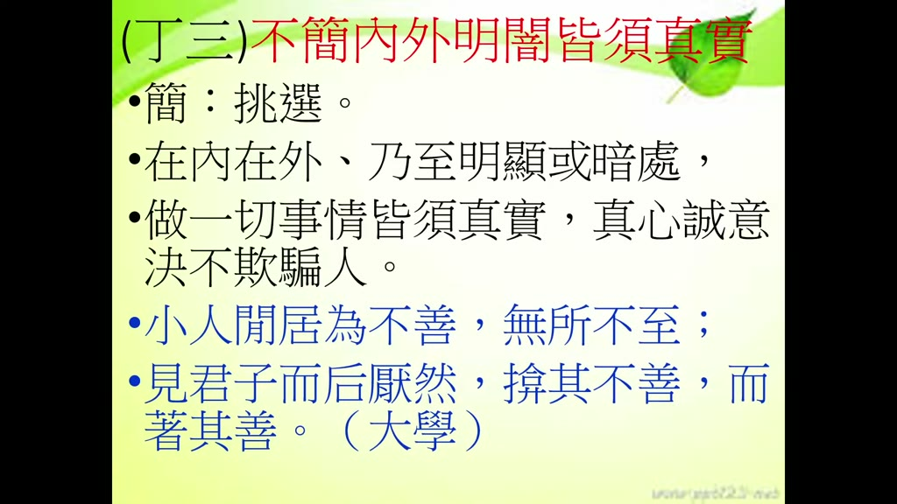

**重點：** 「簡」是挑選：有人看到、沒人看到，大庭廣眾或獨處，都一樣真實。《大學》「小人閒居為不善，無所不至，見君子而后厭然，揜其不善而著其善」，掩飾沒有用，獨處不慎獨終會露出痕跡。

**標籤：** #不簡內外明暗 #慎獨 #大學

下面我們看到不簡內外明暗皆須真實，不簡，這個簡啊，不必挑選，不必挑選，不必挑選什麼？有人看得到，沒人看得到，你都不必怎麼樣選擇，因為我們眾生就會選擇，人家看得到的是一面，人家看不到的又另外一面。那這邊善導大師都特別講，不簡，不簡的不要挑選，內外明暗，在內在外乃至明顯或暗處，很明顯的地方，大庭廣眾，也是這樣做，然後你在家裡面，人家都不在的時候，你在家裡面或一個人獨處的時候，也是這麼做，不簡內外，在內在外明顯暗處，做一切事情都要真實，作一切事情都要真實，不簡內外明暗皆須真實。明暗皆須真實，皆須真實，這個投影，會被切掉，做一件事情，皆須真實，這個是真心誠意，真心誠意，怎麼樣來做，所以雪公老師這個地方就引大學，大學裡面就教我們，大學裡面講說，你看如果是一個不守沒有道德觀，道德觀的沒有道德觀念的人叫小人，沒有道德觀念的人小人閒居為不善，只要沒事 只要是涼涼的沒事的話 閒居的話就怎麼樣，都不幹好事 就做一些不善的事情 無所不至，什麼壞事都幹得出來 什麼事情都幹得出來，然後見君子而後厭然 見到君子以後厭然，厭然的意思就是隱藏的意思，如果平常人家沒看到的時候，做什麼事情不忍卒睹，但是看到一個正人君子的時候，表現出來就不一樣，一些惡行惡狀，一些不能夠讓人看到的行為就隱藏起來了，掩其不善，把一些不善的行為就掩藏起來，而著其善，把自己不錯的、得意的能夠表現出來而著其善，其實這個沒什麼用，剛才講誠於中形於外，你平常如果說是在個人獨處的時候，然後沒有慎獨，然後在獨處的時候，生活當中生活也不照什麼規矩的話，你偶爾當中就會透露出一些，一絲一毫的訊息出來，這個隱瞞不了人家的，不簡內外明暗皆須真實心中作，這個真實心中作呢。

### 投影片 9：斌宗法師的真實：題字要楷書、受戒須自願（28:35–31:19）


**重點：** 民國四十幾年，鹿港斌宗法師（曾在大陸學天台）出版《般若波羅蜜多心經要釋》，請雪公題書名，特別交代要楷書。雪公介紹一位顯要求受戒，法師只問一句「是自願的嗎？」不是就不傳。內外一套，就不是至誠心、清淨心。

**標籤：** #斌宗法師 #心經要釋 #不簡內外

我們來看，這個雪公老師曾經，我們民國四十幾年的時候，我們有一位，臺灣有一位斌宗法師，斌宗法師是鹿港人，他到大陸，他到大陸，他到大陸的那個寧波的那個觀宗寺那邊學了天台，國清寺那邊天台山那邊學了天台宗，天台宗學得非常好，後來回到臺灣來，回到臺灣來，民國四十幾年，所以那時候雪公老師曾經特別禮請斌宗法師，因為那時候臺灣不太有法師很少，所以禮請這個斌宗法師來怎麼樣，幫大家皈依、授誡，那這個斌宗法師曾經寫了一本書，般若波羅蜜多心經要釋，般若波羅蜜多心經要釋呢，他要出版，出版，出版的時候呢，他就請雪公老師題那個書名，那特別交代，書名一定要楷書，不能草書，所以雪公老師，當然雪公老師題字偶爾也會行書啦，草書，但是呢，斌宗法師就特別提醒雪公老師要題楷書，所以你從這個細節上面就可以知道，這個斌宗法師他是不簡內外明暗都是真實，然後雪公老師那時候要介紹一個顯要，顯要就是達官顯要，介紹一個顯要要受戒，要受戒請斌宗法師來傳戒，斌宗法師就問一句話，問雪公老師一句話，是自願的嗎，如果不是自願就不要了，大家可以想看看，如果現在有那麼一個人，比如說一個部長，要來請你受戒，半夜都跑去他們家受戒了，這個事大家都，都是急先鋒了，博士長，一句話 它是自願的嗎，那雪公老師就如實說不是，而不是說就不要，所以你看像斌宗法師像這些地方都是怎麼樣，都是不簡內外一定要真實，所以從細節上面就可以知道我們做很多事情，如果我們有分內外的話，那就這方面有外表做一套 內裡面又一套，這樣都不是真實心中作，這個就不是至誠心，也就是不是清淨心，不是清淨心當然就不是至誠心。

### 投影片 10：心既無染，即感真如（31:19–33:42）

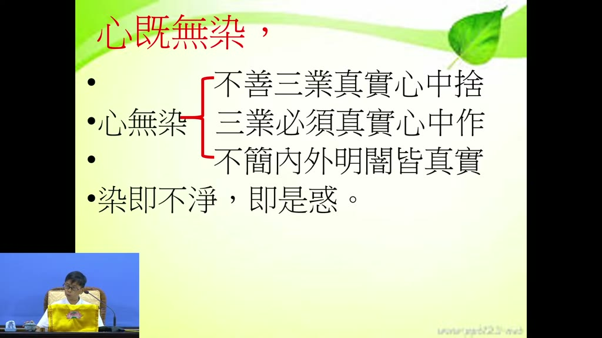

**重點：** 三句真實（不善真實心中捨、善業真實心中作、不簡內外明暗）做到，心就無染、清淨；染即不淨，就是夾雜見思惑（貪瞋痴慢疑），所作都是有漏，不能了生脫死。

**標籤：** #心既無染 #見思惑 #有漏

你不是至誠心的話，你看下面的結論：心既無染，即感真如。如果不是清淨心做、不是至誠心做的話，你做的這些事情都是有漏的，所以下面的結論是這樣，心既無染，即感真如，那如果說你做上面講，惡業也是真實心中捨，善業也是真實心中作，然後不簡內外明暗都是心中這麼樣來執行，清淨心 心裡面就無染，心無染就是不善三業真實心中捨，三業必須真實心中作 不簡內外明暗皆須真實，這三句話來說明心完全沒有汙染，染就是迷惑 有煩惱，如果你這三件事情都是能夠真實心中的捨，真實心中作，都能夠真實，你心就是清淨的，心就是清淨的話，就是沒有汙染，沒有煩惱，沒有煩惱迷惑，沒有煩惱迷惑，你要得什麼好處啊？即感真如啊，所以染即不淨，這個染，就是你有夾雜了一些煩惱，你不善三業，惡業也沒有很想要把它捨掉，善業也沒有怎麼樣，真實心中作，然後內外是各一套，那這樣的話就是夾雜了見思惑，不淨就是夾雜了見思惑，這個惑就是見惑和思惑，貪嗔痴慢疑，你夾雜了貪嗔痴慢疑，你做的事情就是有漏的，有漏的東西，就是這種有漏的東西就不純淨，不能夠讓我們了生脫死的，反過來講，如果心裡面真實心中捨、真實心中作、內外明暗皆須真實，那就不一樣了，即感真如，即感真如，這個我們要好好研究，就是你如果念佛，你念佛或者我們做這個佛法的事情，如果能夠這樣真實心中作、真實心中捨，不簡內外明暗、真實心、真實的話，就能夠和真如本性怎麼樣啊，能夠感通，能夠契合本性。

### 投影片 11：即感真如：至之言專，誠之言實（33:42–37:52）

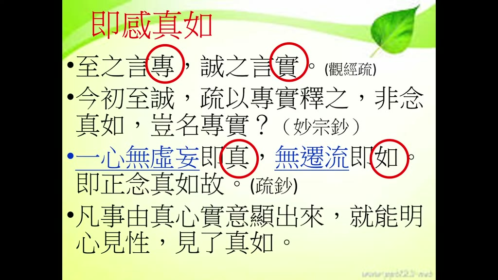

**重點：** 觀經疏「至之言專，誠之言實」；知禮大師《妙宗鈔》「非念真如，豈名專實」；蓮池大師《彌陀疏鈔》「一心無虛妄即真，無遷流即如」：念佛字字清楚、一句不丟，就是真；不被他念牽走，就是如。雪公說五分鐘一心不亂就開智慧，可先練「百八聲不亂」。

**標籤：** #專實 #妙宗鈔 #彌陀疏鈔 #百八聲不亂

這個地方，這個妙宗鈔，他們這個都講得很細，就講得很道地，他說，至是什麼，至者言專，誠叫至誠心的至，至就是專，就是你專門，真的是真實心中捨，真實心中作，內外都是真實，這就是專，誠者言實，能夠很實實在在，不作虛假，所以這個叫至誠，至誠，那個在智者大師的書呢專以專實來解釋它，智者大師的書當中呢它就是一個專這個字一個實這個字來解釋它，非念真如，豈名專實，如果不是念到能夠念念到能夠契合真如哪有資格叫專，諸法門不專，何有資格叫做實。這是知禮大師他這樣的一個他這樣的體會，也就真的因為你修這個真如真如就是本性，真如本性當中一定不能有夾雜任何的一個虛偽思想，虛偽夾雜所以要專要實，所以我們可以像我們如果修淨土法門，你如果不專怎麼能夠叫做和真如，聖經的聖事是何？能夠契合，所以一定要專一定要實，才能夠和真如契合，那和真如契合你看，一念無虛妄即真，就是你這一心，這一心如果不虛妄的話，不要想得很難，你念佛的時候念到能夠聽得到，你念佛的時候，多能夠聽得清清楚楚，這個就是真，就是沒有虛妄，你念佛的時候如果是聽不到，那就是虛妄，嘴巴在念 心裡面不在念，所以你念佛的時候心裡面怎麼樣，不虛不妄，都是字字清楚，一句不丟 一字不失，一個句都沒有丟 一個字都沒有失，清清楚楚 這個就叫真，然後無遷流，無遷流就是不會被其他念頭打岔，念念都是如此，這個叫如，因為如就是如如不動，如如不動，所以你念佛的時候，如果能夠這樣一句不走，一字不丟的這樣念念念念不遷流，念念多下去的話，就是如如不動，所以這個就是正念真如，這是在彌陀疏鈔，這個在彌陀疏鈔裡面，蓮池大師的，蓮池大師的彌陀疏鈔裡面，他是解釋真和如，真和如，所以這個，這個，雪公老師就是，他就是解釋這個，凡事由真心實意顯出來的，你做一件事情，念佛做善的功德，如果真心實意顯出來，就能夠明心見性，就能夠明心見性，能夠見了真如，甚至雪公老師還曾經這樣開示，主要是只要有五分鐘，只要有五分鐘的一心不亂，只要有五分鐘的一心不亂就開智慧，就是開智慧，開這個真如智慧，五分鐘也是很難的啦，所以後來慢慢我們就學一百零八聲，百八聲不亂，一百零八聲從第一聲到一百零八聲，都能夠怎麼樣 無遷流，都能夠如何 如如的，能夠如如不動，一百零八聲念到第一百零八聲，這樣就能開智慧，回去自己可以實驗看看一百零八聲都不要讓妄念牽走不要讓其他念頭引開能夠這樣如如的，能夠這樣念，就能夠開智慧，就是能夠明心見性見了真如。

### 投影片 12：心淨即感真如：善導大師念佛口出光明（37:52–42:21）

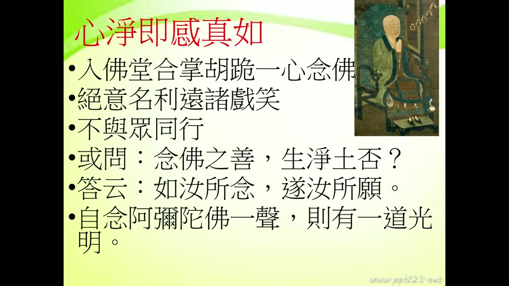

**重點：** 善導大師入佛堂合掌胡跪、一心念佛，冬天也汗流浹背；絕意名利、遠諸戲笑、不與眾同行，獨行才能念佛。有人問念佛能否生淨土，答「如汝所念，遂汝所願」，自念一聲佛，一道光明從口出。講者說這叫以身證法，我們若念不到這程度，反成以身謗法。

**標籤：** #善導大師 #胡跪 #以身證法

你說這是善導大師說的，善導大師有沒有這個經驗，他就有這個經驗，善導大師他念佛，他的經驗就是如此，確實他念佛就能夠感動、感得真如，所以你看在淨土聖賢錄的傳記裡面曾經這樣寫，這個善導大師只要進入佛堂，他一定合掌，胡跪，胡跪是一種很特殊的一種跪法，好像是單腳跪的，單腳跪的和我們雙腳跪的不一樣，進入佛堂以後就合掌恭敬，然後胡跪 跪著 一心念佛，那怎麼樣念啊 念佛念到怎麼樣 一心念佛念到，一心念佛念到汗流浹背 連冬天都汗流浹背，可見怎麼樣 很專心 很專 很實 很專心很實意的在念，念到怎麼樣啊 念到汗流浹背 每次念佛都這樣，然後他平常呢 他有一個生活習慣，不太不太不太，絕意名利遠諸戲笑，他對這個世間的名利呢，就是絕意完全沒有興趣，剛剛講了輕賤、輕慢、毀厭，對娑婆世界的名呢，對娑婆世界利益呢，他怎麼樣絕意輕賤厭捨，然後遠諸戲笑，不太會跟人家說說笑笑，不太會說說笑笑，所以我們要學這個，這個也看 跟人家說說笑笑就打什麼 打綺語啊，打綺語 有一點打綺語 打妄語的意思 應該是要減少，然後呢 你看他 平常和大眾出去，平常和大眾出去呢 我們一般人都很喜歡跟大眾怎麼樣 同行，有說有笑啊 對不對 那多麼愉快的事情啊，但是呢 善導大師怎麼樣 不與眾同行，平常他說獨行 獨行 你說他為什麼要獨行啊，獨行才能念佛啊 對不對 你跟旁邊說說笑笑 說三道四的哪能念佛啊，所以獨行才能念佛啊 所以他不與眾同行，然後呢 那有人問他說念佛之善 生淨土否，就是念佛是這麼好 念佛是既然這麼好的話，能不能生淨土 生到極樂世界呢，是不是真的能夠生到極樂世界呢，那善導大師實際表演給他看，怎麼表演呢，如汝所念，遂汝所願，就像你念的阿彌陀佛，就能夠滿你的願怎麼樣 生到阿彌陀佛世界，你念阿彌陀佛 你就能夠滿你的願，能夠往生到阿彌陀佛極樂世界，然後他表現給大家看，自念，自念阿彌陀佛一聲，自己就念阿彌陀佛一聲，你看馬上就有一道光明，從他口裡面出來，所以這張圖，這張圖是本來就是念一聲佛，這個日本人畫的，日本人畫的，念一聲佛就有一道光明出來，念十聲就十道光明出來，你說他這樣的一個念佛，也有這種效果，誰不會修淨土法門呢？我們坦白說，如果我們現在，我們念佛如果能夠念到這種功夫，你說我們現在臺灣哪些人不會修淨土法門呢？我們就是沒有念佛念到這個程度啊。你說了半天人家也不信啊，對不對？你說了半天什麼不要說光啊，對不對？連個氣也沒有啊。人家當然不信啊。如果我們念佛能夠念到現在這樣，那當然多少人會來修淨土法門？他就是親自怎麼樣，這個叫以身證法，我們現在是以身謗法，我們說念佛多好，但是從來沒有證明說念佛多好，以身謗法 毀謗佛法，那人家是以身證法，用親身來證明這個佛法，所以你看這個，能夠念一聲佛就有一怎麼樣，有一道光明出來，這個就是感動真如啊，就是真如能夠怎麼樣，能夠感召真如出來。

### 投影片 13：丙二 夾雜惡性名雜毒善：事同蛇蠍（42:21–44:28）

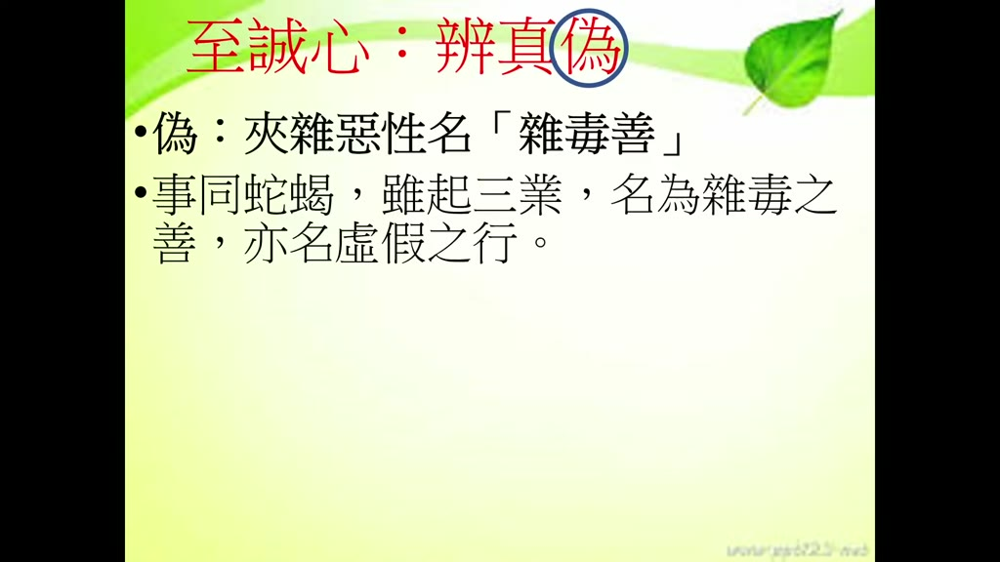

**重點：** 前面丙一是真，丙二辨偽：同樣念佛、修功德，內心夾雜有漏煩惱，善中就摻了毒。四帖疏：「事同蛇蠍，雖起三業，名為雜毒之善，亦名虛假之行」。

**標籤：** #雜毒善 #事同蛇蠍 #虛假之行

好 這個是我們講這一段，辨真偽，辨真偽的第一段，丙一三業修善清淨心中作，三業修善清淨心作，那我們再看丙二，丙二就是夾雜惡性，名雜毒善，夾雜惡，這個就是偽了，前面是真，丙一這個三業修善清淨心作，這是真，現在叫辨偽，辨別什麼叫做偽呢，然後同樣是念佛，念佛同樣是修功德，但是為什麼會變偽呢，那偽的話就是不真實啊，不真實的話，功德就是就差很多了，所以下面講夾雜惡性名雜毒善，夾雜惡性名雜毒善，這個夾雜的就是你，你念佛也好，或者做種種善功德，夾雜的惡性，惡性就是一些有漏的煩惱，夾雜的有漏的煩惱，你這個善也是善，你看也念佛啊，也有功德啊，但是這個善是什麼，是雜了雜了雜了一些毒毒素在裡面，夾雜的毒素在裡面，那你說夾雜的毒素在裡面的善功德，那就是這個功德就不純粹了，不純粹，那這個善導大師說呢，他有個比喻，他說事同蛇蠍，就是你明明是做善的功德，比如說念佛、做善功德但是內心裡面是夾雜的惡性就像那個蛇、蠍子一樣像蛇、像蠍子一樣雖起三業雖然身口意三業都是做善也念佛，但是名雜毒善也叫做虛假之行，也是虛假之行，雜毒善、虛假之行，雪公老師這個地方有一個比喻，如果一個人如果你念佛做善功德，但是如果裡面夾雜的貪嗔痴，這也嚴重了。

### 投影片 14：牛乳雜驢乳：過去惡習摻入現在的善（44:28–47:32）

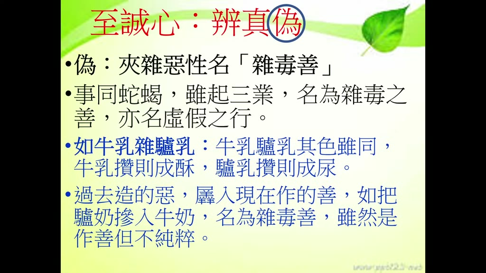

**重點：** 雪公比喻：牛乳與驢乳顏色相同，牛乳攢則成酥，驢乳攢則成尿。過去惡業習氣摻入現在的善，雖是作善但不純粹。學佛後要「隨緣消舊業，更莫造新殃」，把貪瞋痴慢疑習氣降伏住，所念佛號、所修功德才是純粹的牛乳。

**標籤：** #牛乳雜驢乳 #降伏習氣 #隨緣消舊業

那怎麼 雪公老師有個比喻叫做牛乳雜驢乳，牛乳雜驢乳就是牛乳是可以喝的，驢乳我們沒有喝過我不知道，牛乳雜驢乳就是一個牛乳本來是很純粹的，可以提煉什麼 提煉生酥，熟酥、醍醐，但是如果裡面加了一個驢乳，這兩種乳都是白色，牛奶也好 驢奶也好 都是白色，它的顏色也好 都是白色，但是牛奶你把它這樣轉一轉，這個攢 攢就是轉的意思，把它轉一轉以後會變成什麼 生酥，生酥就是 我們現在有沒有賣這種東西，因為我們不常吃 不知道，有生酥有熟酥，就是變成很純很濃鬱的奶製品，很香很濃鬱的奶製品，能夠成生酥熟酥，但是驢奶就不一樣，驢奶如果你去把它轉一轉就變成尿，變成尿，所以當然效果就不一樣啊，所以這個是比喻什麼啊，這是比喻就是說你雖然是牛乳是做善事，而驢乳是做是夾雜惡性，大智度論裡面講，你過去造的惡，我們這個是雪公老師講的，過去造的惡業，然後摻入現在所做的善事，就是你現在會念佛啦，會做這個佈施持戒 種種功德，但是過去嘛，造的惡業 那個惡業就是習氣啦，你過去有一些很多惡的習氣 貪嗔痴的習氣，現在你也會念佛 也會做善功德，善功德，那就像把驢奶摻入牛奶，雖然是作善，但不純粹。誰沒有習氣？當然有習氣，沒有學佛前，大家都有貪嗔痴慢疑的習氣。但是我們學佛以後，隨緣消舊業，更不造新殃。所以我們既然瞭解佛法以後，懂得佛法以後，我們過去的那些惡習氣，貪嗔痴慢疑、惡習氣要伏住，要把它伏住、降伏住、控制住，降伏住、控制住以後，那你現在所念的佛號、做的善功德，那才是甚麼呀，純粹的牛奶，純粹牛奶，所以我們每個人都有惡業呀，沒有惡習氣呀，都有惡習氣，但是要降伏、要伏惑，所以這個地方就教我們，我們不能夠說一邊念佛一邊做善功德，然後過去的什麼吃喝玩樂睡，吃喝玩樂睡的那個惡習氣都還夾雜進來，那這樣就是變成怎麼樣，夾雜惡性，夾雜惡性這個叫雜毒善，雜毒善，所以這個是雪公老師用這樣的一個比喻，所以要怎麼樣。

### 投影片 15：丁一 外現賢善精進之相（47:32–50:15）

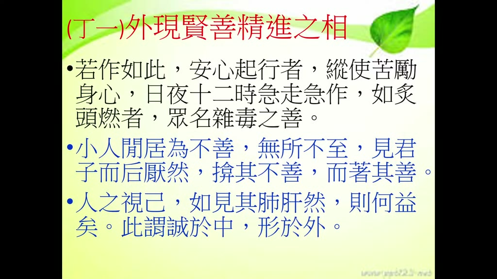

**重點：** 四帖疏：「若作如此安心起行，縱使苦勵身心，日夜十二時急走急作，如炙頭燃者，眾名雜毒之善」。心如蛇蠍、惡性未降伏，整天忙著做善事仍是雜毒善。《大學》「人之視己，如見其肺肝然，則何益矣」，誠於中形於外，表面的賢善精進瞞不過人。

**標籤：** #外現賢善精進 #如炙頭燃 #人之視己如見其肺肝

下面有三條，夾雜惡性名雜毒善，第一個怎麼樣叫做雜毒善，外現賢善精進之相，外表現出賢德善好的精進之相，外現賢善精進之相，善導大師就說，若心裡面像蛇蠍一樣，做很多善事，若作如此安心起行，那你心裡面像蛇蠍這麼樣夾雜的貪嗔痴，雖然安心起行，也做得很安穩啊，也做了很多善事啊，縱使苦勵身心，啊，很辛苦啊，策勵身心，很辛苦策勵我們的身心，然後日日夜夜十二時早上白天晚上都怎麼樣啊，白天晚上都急走急作，啊，走得很快 做得很猛，如炙頭燃，就好像就這個頭上已經著火一樣，如炙頭燃，但是，對不起啊，這個叫什麼 叫雜毒善，就是內心當中，有蛇 像蛇像蠍一樣的，那個貪嗔痴，惡性沒有降伏的話，即使你怎麼樣，整天忙忙碌碌做善事，但是，祖師說這個叫雜毒善，坦白說雜毒善的功德，為何？這個叫外現賢善精進之相，所以剛才講小人閒居為不善，無所不至見君子而後厭然，揜其不善而著其善，但是你看人之視己，如見其肺肝然，別人看不到的地方是一套，別人看到的地方又一套，這麼樣遮遮掩掩有沒有效呢，你看大學裡面，人家看我們不只看你表面，連你的心肝脾肺都看得清清楚楚，如見其肺肝然則何益矣，有什麼幫助呢，因為誠於中形於外，你在內心當中怎麼表現，外現賢善精進之相，表面上賢德善良的精進之相，是瞞不過人的，我們今天先報告到這邊，（片尾）。

## 已知轉錄錯誤

| 時間 | 聽成 | 應為 |
|---|---|---|
| 00:10–00:30、04:51–05:17、07:10–07:40、15:24–15:54、20:15–20:45、24:37–25:07、26:34–26:59、42:23–42:53、48:35–49:05 | 整個 30 秒窗格只有一句標題（如「口業毀業」「接續證實」）或外洩的提示詞「阿賴耶識、敦倫盡分」 | Groq 長音訊漏轉；這 9 段已單獨重送 Groq（不帶提示詞、--lang zh）補回，接縫處的重複句已刪除 |
| 16:22 | 李炳南、李德 | 推測是提示詞外洩或「心安理得」的重複，未能確認，保留原樣 |
| 35:09 | 聖經的聖事是何？ | 轉錄不清，推測是講者念「真如」相關句子，未能確認 |
| 19:45–19:52 | 一半心香書葛繁／像葛繁來舒陳 | 投影片詩句是「此後心香輪葛繁」；講者的口語解釋聽不清，保留原樣（推測） |
| 21:42 | 佛教徒們的聖誕節是在四世共養湯藥 | 第四個，四事供養湯藥（推測，原句是 Groq 幻覺） |
| 30:44 | 博士長 | 不明，推測是「部長」之類的稱呼，保留原樣 |
| 32:28 | 染急不盡 | 染即不淨（依投影片「染即不淨，即是惑」） |
| 39:14 | 親見慢親見悔厭 | 輕賤、輕慢、毀厭（推測，依前文三業的捨法） |
| 44:51 | 宗宗、曹宗、提湖 | 熟酥、醍醐（推測，五味：乳、酪、生酥、熟酥、醍醐） |
| 45:07 | 這個船 船就是轉的意思 | 攢（依投影片「牛乳攢則成酥」） |
| 08:17 | 北天木山 | 天目山（推測，浙江避暑勝地；講者原話可能是「西天目山」） |
| 02:00、02:30 | 揚德、因德 | 陽德、陰德（推測，依上下文：人家讚嘆完就沒了 vs 以後開花結果） |
| 17:21–19:52 | 苟泰手、苟凡、葛炭、葛泰、葛範、葛藩 | 葛太守、葛繁（依投影片「讀宋鎮江葛太守小傳」「此後心香輪葛繁」） |
| 28:46–30:56 | 兵宗／兵中／冰中／賓宗法師、博羅波羅蜜多心經要事、關中寺、國慶寺 | 斌宗法師、般若波羅蜜多心經要釋、觀宗寺、國清寺（依斌宗法師生平推定，未查證） |
| 50:05 | 多謝您的觀看，下次見！ | 片尾幻覺，改為「（片尾）」 |
| 00:00、03:10 | 致成心、（清淨心作）坐以後 | 至誠心、作以後（使用者校對指出） |

## 補充資料連結

- 補充資料檔：[supplement.md](supplement.md)（與本報告同資料夾；內容已收錄於上方〈補充資料〉）
