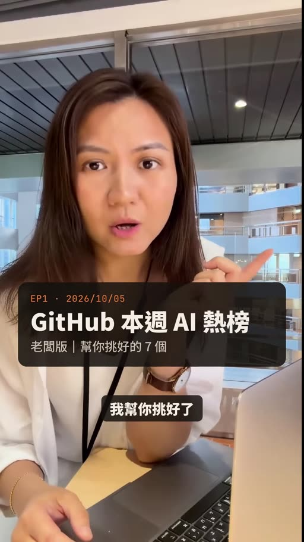

# Video by good_job_ai

- 來源：https://www.instagram.com/reel/DeJhY7PAMrR/?rpxt=MWh4bmQwOHVnbnFsMw==
- 平台 / 上傳者：Instagram / 一股GoodJob
- 長度：00:56 (56.4s)
- 逐字稿來源：whisper (groq)
- 更新日期：2026-10-13
- **關鍵字：** #GitHub 熱榜 #AI 工具 #HeyGen #Paperclip #Agent 管理 #長期記憶 #VoiceStudio #開源

## 摘要與名詞說明

**一句話重點：** 一股GoodJob 在 56 秒內，從第七名倒數到第一名介紹本週 GitHub 熱門 AI 開源專案，最後以老闆視角推薦第三名 Paperclip。

| 時間 | 重點 |
|---|---|
| 00:00 | 開場：本週 GitHub 最紅的 AI 工具，已幫你挑好 7 個 |
| 00:03 | #7 MoneyPrinterTurbo：給主題自動寫腳本、配素材、上字幕，生成短影音 |
| 00:08 | #6 HeyGen hyperframes：寫網頁就能出影片，本片的卡片就是用它做的 |
| 00:15 | #5 Univer：讓 AI 直接操作試算表、文件、簡報 |
| 00:20 | #4 Agent-Reach：讓 AI 看 Twitter、Reddit、YouTube、小紅書 |
| 00:25 | #3 Paperclip：管理 AI 員工的工作台，設目標、給預算、儀表板看所有 Agent |
| 00:32 | #2 Hindsight：AI 長期記憶，會從過去經驗學習 |
| 00:37 | #1 VoiceStudio：本機執行的開源配音工具（複製聲音、影片配音、有聲書） |
| 00:44 | 老闆推薦 #3 Paperclip：用目標與預算管 AI 團隊；結尾留言「排行榜」索取清單 |

## 名詞
- Star：GitHub 專案的收藏數；畫面數字為「本週新增 Star」，**講者／畫面主張，未查證**。
- Agent：能自主執行任務的 AI 代理。

## 轉錄校正備註
- 轉錄來源 Groq Whisper；已依畫面字幕校正 HeyGen、Paperclip、企業導入、下週榜見等（見 `meta.json.known_asr_errors`）。
- 專案名稱／作者（如 harry0703/MoneyPrinterTurbo）取自畫面卡片，其功能與熱度說法皆為**講者主張，未查證**。
- 00:04 畫面為卡片 #7 字幕；#4 卡片曾短暫顯示 +0（動畫計數中），以 +3,952 為準。
- 非講座類影片，未去語助詞。

## 圖文對照（畫面 + 逐字稿）

### 投影片 1：開場：本週 GitHub 最紅的 AI 工具（00:00–00:03）

**重點：** 主持人（一股GoodJob）預告挑好 7 個本週 GitHub 熱門 AI 專案。

這周GitHub最紅的 AI 工具，我幫你挑好了。

### 投影片 2：#7 一鍵生成短影音（00:03–00:08）

**重點：** 給主題就自動寫腳本、配素材、上字幕；harry0703/MoneyPrinterTurbo，本週新增 Star +1,687（畫面數字）。

第七名，給它一個主題，它就自動寫腳本，配素材，上字幕，直接生成短影音。

### 投影片 3：#6 寫網頁就能出影片（00:08–00:15）

**重點：** HeyGen 開源影片框架，專為 AI Agent 設計；heygen-com/hyperframes，+1,645。

第六名，HeyGen 開源的影片框架，寫網頁就能出影片，這支影片的卡片，就是用它做的。

### 投影片 4：#5 讓 AI 直接操作 Office（00:15–00:20）

**重點：** 試算表、文件、簡報皆可讀寫；dream-num/univer，+3,283。

第五名，讓AI直接操作，試算表，檔案和簡報，才能把資料變成互動報表。

### 投影片 5：#4 幫 AI 裝上網路能力（00:20–00:25）

**重點：** 推特、Reddit、YouTube、小紅書一次接上；Panniantong/Agent-Reach，+3,952。

第四名，幫AI裝上網路能力，Twitter Reddit YouTube，小紅書都能幫你看。

### 投影片 6：#3 管理 AI 員工的工作台（00:25–00:32）

**重點：** 設目標、給預算，一個儀表板看所有 Agent；paperclipai/paperclip，+10,722。

第三名，管理AI員工的工作臺，設目標給預算，一個儀表板看所有agent在做什麼。

### 投影片 7：#2 會學習的 AI 長期記憶（00:32–00:37）

**重點：** 不只記得對話，還會從經驗學習；vectorize-io/hindsight，+14,198。

第二名，AI的長期記憶，它不只記得你說過什麼，還會從過去的經驗學習。

### 投影片 8：#1 開源本機配音工具（00:37–00:44）

**重點：** 聲音複製、影片配音、有聲書，全在本機跑；debpalash/VoiceStudio，+16,775。

第一名，開源，能完全在自己電腦上跑的配音工具，複製聲音，幫影片配音，做有聲書，一套搞定。

### 投影片 9：我的推薦：#3 Paperclip（00:44–00:56）

**重點：** 老闆視角：不是多買幾個 Agent，而是用目標與預算管理 AI 團隊；結尾留言「排行榜」索取完整清單。

如果你是老闆，我最推薦第三名，Paperclip，它不是叫你多買幾個agent，而是用目標和預算去管AI團隊，這才是企業導入真正該想的事，收藏起來，下週榜見。

## 已知轉錄錯誤

| 時間 | 聽成 | 應為 |
|---|---|---|
| 00:09 | 黑陣開源 | HeyGen 開源（畫面 #6 字幕確認） |
| 00:11 | 寫網歷 | 寫網頁（畫面確認） |
| 00:46 | Pay Per Click | Paperclip（畫面確認） |
| 00:50 | 企業匯入 | 企業導入（畫面確認） |
| 00:53 | 下週周訪見 | 下週榜見（畫面確認） |
| 00:18 | 才能把資料變成互動報表 | 推測為「還能…」；畫面卡片只寫「試算表、文件、簡報，AI 都能讀寫」，此句畫面無對應 |
