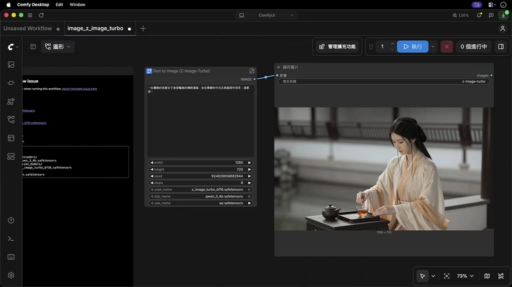
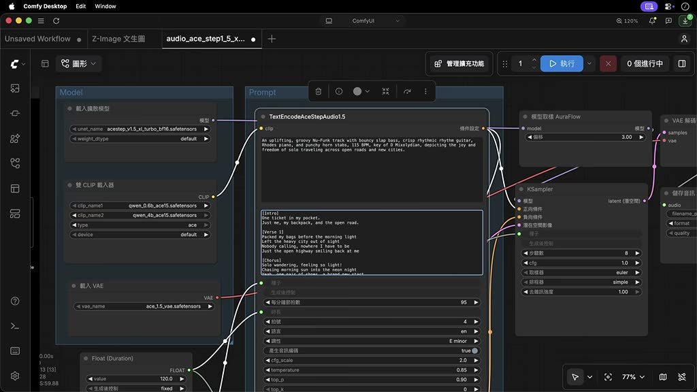
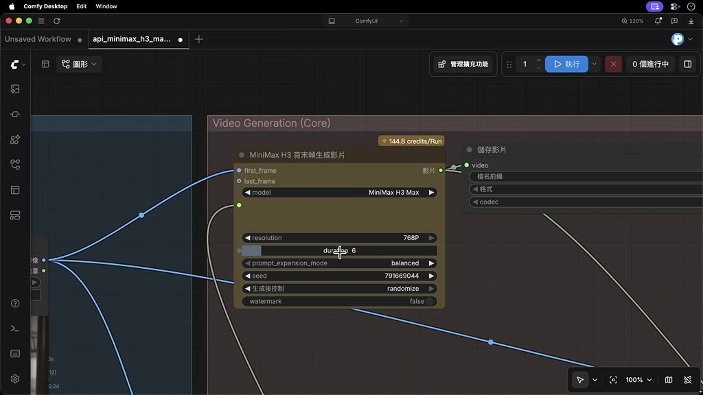

# 免費製作 AI 影片：ComfyUI 接上 Claude（MCP）

- 來源：https://youtu.be/fAWliYuOiuc
- 平台 / 上傳者：YouTube / PAPAYA 電腦教室
- 長度：15:03 (903.3s)
- 逐字稿來源：whisper (groq)
- 更新日期：2026-10-13
- **關鍵字：** #ComfyUI #Comfy Cloud #MCP #Claude #Z-Image Turbo #ACE-Step #MiniMax H3 #GPT Image 2 #工作流程 #節點

## 摘要與名詞說明

**一句話重點：** PAPAYA 電腦教室示範在 Mac 上安裝 ComfyUI 桌面版，用內建範本免費在本機生成圖片（Z-Image Turbo）與音樂（ACE-Step），以 Comfy Cloud 點數跑 MiniMax H3 圖生影片，再透過 Comfy MCP 讓 Claude 代為執行、改造工作流程與規劃動畫分鏡。

## 重點時間表

| 時間 | 重點 |
|---|---|
| 00:00 | ComfyUI 以節點流程生成影像；講者主張內建範本加上 AI 助理可大幅降低學習門檻 |
| 00:37 | 官網下載安裝桌面版，選「本地」執行（雲端 GPU 需訂閱付費） |
| 01:34 | 主介面與內建範本：皇冠代表只能雲端執行，可篩選只看本機範本 |
| 02:42 | 基本操作：拖曳節點、子工作流程、滾輪縮放、空白鍵平移、句號鍵聚焦 |
| 03:54 | 側邊欄一鍵下載缺少的模型，Ctrl／Command-R 重新整理；模型存放位置看說明卡片 |
| 05:02 | Z-Image 生成 1280×720 圖片；作品存在 Output 資料夾、資產面板；Ctrl／Command+S 儲存工作流程 |
| 06:31 | ACE-Step 文字生成音樂：曲風、歌詞、速度、調性、長度 |
| 08:07 | MiniMax H3 圖生影片：硬體需求高，改用 Comfy Cloud（註冊、儲值點數） |
| 09:31 | 以泡茶圖為初始影格，設定提示詞、解析度、長度（最長 15 秒，越長越耗點數） |
| 10:45 | ComfyUI 支援 MCP；安裝 Comfy MCP 到 Claude（指定 ComfyUI 資料夾、信任工作區） |
| 11:56 | 請 Claude 用現有工作流程生成中文歌，Claude 先確認主唱、歌詞等細節 |
| 13:06 | 請 Claude 改用 GPT Image 2、一次生成三種風格的警察企鵝；改好的流程可直接換主題 |
| 14:12 | 請 Claude 把柴犬廚師故事拆成分鏡，生成一段動畫 |

## 名詞與縮寫
- **ComfyUI**：以節點（node）組成工作流程的開源影像／影音生成工具，有桌面版。
- **Comfy Cloud**：Comfy 官方雲端算圖服務，採點數制，可執行不開源或硬體需求高的模型（範本上有皇冠圖示）。
- **MCP（Model Context Protocol）**：讓 AI 助理呼叫外部工具的協定；**Comfy MCP** 讓 Claude、ChatGPT 等直接操作 ComfyUI。
- **Z-Image Turbo**：本機文生圖模型範本。**ACE-Step**：文字生成音樂模型。**MiniMax H3**：影片生成模型（圖生／文生／參考生影片）。**GPT Image 2**：OpenAI 影像模型，在此透過 Comfy 點數使用。

## 備註（講者主張，未查證）
- ACE-Step 支援 50 種以上語言、MiniMax H3 主要針對 NVIDIA 顯示卡、雲端影片最長 15 秒、示範儲值 10 美元等數字與說法，均為講者主張，未查證；版本與價格可能已變動。
- 「免費」指本機執行開源模型；雲端範本（MiniMax H3 圖生影片、GPT Image 2）需要付費點數。
- 畫面中 ComfyUI 為 v0.34.3、PyTorch 2.12.1，Claude 桌面版顯示 Opus 5（錄製時狀態）。

## 轉錄校正備註
- 逐字稿來源：Groq Whisper（自動偵測為中文）。ComfyUI 被聽成 KonfiUI、confyUI 等多種寫法，已新增至 `glossary/domains/ai-video.json`；Claude 被聽成「Cloud」只在本支修正。
- OpenCC 台灣用語把「參數」「類型」轉成「引數」「型別」，已改回。
- 07:39–07:56、12:46–13:06、14:41–14:55 為示範音樂與動畫播放，無旁白。
- 其餘推測性校正記在 `meta.json.known_asr_errors`。

## 圖文對照（畫面 + 逐字稿）

### 投影片 1：開場、下載安裝與主介面範本（00:00–03:54）

**重點：** ComfyUI 以節點流程生成影像；官網下載桌面版，選「本地」執行（雲端 GPU 需另付費）。內建範本可依類別瀏覽，皇冠代表只能雲端執行，可用篩選只看本機範本；示範選 Z-Image Turbo，並介紹拖曳節點、縮放／平移畫布、句號鍵聚焦節點等基本操作。

**標籤：** #ComfyUI #本地執行 #範本 #皇冠 #節點操作

嗨 大家好，今天我們要來聊聊如何用自己的電腦免費生成高品質的AI圖片和影片，我們要用到一款非常知名且強大的軟體 叫做ComfyUI，這個工具把生成影像的運算步驟拆解成一個類似生產線的節點流程，也因為如此 過去常被許多初學者認為它的學習曲線相當的陡峭，不過好訊息是，現在ComfyUI已有許多內建的範本，再配合ChatGPT和Claude等AI助理的協助，可大幅降低新手學習和操作的門檻，好，那要下載ComfyUI，我們可以到它的官網，點選右上角的按鈕，接著點選下載來將安裝檔儲存到自己的電腦，並對著它雙擊滑鼠左鍵，就可以完成ComfyUI的安裝，那我們把ComfyUI開啟之後，它首先會詢問我們要使用哪一種執行方式，其中左邊的選項是將算圖工作跑在雲端的GPU，需要另外訂閱和付費，而這邊我們要選擇的是本地，代表我們要用自己的電腦來跑ComfyUI，不過這也代表你的硬體規格不能太差，因為這會影響到你的電腦能跑多大的模型，以及算圖生成的速度，接著我再到底下勾選我同意的選項，點選繼續，你可以隨意指定一個安裝的位置，或是直接保持預設值，然後按下繼續，點選跳過並安裝，如此，ComfyUI就會開始下載必要的元件來進行安裝的程式，過了一會兒安裝完成後，我們就會來到ComfyUI的主介面，那此時畫面會呈現一個空白的畫布，在早期使用ComfyUI時，使用者必須手動插入節點來建立工作流程，操作步驟相當的繁瑣，不過現在ComfyUI已經內建了許多現成的範本，為我們省下不少的設定時間，那這裡我以生成圖片來做個簡單的示範，你可以在頁面中瀏覽各式各樣AI模型的工作流程，那你會注意到某些範本的右上角有顯示皇冠的圖示，代表這個AI模型可能硬體需求過高或是沒有開源，因此只提供雲端執行的選項，如果你只想要瀏覽執行在本機的範本，你可以勾選ComfyUI來隱藏那些需要付費的專案，如有需要，你也可以搭配旁邊的下拉選單，來顯示最新或近期熱門的AI模型，這邊我就用Z-Image Turbo這個範本來做個簡單的示範，開啟之後，你會注意到右上角有一則錯誤訊息，這是因為要用來生成圖片的AI模型，我們還沒有下載，所以是正常的，不過在下載之前，我們可以先熟悉一些ComfyUI的基本操作，首先畫布中的每個節點，我們都可以用滑鼠自由拖曳來調整位置，而節點與節點之間會有一條連接線，在運算過程中生成的資料，會沿著這些線段一路從最左邊傳遞到最右側的節點，那每個節點都有其特殊功能，也有各自的參數可以調整，甚至某些節點的內部，其實還打包了另一套完整的子工作流程，你可以把它展開來研究裡面的運作方式，在畫布中瀏覽工作流程時，你可以滾動滑鼠滾輪來縮放畫布的視角，按住鍵盤的空白鍵不放可以平移整張畫布，而如果你想要將頁面聚焦於某個節點，你可以把它點選起來，再按一下鍵盤的句號按鈕，該節點就會自動縮放以符合頁面的範圍，或者你也可以按住Ctrl或Command鍵不放，一次框選多個節點，此時再按下句號，畫面就會自動聚焦在這三個節點。好，那我們回到上一個階層，也就是原本的工作流程，然後到右上角開啟側邊欄，就可以看到剛才出現的錯誤訊息。

### 投影片 2：一鍵下載缺少的模型、生成並儲存圖片（03:54–06:31）

**重點：** 側邊欄可一次下載所有欠缺的模型，完成後 Ctrl／Command-R 重新整理；模型存放位置寫在畫布左側說明卡片，可從設定的「儲存」分頁開啟資料夾。以 Z-Image 生成 1280×720 古裝女子泡茶圖，作品存在 Output 資料夾，也可在資產面板檢視；Ctrl／Command+S 儲存工作流程。

**標籤：** #缺少模型 #Z-Image #Output 資料夾 #資產面板 #儲存工作流程

那這邊，ComfyUI設計得相當貼心，它可以讓你一次下載所有欠缺的模型，不需要自己到網路上四處尋找模型的來源，而由於這些模型檔案都相當的大，因此下載會需要一段時間，如果有需要，你也可以透過右上角的按鈕來檢視目前下載的進度，等到模型全部下載完成後，你只要按下Ctrl或Command-R，重新整理目前的頁面，剛才的錯誤訊息就會自動消失囉，好，那你可能會好奇，剛才下載的三個模型是下載到哪裡去了，其實這個答案，就寫在畫布最左邊的那張卡片，裡面有清楚標示每個模型存放的資料夾，而如果你想要實際做個檢視，你可以點選上方的ComfyUI，切換到儲存的分頁，再去點選下方的連結，系統就會自動開啟這個資料夾的位置，然後你就可以參考剛才卡片中的說明，進入對應的子資料夾，就能找到下載好的模型檔案了，如果之後某些模型檔你也不再需要，你也可以隨時把它們刪除，來替硬碟騰出寶貴的空間喔，好，那我們就來做個測試，利用Z-Image這個AI模型來生成一張圖片，譬如我寫了一段提示詞，主題是一位穿著古裝的女子正在庭園中泡茶，圖片的解析度我設為寬1280、高度為720，然後你可以在右上角輸入想要生成的張數，最後按下執行，稍待片刻後，我們就能在最後一個節點看到生成的結果，而如果想要將這張圖片儲存到電腦的資料夾，你可以對著它開啟右鍵選單，執行儲存圖片，或者你也可以到左側開啟資產面板，這邊會顯示你所有用AI生成的作品，事實上這些作品跟先前下載的模型一樣，都有固定的儲存位置，如果你想要做個檢視，你同樣可以從上方的面板中，點選輸出欄位中的連結，如此就會開啟一個名為Output的資料夾，所有生成的作品都會自動儲存在這裡，好，那你會注意到只要我們在畫布內做了任何的編輯，上方的標籤就會跑出一個小白點，代表目前的工作流程還沒有儲存，此時你只要按下Ctrl或Command加S，系統就會請你替這個工作流程命名，命名完成之後，你就可以放心的把這個標籤關閉，之後如果想要再生成圖片，你只需到左側點選工作流程的圖示，就能找到剛才儲存的專案，開啟後就能再次使用這個工作流程囉。

### 投影片 3：ACE-Step：用文字生成音樂（06:31–08:07）

**重點：** 音訊類別選 ACE-Step，同樣一鍵補齊模型。欄位依序為曲風描述（Funk、充滿能量）、歌詞（講者主張支援 50 種以上語言，未查證）、速度 120、調性（明亮大調）、長度 60 秒；生成後可從節點選單下載。

**標籤：** #ACE-Step #文字生成音樂 #曲風 #歌詞 #BPM

好，那我們來試一個其他類型的工作流程，譬如這一次我選擇音訊類別，然後選擇ACE-Step，這是一個用文字生成音樂的AI模型，那同樣的，由於對應的模型還沒有下載到電腦，所以畫面的右上角同樣會跳出錯誤的訊息，這次我們只要按下全部下載，ComfyUI就會自動把缺少的檔案補齊，下載完成後，我們同樣按下Ctrl或Command-R重新整理頁面，於是就可以準備來生成音樂了，第一個欄位是用來描述曲風的地方，譬如我想要做一首Funk風格，充滿能量和節奏感的歌曲，然後第二欄可用來輸入歌詞，它支援了包含中英文、超過50種以上的語言，接著再往下看，這邊我們可以指定歌曲的速度，譬如我設為120，然後是音樂的調性，這裡我把它改成較為明亮且活潑的大調。至於歌曲的長度，由於這只是一個簡單的測試，所以我就先把它設短一點，只要1分鐘、60秒就好，最後按下執行，好，我們來試聽看看生成好的音樂，OK，如果你想要下載這首歌的話，你只要到右側點選功能選單，接著選擇下載指令就OK囉。

### 投影片 4：MiniMax H3 圖生影片（Comfy Cloud 雲端算圖）（08:07–10:45）

**重點：** 講者表示 MiniMax H3 可本機執行但硬體需求高、主要針對 NVIDIA 顯示卡，Mac 跑起來勉強，因此改用雲端（篩選「External or Remote API」）。需註冊 Comfy 帳號並儲值點數（示範儲值 10 美元）；以女子泡茶圖為初始影格，設定解析度與長度（最長 15 秒，越長點數越多），示範 5 秒影片。

**標籤：** #MiniMax H3 #圖生影片 #Comfy Cloud #點數制 #初始影格

好，最後我們來試一下生成影片的工作流程，那最近有一個新推出的AI模型叫做MiniMax H3，可以跑在本機的電腦，只是這個模型對於硬體的要求較高，而且主要是針對NVIDIA顯示卡設計的，跑在我這臺Mac電腦的話會有些勉強，因此這邊我打算嘗試用雲端的方式來執行這個工作流程，首先我把篩選的功能改顯示成外部或遠端的API，這樣頁面就只會顯示帶有皇冠的工作流程，然後我選擇MiniMax H3圖生影片的範本，開啟之後右上角同樣有一則錯誤訊息，不過這一次它是提醒，我們還沒有提供用來生成影片的圖檔，而原來缺少模型的提示已經不見了，因為這個範本的運算都是在雲端完成的，那要使用雲端的算圖服務，我們必須先註冊一個Comfy的帳號，譬如你可以用自己的Google信箱來進行註冊，接著按下確認，成功登入後，ComfyUI的右上角就會顯示你的個人頭像，由於Comfy的雲端算圖是採取點數制，所以我們必須先做個儲值才能開始使用，那這邊我們就按下新增點數，譬如我先儲值10美元，使用信用卡付款完成後，這個頁面就會顯示你目前擁有的點數，接著我們就可以回到畫布準備來生成影片，而在動工之前，你不妨可以先花點時間讀一下旁邊的說明卡片，你可以把整段說明貼到ChatGPT，請它幫你翻譯成中文，如此在使用這個工作流程時就會比較順手，這邊我們必須先提供一張圖片，作為影片的初始影格，而我打算直接沿用剛才那張女子泡茶的作品，把它拖曳到第一個節點之內，然後在下方輸入提示詞，描述一名女子正優雅的在泡茶，同時相機的鏡頭緩緩的向後拉遠，再往下我們會看到兩個比較特殊的節點開關，其中一個是用AI最佳化提示詞的功能，而另一個則是把影片放大到2K的畫質，那這兩項我先維持預設值不變，然後回到畫布的上方，而在最後這個黃色的節點，我們可以在裡面指定影片的解析度，以及影片生成的長度，最長可以拉到15秒，那你會注意到在調整秒數的時候，右上角的點數值也會跟著變動，代表影片越長消耗的點數也就越多，這邊我先設為5秒就好，然後點選執行，過了一會之後，我們就能在旁邊的節點看到生成好的影片囉。

### 投影片 5：Comfy MCP：讓 Claude 操作 ComfyUI（10:45–13:06）

**重點：** 講者主張這一年來 ComfyUI 最大的變化是支援 MCP，AI 助理可直接操作工作流程、降低入門門檻。安裝：官網「Ask your agent to install Comfy MCP」複製提示詞，在 Claude 指定 ComfyUI 安裝資料夾、信任工作區後貼上執行，再重啟 Claude。示範請 Claude 用現有音樂工作流程生成中文歌，Claude 會先確認主唱性別、是否預覽歌詞等細節。

**標籤：** #MCP #Comfy MCP #Claude #信任工作區 #生成音樂

OK，對於ComfyUI的使用者來說，這一年來最大的變化，就是ComfyUI開始支援MCP，透過MCP，AI助理像是ChatGPT或Claude，就能直接跟電腦內的軟體進行對話，而這個改變帶來最大的好處，就是我們即使看不懂節點運作的原理，也依然能透過AI助理來管理這些工作流程，大幅降低了ComfyUI入門的門檻，那Comfy MCP的安裝方式非常的簡單，你可以在官網點選安裝MCP的按鈕，然後選擇本地安裝，再到右下角把欄位中的提示詞做個複製，然後你就可以在電腦中開啟自己習慣使用的AI助理，例如ChatGPT或是Claude，那這邊我以Claude為例，我們首先要去指定專案資料夾的位置，譬如我直接選擇ComfyUI的安裝資料夾，然後在對話方塊內點選信任工作區的按鈕，資料夾設定完成後，我們就到下方把剛複製的提示詞貼到輸入框內，然後按下Enter鍵送出指令，過了一會兒，等Claude跑完安裝程式之後，我們再把Claude重新啟動一次就OK了，那AI助理透過MCP可以幫我們做哪些事呢？其中最簡單的任務，就是它可以直接幫我們跑工作流程，譬如我在ComfyUI已建立了三個工作流程，如果我想要請Claude幫我生成音樂的話，我可以去開啟一個新的對話，然後寫一段提示詞，例如請它到ComfyUI幫我生成一首中文歌，並且說明你想要的曲風和歌曲主題，而在動工之前，Claude會向我們先確認一些細節，例如主唱是採用男生還是女生，以及是否要預覽生成好的歌詞等，你可以依照自己的想法逐一作答，細節確認完畢後，Claude就會開始呼叫ComfyUI來執行運算，那音樂生成完畢後，我們只要回到ComfyUI開啟資產面板，就能在面板內直接進行播放，好，我們來試聽看看。

### 投影片 6：請 Claude 改造工作流程、規劃動畫分鏡（13:06–15:03）

**重點：** 請 Claude 把 Z-Image 文生圖流程改用 GPT Image 2（使用 Comfy 點數），一次生成寫實照片、向量插畫、3D 動畫三種風格（1920×1080），並以警察企鵝為主題；修改後的流程也出現在 ComfyUI 畫布，可直接換主題（柴犬廚師炒飯）執行。最後請 Claude 把柴犬故事拆成多個分鏡，以 MiniMax 工作流程生成 15 秒動畫。

**標籤：** #GPT Image 2 #改造工作流程 #三種風格 #分鏡 #動畫

好，除了執行現有的工作流程之外，AI助理也能幫我們改造流程本身的結構，甚至建立全新的工作流程，舉例來說，先前我有一個Z-Image文生圖的流程，我想要把裡面的AI模型替換成GPT Image 2，同時每次生成圖片時，我希望能一口氣生成寫實照片，向量插畫和3D動畫三種不同的風格，最後我還請Claude在修改完成之後，直接以一隻警察企鵝作為主題來生成圖片，好，我們把提示詞送出，稍待片刻後，三張不同風格的企鵝圖片，就會直接顯示在Claude的對話視窗內，而且當我們回到ComfyUI時，也能看到修改好的工作流程已完整呈現在畫布之中，事實上要執行這個工作流程，我們不一定要透過Claude，你也可以在提示詞的方框內輸入其他的主題，例如一隻穿著廚師制服的柴犬，正在廚房裡炒一大鍋炒飯，點選執行，如此我們就能得到三張不同風格的柴犬作品哦，好，使用AI助理另一個很大的好處，就是它可以幫我們構思和最佳化提示詞，舉例來說，我想要把這個柴犬廚師的圖片轉成一段動畫，於是我先想了一個簡單的劇情，然後請Claude把這個故事拆解成幾個不同的分鏡，並且要求每個分鏡都要採用不同的構圖和運鏡手法，最後將提示詞送出，Claude就會開始執行任務，稍待片刻後，一個簡單的動畫作品就生成完畢了，我們一起來看一下，OK，那今天關於ComfyUI的介紹，我們就聊到這邊，我們下回再見，拜拜。

## 已知轉錄錯誤

| 時間 | 聽成 | 應為 |
|---|---|---|
| 多處 | KonfiUI／confyUI／ConfitUI／Kombi UI／Config UI | ComfyUI（已入 ai-video 詞典，Config UI 只在本支修正） |
| 多處 | Cloud | Claude（只在本支影片成立，雲端講座不可套用） |
| 02:27 | The Image Turbo | Z-Image Turbo（依畫面範本名） |
| 05:37、12:41 | 支援面板 | 資產面板（畫面為 Media Assets；用字推測） |
| 06:52 | MiniMax H3就會自動把缺少的檔案補齊 | ComfyUI 就會自動…（此段是 ACE-Step，推測） |
| 06:57 | Ctrl或Ctrl-R | Ctrl 或 Command-R（依 04:16 同句，推測） |
| 07:39 | 設定看看深圳好的音樂 | 試聽看看生成好的音樂（推測） |
| 09:11 | Confit的雲端算圖是採取點數字 | Comfy 的雲端算圖是採取點數制 |
| 10:49 | 這一來年 | 這一年來（推測） |
| 12:15 | 例如請大家到 | 例如請它到（推測） |
| 13:30 | 相量插畫 | 向量插畫（依畫面提示詞） |
| 03:05、06:31 | 引數、型別（OpenCC s2twp 轉換） | 參數、類型 |
