# 免費製作 AI 影片：ComfyUI 接上 Claude（MCP）：操作 SOP

- 來源：https://youtu.be/fAWliYuOiuc（步驟後標註影片時間）
- 更新日期：2026-10-13
- 說明：本文由影片整理；影片中的價格、硬體需求與效果為講者主張，未查證。

> 依影片整理（示範環境：Mac 版 ComfyUI 桌面版 v0.34.3、Claude 桌面版）。步驟後括號為影片時間；按鈕名稱照畫面原文（介面為簡繁混用）。價格、硬體需求、版本與效果皆為講者主張，未查證。影片只示範 Mac，Windows 的差異「影片未示範」；快捷鍵 Command 在 Windows 通常對應 Ctrl（推測）。

## 一、安裝 ComfyUI 桌面版並選「本地」執行（影片 00:37–01:34）
**前置條件**
- 電腦硬體要夠力：硬體規格會影響能跑多大的模型與生成速度（講者主張，未查證；具體最低規格影片未說明）。
- 選「本地」不需訂閱；選「云端」需另外訂閱付費（講者主張，未查證）。
**步驟**
1. 開啟 ComfyUI 官網，點選右上角的下載按鈕（`DOWNLOAD DESKTOP`），再點選下載，把安裝檔存到電腦。（00:39）
   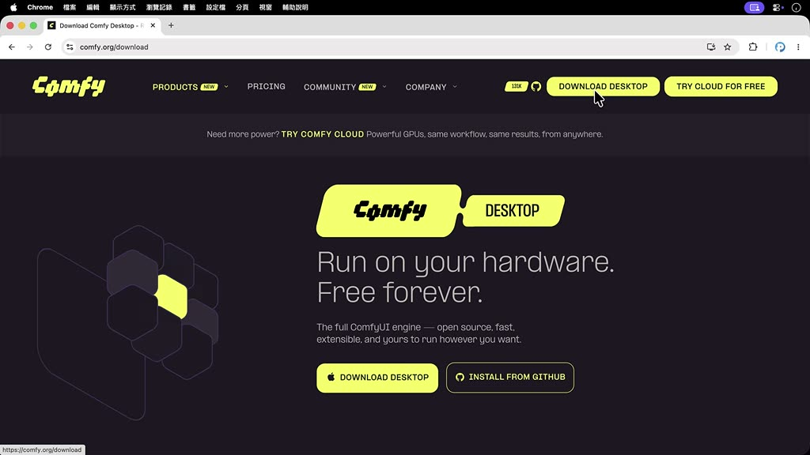
2. 對安裝檔雙擊滑鼠左鍵完成安裝（Mac 示範）。（00:46）
3. 開啟 ComfyUI，出現「你想如何运行 Comfy？」。左邊「云端」是跑在雲端 GPU（需另外訂閱和付費），右邊「本地」是用自己的電腦跑；選擇「本地」。（00:51–01:05）
   
4. 勾選同意選項（畫面為「我同意 EULA 和 服务条款」），按「继续」。（01:16）
5. 安裝位置可自行指定，或保持預設值，再按「继续」。（01:21）
6. 點選「跳过并安装」，ComfyUI 會開始下載必要元件並安裝。（01:28）
7. 安裝完成後進入主介面，會看到空白畫布。（01:34）
**注意事項**
- 上述畫面文字為簡體（「继续」「跳过并安装」）；影片後段主介面為繁體。
- 影片沒說明安裝時間與下載量。

## 二、用內建範本開啟工作流程，並熟悉基本操作（影片 01:49–03:54）
**前置條件**
- 已完成第一章。
**步驟**
1. 在頁面中瀏覽內建範本。範本右上角有皇冠圖示的，代表硬體需求過高或沒有開源，只提供雲端執行（講者主張，未查證）。（01:59–02:12）
2. 若只想看本機可執行的範本，在篩選下拉選單勾選「ComfyUI」（取消「External or Remote API」），即可隱藏需要付費的範本；旁邊的下拉選單可改排序，顯示最新或近期熱門的模型。（02:14–02:24）
   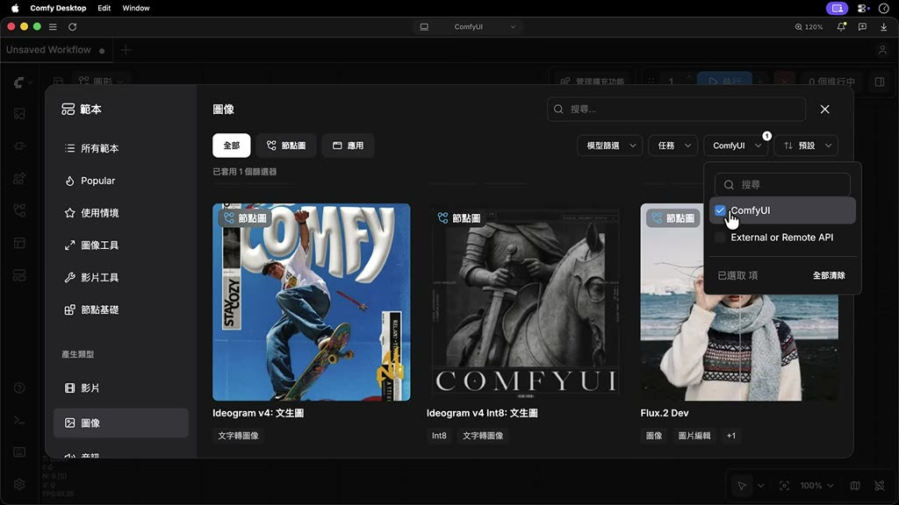
3. 選擇範本「Z-Image Turbo」（文生圖）開啟。（02:27）
4. 右上角會出現錯誤訊息：因為生成圖片用的模型還沒下載，屬於正常。（02:32）
5. 畫布基本操作：（02:42–03:40）
   - 拖曳節點可調整位置；節點之間的連接線是資料傳遞路徑，由最左邊傳到最右邊。
   - 每個節點有自己的參數可以調整；某些節點內部打包了子工作流程，可展開查看。
   - 滾動滑鼠滾輪縮放畫布；按住空白鍵不放可平移整張畫布。
   - 點選某個節點後按一下句號鍵，畫面會縮放聚焦在該節點。
   - 按住 Ctrl 或 Command 鍵框選多個節點，再按句號鍵，畫面聚焦在這幾個節點。
   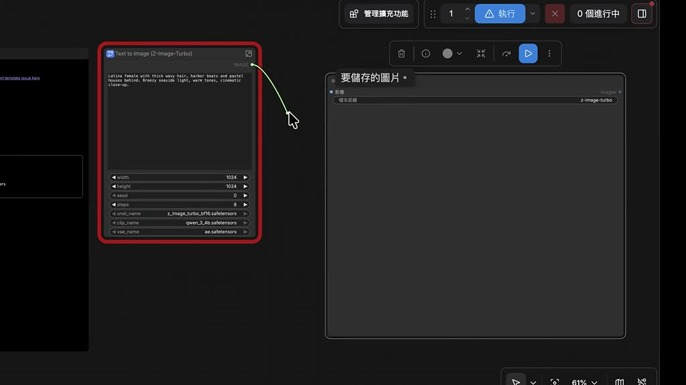
6. 要回到上一層（原本的工作流程），到右上角開啟側邊欄，可看到剛才的錯誤訊息。（03:40）
**注意事項**
- 範本右上角的錯誤訊息在還沒下載模型前一定會出現，不是安裝失敗。
- 「句號鍵」在影片是指鍵盤的 `.`（推測）。

## 三、一鍵下載缺少的模型，並找到模型存放位置（影片 03:54–05:02）
**前置條件**
- 已開啟範本（例如 Z-Image Turbo），畫面有缺少模型的錯誤。
- 磁碟空間足夠；模型檔案很大（此範本畫面顯示三個檔案合計 19.27 GB，下載需要一段時間）。
**步驟**
1. 在右上角開啟側邊欄，進入「工作流程總覽」的「錯誤」分頁，會看到「缺少的模型」清單（ae.safetensors、qwen_3_4b.safetensors、z_image_turbo_bf16.safetensors）。（03:54–04:00）
   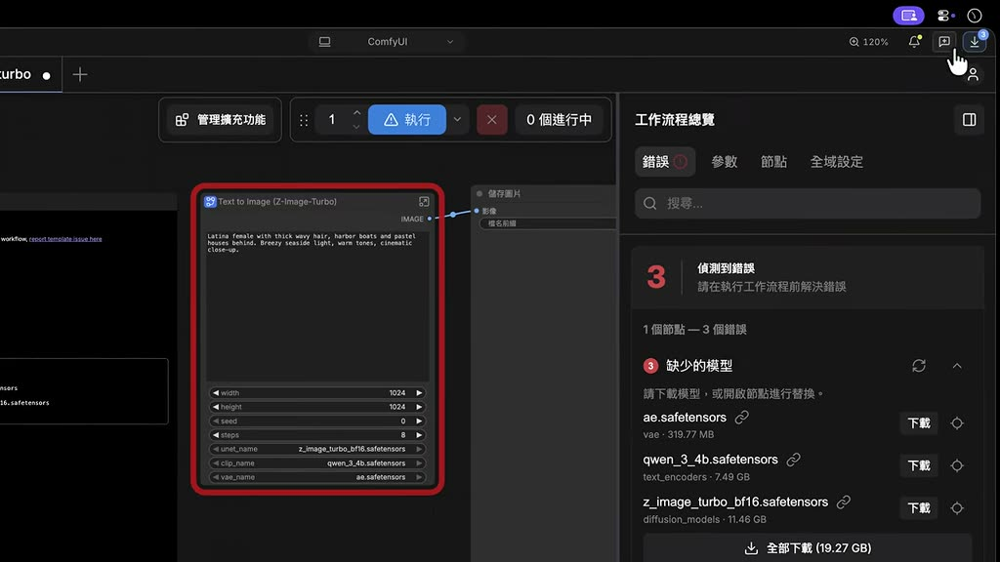
2. 按清單下方的「全部下載（19.27 GB）」，一次下載全部缺少的模型（也可個別按「下載」）。（04:00）
3. 想看下載進度，點選右上角的下載按鈕。（04:08）
4. 全部下載完成後按 Ctrl 或 Command-R 重新整理頁面，錯誤訊息會自動消失。（04:13–04:20）
5. 想找模型存在哪裡：看畫布最左邊的說明卡片，上面標示每個模型存放的資料夾。（04:29–04:33）
6. 要實際開啟資料夾：點選上方的「ComfyUI」，切換到「儲存」分頁，點選下方的連結，系統會開啟該資料夾；再依卡片說明進入對應的子資料夾（例如 `diffusion_models`），就能看到模型檔。（04:36–04:52）
   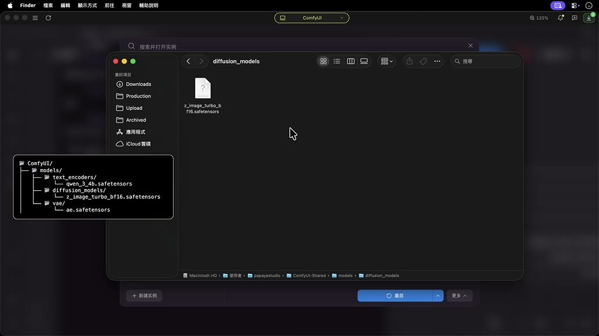
7. 之後不需要的模型檔可以隨時刪除，以釋出硬碟空間。（04:55–05:00）
**注意事項**
- 下載完成後一定要重新整理（Ctrl／Command-R），否則錯誤訊息不會消失。
- Windows 上的資料夾路徑與開啟方式「影片未示範」。

## 四、用 Z-Image 生成圖片、儲存圖片與工作流程（影片 05:02–06:31）
**前置條件**
- 已完成第三章（模型已下載）。
**步驟**
1. 在提示詞欄輸入描述。影片示範的主題：一位穿著古裝的女子正在庭園中泡茶。（05:08–05:14）
2. 圖片解析度設為寬 1280、高 720。（05:14）
   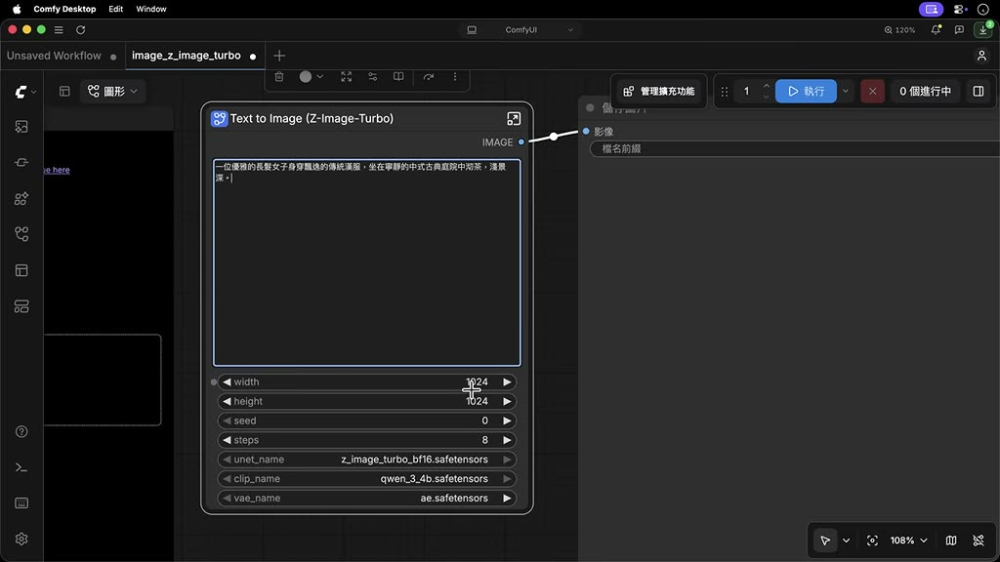
3. 在右上角輸入想要生成的張數（影片畫面為 1），按「執行」。（05:19–05:22）
4. 稍候，生成結果會顯示在最後一個節點。（05:24）
   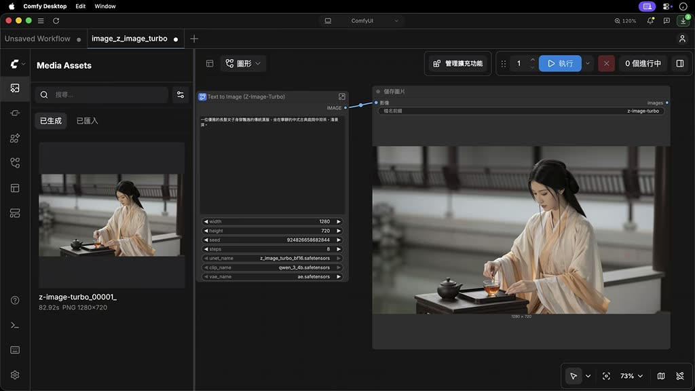
5. 要儲存圖片：對圖片按右鍵，執行「儲存圖片」；或到左側開啟資產面板（畫面為 Media Assets），所有生成的作品都在這裡。（05:29–05:40）
6. 要找到固定的儲存位置：在上方面板點選「輸出」欄位中的連結，會開啟名為 `Output` 的資料夾，所有生成的作品都自動存在這裡。（05:48–05:57）
7. 編輯畫布後，上方標籤會出現一個小白點，代表工作流程尚未儲存；按 Ctrl 或 Command 加 S，輸入工作流程名稱後確認。命名完成就能安心關閉該標籤。（06:00–06:17）
   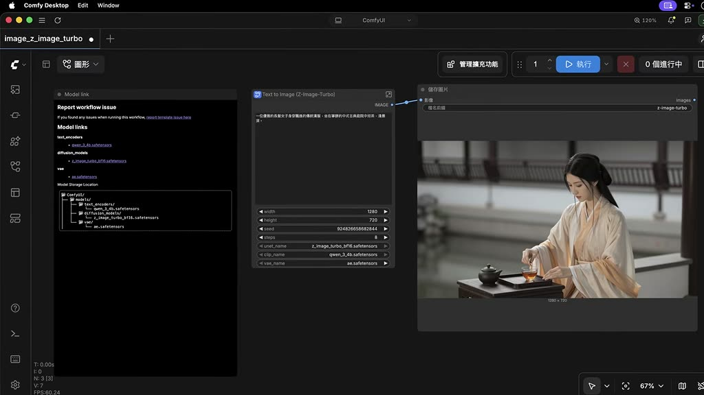
8. 之後要再用：到左側點選工作流程圖示，找到剛才儲存的專案，開啟即可重複使用。（06:20–06:27）
**注意事項**
- 影片沒說明這張圖生成花了多久。

## 五、用 ACE-Step 文字生成音樂（影片 06:31–08:07）
**前置條件**
- 已完成第一、三章的操作方式（開範本、補模型）。
- 模型為本機執行，所需硬體「影片未說明」。
**步驟**
1. 開啟範本頁，在類別選擇「音訊」，選擇「ACE-Step」範本。（06:34–06:37）
   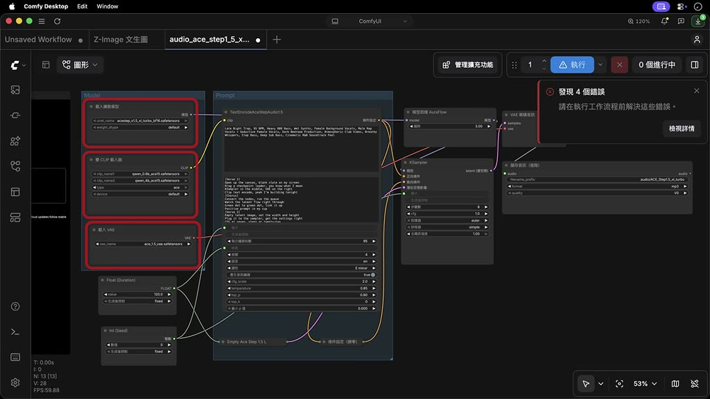
2. 右上角同樣會出現缺少模型的錯誤，按「全部下載」，等待完成後按 Ctrl 或 Command-R 重新整理頁面。（06:42–06:57）
3. 第一個欄位填曲風描述（影片示範：Funk 風格、充滿能量和節奏感）。（07:03–07:09）
4. 第二個欄位填歌詞（講者主張支援包含中英文、超過 50 種語言，未查證）。（07:11–07:14）
5. 往下設定歌曲速度（示範 120）、調性（示範改成較明亮活潑的大調）、歌曲長度（示範 60 秒，因為只是測試）。（07:19–07:37）
   
6. 按「執行」，等待後試聽生成的音樂。（07:37–07:56）
7. 要下載歌曲：到右側點選功能選單，選擇「下載」。（08:02–08:05）
**注意事項**
- 影片 07:39–07:56 為音樂播放，沒有旁白。

## 六、用 Comfy Cloud 雲端生成影片（MiniMax H3 圖生影片）（影片 08:07–10:45）
**前置條件**
- 需要 Comfy 帳號（可用 Google 信箱註冊）與信用卡；雲端算圖採點數制，需先儲值（示範儲值 10 美元；價格與點數換算為講者主張，未查證）。
- 講者表示 MiniMax H3 可跑在本機，但硬體要求較高、主要針對 NVIDIA 顯示卡，Mac 跑起來勉強，所以示範用雲端（講者主張，未查證）。
- 已完成第四章（要用到一張現成的圖當初始影格）。
**步驟**
1. 在範本頁把篩選改成顯示「External or Remote API」，頁面就只會顯示帶有皇冠的雲端工作流程。（08:30–08:35）
   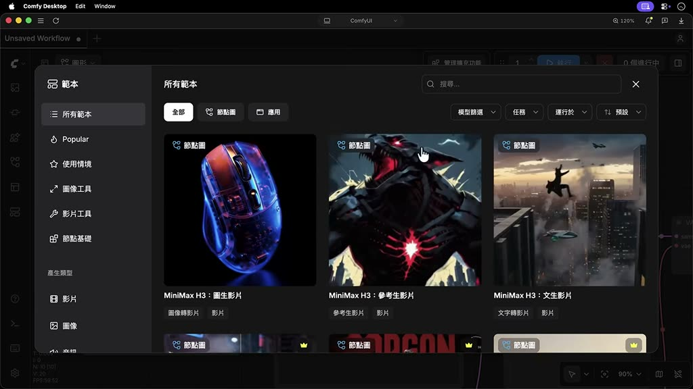
2. 選擇「MiniMax H3：圖生影片」範本。（08:39）
3. 右上角出現錯誤訊息，這次是提醒還沒提供生成影片用的圖檔；缺少模型的提示已消失，因為運算在雲端完成。（08:42–08:53）
4. 註冊／登入 Comfy 帳號（例如用 Google 信箱），按確認；登入後右上角會顯示個人頭像。（08:58–09:07）
5. 儲值：按「新增點數」，輸入金額（示範 10 美元），以信用卡付款；完成後頁面會顯示目前擁有的點數。（09:11–09:22）
   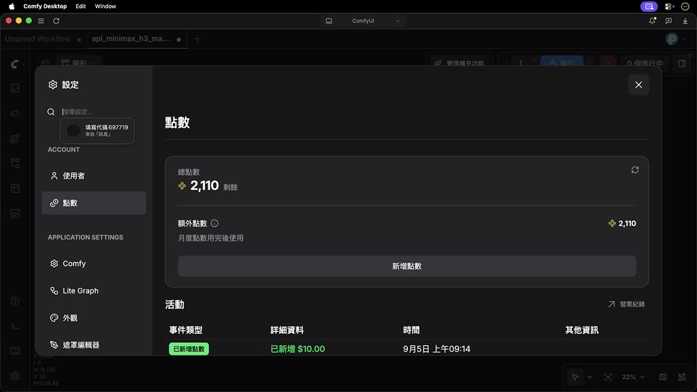
6. 回到畫布，先讀旁邊的說明卡片；英文看不懂可整段貼到 ChatGPT 請它翻成中文。（09:31–09:41）
7. 把剛才生成的女子泡茶圖拖曳到第一個節點（作為影片初始影格）。（09:44–09:53）
8. 在下方提示詞欄輸入動作描述（示範：一名女子正優雅地在泡茶，同時相機鏡頭緩緩向後拉遠）。（09:55–10:01）
9. 往下有兩個特殊節點開關：「用 AI 最佳化提示詞」與「把影片放大到 2K 畫質」；示範保持預設值。（10:04–10:14）
10. 回到畫布上方，在最後那個黃色節點指定影片解析度與長度；長度最長可到 15 秒，調整秒數時右上角的點數值會跟著變動（越長越耗點數）。示範設為 5 秒。（10:19–10:36）
    
11. 按「執行」，稍後在旁邊的節點看到生成好的影片。（10:39–10:42）
**注意事項**
- 影片長度越長，消耗點數越多；執行前先看右上角的點數值。
- 影片沒說明這支 5 秒影片實際扣了多少點。
- 取消訂閱、退款或點數有效期限「影片未示範」。

## 七、安裝 Comfy MCP，讓 Claude 操作 ComfyUI（影片 10:45–14:55）
**前置條件**
- 已安裝並能開啟 ComfyUI；已安裝 Claude 桌面版（影片示範 Claude 桌面版，ChatGPT 也可以，影片只示範 Claude）。
- 在 Claude 內以工作區（資料夾）運作；示範工作區是 ComfyUI 的安裝資料夾。
- MCP 讓 AI 助理直接跟電腦內的軟體對話（講者主張這是這一年來 ComfyUI 最大的變化，未查證）。
**步驟**
1. 到 ComfyUI 官網（網址 `comfy.org/mcp`）點選安裝 MCP 的按鈕，選擇「LOCAL COMFYUI」（本地安裝），再到右下角「Ask your agent to install Comfy MCP」欄位，複製裡面的提示詞。（11:12–11:24）
   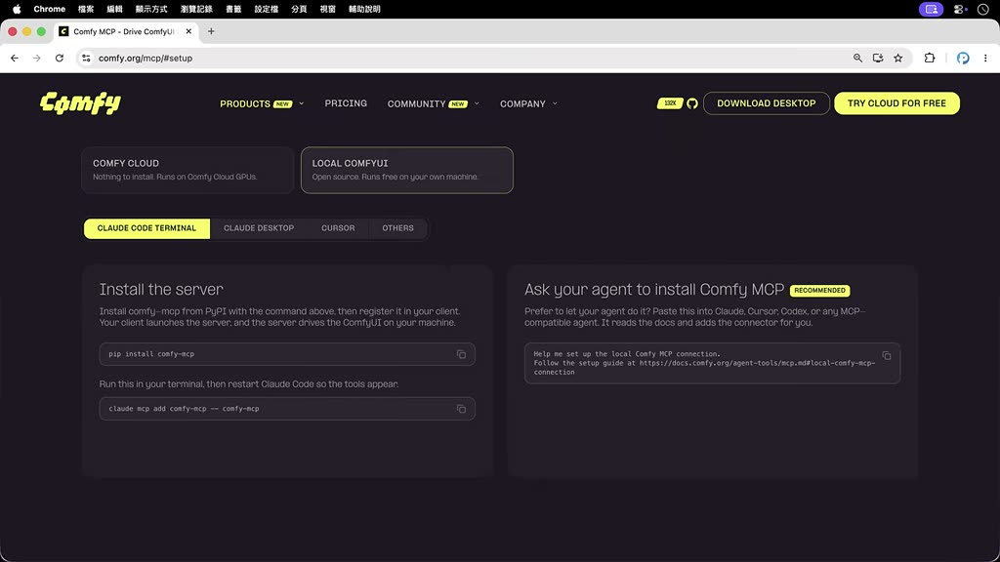
2. 開啟 Claude 桌面版，指定專案資料夾位置（示範選 ComfyUI 的安裝資料夾）。（11:28–11:35）
   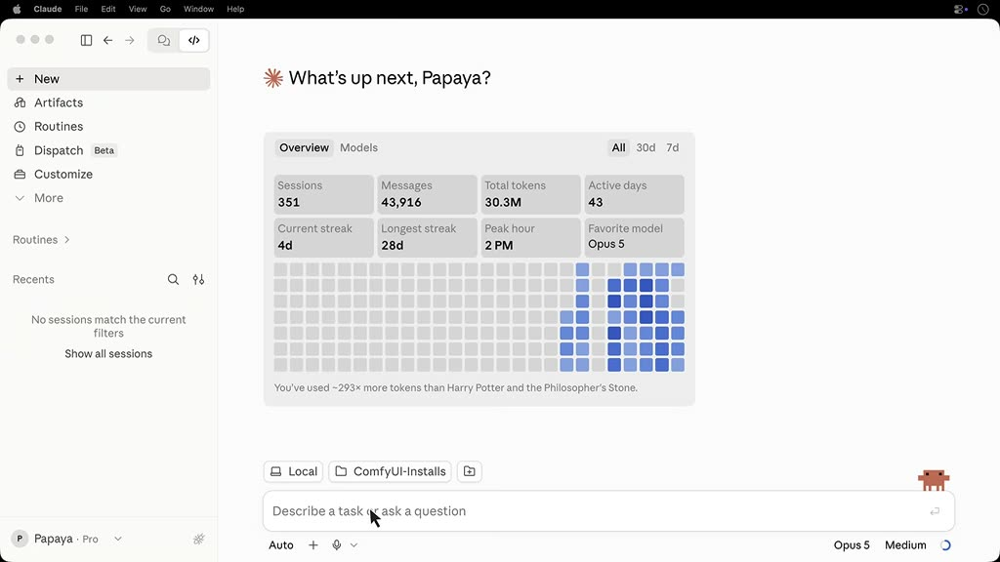
3. 在對話方塊內點選「Trust workspace」（信任工作區）。（11:39）
4. 把剛複製的提示詞貼到輸入框，按 Enter 送出。（11:42–11:48）
5. 等 Claude 跑完安裝程式後，重新啟動 Claude 即完成。（11:50）
6. **跑現有工作流程**：開新對話，用提示詞請 Claude 到 ComfyUI 生成作品（示範：生成一首中文歌，並說明想要的曲風與主題）。Claude 動工前會先確認細節（例如主唱是男生或女生、是否預覽歌詞），逐一回答即可；之後 Claude 會呼叫 ComfyUI 執行運算。完成後回到 ComfyUI 開啟資產面板就能播放。（12:05–12:46）
   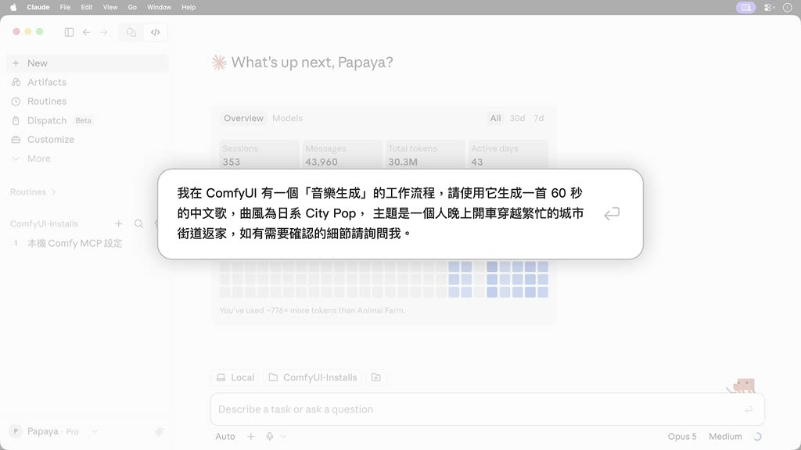
7. **改造工作流程**：請 Claude 修改既有流程。示範提示詞重點：把 Z-Image 文生圖流程改用 GPT Image 2（使用 Comfy 點數）、流程改名為 GPT Image 2（文字圖）、一次同時生成寫實照片／向量插畫／3D 動畫三種風格、尺寸 1920×1080，改好後再生成「穿警察制服的可愛企鵝在繁忙城市十字路口指揮交通」。（13:12–13:45）
   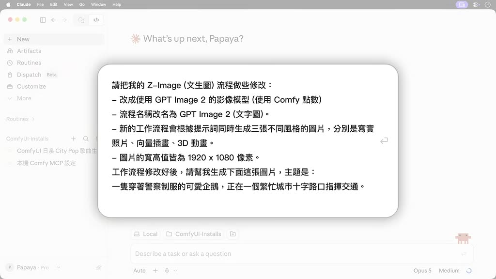
8. 回到 ComfyUI，修改後的工作流程已完整呈現在畫布；之後不透過 Claude 也能直接在提示詞方框輸入新主題（示範：穿廚師制服的柴犬在廚房炒一大鍋炒飯），按「執行」得到三張不同風格的圖。（13:50–14:08）
9. **構思提示詞與分鏡**：把想好的簡單劇情請 Claude 拆成幾個分鏡，要求每個分鏡有不同構圖與運鏡，Claude 會用 MiniMax 工作流程生成一段動畫（示範影片長度 15 秒）。（14:12–14:41）
   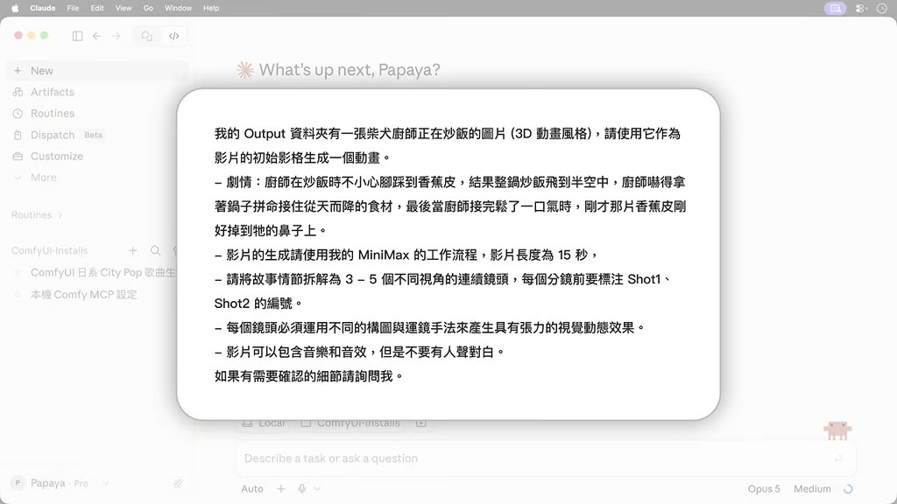
**注意事項**
- 修改工作流程使用 GPT Image 2 與 MiniMax 影片時會消耗 Comfy 點數（第六章）。
- 畫面顯示 Claude 在執行時用到的指令為 `claude mcp add comfy-mcp -- comfy-mcp`（comfy.org/mcp 頁面「Claude Code Terminal」分頁）與 `pip install comfy-mcp`；影片實際操作是走「Ask your agent」複製提示詞的做法，這兩行指令影片沒有示範執行。
- 影片 12:46–13:06、14:41–14:55 為作品播放，沒有旁白。

## 八、錯誤排解表
| 現象 | 原因 | 做法 | 影片時間 |
|---|---|---|---|
| 開啟範本後右上角出現錯誤訊息，工作流程總覽「缺少的模型」清單列出模型 | 範本需要的模型還沒下載 | 「全部下載」，完成後按 Ctrl／Command-R 重新整理 | 02:32、03:54–04:20 |
| 開啟音訊範本（ACE-Step）出現「發現 4 個錯誤」 | 同上，ACE-Step 的模型還沒下載 | 同上 | 06:46–06:57 |
| 開啟雲端範本（MiniMax H3 圖生影片）出現錯誤 | 還沒提供生成影片用的圖檔 | 把圖片拖曳到第一個節點 | 08:42–09:53 |
| 雲端範本無法執行／點數不足 | 雲端算圖採點數制，需先儲值 | 「新增點數」儲值後再執行 | 09:11–09:22（點數不足的畫面影片未示範，為推測） |
| 工作流程分頁標籤出現小白點 | 尚未儲存 | Ctrl／Command＋S 命名儲存 | 06:00–06:17 |

