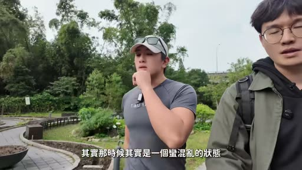
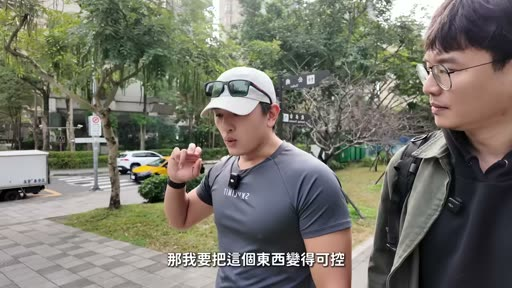
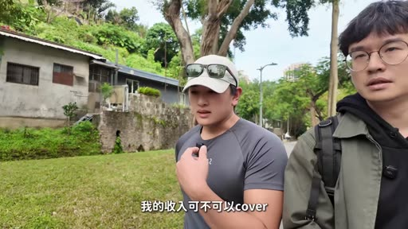
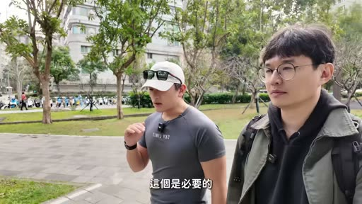
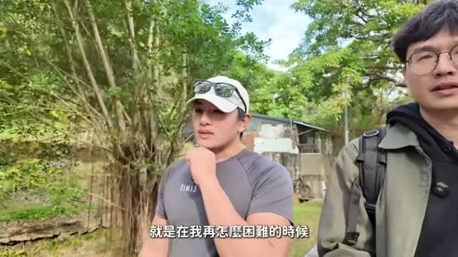
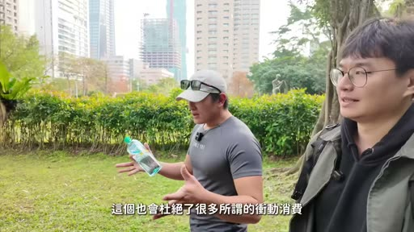
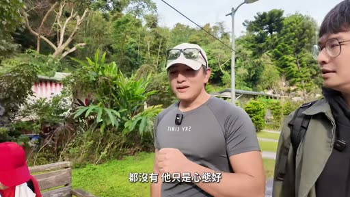

# 我問了一個負債3000萬的人，怎麼財富自由？ feat. 黃士豪

- 來源：https://youtu.be/CDVKZJdp2Iw?si=mMJNftVkT5mkFB6k
- 平台 / 上傳者：YouTube / 早安傑森
- 長度：21:34 (1294.0s)
- 逐字稿來源：whisper (groq)
- 更新日期：2026-10-13
- **關鍵字：** #財富自由 #負債3000萬 #現金流 #寫日記 #觀點與事實 #生存階段與發展階段 #知足 #過得去 #夢想倉庫 #跑道系統

## 摘要與名詞說明

**一句話重點**：早安傑森訪問曾在大學時背上家人 3000 萬債務、如今自稱財富自由的黃士豪（Will），Will 認為關鍵不在資產多寡，而在「把觀點與事實分開、確保現金流」，並以生存／發展兩階段、夢想倉庫等方法設計理想生活。（以下數字與主張皆為講者主張，未查證。）

| 時間 | 重點 |
|---|---|
| 00:00 | 開場：來賓 Will 曾負債 3000 萬，債務是家人留下的，發生在大學畢業前 |
| 01:26 | 當時情況：父親糖尿病惡化、無收入；債主分親友、銀行、地下錢莊三類；曾有輕生念頭 |
| 02:56 | 讀曼德拉等傳記，體悟外在境遇由自己定義；開始寫日記分辨「觀點」與「事實」 |
| 04:10 | 把壓力變可控：只要每月付得出款，就跟沒有債一樣；現金流重要性遠大於資產負債總額 |
| 05:00 | 讀書是家裡唯一負擔得起的出口；三個人生要素：資源、優先順序、流程；3000 萬 ÷ 60 年 ≈ 每年 50 萬 |
| 06:14 | 資產水位不同，影響最大的仍是現金流；焦慮不是錢造成的；收入 cover 支出 + 6 個月存款即可放心 |
| 08:53 | 生存階段（量入為出是必要的）vs 發展階段（錢應圍繞理想生活）；知足＝知道現在的自己絕對足夠去追求 |
| 10:38 | 十五年計畫（孩子滿 18 歲前）：健康、親子關係、留給孩子的東西 |
| 12:04 | 理想生活不是單點，而是方向；重點是建立系統 |
| 13:06 | 「過得去」的能力：《金剛經》破四相、用寫日記當生活支點 |
| 15:16 | AI 時代更該探索「想做什麼」，不必等到財富自由才開始 |
| 16:16 | 課程三塊：財富認知與能量系統、（高空）系統、跑道系統；夢想倉庫、成功與幸福的區分 |
| 19:01 | 心態比專業知識重要（台積電阿嬤例）；後悔錯過孩子一兩歲；最大夢想是終結世界貧窮 |
| 21:26 | 結語：課程連結放在資訊欄（影片為課程導流性質，宜留意） |

## 名詞與說明
- **觀點 vs 事實**：Will 的日記練習，把「討債電話來了」（事實）與「我很失敗」（觀點）分開。
- **生存階段／發展階段**：Will 的分法；跨過「每月 10–20% 盈餘＋6–12 個月備用金」這條線即進入發展階段（講者主張）。
- **夢想倉庫／高空系統／跑道系統**：Will 課程中的工具名稱；「高空系統」名稱為語音辨識結果，疑有誤（見 meta.json known_asr_errors）。
- **過得去**：Will 提出的能力，指狀態差時仍能靠一件小事（如寫日記）自我肯定、繼續前進。

## 轉錄校正備註
- 逐字稿來源：Groq Whisper（自動偵測為中文）；影片有燒入字幕，已用截圖核對專有名詞。
- 已校正：黃世豪→黃士豪、存證信函、地下錢莊、壽險、至暗時刻、量入為出、緊急備用金、金剛經／壽者相、閾值、冷水澡等；
- 不確定處（推測）已記在 `meta.json` 的 `known_asr_errors`，包括「高空系統」「Alex去爬伊犁」「I'm Stable」等。
- 本片為訪談，非講座，未去除語助詞。
- 影片含課程導流（連結在說明欄，影片未呈現）；講者的數字與財務觀點（買房 vs 租屋、盈餘比例、13 萬學員）皆未查證。

## 圖文對照（畫面 + 逐字稿）

### 投影片 1：開場：負債3000萬的Will與債務由來（00:00–02:56）

**重點：** 主持人介紹來賓黃士豪（Will）：大學未畢業時家人留下3000萬債務；債主分親友、銀行、地下錢莊三類，最低點曾想過用壽險還債。

**標籤：** #黃士豪 #負債3000萬 #債主三類 #至暗時刻

今天的影片跟以往一樣，沒有打算給你太多的多巴胺，但有一點不一樣，今天不只有我一個人，我找了一個我認為比我厲害很多的人，聊一個有一點慫的話題，叫做財富自由，這個人叫做Will 黃士豪，他是一個曾經負債到3000萬的人，你可能會以為賠那麼多錢，應該是做生意失敗或什麼之類的，但還真的不是，就是這筆負債呢，其實是家人留給他的，而且發生的時間點是在他大學都還沒有畢業的時候，想起來挺可怕的，雖然說有時候數字太大，反而有一種不真實的感覺，但我就是跟他見了面，實際的去聊這些事情，所以我可以感受到，對他而言，當時的這三千萬，每一塊錢都是真實的負擔，但他撐過來了，而且不只是撐過來，他現在可以說，算是就是世俗所稱的財富自由，就是他現在要躺平，應該是可以躺平到，進棺材都沒問題，那我想我們在現實生活中，應該都很少會遇到，財富跨度這麼大的人，所以我就問了他，許多關於錢的問題，除了錢之外，我們也聊了很多，像是狀態調整的問題，我覺得Will給我的答案都非常的實際，而且具體，他自己在做的事情，他在解決方法，而不是他從哪裡聽來哪裡看來的，我自己當天跟他聊完之後呢，其實回家後好幾天，都還是一直在回想我們聊天的內容，我自己是覺得很有收穫，就希望你們也有一樣的感覺喔，因為很多觀眾可能是從來沒看過的，我覺得最容易被大家震撼到的就是，曾經有負債到一個誇張的數字，我想多數人，他沒辦法去想像那個狀態，3000萬實在是很多，你當時的心理狀態，其實那時候是一個蠻混亂的狀態，第一個是爸爸身體先開始變差，糖尿病惡化，那惡化之後是眼睛先看不到，所以那時候就等於是他那邊完全就不能夠有收入，所以其實第一個是本來很多計劃都被打亂了，就包含說可能畢業後本來也是，就申請好要去國外的學校，債務事後才發現說，不只是有說要趕快賺錢來幫忙醫療的支出等等的，而且還有一些債務要還，從手足無措到慢慢知道債務有多少，到心甘情願可能應該有大概兩三年的時間，哇，後來我還是堅持說有去，要去就英國念一年的碩士，只是讓我家先等我一年這樣子，就大家先撐住然後等我一年，OK，因為這樣看起來我的收入還是，以後比較有可能比較高，因為那時候其實債主是很多對不對，就是有三類嘛，一個是親友的，一個是銀行的，一個是地下錢莊，另外兩個都比較好嘛，因為親友畢竟他也不想要，真的把你逼到絕境，所以你能還這最好，那銀行了不起就是查封這個查封那個存證信函，那沒辦法就只能一直存證信函，最棘手就是在地下錢莊那個部分，這個絕望的感覺維持了多久，最低點其實也有曾經就覺得說，我會不會保個保險然後用壽險去還債好了，就是有到這種很黑暗的至暗時刻，這已經是在你工作的時候了，對已經在工作的時候了，後來是因為就開始看書嘛，特別去找了很多那種傳記，才慢慢的覺得說其實，不管是外面的環境在怎麼樣，好跟壞都是我來決定的。

### 投影片 2：曼德拉、寫日記與現金流（02:56–06:14）

**重點：** 讀傳記（曼德拉）後體悟外在境遇由自己定義；靠寫日記分辨「觀點」與「事實」；把壓力變可控，每月付得出就等於沒有債；三要素：資源、優先順序、流程。

**標籤：** #曼德拉 #寫日記 #觀點vs事實 #現金流 #資源／優先順序／流程

我記得當時最印象深刻是那個Mandela，就是那個南非的總統，他好像就是被關了三十幾年，當他出來的時候他就原諒所有的白人，他就講了說就是要當自己生命的船長，外在的這些境遇不能夠決定我成為什麼樣的人，別人覺得我這樣是很冤枉啊，白人很可惡啊，但是真正的自由不是，我現在終於可以來反向的壓制白人，而是我可以選擇我要原諒他還是繼續壓制他，所以我後來就想說其實外面的債務不管再怎麼樣，我都可以自己決定是讓他把我打敗，還是我就利用他來讓自己變好，把外面的東西變成是中性，那這就是關鍵一個很重要的練習，就是我開始寫日記，我開始分辨什麼叫觀點，什麼叫事實，今天有討債的人打給我，那以前我就壓力很大，覺得自己很失敗，做什麼都沒有用，再怎麼努力都只能這樣子，一輩子就沒希望了，後來發現我這些讓自己心情很糟糕的東西，都是我的觀點，其實只是發生了討債集團打電話過來，罵髒話而已，他也不是針對我，他就是有錢要不到，就這樣子而已，絕大多數的覺得不好的東西都是，我讓自己變得不好的，我慢慢發現說，我只要改變我的觀點，我就不會過那麼慘了，所以我會慘根本就不是因為，三千萬的負債，我會慘是因為我覺得他很慘，所以我才很慘，我讓他來決定我的處境，所以這是第一個我覺得發生轉變的地方，那真的就是從寫日記開始，這個開始之後，我發現壓力來自於說，明天又會接到誰的電話，我不能控制，所以這個時候就發現，那我要把這個東西變得可控，我才開始去思考說，以阿誇英雄好漢的，就不是三千萬的負債，是明天的帳單付不出來，我只要每個月這個五萬塊，我可以付得出來，那我每個月都是正常人，我根本就不用去擔心什麼，三千萬五千萬的，假設我下個月真的怎麼樣，後面也不關我的事情，保證每個月我可以付得出來，保證每一天我可以過好，我就跟沒有債的是一樣，對 所以那時候我就開始知道說，OK 現金流重要性遠遠大於你，資產跟負債的總額比，但我好奇，就是你在壓力很大的情況下，你還會去選擇看書 閱讀，這跟你本來的，舊有的習慣就有關係嗎，其實從小，我們家就一直在到處跑路，媽媽她壓力比我更大，因為爸爸都不在，那媽媽我也會做兩件事情，第一個聽音樂，我還記得她要聽恩雅，第二個她就是看書，那原因也很簡單，因為書是我們唯一可以負擔得起的東西，對 所以那時候我很快想到出口就是音樂跟看書，從劉墉開始看 看到很多傳記，那我記得印象很深刻，像有一本叫《領導不需要頭銜》，就是講說你出社會更需要設計自己的課表，那另外一個是你要如何衡量你的人生他就講到說每一個人的人生成就第一個不是隻有單純看錢跟事業決定一個人的人生成功而不是外在的物質成功有三個要素第一個是你的資源有哪些，因為當時我就很缺資源，我甚至覺得說因為我沒有資源，才會這麼慘，但他提到第二個你的優先順序，基本上就是價值觀，一樣有時間你會先拿去賺更多錢，還是陪家人這種價值觀，第三個就是你的流程，你選擇了什麼樣的道路，你的努力會產出什麼，所以當時我就發現，我不能掌握我的資源，但是後面兩個我可以掌握，所以我還有很多努力的地方，所以那時候開始慢慢學到說，其實二十幾歲有三千萬的債務，這個不代表人生的終點，我把它除以我接下來六十年，三千萬除以六十年，一年就大概五十萬，我聽這樣聽起來就好多了，對 所以又回到剛剛那個概念，就只要我這規模還得起債，那我這個月就是自由，我跟沒有債的人是差不多的，那因為這樣子開始翻轉了很多，對未來的想像就是，我也有機會可以過正常的生活，甚至過自己的理想人生。

### 投影片 3：財富水位、焦慮與買房（06:14–08:53）

**重點：** 現金流影響大於資產；焦慮不是錢造成的；收入能cover支出加六個月存款即可放心；買房的糾結與租屋觀點（講者主張，未查證）。

**標籤：** #現金流 #焦慮 #六個月存款 #買房vs租屋

因為你的資產的跨度非常大，就從負債到3000萬到我查到資料說現在已經破億了，這些財富的這種不同的水位啊，覺得你的心情上有很大的差別嗎，對於我自己來說，錢對我造成影響其實是一樣，現金流的變化造成的影響，一定比資產造成的影響還大，像現在可能你有10間房，你還是只會住一間，那其實那一間你有在用的才是影響你生活品質的，剩下頂多只是影響你的心理的安全感，所以我的第一個有差別就是，我發現我把債務談完之後，可以確保我每個月還完債不會有人打電話給我，那這件事情我就覺得差很多，因為我回來看待我的工作也不一樣，本來還會擔心，不知道是主管打電話來，還是討債局有人打電話過來，現在我很確定不會有討債局有人打電話過來，所以這個心情其實套用在很多人的生活上，可能也是這樣對嗎，我完全同意，就是大家很多時候焦慮自己沒有房，就反而回來看我的生活需要多少，我的收入可不可以cover，假設你現在的收入是可以cover你的支出的，其實就不用有太多的焦慮，大家的擔憂根本跟債務沒什麼太大關係，原因是你債務還完了，你會開始煩惱別的事情，我明白 房子買了 我車子不夠好，車子解決了 孩子的問題，孩子長大了 我要再給孩子一個房，大家永遠會找到一件事情去焦慮，所以我就發現說其實有錢沒錢，或者是有房沒房 有債務沒債務，焦慮並不是，不是錢造成的，不是那些東西造成的，是自己選擇讓自己焦慮的地方，那我們要確保先保證自己是可以生存的，那生存就是我的每個月收入可以cover的支出，這一塊保障起來之後，再加上我自己設定，銀行要有至少六個月以上的開銷存款，只要這個事情搞定之後，其實剩下的焦慮都是多餘的，它只是心理作用，應該就要很放心的，不管是去創造生活體驗，或是更大膽的去投資去學習，這件事情在我聽來，基本上是成立的，但你自己執行起來有困難點嗎，就光是房子這個東西我就糾結很久，但到最後就只是買了一個媽媽的故鄉，很老很老的房子給爸媽住，就圓我媽媽的一個心願，就是要有自己的房子，她就算跑路一輩子，所以是買一個房子，那我自己都是沒有怎麼自住的，臺灣目前的狀況我覺得還是用租的比較划算，這大家用算的就好了，那投資我是覺得房地產合理的報酬方式是租金，對 炒作會有居住正義的問題，他應該是要跟著大家薪資漲幅去漲，那那個就OK，但如果他是變成是很像資產這樣在漲，資本利得這樣的話，有點不對的，對 因為他沒有創造任何工作機會，房子從一千萬漲到兩千萬，沒有增加產值，所以像房子這個事情我也是糾結很久，因為所有人都跟你講，你要買房啊，強迫儲蓄等等等等的，在這些拉扯裡面，我還是要決定我的錢，用在哪裡才會服務於我認為的好生活，有房不是自由，是你今天有錢，你可以決定買或不買才是自由。

### 投影片 4：生存階段、發展階段與真正的知足（08:53–12:04）

**重點：** 量入為出只適用生存階段；每月有10–20%盈餘、6–12個月備用金後進入發展階段；知足是知道現在的自己絕對足夠去追求；十五年計畫圍繞健康與孩子。

**標籤：** #生存階段 #發展階段 #量入為出 #知足 #十五年計畫

我想問有沒有大家都覺得是對的，但你覺得是很糟糕的財務建議，量入為出是一個，我覺得蠻要小心的財務建議，大家的財務狀況分成兩個階段，一個叫生存階段，一個叫發展階段，生存像我當年一樣，帳單付不出來，吃飯都成問題，這叫生存階段，在生存階段量入為出，這個是必要的，而且它就是很神聖的事情，因為它可以滿足我們生存，所以這個階段，所有人都應該做這件事，這個階段你跟我談夢想，跟我談這個工作，不符合我的志向，這個就是不負責任，對，所以生存階段，一定是以生存為之上，但一旦跨過那條線，來到發展，我們就不應該再以這個為主，因為假設大家來到了發展階段，但每天想著是量入為出的話，那人類的文明是不會進步的，我們不會有這些攝影機，不會有網路，什麼都不會有，所以那條線是怎麼呢，我剛剛提到的，我每個月可以有10% 20%以上的這種盈餘，再來我的銀行賬上有6個月，甚至到一年的開銷的存款，緊急備用金，一旦打到，那麼剩下錢應該要圍繞我們要的生活去進攻，圍繞他去做所有的分配，有錢又不幸福的原因，其實大多就源自於我們都在發展階段了，但整天還是被生存的安全感綁架，你看他有房有車生活過得不錯，但就總覺得還不夠，總覺得我以後發生什麼東西我要未雨綢繆，或是小孩子以後這樣那樣怎麼辦，當我們沒有分清楚自己在哪階段時候，量入為出啊 還有像知足常樂，哈哈哈，在講知足都是叫你妥協，你這個工作已經很好了，當我想要更多自己認為好的東西的時候，大家都跟你講你這樣很好了 你不要再太貪心，其實這些都是妥協，我認為真正的知足不是用外在的東西來決定我要什麼，我覺得這個不算是知足，知足是不管我要去哪裡，我想要什麼生活，我都知道現在的我絕對足夠我去追求，這才是知足，所以如果說我想要維持現況 那也很好，這是最棒的，但如果想要更多，我也知道我現在有了絕對足夠，我就有勇氣去追求，那這個才是真正的知足，那你現在有一個下一個追求點嗎我去在兩年多以前搬到新加坡我自己就有一個十五年計劃就是我們家三個孩子都滿十八歲我希望在那個時候，我的健康啊，跟他們的關係啊，還有可能，我留給他們的東西，列了一些清單出來，OK，所以我從，大概兩年半以前，我就開始圍繞這個，去重新設計我的生活，為某一些，我可以做到的做準備，比如說保持健康嘛，然後確保說，他們在保存期限，就我們知道，爸爸十二年保存期限，我之前能看到這影片，就這個時間裡面，我要盡可能的跟他們多相處，跟他們分享我的價值觀，因為我覺得現在的資訊發達很殘酷的，就是他如果沒有我的價值觀，那就會是別人的價值觀，這是很恐怖的事情，我有這個危機意識啊，如果我沒有跟他有足夠多交流的時間，那就是別人來取代，所以感覺你下一段目標，都已經不是放在財富上了，應該講錢啊 不在錢上，但這些才是財富，我蠻知道自己多少是夠用，像我在教課也是一樣，我們會把自己的高空系統給建出來，高空系統是什麼，高空系統就是把我認為我要的生活，理想生活當什麼樣子，我去把它想像出來，想像出來之後呢，我再開始去細部的拆解，這樣的生活需要多少錢，所以只要我現在的財富狀況，就算沒有達到，但我知道我怎麼達到的話，我那邊就讓它按部就班的走，那我就專注我可以做的東西，對 那我就不應該再花時間在錢上面。

### 投影片 5：理想生活不是單點，以及「過得去」的能力（12:04–15:16）

**重點：** 目標只是方向，重點是建立系統；《金剛經》破四相＝不跟自己／別人／世界／時間過不去；找一個生活支點（寫日記），做了就能告訴自己今天有前進。

**標籤：** #願景 #系統 #過得去 #金剛經 #生活支點

好 那我這邊問一個問題就是，像是說要提前去預想你理想生活的這個，方法，就是我其實在很多地方都看過，但是我發現在執行上有一個問題，我覺得好像在玩那種遊戲，或是世紀帝國，就是你還沒有開到那個圖的時候，沒錯，其實你很難去想像，到底怎樣是理想生活，所以你只能在你已知的範圍裡去想像，那通常就會，很不準確，或是根本就不是那樣子，那這件事情要怎麼解決，要先理解所謂的目標，或者是願景理想生活，它一定不是一個單點，它只是給你一個方向，它讓你知道你今天要往哪裡前進，所以就像是假設我前面有很多座高山，第一座對我來說就很高了，我如果沒有爬上第一座，我不會看到其他座，其實重點是在建立一個系統，這個系統就是我隨時可以知道，我現在要去哪裡，然後我怎麼去到那個地方，它不會說我今天定下的，我一輩子只能到那邊，其實不會這樣，因為當我有目標的時候，我的努力累積出來的成果，一定可以用到下一段旅程，藉由一些現在可以有的目標，把那個系統跟能力建立起，這個才是重點，你在這整個奮鬥的過程，一定有遇過狀態不好的時候，你都是怎麼讓自己恢復的，其實這個才是，讓成功只是屬於少數人的最重要原因，有一個很重要的能力，三個字 過得去，過得去的能力，後來我就開始很喜歡佛經像《金剛經》這些東西，其實《金剛經》在講說你要破四相，破我相 破人相 破眾生相，還有破壽者相，其實就是不要跟自己過不去，不要跟別人過不去，不要跟這個世界過不去，也不要跟時間過不去，反正就是自尋煩惱而已，你反而每天專注當下你可以年輕更久，對 所以什麼叫過得去呢，我們把計畫你訂出來之後，就一定會發生一個狀況，我今天狀況不好，或是對我來說我最常自我懷疑的時候就是，我都付出800%的努力了，為什麼情況看起來沒有好轉，後來我就發現要幫自己找一個生活的支點，就是在我再怎麼困難的時候，我都可以做的事情，那隻要我有做，我就可以拍拍自己肩膀說，OK 今天這樣就可以了，你還是往前進，那我的職業就是寫日記，所以就算我過不去了，我知道我要賺很多錢，我知道我要去工作，我知道我應該做這些才是，朝目標前進，可是今天狀況真的很糟糕，真的很想死，那一天我就跟自己講，OK 我們把日記拿出來，我就簡單的練習，為什麼我今天心情不好，我寫一下那個事實，那寫一下讓我心情不好的觀點是什麼，那我只要寫完，有時候可能兩三百個字，我回頭上來，我就會說OK 今天這樣就可以了，我去休息還是怎麼樣，我也算今天有努力了，而且你是不是有時候寫完，你就有動力，對，就是雖然你瞬間事情都沒有解決，但你覺得好很多了，所以我就發現，當我這樣有一個很簡單的支點，那我每天我都知道，我可以抓住他的時候，我就可以很驕傲地告訴自己，我今天也是在努力，今天又在前進，那隔天醒來就一定過得去，那後來我再看一些西方心理學，那他們也講，其實成功最重要的要素，叫做I'm Stable，我們就可以找到像這種，很簡單的東西來告訴自己，就算我今天碰到這麼困難的東西，我也還是沒有停止，其實這一種，給自己的心理暗示是很強大的，就是我還是有在前進，那一次兩次三次，閾值就變高了，以後發生一樣的問題，你就覺得這個根本就不是問題，所以他也可能是洗一個冷水澡，都可以，但就是一個讓自己不管怎麼樣都要去做的東西。

### 投影片 6：AI時代的自我探索與課程三大系統（15:16–19:01）

**重點：** AI取代工具性角色後要探索怎麼活；課程三塊：財富認知與能量系統、（高空）系統、跑道系統；夢想倉庫、成功與幸福、把理想生活換算成金額與年化報酬。

**標籤：** #探索想做的事 #夢想倉庫 #成功與幸福 #年化報酬率

以前我們受教育的時代，跟我們現在一定不一樣，我們這個時候很重視的，其實不是人物的生命，是人物的做事，我們是用這個人是什麼樣的工具來定義他成功或是什麼，醫師啊 工程師啊等等的，成就是用這些來看，但是接下來當這些東西都可以被AI取代的時候，我們才會開始反思我怎麼活，才可以更像一個人，而不是AI也可以做的工具，即便像Alex去爬伊犁這樣的事情，看起來沒有什麼產值，可其實上這個是未來產值最高的，因為他很享受他做的東西，現在我就也希望更多人開始去，重新探索自己想做什麼，因為這個事情很重要，你也不要管它有沒有意義，我們常常在做一件事情，就會開始想這個東西能賺錢嗎，這個東西有意義嗎，其實就是過了生存線之後，其實就應該要去，很努力地探索這些事情，對，就是也不用覺得說，比如說我要等到很多錢才開始，或者是很老才開始，因為大部分人我們都會覺得說我一定要等到我真的超級安全我才敢去想這件事情對 或是什麼財富自由的那條線其實不用 真的不用而且這樣收入是會變高的那有沒有什麼是你在課程裡面，你覺得最值得被大家先知道的東西，其實我的課程有三個主要的結構，一個叫財富認知跟能量系統，一個叫高空系統，一個叫跑道系統，所以第一個環節很重要就是，我們要去找到自己的限制性信念在哪裡，你怎麼重塑自己的認知，知道哪些認知可以幫我，哪些認知不能幫我，那第二步就是我要開始去擴大它，甚至縮小它也可以，很多人是他根本就不需要什麼豪宅名車，不需要 只需要很簡單的生活角，可是他會因為這樣子被別人講很沒有出息，或他是會告訴自己我這樣是不是太沒有用，所以第二個就是要找到自己合適的大小，所以課程它是會提供一個工具，一個完整的體系加工具，就是跟著做，所以比如說高空系統我舉例好了，我到底怎麼知道我到底要過什麼生活，我們就會從所謂的夢想倉庫開始，然後有一個夢想倉庫就是把說，我想做的東西放到裡面去，定期的收集它，下一步是什麼呢，就是我要定期去檢視，哪一些可能不想要了，哪一些真的很想要，那這個也會杜絕了很多所謂的，衝動消費，有一個發展到收斂的過程，你知道哪一些是刪掉，哪一些一直留在那邊，留在那邊就可能是，真的我們希望想要，在理想生活中的東西，對，或是生活，那這一些我們給一個，也有一個比較完整的樣貌，就是你應該考慮到哪一些，因為當大家在想理想生活的時候，通常都會是自己現在沒有的，可是就忘記自己有的很多東西很重要，比如說老婆小孩，比如說健康啊，大家在寫說我要豪宅的時候，不會去寫到說我在豪宅裡面要有家人在，或是我要有健康的身體，那如果沒有寫到這些的話，我很有可能在追求豪宅的過程當中，就犧牲掉了，那以後真的只有豪宅或犧牲健康，以後只有阿尼 腿尼在豪宅裡面，對，所以有一個完整框架把這些東西給列出來，你就知道哪些是要的哪些是已經有的，所以要的東西我們會叫成功嘛，發現自己有東西這個就是叫幸福，這個系統好的地方就是，當你開始做的時候，你不會等到有錢之後，達到理想之後才開心，你會知道你現在已經擁有了很多你以後也想要有的東西，所以你的開心會從當下開始，那這個東西明確完之後，我們就可以把它轉成是需要多少錢，我跟我的現在多少錢做比較，我就知道差距了，所以它就不會是很虛無縹緲說，我要在信義區買一個豪宅，沒有人知道多少錢，我也不知道我現在差多少，我也沒有一個好的投資計劃，它就永遠是痴人說夢，但現在我們可以把它真的是Apple to Apple把它比較出來，那我可以算我的年化報酬率需要多少，需要多少錢 需要多少時間，需要投什麼樣的商品 達到多少的報酬率，這些很重要因為這些會決定，還是要加個股 還是我要真的碰加密貨幣，該不該學 對嗎，就是這些東西就可以因人而異，所以錢是這樣子的 那生活也是一樣啊，像我講 我想要在小孩18歲的時候，可以有什麼樣的畫面，那我就會知道說 那運動，佔我的生活比重應該到多少，所以就這樣的一個高空系統，你反而可以開始到，我今天開始應該怎麼活，那就是一個完整的體系，那再來跑道系統就是大家的投資計劃，但投資就很因人而異了，重點是前面的配置還有理財，如果配置沒有做 千萬不要投資，然後理財沒有做 千萬不要配置。

### 投影片 7：跑道系統、台積電阿嬤與遺憾、結語（19:01–21:34）

**重點：** 配置與理財在前、投資在後；講者稱心態認知比專業知識重要（台積電阿嬤例，未查證）；後悔錯過孩子一兩歲的時光；最大夢想是終結世界貧窮。

**標籤：** #跑道系統 #心態 #遺憾 #終結貧窮

那整個跑道就是這樣子來教會大家，我們學院這麼多，全球大概現在有，應該有13萬個，你會發現很多年紀稍大的人，他可能至今跟一個，二十幾歲的年輕人，可能差不多沒有知識，沒有技能，也沒有什麼科技工具的東西，都沒有 他只是心態好，像臺灣很多大媽，我就希望有小孩子進臺積電工作，我希望阿孫進去，所以阿孫可能念高中開始，就買臺積電放著，就放到阿孫真的進臺積電，好十年過去了，那過程當中年輕人，專業背景知識很夠的人，一直進進出出，他們績效抵不過這些阿嬤的，所以你會發現說其實心態認知，知道自己要什麼，遠遠比專業知識重要，就是不要瞎忙一場，市面上會把財商跟投資分開來看，然後把個人成長跟錢也是分開來看，講錢的就是講錢，然後講投資就講投資，他也不會講到主人收入，但是因為我希望，我的個人財富力量工程，重點其實是財富不是錢而已，所以其實是比較完整的，從這輩子怎麼樣叫做幸福生活，然後怎麼在賺到錢的同時，我從第一天開始就翻轉我的生活了，我們也在不斷地，迭代讓他變得更好，所以到這我就覺得，他其實是一個老天爺給我的禮物，那我就是想辦法把它分享給更多人知道，當年負債3000萬你看了這個課程，會更快的脫離泥沼，哦 一定會，而且我當時其實有錯過蠻多，我覺得很重要的時刻，我也蠻後悔很多時候，我有那一種就全家都是我在扛，然後就對媽媽爸爸口氣很糟糕，那或者是像剛有孩子的時候，我其實錯過我們家老大，就是一兩歲，那段時間我是錯過蠻多的，看那個照片他小照片我都會覺得，當然後悔沒有用，但是我就覺得至少不要再有更多人像我一樣了，對因為那個真的是蠻痛的，你會說現在小孩還小，可是真的你現在他八歲，你去看他兩歲的時候，你回不去了，就算他還小但是你就是回不去了，那很多時候你在那個時候，你怎麼跟家人講話，或是你的缺席，這種記憶可能是一輩子，所以我真的是希望有更多人可以，更早知道這些東西少一點遺憾，這就是我們當天聊的內容，有沒有覺得Will是一個很實在的人，他講的東西呢，都是他真的做過的事情，而他的課程呢，就很像是他把，拯救過自己的那一套方法，重新整理包裝之後，變成一個，人人都可以使用的工具，其實影片最後還有一段，我問他說，他最大的夢想是什麼，他給我的答案是，他想要終結世界上所有的貧窮，我想說這哪有可能啊，他說他也知道不可能啊，但是正因為不可能，所以這一個目標呢，會讓他有一輩子努力的價值，好 今天的影片大概就這樣啦，那如果你對自己的財務狀況還不是太滿意的人呢，我有把我有的課程放在資訊欄，歡迎大家去看看，拜拜。

## 已知轉錄錯誤

| 時間 | 聽成 | 應為 |
|---|---|---|
| 02:00 | 到心甘情願 | 推測：可能是「到接受」或「到釋懷」，保留原文，未確認 |
| 04:20 | 以阿誇英雄好漢的 | 推測：語意不明，約為「壓力的來源其實」，未改 |
| 11:10 | 爸爸十二年儲存期限／我之前能看到這影片 | 推測：「儲存期限」疑為「保存期限（孩子還願意親近父母的時間）」，已改「保存期限」；後句語意不明未改 |
| 11:41 | 高空系統 | 推測：可能是「航空系統」（與「跑道系統」呼應），畫面字幕未見，保留原文 |
| 15:36 | Alex去爬伊犁 | 推測：人名與地名不確定，未改 |
| 15:20 | 不是人物的生命 | 推測：語意不明，未改 |
| 14:53 | I'm Stable | 推測：英文詞不確定，未改 |
| 19:46 | 主人收入／個人財富力量工程 | 推測：「主動收入」「個人財富的力量工程」，未改 |
| 17:44 | 阿尼 腿尼 | 推測：語意不明，未改 |
| 18:16 | 新地區 → 信義區 | 推測：已改為「信義區」，未經畫面確認 |
| 18:32 | 碰價面貨幣 → 加密貨幣 | 推測：已改，未經畫面確認 |
| 03:37 | 有討厭家人打給我 → 有討債的人打給我 | 推測：依上下文改 |
