# 會性法師-大佛頂首楞嚴經-第103集

- 來源：https://youtu.be/kvsrMirvdDQ?si=W3c-6oAxN0Gqe9Dj
- 平台 / 上傳者：YouTube / 會性法師-講經集
- 長度：1:13:51 (4430.7s)
- 逐字稿來源：whisper (groq)
- 更新日期：2026-10-13
- **關鍵字：** #楞嚴經 #圓通 #耳根圓通 #十四無畏 #持名無畏 #四不思議 #觀世音菩薩 #葛藤 #山庵雜錄 #施無畏

## 摘要與名詞說明

**一句話重點**：接續《楞嚴經》第六卷，講完觀世音菩薩「十四無畏」的最後一項「持名無畏」，再講觀世音耳根圓通成就的「四不思議」，並以古書中的感應故事說明持念觀音的功德；最後「結顯圓通名號」，下次從「因入流相」講起。（影片是講經，經文與古註的詮釋皆為講者／古註主張，未另外查證；感應故事為講者轉述古書，未查證。）

| 時間 | 重點 |
|---|---|
| 00:36 | 十四無畏第十四「持名無畏」經文；說明三千大千世界 |
| 03:40 | 六十二恆河沙數的菩薩、修法垂範 |
| 07:00 | 持觀世音一名與持六十二恆河沙數菩薩名號，福德正等無異 |
| 10:20 | 圓瑛法師《講義》、通理《指掌疏》的解釋（單持／共持、霄壤） |
| 13:20 | 觀世音自稱「真圓通」；二十四聖與「獨最」之說 |
| 16:30 | 說「葛藤」，講者自述13歲抓葛藤得救 |
| 20:20 | 查《佛學實用辭典》：葛藤的意義，不宜用於佛命文殊選圓通 |
| 23:20 | 指掌、正脈把二十四聖說成「似圓」不妥；對照第四卷經文 |
| 26:20 | 佛說二十五聖平等無優劣；《文句》解「真」為投機 |
| 30:00 | 此方真教體清淨在音聞：以耳根為教體 |
| 33:00 | 專念一尊與六十二恆河沙；十四無畏總結 |
| 36:50 | 四不思議（總說）、第一：妙妙聞心 |
| 40:20 | 現眾多妙容：十一面觀音與寶誌禪師 |
| 44:00 | 千手千眼：首臂目無量 |
| 47:10 | 第二、第三不思議：施無畏、令眾生捨珍寶 |
| 50:30 | 第四不思議：求妻得妻、求三昧得三昧、求大涅槃 |
| 53:00 | 治病感應：曇無讖、沮渠蒙遜與《普門品》 |
| 56:00 | 《山庵雜錄》趙寮元念觀音病癒的故事 |
| 60:20 | 病癒後；古頂和尚改相的故事 |
| 65:00 | 作者恕中無慍、《感應頌》、至誠懇切 |
| 69:00 | 契嵩念觀音；三種妙用總結；結顯圓通名號 |
| 72:08 | 片尾：講者簡介（畫面） |

## 名詞與說明
- **十四無畏／三十二應／四不思議**：《楞嚴經》卷六觀世音菩薩自述的三組妙用；本集講完十四無畏的第十四，並講四不思議。
- **圓通**：二十五位聖者各說所證的法門；觀世音菩薩選耳根圓通（「反聞聞自性」）。
- **葛藤**：禪門用語，纏繞、囉嗦之意；講者認為古註「添此葛藤」之說不妥。
- **指掌／正脈／講義／文句**：通理《楞嚴經指掌疏》、交光《楞嚴經正脈疏》、圓瑛《楞嚴經講義》、《楞嚴經文句》。
- 畫面上有燒入的經文與關鍵字幕，已用來核對校稿（例如「霄壤」「葛藤」「藤蔓類」「有畏」「圓照三昧」）。

## 轉錄校正備註
- 逐字稿來源：Groq Whisper（自動偵測為中文）；**19:59–36:55 約 17 分鐘原本整段漏轉**（補漏時遇 HTTP 429 限流），已把該段音訊每 30 秒單獨重送補回（第二次轉錄），並套用同樣的簡轉繁、標點與去語助詞。
- 本集為講經，已去除語助詞（「呢」「啊」及句尾「啦／嘛／喔／哦／囉」）；原話在 `transcript.raw.md`。
- 誤聽很多，已依經文、畫面字幕與上下文校正（圓通、耳門、葛藤、恆河沙數、阿難、應機、恕中無慍《山庵雜錄》等）；穩定的長詞已寫入新詞典 `glossary/domains/lengyan.json`，其餘不確定的記在 `meta.json` 的 `known_asr_errors`（標「推測」）。
- 仍有幾處語意不明未改（例如 27:29「我說出來不過是四的」）。

## 圖文對照（畫面 + 逐字稿）

### 投影片 1：十四無畏之第十四：持名無畏（經文）與三千大千世界（00:00–03:40）

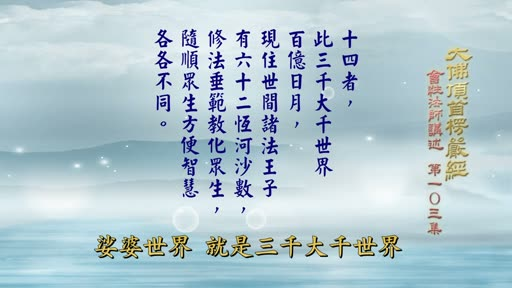

**重點：** 接續三十二應，講十四無畏的第十四「持名無畏」：持觀世音一名，與持六十二恆河沙諸法王子名號福德正等無異。並說明小千、中千、大千三種千世界合成「三千大千世界」，即釋迦牟尼佛教化範圍的娑婆世界。

**標籤：** #持名無畏 #三千大千世界 #娑婆世界

（片頭音樂），各位善知識，大佛頂首楞嚴經第六卷，就是三十二應講過之後，第二就是十四無畏，十四無畏講了十三種，現在是講第十四，十四者，此三千大千，百億日月，現住世間諸法王子，有六十二恆河沙數，修法垂範，教化眾生，隨順眾生方便智慧，各個不同，由我所得圓通本根，發妙，耳門，然後身心微妙含容，周遍法界。令諸眾生，持我名號，與彼共持六十二恆河沙諸法王子，二人福德，正等無異。世尊，我一名號，與彼眾多名號無異。由我修習，真圓通，這是第十四 持名無畏，這個娑婆世界，就是三千大千世界，一尊佛所教化的範圍，就是一個三千大千世界，這個所謂三千大千世界，是由許多世間，合起來成為一個大千世界，就是一個小世界，在古代印度的說法，是一個日月，一個須彌山，一個四大部洲，那麼這樣組成一個小世界，那麼一千個小世界，就叫做一個小千世界，一千個小千世界，叫做一個中千世界，一千個中千世界，叫做一個大千世界，那麼這一個大千世界，因為小千，中千，大千，三次說千，所以叫做三千大千世界，實際上，就是一個大千世界，那麼這是指我們這個娑婆世界，釋迦牟尼佛所教化的範圍。

### 投影片 2：六十二恆河沙數的菩薩：修法垂範（03:40–07:00）

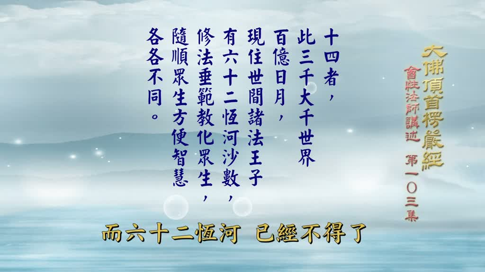

**重點：** 諸法王子即菩薩；六十二恆河沙數的菩薩，一沙算一位；經文原作「六十二」，《法華經》才是六十二億；菩薩一面修行一面為眾生作模範，各有權巧方便。

**標籤：** #諸法王子 #恆河沙數 #修法垂範 #權巧方便

那麼這裡面，大概有一百億的日月，就是一百億個日月，一百億個須彌山，一百億個四大部洲，就是一個大千世界，釋迦牟尼佛所教化的範圍，這個三千大千世界裡面，現在住在這個三千大千世界裡，一百億個小世界裡，那麼所有的菩薩現住世間諸法王子，現在釋迦牟尼佛說楞嚴經，那個時候，觀世音菩薩說他的耳根圓通的時候，在那個時候，這三千大千世界當中，菩薩 法王子 佛為法王 於法自在，那麼菩薩繼續佛的家業 就是法王之子，那麼法王子就是菩薩，諸法王子就是三千大千世界裡面，有許多菩薩 有多少，有六十二恆河沙數，一條恆河的沙 究竟有多少，好 不曾有人算過，也不曉得有多少，佛凡是講到這個數目字最多的地方，就拿恆河下來做比，這裡不是一條恆河，六十二，法華經還講的是六十二億，有些註解這裡加上億字，實際上不必，因為經文原文沒有億，加個億就不得了了，六十二恆河已經不是了，如果是六十二億恆河，那還得了嗎？怎麼能夠算得出來？現在我們就是以經文的六十二來說，不說億，億是法華經的事情，我們不去論它。這裡只是六十二，六十二條恆河的沙，一沙算一位菩薩，盡六十二恆河沙數那麼多的沙，算盡，所以盡這個三千大千世界裡面就有那麼多的菩薩，他在這個三千大千世界裡面做什麼，修法垂範，他自己正在修行 還沒成佛呀，所以他要修學佛法，而對於教化眾生 菩薩是要做眾生的，垂就是對於一切眾生來說，做他的模範，做眾生的模範，自己修的法門來做教化眾生，那麼就是以眾生為模範，給眾生做模範，這些六十二恆河沙數菩薩，給眾生做模範，各個有他教化的因緣，那麼他們隨順眾生，眾生的根性千差萬別，那麼他有權巧方便的智慧，這個方便智慧各個不同，就是應眾生。

### 投影片 3：耳根圓通與持名功德「正等無異」（07:00–10:20）

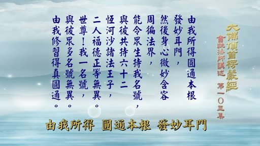

**重點：** 觀世音以耳根為本、從耳門發妙，身心含容、周遍法界，能令眾生持名；持一尊名號與持六十二恆河沙數菩薩名號功德相同，原因是「由我修習得真圓通」。

**標籤：** #耳根圓通 #反聞聞自性 #正等無異

根基各各不同，根基千差萬別，那麼菩薩的方便智慧也是各各不同千差萬別，那麼他們都有很大的功能，在哪裡呢，由我所得圓通本根發妙耳門，這是觀世音菩薩自己說他自己的修行，因為有，觀世音所知道的圓通的法門，本根就是耳根法門，以耳根為本，從耳門發出微妙的修法，反聞聞自性，由此成就耳根圓通。那麼然後，菩薩的身，與菩薩的心，很微妙的，包含容納，周遍這個三千大千世界裡面，所有的眾生的根基，他足能夠應機說法，周遍這個三千大千世界，我能令一切眾生，就是這個娑婆世界的，三千大千世界裡面的眾生，持我名號，用持名修行來說，受持觀世音菩薩一位菩薩的名號，跟，念這個六十二恆河沙數法王子，就是菩薩的名號的功德，以彼共持六十二恆河沙菩薩的這個功德，一尊觀世音菩薩的，你受持他一名的功德，跟有另外一個人共同受持，六十二恆河沙數法王子的功德，兩個人的修法比較起來呀，二人福德正等無異，相同，念觀世音菩薩的一位的功德，跟念六十二恆河沙數菩薩的功德完全相同，所以叫做正等無異，無異就是沒有異樣，完全相同，沒有異樣，那麼為什麼，觀世音菩薩一位的，這個持他一位的名號，功德就等於六十二恆河沙數菩薩的功德，修持他的名號的功德，那麼這兩個人完全相同，原因在哪裡，世尊，我一名號，與彼眾多名號無異，他對釋迦牟尼佛說，世尊，我觀世音一個名號，跟六十二恆河沙數菩薩的名號，他們兩個人修持的福德比較起來，沒有差別，所以無異，這個原因在哪裡，最後說由我修習得真圓通，因為我修習得真圓通的緣故，所以勝過六十二億恆河沙數，文字淺顯，這樣看看就差不多明白了。

### 投影片 4：圓瑛法師《講義》與通理《指掌疏》的解釋（10:20–13:20）

**重點：** 引《指掌疏》：單持一名與共持眾名，就行而論有霄壤之別，就福而論卻不爽絲毫；《講義》補上「單持」「共持」等字，並以「由我修習得真圓通」說明其他二十四聖不及。

**標籤：** #指掌疏 #講義 #霄壤 #單持共持

我們看看古註，先看近註，圓瑛法師的講義，講義裡面他怎麼註解，這段文他怎麼說的，他就先引用這個，清朝初，這個達天通理法師的，楞嚴經指掌疏裡面的解釋，所以講義裡面說指掌云，一名多名，單持共持，於二人之行而論之，有類霄壤，觀世音菩薩一位的名號，跟六十二恆河沙數的菩薩的名號多名，單持就是單持一尊觀世音菩薩的名號，共持就是共同受持，六十二恆河沙數菩薩的名號，這兩個人的修法就是一個人專修觀世音菩薩的一尊名號，一個人念六十二恆河沙數菩薩的名號，這兩個人的行迹，約事迹來論，有類霄壤，相差很遠，一個在天一個在地，相差很遠，一個人是一位的名號而已，一個人是六十二恆河沙數，論起來不是很多很多嗎，這個不能比對了，相差有類霄壤，霄是天壤是地，於二人之福，再論之，不爽絲毫，這個兩個人所修的福在來論，沒有絲毫的，差別完全沒有異樣，就是正等無異，經文的正等無異，其故何也，原因在哪裡呀，因為，本來在指掌裡面，他是用，問答方式，來表達這個意義，現在他是把這個問答方式，把它去掉，所以接下來呀，他又連下文的緣故，加一個大士曰，大士就是觀世音菩薩，觀世音菩薩說，單持我一名號，一彼共持眾多名號，這還是指掌的文字，但是他添了字，我一名號一彼眾多名號，原文是這樣子，現在講義裡面他把它添上，單持我一名號，一彼共持眾多名號，單持兩個字跟共持兩個字是講義添的句，福德無異福德兩個字也是講義添的句，說他們兩個人的福德沒有兩樣，接下去是講義本身的話了，則持名無畏矣，這麼看起來一多平等。

### 投影片 5：觀世音自稱「真圓通」與二十四聖（13:20–16:30）

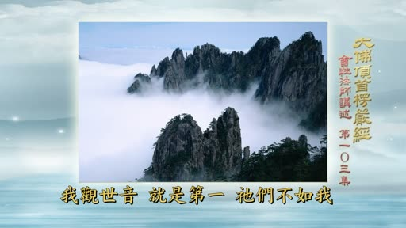

**重點：** 講者先轉述古註把觀世音選為「獨最」，再指出這種解釋不妥，因為後文佛仍命文殊再選圓通，並質疑「添此葛藤」的說法。

**標籤：** #獨最 #二十四聖 #文殊選圓通

那麼持名就沒有怖畏了，為什麼會有這種不可思議的功德，此實由我修習耳門圓通，實在是因為我是修耳根圓通，代觀世音菩薩說我是修耳門圓通，乃得真實圓通故也，說我修耳門圓通才是真正的圓通，這就形成其他二十四位不是真的，變成了與二十四聖相對來論，跟六十二恆河沙數菩薩的修法相對來論，我的才是真的，他們不是真的，具足圓通常三真實，因為耳門圓通，具備圓通常三種真實的意義，在後文，文殊菩薩選圓通裡面就有說到，這裡暫時按照文字念過去，因此，我能超二十四，聖而獨妙，觀世音菩薩，我超過他們前面的二十四位聖者，當敵諸法王子以勿疑矣，敵諸法王子，諸法王子就是指六十二，恆河沙數，那麼這就不必有疑問了，我的功德，因為我的耳門圓通，耳根圓通是圓通常，完全具足，是真圓通，所以他們不能跟我比了，觀後二句菩薩密意，以將諸聖圓通玄機為獨最，這是凡夫的說法，實際上觀世音菩薩不是這樣說的，他是這樣的觀後邊兩句，後邊兩句就是由我修習得真圓通，我觀世音菩薩自稱，因為我修到的是在真正的圓通，看這兩句就可以知道，菩薩的密義已經把諸聖前面二十四位聖者所證的圓通，在這裡面選出我自己為獨最，我觀世音的耳門圓通，好第一，所以，後佛命文殊更選擇，為不了佛與觀音密義者，添此葛藤也，不倒，這樣解釋不倒，怎麼說，他說不要選在後邊選，我現在也就已經選好了，我觀世音這是第一，他們不如我呀，所以因為選我為獨最，其他的都不如我，只有我的最高，既然如此，那麼後邊佛叫文殊菩薩選圓通，再重複選圓通，這是因為無為獨最。

### 投影片 6：說「葛藤」：割葛藤救命的故事（16:30–20:20）

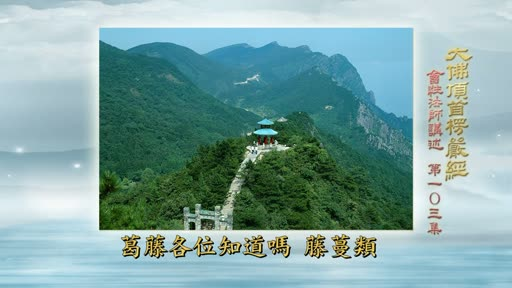

**重點：** 「葛藤」是禪門用語；講者插述13歲時掉進水塘、抓到葛藤得救，因此感念葛藤（講者自述）。

**標籤：** #葛藤 #禪門 #自述

為了一部分不瞭解觀世音菩薩的密意，跟佛的密意的人，添這個葛藤，添這個葛藤，葛藤兩個字在這邊是不大妥當，怎麼說的，葛藤兩個字是禪門 宗門下的話，說到葛藤，我要打個岔，因為我跟葛藤有很大的姻緣，葛藤各位知道嗎，藤蔓類，我在獅頭山葛藤很多，這種藤，韌性很強，小小的，跟這個小香一樣，大的 稍微大一點，小小的藤，很長很長，韌性很強，獅頭山很多，山上大致都有，我為什麼說到這裡來，因為它救了我的命，我在13歲的那一年，因為我的家附近，有煤礦，那個煤礦工人，他住在另外一個地方很遠，也是山上，夏天的時候天氣很熱，他放假回去，要住玩兩天，那麼他就帶我去，那麼我跟他去，他的家前面有一個，水塘，埤塘，水是混濁的，黃色的，泥巴水，那個水塘多深不知道，很大，那麼因為天氣很熱，中午大家吃口飯之後，很多村子裡面的小孩就去游泳，在水塘裡面游泳，他們會游泳，從此岸游到彼岸，我一個人我不會游泳，我沒有學過，不會玩水，那麼他們在遊遊得很快樂，我在這邊真是無聊，熱得受不了，自己坐在那邊，又是太陽又大，沒有地方 可以閃避這個太陽，好吧 我也下去玩玩水吧，想這個淺的地方來泡一泡水，也會比較涼快一點，我就下去了，沒有想到那個泥巴漿 是軟的，一腳一踩 沒有踩對呀，整個人就掉下去了，掉到水池深的地方去了，這個時候糟了，已經喝了好幾口水，手隨便，亂抓亂抓，正好抓到葛藤，就是山上，從樹木裡，緣樹木的葛藤，本來是往上生的，不曉得為什麼，可能是本地人，葛藤會妨礙他的樹木，把它砍掉，什麼砍掉？這葛藤就垂到，這個水塘裡面去，如果久了，它也會泡壞，可是可能是剛剛垂下去，沒有兩天，還是很強的力量，我抓到這個藤，才爬起來，已經喝了好幾口水了，如果沒有這個葛藤的話，我已經老早就沒有命了，轉身恐怕五十歲了，我那個時候才十三歲，有這個葛藤，又救了我的命，不是救命恩人是救命恩藤，所以我後來在山上看到，葛藤我捨不得砍它，我還是把它保留住，我的家裡附近的葛藤，我不砍，我的祖母就說我，那怎麼不割掉，我說它救了我的命，我捨不得割它，所以葛藤，這一種植物韌性很強，山上很多，禪宗拿這個葛藤來做，做什麼用，各位有佛學實用辭典。

### 投影片 7：查佛學詞典：葛藤的意思（20:20–23:20）

**重點：** 查《佛學實用辭典》「葛」十三畫：葛藤指煩惱纏縛、說話囉嗦兜圈子；並引《宗門武庫》等禪宗用例，認為「添此葛藤」不適用於佛命文殊選圓通。

**標籤：** #佛學實用辭典 #宗門武庫 #葛藤 #囉嗦

你不妨去查一查，看實用辭典，對於這個葛藤兩個字是怎麼解釋，如果你是用的，前不久有人送的很多，一大厚冊的，這個，所謂佛學實用辭典，十三畫，葛十三畫，查十三畫，我已經查過了，是1589，1589頁，那一面，有這個葛藤在解釋，你看看它的葛藤怎麼解釋，我念給你聽好了，比煩惱也，葛藤是比煩惱的，又斥法門之煩者，法門講的太亂太煩，好像葛藤一樣，也叫做葛藤，還有是禪家的語言，禪家的常語，禪門經常講這個話，他還引這個出曜經，我不說，那麼叢林盛事裡面說，叢林盛事是禪門，一本書，他說禪家者流，凡見說事枝蔓不徑捷者，就叫做葛藤，就是說的很多話囉嗦，那個兜圈子這個就叫做葛藤，他還引證這個大慧宗杲禪師的，這個宗門武庫裡面的話說這個葛藤，他說，雲居舜老夫，常譏天衣懷，說葛藤禪。一日，聞懷遷化，聽到天衣懷入滅了。他就在法堂裡面合掌說，且喜葛藤樁子倒。葛藤倒了，倒了以後不會有人說葛藤禪了。這樣看起來，根據辭典裡面的解釋，我們這樣看起來，葛藤兩個字最起碼，會被人認為多餘，多餘，那這裡說，添此葛藤也，後邊再叫文殊選圓通，添此葛藤，那就是變成後邊，佛叫文殊選圓通，是多餘的，變成多餘的，不好，這樣子不好，佛怎麼會叫人做這個多餘的事情，佛也不會弄出這個葛藤來，所以下筆註疏，得要用好好的用腦筋，多想想這個話能不能用，葛藤兩個詞語呀，在這裡是不適當的，是不能用的，所有的註解裡面雖然在哪裡分真假，但是他們沒有把葛藤搬進來，這個所謂觀世音菩薩真圓通。

### 投影片 8：指掌、正脈把二十四聖說成「似圓」並不妥（23:20–26:20）

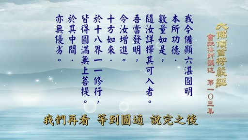

**重點：** 指掌說觀世音是真圓通、其他二十四聖是「似圓非真圓、似通非真通」；正脈、講義同調。講者認為這樣把二十四聖貶低，與第四卷「十方如來於十八界一一修行，皆得圓滿無上菩提，於其中間，亦無優劣」不符。

**標籤：** #似圓非真圓 #正脈 #十八界 #無優劣

看看其他的註解怎麼說，就在指掌下文接著就說，其所得圓通，菩薩的是真的，那麼其他二十四聖的圓通，他說他們所證的圓通就是二十四聖，為似圓，非真圓，似通，非真通，不好，這種解釋都不對。他說只有觀音才是真圓通，前面二十四聖所證的那不是真圓通，不是真圓通是什麼？是圓，好像圓的，但是真正是不圓。是通，好像是通的，真正是不通的，非通。是圓非圓，是通非通。這個把前面二十四聖說得太不值錢了。怎麼可以這樣說？指掌這樣也讀不對。他雖然沒有加上葛藤，但是這個解釋不好。那麼這個講義差不多都是繼承正脈，指掌也是他的其中之一，那麼正脈怎麼講，正脈也是一樣，尤其，其顯然自認，為我的，真圓通，說觀世音自認 我才是得到真正圓通，可見，餘諸聖所得，非真，正脈說的，可見餘諸聖所得非真，餘諸聖所得非真，就是變成那麼其他24位，聖者所證的圓通不是真的，都是相似而已，像這類的解釋，都把前面二十四聖拉彎了，扭曲了，扭曲了，這樣很不好，因為佛沒有這樣說，釋迦牟尼佛在第四卷的經文裡面曾說過，十方如來於十八界一一修行，皆得圓滿無上菩提，一一，於其中間亦無優劣，這是第四卷的文字，十方諸佛在十八界六根六塵六識，無論哪一門一一修行，都能夠圓滿成就無上菩提，那麼無論他修哪一門，在中間所修的，沒有優劣的沒有差別的，他們一樣平等平等，無有優劣，我們再看等到這個圓通說完之後，佛要教，要命令文殊菩薩選圓通之前，佛說的話還沒有講到，我們先把它念一念。汝今觀此二十五無學諸大菩薩及阿羅漢，各說最初成道方便，皆言修習真實圓通。彼等修行，實無優劣前後差別。佛說的，彼等二十四聖與。

### 投影片 9：佛說二十五聖平等；《文句》解「真」為投機（26:20–30:00）

**重點：** 引經文：佛說二十五聖「實無優劣前後差別」；《文句》解「真圓通」的「真」為「投機」（正投阿難及此方眾生之機），不是與二十四聖論真假；若只有觀音真，念佛也成白念。

**標籤：** #文句 #投機 #平等 #念佛圓通

觀世音菩薩的耳門圓通二十五，他們的修行，沒有優劣，沒有說誰勝，誰劣，現在他們這一解就變成，觀世音菩薩是勝，二十四聖是劣，形成有優劣，這個不對，佛沒有這樣說，佛說是，彼等都是平等平等，沒有優劣，也沒有前後差別，他們二十五聖所修的法門，沒有前後沒有差別，這是，佛說的話，解釋都跟佛說的話相違，違背佛說，這樣說完全不對，所以，看註解，要會看，像這種的註，看起來就會，使人誤會，因為，那前面二十四聖修的，不是真圓通，只有觀世音菩薩才真圓通，那如果是這樣子的話，就直接叫觀世音菩薩說一個圓通就好了，前面二十四聖就不必說，說出來做什麼？我說出來不過是四的，不能當選，都是落選的，因為憲章真的選過，不能24個總統選，如果以這種的看法來看經文，那就有優劣，有差別，有前後，跟佛的話完全相違，那要應當怎麼解才對呀？看文句，好，在文句裡面的解釋說，由我修習得真圓通者，重解經文，正投阿難及此方之基，故名為真，注意，因為這裡說的是投阿難的根基，跟此方眾生而根最利的根基，所以叫做真，接下去說，那就是說，非為二十四聖有未真也。文句就把它拉回來，並不是說其他二十四聖不真，只有觀音才真，不是的，他們平等，沒有差別，現在觀世音菩薩說的，由我所修習的真圓通，這個真圓通的真，不是跟前面二十四聖在論論真假，所以，指掌解釋說前面二十四聖是似圓通，而觀世音菩薩，圓通才是真圓通，這就錯誤了，這個因為他這個四個字一句，由我修習的真圓通的真字沒有解釋，所以會發生這種的錯誤觀念，認為只有觀世音才是真的圓通，其他二十四聖就不是真圓通，指掌、正脈、講義都這樣講，這完全是不對的，如果是這樣子的話，我們念佛也白念了，為什麼，念佛也在二十五圓通裡面的六根圓通，六根圓通大師之菩薩的念佛圓通，難道它不是真的嗎，它也是第一，所以用這個真是真假，來對於前面的二十四聖來說明，這是不準確，是錯誤的，不能用，所以關於這個解釋，我們應當於，以文句的解釋為準，就是這裡所謂的真圓通，第一 真正投阿難的根基。

### 投影片 10：此方真教體，清淨在音聞：以耳根為教體（30:00–33:00）

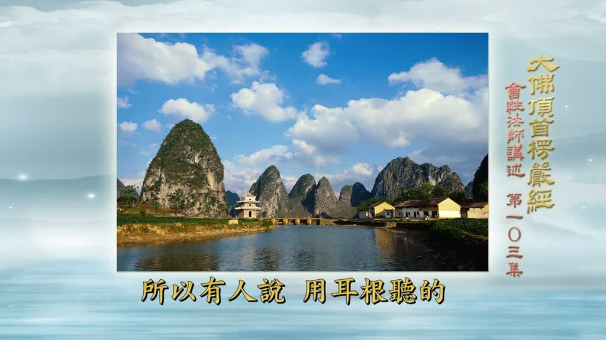

**重點：** 娑婆世界眾生耳根最利，以耳根為教體，聽法容易得受用；講者說「聽一遍勝過自己看三十遍」（講者主張）。「真」應解為應機之真，不要以分別心分真假。

**標籤：** #耳根最利 #教體 #應機

因為這個當今是阿難，要合乎阿難的根基才能有用，所以這裡所說的真圓通是投機的真，不是跟前面二十四聖相對的論真假，投機就是應機，因阿難的根基，阿難正合成二個因，其他他不適合，所以後邊文殊要選，那麼其他二十四聖，所修的所證的平等，沒有差別，不是在理上論差別，而是在應機上論差別，一方面娑婆世界，此方真教體，清淨在音聞，後邊文殊不再說的，娑婆世界真正的教體，就是以，這個耳門圓通，耳根為教體，因為我們娑婆世界的眾生，耳根最利，只要用耳根聽法呀，容易得到受用，所以有人說，用耳根聽的，聽一遍，勝過自己看三十遍，自己看三十遍，未必一聽一遍，那麼好記，記得那麼清楚，所以，我經常說，我有許多是聽來的，雖然聽的並不多，但是有很多，都是聽來的，往往聽一次，記得，看，不曉得看過多少遍，可是就是記不到，因此之故，這個，由我修習得真圓通，這個真，不能以指掌講義正脈，所說的為準，他們都是有分別心，這種的對待說法不對，應當是說應機之真，應阿難的根基，同時，應娑婆世界的耳根最利的根基，因為他方世界不一定，只有娑婆世界的人是耳根最利，所以這個耳門這個修法，適合阿難為主，兼帶為娑婆世界眾，也是以耳根為主，我們念佛也離不開耳根，六根都攝，所以應當要了解這個道理，不要用分別心去分別說，誰真誰假，世尊，我一名號 與彼眾多名號 無異，為什麼無異，由我修習得真圓通，我這個耳門圓通 正應娑婆之機，其他六十二 恆河沙數菩薩，也許他比較沒有注重在耳門圓通，所以，觀世音菩薩，因為菩薩的修法，勝過他們六十二恆河沙數菩薩。

### 投影片 11：專念一尊與六十二恆河沙：一門深入；十四無畏總結（33:00–36:50）

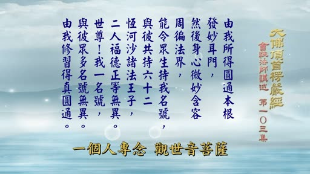

**重點：** 用一天念十萬聲為例，說明專修一門容易一心不亂，念太多反而記不得、念亂；觀音耳根圓通殊勝、與娑婆眾生有緣，因此度眾最多。並總結十四無畏為「施無畏力福備眾生」，前十三種遠離怖畏，後三種兼成就福。

**標籤：** #一門深入 #施無畏力 #福備眾生

這是按照古註我們比較起來說明。那拿持名以我們凡夫心來說吧。一個人專念觀世音菩薩，一天念十萬，天天可以念。念得他心心合一，與觀世音菩薩打成一片榮譽。所以，六十二恆河沙數，你一天念多少，六十二恆河沙數菩薩一天念十萬，一年念下來恐怕，一個恆河沙的百萬分之一恐怕還沒念到，盡你一生七八十年來念好了，恐怕也念不了一恆河沙，何況是六十二，那麼這六十二恆河沙數菩薩呀，你一輩子念不到百萬分之一，還沒念完，一尊只念一句而已，怎麼能夠相比，如果論修行，一門深入，一門深入，專修一門，容易成就，容易專一，才能夠一心不亂，假如念的很多，記不得，結果不曉得念到哪裡去了，還念亂了，還不知道，重複也不知道，沒有念到也不知道，都會搞亂，所以這是一種比方，是一種權巧方便，說明觀世音菩薩他應機最殊勝的原因，因為他耳門圓通殊勝，一方面他與娑婆世界眾生有緣，緣法最深，所以眾生稱他的名號的人最多，家家觀世音，原因就是他是娑婆世界修行成就，由於耳根圓通最應機的緣故，所以他度眾最多，應化事蹟最多，那麼，古人的解釋還有一點需要說明的，說這個十四無畏，現在是總結起來，總結的名稱叫做，是名十四施無畏力福備眾生，這是十四種的，施無畏的力量，以福的，來周備於一切眾生，使他能夠成就這個功德，但是，前十三種可以叫做有畏，持名為什麼會有畏呀，我念不念 不念有畏，念就沒有畏，是這樣解釋嗎 不是的，應當是眾生在怖畏的時候念菩薩的名號，通通都能夠得到解脫 得到受用，所以呀，使眾生能夠，遠離一切怖畏，因此叫做施無畏者，另外還有一種解釋，前面十一種是注重在離怖畏，後邊十二十三十四，這三種，一方面是離怖畏，一方面是成就他的福的因緣，成就福的因緣，所以也包含在這個利物為的這個意義裡面，剛才講的十四無畏，在文字上前文已經說過，還有一些語意沒有說的，就留到後邊了，四不思議裡面同時來做說明，我們就接下來講，下面第三段四不思議。

### 投影片 12：四不思議（總說）與第一不思議：妙妙聞心（36:50–40:20）

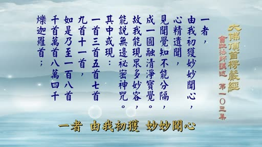

**重點：** 觀世音因耳門圓通成就，又獲四種不可思議的無作妙德。第一：由我初獲妙妙聞心，心精遺聞，見聞覺知不能分隔，成一圓融清淨寶覺，故能現眾多妙容、說無邊秘密神咒。

**標籤：** #四不思議 #妙妙聞心 #心精遺聞 #清淨寶覺

所以，世尊，我又獲是圓通，修證無上道故，又能善獲四不思議無作妙德。這是總說。觀世音菩薩把前面十四無畏說過之後，他對釋迦牟尼佛說："我，觀世音，又得到這個耳門圓通修證無上道的緣故，因為觀世音菩薩由耳門圓通成就他的果位，乃至在成就正法明如來，現在還是實現菩薩身在那裡做度化眾生事業，因此他成就這個耳門圓通，又得到四種不可思議的妙德，又能善獲，獲就是得，又得到四不思議，就是這四種不可以心思，不可以口議，心想想不出來，嘴講講不出來，這麼殊勝的功德，有四種。那麼下面就順著文字來做說明，這個不必多做多做解釋了，都是菩薩的最高境界，與我們凡夫來說，沒有辦法去想象，先說第一種，一者，由我初獲妙妙聞心，心精遺聞，見聞覺知不能分隔，成一圓融清淨寶覺，這是說明因地修行，耳門圓通的進見，由我觀世音，最初證到，這個最微妙的，耳門圓通，妙，第一個妙字，說明眾生本來自妙，有這個微妙的真性，而現在修證成就，那就是圓滿本有的妙性，所以叫做妙妙聞心，聞從耳門反聞聞自性，而證到本有的真心，成就這個耳門圓通，所以叫做妙妙聞心，心精遺聞，心精，恢復本有的真心，遺聞，對於一切的外塵的境界的，深深相位處，遺，就是把它遺棄掉，遺，是已經不用它，已經反聞聞自性，外面的塵境已經不用，所以叫做遺，也就是說，反聞聞自性，外塵不立，外塵不可得，所以叫做心精遺聞，那麼因此不但是聞是如此，而跟所對的相稱如此，就是見聞覺知也不能分割，眼根所對的色身叫做見，耳根所對的聲身叫做聞，覺包含，鼻舌身，所對之境，知，持這個意思，就是意為能知，見聞覺知，通通都不能分割。

### 投影片 13：現眾多妙容：十一面觀音與寶誌禪師（40:20–44:00）

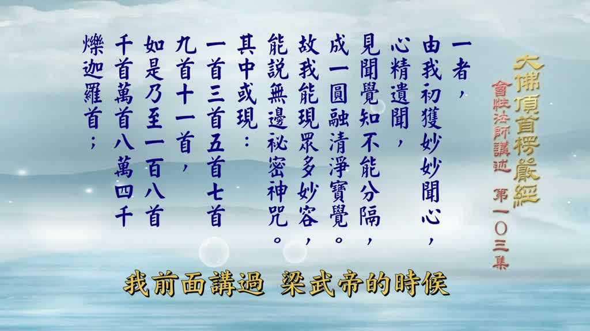

**重點：** 妙容以頭首為主，可現一首、三首……十一首至八萬四千爍迦囉首；講者轉述南朝梁武帝請張僧繇畫像、寶誌禪師臉上現十一面觀音的傳說（未查證）。

**標籤：** #十一面觀音 #寶誌禪師 #爍迦囉首

所以已經六根圓通，六根互用，不能分割就是不會割開，我們是完全割開，眼只能見，耳只能聞，菩薩，不但能見，也能聞，也能覺，也能知，乃至六根通通如是，不必去分開來，所以叫做，不能分割它，完全是圓融的，成一圓融，清淨寶覺，成就一個圓融，自在清淨的，究竟本性，最明為妙的，如眾寶所成就的這個覺性一樣，所以叫做寶是顯示尊貴，自性本來是最尊貴的，所以叫做寶覺，這是因地修行的情況，現在成就果地，故我能現眾多妙容，容是容貌，相貌，以頭首為主，全身相貌，也包含在其中，有種種的微妙的，永遠，來做度化眾生事業，他也能說無邊秘密神咒，就是觀世音菩薩的咒也最多，在密部裡面，咒也最多，我們平常課誦，念誦的十小咒，除了千手大悲咒之外，十小咒裡面也有好幾種，是觀世音菩薩說的，那麼，其中，就在這個微妙的，這個現容的情況之下，他在這中間，或現或是不一定，如果需要，以這些現象來度眾的話，他就能現，一首，一個頭首，三首，三個頭首，五首，五個頭首，七首，九首，十一首，有十一面觀音，我前面講過，這個梁武帝的時候，南朝梁武帝的時候，誌公寶誌禪師，這個梁武帝請人來畫他的像，就是看不准他的面相怎麼樣子，那麼畫的人張僧繇要求說，請大師你得把你的真正的面相顯現出來，讓我能夠畫，寶誌禪師就用手這樣一畫，臉上現出十一面觀音，十一面觀音就是這裡所說的十一首，十一面觀音，所以由此一般人就稱這個寶誌禪師，是觀世音菩薩化身，十一首，如是乃至一百八首，慢慢增加，如是就像前面這樣的，十一十三一十三，單數的增，乃至略掉中間，十三到一百零五，這一百八首，就是一百零八個首，還有多至，一千個首一萬個首，乃至八萬四千，爍迦囉首，爍迦囉叫做堅固，爍迦囉印度話，翻成中國話就是堅固，這首臂都是非常堅固而微妙，這是頭首的現象，乃至八萬四千，這個不是我們所能想象的，八萬四千頭首怎麼安置，一個身體。

### 投影片 14：千手千眼：首臂目的無量（44:00–47:10）

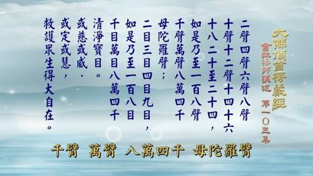

**重點：** 手臂成雙，二臂至二十四臂，乃至八萬四千母陀羅臂；目由二目乃至八萬四千清淨寶目；千手千眼的現身或慈或威、或定或慧，救護眾生得大自在。

**標籤：** #母陀羅臂 #清淨寶目 #千手千眼

八萬四千手怎麼安置，也許就是八萬四千的現身，現首必定有身，現首臂，手臂是論雙，不能單，頭是單一，手臂是兩個，二臂，四臂，六臂，八臂，十臂，十二臂，十四，十六，十八，二十，至二十四，有人裝觀世音菩薩千手千眼，不可能把一千個都裝上去，最起碼做到二十四，一邊十二個手，一邊十二個手，那麼兩邊就是二十四了，以二十四個，這個手臂，來表現他的，千眼，如是乃至像這樣子，一百八臂，現到一百八，千臂萬臂，八萬四千，母陀羅臂，母陀羅就是，手都是非常的熟身，隨時要怎麼現就怎麼現，這是現手臂，千手千眼，有人禮拜觀世音菩薩，專修觀音法門，拜了幾十年下來，最後，觀世音菩薩現千手千眼，他看到非常高興，祈求菩薩加被，菩薩就拿他的手一指給他，這一隻手裡面有一個眼睛，千手千眼，給他一指，那麼你修成了，就是觀世音菩薩的，千手千眼的一個法身，所以他能夠現無量的手臂，八萬四千是多，眼睛，手臂千眼，眼睛，二目，三目，四目，九目，如果一個人在臉上怎麼樣安置，我們想象不出來，如是乃至一百八目千目萬目八目，八萬四千，清淨寶目。所謂千手千眼還是千而已，都不到八萬四千。手臂也是八萬四千，乃至眼睛也是八萬四千，都是無量無邊，不可思議。像這種的現身現手，現眼，是現手現眼，不可思議，那麼這個現象，它不是統統相同，或慈或威，有的是很慈祥的菩薩現象，菩薩地名，或者是威，很有威的像金剛神，或定或慧，或者現出這個定相，炎燃禪相，或者現在，般若智慧的現象，這些做什麼，救護眾生，就是他救護眾生，得大自在，這是第一。

### 投影片 15：第二、第三不思議：施無畏與令眾生捨珍寶（47:10–50:30）

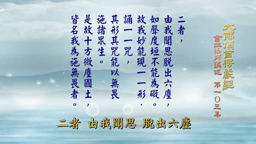

**重點：** 第二：由我聞思脫出六塵，如聲度垣，不能為礙，能現一一形、誦一一咒，以無畏施眾生，故稱「施無畏者」。第三：由我修習本妙圓通清淨本根，所遊世界皆令眾生捨身珍寶、求我哀愍；「令」字解為影響，不是使令。

**標籤：** #如聲度垣 #施無畏者 #捨身珍寶

這個沒有辦法解釋的，文字念念好了，二者，由我聞思脫出六塵，如聲度垣，不能為礙，故我妙能現一形，誦一一咒，其形，其咒，能以無畏施諸眾生，是故十方諸微塵國，皆名我為施無畏者，觀世音菩薩也叫做施無畏菩薩，第二種的不思議就是，因為他有，反聞聞自性，這個脫出六塵的境界，那麼完全顯示，本有在自性精進的現象，好像，像聲音超出這個垣牆，如聲度垣，垣是牆，聲音牆關不住。例如我們這邊講話，隔壁的牆外，他都能夠聽到，就是聲音能夠渡出牆之外，牆不能礙他，所以叫做如聲度垣，不能為礙。因此之故菩薩，他在十方世界當中，不會妨礙他，他有什麼現身，都可以隨時顯現，因此之故，我很微妙地能現一個身，一個形，一一形就是一一身相，種種形象不一樣的，不止一種而已，千萬一種，也能說無量咒，誦一一咒，誦就是說，說出種種的咒，最少字的像六字真言，最多字的像大白咒之類，其心其咒能以無畏施諸眾生。無論是現身的身體，說咒的咒語都能以無畏佈施一些眾生，使眾生利益不畏。因此之故，十方，諸微塵國土的十方世界眾生，都尊稱觀世音菩薩，叫做施無畏者，真正能夠佈施一切眾生的遠離怖畏的功能，通通他能夠成就。三者由我修習本妙圓通清淨本根，所遊世界，皆令眾生捨身珍寶，求我哀愍。第三種的不可思議，他到十方世界，無論到什麼地方，由他證到這個耳根圓通的清淨本根，所遊化的世界都能夠影響到眾生捨身珍寶而來供養菩薩，求菩薩哀愍。這個令，這個令字不要看作使令，不是說我叫他佈施，我叫他供養，不是這個意思，這個令，看作影響，影響，菩薩到什麼地方，就會影響到那個地方的眾生，他寧可捨身上的珍寶來，供養菩薩，求菩薩，哀愍他，來救護他，那麼就是說，他無論到哪一個地方，眾生看到就喜歡，就要請菩薩來施無畏，不是使令。

### 投影片 16：第四不思議：求妻得妻、求三昧得三昧（50:30–53:00）

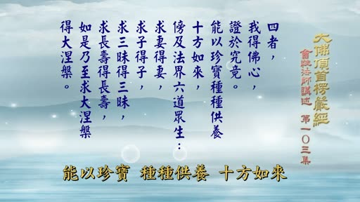

**重點：** 第四：我得佛心證於究竟，能以珍寶供養十方如來、傍及六道眾生，求妻得妻、求子得子、求三昧得三昧、求長壽得長壽、乃至求大涅槃得大涅槃；講者以《維摩經》「法喜以為妻」解「求妻」為求法喜。

**標籤：** #求妻得妻 #三昧 #大涅槃 #法喜為妻

看作使令就不正確，就是影響的意思，這是第三，四者 我得佛心證於究竟，因為菩薩已經成佛，現在是菩薩身，這是方便，已經證到究竟的果的，所以我得佛心證於究竟，佛所證的佛心，也就近正道，所以能以珍寶，種種供養十方如來，他能夠用種種的珍寶，來供養十方諸佛，傍及法界六道眾生，我能資助法界六道里面，一些眾生，六道眾生，就是指六凡法界裡面，三善道三惡道，天人阿修羅、地獄餓鬼畜生，六道苦惱眾生，眾生有所求，他能使他統統滿願，所以求妻得妻，求子得之，求三昧得三昧，求長壽得長壽，如是乃至求大涅槃，再大涅槃，這是滿眾生所求，你要求什麼，菩薩就使你成就什麼，求妻得妻，這個話，以理來看，就是前面引用維摩經所說的，法喜以為妻，我們求法喜之妻，不是求世間法的妻，所以求妻能夠得妻，就是在法喜，法喜充滿了法喜，求子的子在滿二求前面已經說過，求三昧的三昧，您要進哪一種定，要修哪一種定功，那隨你所求，它都會幫助你使你成就，假如有人壽年不長，要求長壽，念觀世音菩薩，也能得到長壽，這樣子，柔智像這樣子的要求，乃至略教其他，很多很多，眾生所求的，乃至究竟要成佛，大涅槃，涅槃是不生不滅，就是究竟佛果的果子，約理說是涅槃，約智說就是菩提，如果你想要成佛，這大涅槃，那麼如法修行觀世音法門，也能成就涅槃，這是事不思議，凡是有所求都能滿願，前面說過的十四無畏，有一種很是普及的菩薩的故事。

### 投影片 17：觀音治病：曇無讖、沮渠蒙遜與《普門品》（53:00–56:00）

**重點：** 講者敘述北涼王沮渠蒙遜頭痛，曇無讖勸他念《普門品》而癒，是《普門品》單行流通的緣起；隋朝智者大師另作《觀音經義疏》（講者所述，未查證）。

**標籤：** #普門品 #曇無讖 #沮渠蒙遜 #智者大師

可是前文裡面沒有，什麼，治病，治病，觀世音菩薩的法門傳到中國，能夠普遍流通，第一個就是治理眾生的病，南北朝的開頭，就是五胡十六國，最後的一國，北涼，北涼王沮渠蒙遜，犯頭痛，痛得要裂開，什麼藥都治不好，那麼曇無讖三藏法師來，他就問曇無讖三藏，我的頭痛沒有辦法治療，你有什麼方便辦法幫助我嗎，曇無讖就叫他說，你念觀音經，念觀音經就會好，觀音經是什麼，就是普門品，法華經的普門品，要治不好，沮渠蒙遜，把這個普門品恭念，頭痛馬上就好了，不藥而愈，恭念觀世音菩薩普門品，那麼他的頭痛就好了，這是最早治病而發生功效的原因，由此觀世音菩薩的法門普遍流通，所以法華經普門品，因為單行流通就是由這個原因而來，由治病的原因，所以到隋朝，智者大師另外註解觀世音菩薩普門品，叫做觀音經義疏，前面有玄義，有玄義有義疏，就註解這個觀世音菩薩普門品，所以這是由治病而來的，所以世間上有很多人，很多奇怪的病，藥治不好的，最後念觀世音菩薩念好了，在這個恕中無慍禪師的一部書叫做《山庵雜錄》，《山庵雜錄》裡面記載一個念觀世音菩薩法門的事，說浙江的天童寺，就是在明朝初年，明朝開始，因為這個事情出在明朝的洪武九年的事情天童有一位趙寮元寮元是大寺廟叢林裡面的一種執事，管理寮房的，寮是寮房，元是源頭的元，一元兩元的元，寮元是在叢林裡面，專主理這個寺廟裡的寮房，有新的注重來了，要分配哪一個寮房，如果在寮房方面有什麼事情，由他去負責，這個叫做寮元師，有一位寮元師，他這個書本上寫的，趙寮元。

### 投影片 18：《山庵雜錄》：趙寮元念觀音病癒（56:00–60:20）

**重點：** 恕中無慍《山庵雜錄》記載：天童寺趙寮元多病，念觀世音一年未見效，轉念要念阿彌陀佛求往生時，觀音現身；之後五天病癒（講者轉述古書記載，未查證）。

**標籤：** #山庵雜錄 #天童寺 #趙寮元 #感應

普藏的趙，應該還有一個字了，還沒有寫出來，不知道是，這個趙寮元師，一向都病，很多病，經常，以藥為伍，那麼到了朱洪武的，丙辰年就是九年了，這一年他病得很辛苦，那麼當時有一位庫師，就管庫頭的了，他是學修，專修這個觀世音菩薩法門的，因此他就勸這個趙寮元，說你呀，我看你吃藥不是辦法了，你念觀世音菩薩，求觀世音菩薩加被，看有沒有希望快點好吧，那麼因此他就聽話，從那一年，開始那一年的十月十七，開始就念觀世音菩薩，每天最少念一萬，他是病中，很辛苦，很勉強的，可以念滿一萬，無論如何要把它念成一萬，這樣子一直念一直念，天天念，念了一年，到了第二年的十月十七，自己覺得並沒有好，不但沒有好，覺得距離死的時間好像不遠了，自己的感受，覺得可能快要死了，因此到了第二年的十月十七，他就轉了念頭，他想，我看念觀世音菩薩不是辦法了，菩薩不救我了，我看要求往生了，他就轉念，我還是念阿彌陀佛好了，求阿彌陀佛來接應，因為觀世音菩薩他都不救我的病，他這個念頭一動，就是十七上午，這個將要吃中飯的時間，他動這個念頭，這個念頭一動，突然之間，他是睡在床上，他的自己一個房間，看到有一個很美很美漂亮，這不得了的女人，站在他的面前，他嚇了一跳，我的房間門是一看，房間門是關住的，窗戶也關住的，十月已經很冷了，他同等的關係，根本就沒有辦法進來呀，他躺在床上，一看前面，這床邊就是站了一個很美的女人，看著那個相貌，從來不曾看過這麼美的人，他嚇壞了，為什麼會有這個人跑進來呀，門窗都關住，旁邊也沒有人，他覺得很奇怪，正在納悶的時候，好好的看，看這個人是怎麼樣，往頭頂一看，這個人的頭頂上有一尊佛像，一尊佛像，再細看全身都是白衣，穿著白衣，那個相貌莊嚴，簡直他沒有辦法表達，看到這個人，一手拿了一個淨瓶，一個手拿了一個楊柳枝，站在他的面前，帶一點微笑，這個時候他才看出來，觀世音菩薩，是觀世音菩薩現身了，看著他微笑，沒有講話，他心裡很慚愧，他想我念了一年，一年都沒有感應，我想這個時候大概快死了，所以我轉念想念，念佛名號求往生，菩薩就現前了，那菩薩你這要救我嗎，我的病會好嗎，菩薩並沒有說話，點點頭翻身就走了，那麼他想了這麼顯明的感應，你從來不曾看過菩薩現身，念了一年，這個時候他轉念想要念阿彌陀佛求往生，菩薩現前了，說你還不是往生的時候，你還能夠好，所以他現身了。誒，看看菩薩救人也會賣關子誒。這個拚老命念吧，念到最後，如果覺得不行了，要往生了，你就轉念念，要念阿彌陀佛，他就來了。由這個經念以後記住，如果說是念得快，快沒有辦法了，要往生了，你就轉念念阿彌陀佛，菩薩可能就會去現身。

### 投影片 19：病癒後的感應與古頂和尚改相（60:20–65:00）

**重點：** 趙寮元此後健康；觀音還能使人「改相」：古頂和尚本有五短之相，聽看相師建議，二十年每天念拜觀音，相貌改變、聲音洪亮，後來住持大叢林、七十九歲示寂（講者所述，未查證）。

**標籤：** #改相 #古頂和尚 #五短之相 #專修觀音法門

那麼從此，他看到菩薩現身之後，不曉得楊柳枝有沒有幫他灑甘露水，書本里面沒有說，我們不敢隨便論斷了，總之他看到菩薩這樣就不得了了，從此他全身輕安，很自在，一天一天病就好了，也不要吃藥，五天，五天而已，大概他菩薩站的時間只有五秒鐘，他五天病就完全好了，恢復健康，一直到恕中無慍，禪師他寫這本書的時候，已經是過了二十年，那麼他這個書本上寫，這個人到現在還在，身體很健康，已經五十幾歲了，山庵雜錄裡面有這麼記載，還有上下兩卷，它裡面說到這種的，很不可思議的感應，念觀世音，這真正要很下功夫，他帶病拼命地念，一天一定要念上一萬，很不容易的，而且這個人，他一向就多病，從這一次的感應之後，一直很健康，那麼等到恕中無慍，禪師寫這本書，過了二十年才寫的，那麼那個時候，這個人已經是五十幾歲，那麼他這次感應的時間，總在三十幾歲左右，那麼他還是在天童寺當知事，這就是治病的感應，前面有很多在感應錄裡面，我們沒有一一提出來，那麼由此可見，菩薩，只要你真正的發心，懇求菩薩來，大慈大悲來救苦救難，是會有感應的，只要你肯真正發心，這是一件事，另外，菩薩，他還能使人改相，你專心關心菩薩法門，相也會改變，這也記載在，山庵雜錄一件事，山庵雜錄裡面說，有一位，古頂和尚，名字叫做古頂，頂，是這個，爐頂的頂，古頂和尚，他出家，可是他有五短之相，五種缺點的相，嘴唇是，往上挑，一個，牙齒往外露，兩個，聲音沙啞，三個，皮膚都是好像什麼，很粗，很粗，看起來根本不像人的皮膚，很可怕，這是第四個，身體很矮，身軀很矮，只有三四尺高，這是五個，有一個看相師，看到，你這個人，這位師父，你有五種缺點的相，你這個相，壽命不會長，而且恐怕不到四十歲就要，就完了，有什麼辦法呀，看相的也懂得佛法，你念觀世音菩薩，求觀世音菩薩，他就聽這個看相師的話，就專修念觀世音菩薩法門，白天要念十萬聲，晚上要拜一天拜，拜觀世音菩薩，這樣的下苦功，二十年，二十年的時間，沒有一天間斷，病也這樣拜，拚老命的拜，拜念不停的，二十年下來，相都改了，相怎麼改了，嘴唇，都能夠厚容起來，牙齒都變成正常的皮膚都是很細那個粗相都沒有了人也長高了五相統統改過來二十年後，那個看相師還在世，他看到的時候，師父，現在你的相整個改過來了，跟從前不同了，那麼他幫他算，你最起碼按照你現在的相，可以活到七八十歲，這個古典說。

### 投影片 20：《山庵雜錄》作者、《感應頌》與至誠懇切（65:00–69:00）

**重點：** 說明作者恕中無慍；提到徐子靖居士編《觀世音菩薩感應頌》、臺中蓮社曾印；強調修觀音法門不能用「試試看」的心情，要至誠懇切。

**標籤：** #恕中無慍 #感應頌 #至誠懇切

活到幾歲，另外一回事沒有什麼關係，我只要能夠弘法度眾，照佛法，我能做，達成度化眾生的目標，我就夠了，那麼從此之後，他聲望很好，說話也很流利，而且聲音不會沙啞，洪亮，非常洪亮的聲音，善人說話，因此各地方的大叢林，都請他去當住持，他住持了好幾個大叢林，度了很多眾，最後人挺去，晉山，捷徑的晉，向家林，到晉山住持，他在晉山當了十二年，最後七十九歲，在晉山入滅，那麼這就是，不但是能夠延壽，還能改相，這都記載在古書裡面，山庵雜錄是一位禪師，叫做無慍，四書《論語》裡面的，人不知而不慍那個慍，他的名字叫做無慍，字號叫做恕中，就是明朝初年，朱洪武那個時候，明朝初年的一位大禪師，修禪 參禪開悟了，那麼除掉他的語錄之外，他寫了一本《山庵雜錄》，有上下兩卷，《山庵雜錄》裡面就是，不但是把禪門裡面所有的，一般人家不知道的，他所聽到的故事記載起來之外，也有很多感應事故，所以裡面也有這兩個，這個修觀音法門的感應事蹟，所以我看《山庵雜錄》之後，發現這兩個我就把它記下來，就說這很特殊，在普通一般感應的書本里面，沒有看過，現在這個徐子靖居士，編了一部，觀世音菩薩感應頌，以頌的方式，總和起來說明，然後在一條一條，列出這個感應事蹟，這個書本很厚，很多，裡面是不是有這兩種，我沒有詳細去翻看，不得而知，因為這本感應頌的書太多，在現在也沒有這個力量去看，這是我看山庵雜錄裡面發現的，在平常並少見這一類，所以顯示觀世音菩薩，真是能夠使人所求都能滿願，不過有一個條件，凡是修觀世音菩薩的法門，不要用試試看的心情，不能說我念試看，我想試試看，看有感應嗎，不能有這個心情，如果有這種心情念，不會有感應，菩薩不是叫你考試，不能說我來考考看，看能不能成就，這個不對的，所以不能用這個方式，要至誠懇切，無論你修什麼法門都是一樣，要至誠懇切，才能夠得到真正的感應，那麼關於這一堆感應故事，多得不得了，不能一一詳細了，那麼這是四不思議，因為裡面說到，求長壽也能得長壽，世間上修觀世音菩薩，法門得到長壽，在感應頌裡面有很多記載，可以做參考，禪門，這個宗門下的所有修禪的人，參禪的人，專修觀音法門的不少。

### 投影片 21：契嵩念觀音；三種妙用總結；結顯圓通名號（69:00–72:08）

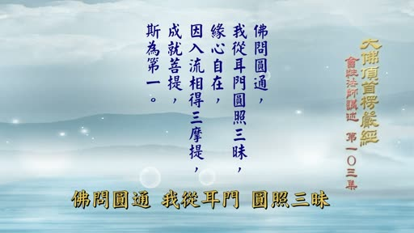

**重點：** 宋朝契嵩禪師專念觀音；總結三十二應、十四無畏、四不思議；第三段「結顯圓通名號」：我從耳門，圓照三昧，緣心自在，因入流相，得三摩地，成就菩提，斯為第一；下次從「因入流相」講起。

**標籤：** #契嵩 #結顯圓通名號 #圓照三昧 #因入流相

宋朝的這個契嵩禪師，福日契嵩禪師，他就是專念觀世音菩薩，按照他的傳記裡面記載，他一天要念十萬，有些人說他晚上念十萬，我想一天念十萬，連夜念十萬字，有可能，因為他還要住多，他有很多工作，不可能，單在夜晚念滿這個數目，這是觀世音菩薩的成就，三種的妙用的說明，在經文裡面，大概就已經說清楚了，就是說，有三十二應，十四無畏，四不思議，我們只有大概講了，感應故事太多，不可能一一詳細地列出來，關於這個徐子靖居士編的，觀世音菩薩感應頌，這本書，臺中蓮社曾印過，而且把它放大，版本很大，可以做參考，那麼一般流通也有很多，這個觀世音菩薩靈感錄，另外有一本是近代的，近代人寫在觀世音菩薩靈感錄，那麼都可以做參考，這些看了之後會升起信心，對菩薩有這個不可思議的感應，只要真正的修學，必定會有成就，這是關於觀世音菩薩的，耳根圓通的妙用，已經說到這裡為止，最後總結上文，結顯圓通名號，第三段，結顯圓通名號，前面詳細說明妙用，已經說完，結顯這個圓通的名號，叫做佛問圓通，我從耳門圓照三昧，緣心自在，因入流相，在三摩地成就菩提，斯為第一，佛在前面，二十五圓通之前，曾說過，問大家怎麼樣才得到圓通，那麼既然是佛問，在圓通的情況嗎，我觀世音他自身，我是從耳門，圓照三昧，就是修耳門圓通，反聞聞自性，成就這個圓通常的真意，成就圓通，那麼緣心自在，我不是緣外境，緣自心，自心本具的妙用，通通都是由此顯現，那麼因入流相這三摩地，前面開頭就說過了，有，這個，有入流，關於這個道理，在開頭曾講過，那麼現在因為時間到說不完，我們下次還是從這個，因入流相這三摩地，這個地方講起，今天就講到這裡為止。

### 投影片 22：片尾：講者簡介（72:08–1:13:51）

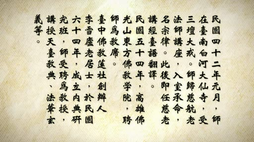

**重點：** 片尾畫面為會性法師簡介（受戒、講經等；解析度低，未逐字核對）。

**標籤：** #會性法師

（片尾音樂）。

## 已知轉錄錯誤

| 時間 | 聽成 | 應為 |
|---|---|---|
| 17:00–23:00 | 石頭山／小鄉／山上大字都有／玩兩天→晚兩天／一嚼一抬／甜的地方／歌藤的詞典解釋與《宗門武庫》引文等 | 畫面字幕確認：獅頭山／小香／山上大致都有／要住玩兩天／一腳一踩／淺的地方／雲居舜老夫常譏天衣懷說葛藤禪／聞懷遷化／且喜葛藤樁子倒／多餘；先前推測的「小繩」錯，已更正；已改 |
| 13:16–14:46 | 這持名無畏應／一道平等／沒有不畏了／此時／但觀世音不在說／聖耳朵妙／當你諸法王子以物一一 | 畫面字幕確認：則持名無畏矣／一多平等／沒有怖畏了／此實／代觀世音菩薩說／聖而獨妙／當敵諸法王子以勿疑矣；「這裡只是按照」依字幕改「這裡暫時按照」；已改 |
| 11:24 | 行地／悅四地來論 | 畫面字幕確認：「這兩個人的行迹 約事迹來論」；已改「行迹」「約事迹來論」。同處「古著／近著」畫面字幕為「古註／近註」，已改；「注寫」依使用者指正改「註解」 |
| 00:00 | The／Light／of the／《詩歌》 | 片頭音樂幻覺，已改「（片頭音樂）」 |
| 72:08 | Zither Harp／優優獨播劇場—YoYo Television Series Exclusive | 片尾音樂與字幕幻覺，已改「（片尾音樂）」 |
| 19:59–36:55 | （整段約 17 分鐘缺漏） | Groq 補漏時遇 HTTP 429 限流而失敗；已把該段音訊每 30 秒單獨重送補回（第二次轉錄，依第二次轉錄補入），已套用同樣的簡轉繁／詞典／去語助詞 |
| 多處 | 歐南／柯南 | 推測：阿難（上下文為佛對阿難說法，畫面經文可佐證前後文）；已統一改「阿難」 |
| 多處 | 應激 | 推測：應機；已改 |
| 10:25 | 元宇化石 | 推測：圓瑛法師（《楞嚴經講義》作者）；已改 |
| 10:38 | 打天通禮法師／楞嚴金執掌書 | 推測：達天通理法師《楞嚴經指掌疏》；已改，「執掌／持掌／職長／祝傑」統一為「指掌」 |
| 54:49 | 壽中武運／樹中如雲／三安雜錄／吳運 | 推測：恕中無慍《山庵雜錄》（講者引《論語》「人不知而不慍」）；已改 |
| 42:32 | 志工保治禪師／張三遊 | 推測：誌公寶誌禪師／張僧繇；已改 |
| 53:20 | 五福修六歌／北梁王讀句蒙順／譚無千 | 推測：五胡十六國／北涼王沮渠蒙遜／曇無讖；已改 |
| 69:01 | 棄宋禪師 | 推測：契嵩禪師；已改，「福日」二字語意不明，未改 |
| 27:29 | 我說出來不過是四的／因為憲章真的選過 | 推測：語意不明，未改 |
| 32:22 | 間代為 | 推測：兼帶為，已改 |
| 32:47 | 正印娑婆之心 | 推測：正應娑婆之機，已改 |
| 33:18 | 打成一片榮譽 | 推測：語意不明，未改 |
| 46:55 | 炎燃禪相 | 推測：安然禪相之類，未改 |
| 56:25 | 庫師就管庫頭的了／他是學修 | 推測：語意不明，未改 |
| 65:35 | 最後人挺去／捷徑的晉／向家林 | 推測：語意不明，未改 |
