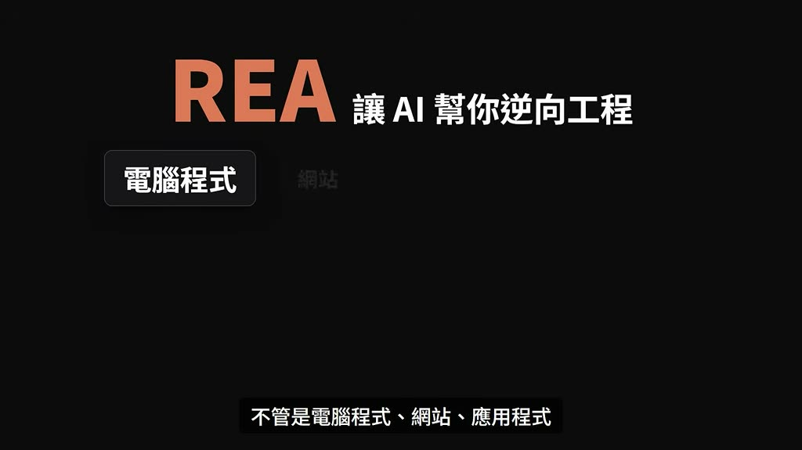
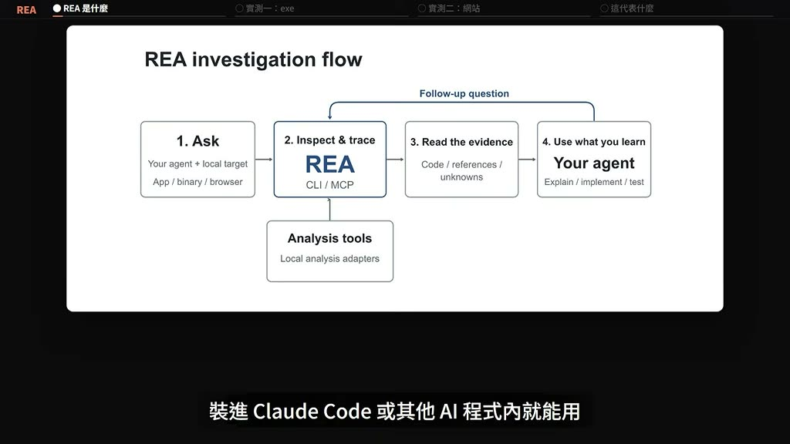
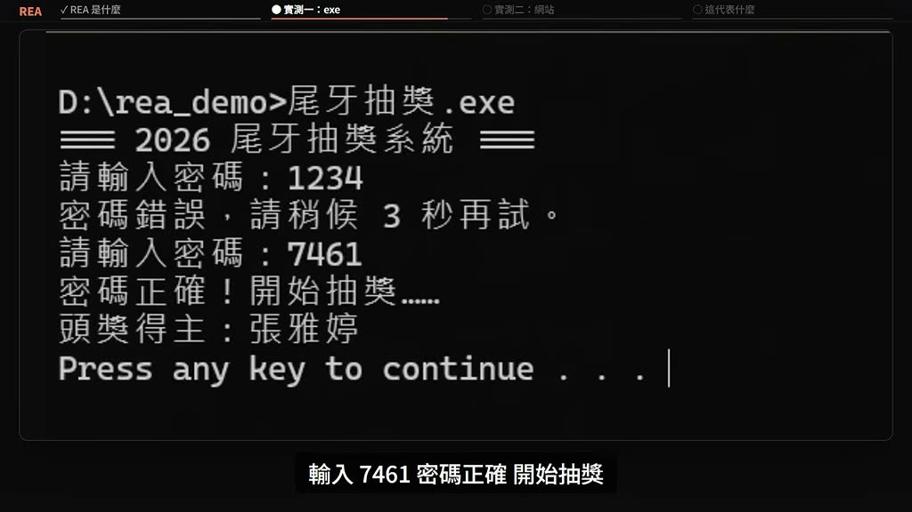
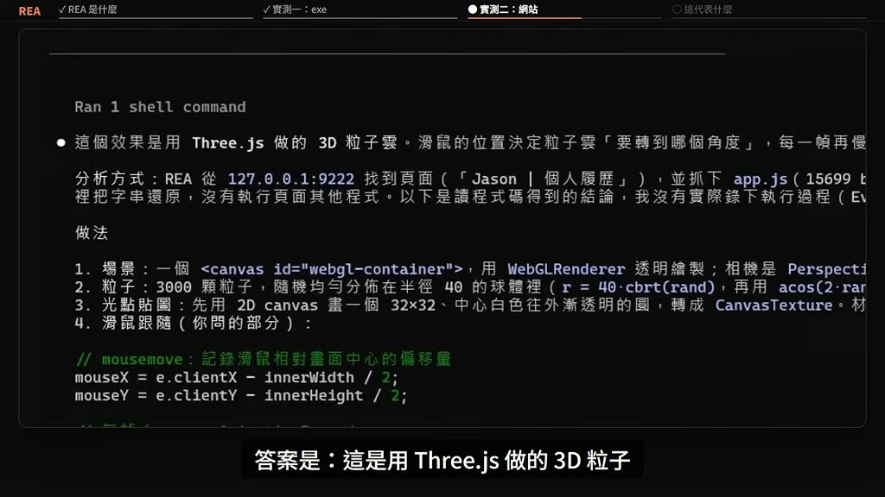
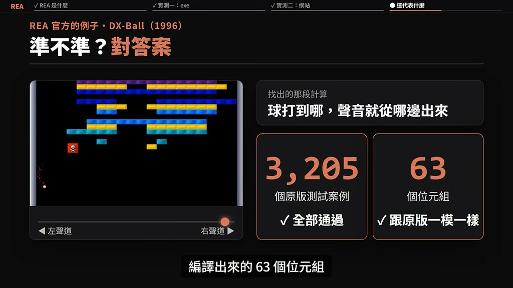

# 為什麼整個 GitHub 都在瘋傳 REA？別人的程式碼，現在是你的了?

- 來源：https://youtu.be/nmzKH9t4Zos?si=MVFw0Spj1_CwBGcK
- 平台 / 上傳者：YouTube / P & H
- 長度：08:27 (506.6s)
- 逐字稿來源：captions (zh, manual, original)
- 更新日期：2026-10-14
- **關鍵字：** #REA #逆向工程 #MCP #Claude Code #Ghidra #Detect It Easy #Three.js #DX-Ball #JADX #Binwalk

## 摘要與名詞說明

**一句話重點**：REA 是一組 MCP server + skill，讓 Claude Code 等 AI 程式能操作逆向工程工具，直接回答「這個 exe／網站是怎麼做的」，每個結論附證據與限制。

| 時間 | 重點 |
|---|---|
| 00:04 | REA 在 GitHub 衝破 8 萬星、登上熱門榜第一（講者主張，未查證）；以蛋糕比喻說明逆向工程 |
| 01:13 | REA 四步驟：直接問 → REA 接手檢查追蹤 → 回傳證據與未知處 → Claude Code 解釋；不同目標需不同工具 |
| 03:02 | 實測一：用 Ghidra 逆向 Windows exe「尾牙抽獎」，約 1.5 分鐘找出密碼 7461（55,666,521 的平方根） |
| 05:56 | 實測二：用 Chrome 連上網站，約 1 分鐘還原背景粒子特效（Three.js、3,000 顆粒子、每幀補 5%） |
| 07:28 | 準確度（DX-Ball 重寫版通過 3,205 個測試案例、63 位元組一致）與限制（遠端伺服器看不到） |

## 名詞與縮寫
- **逆向工程**：從成品倒推設計、結構與做法。
- **MCP server / skill**：讓 AI 程式呼叫外部工具的協定與技能包。
- **Ghidra**：NSA 研究部門開發、2019 年開源的逆向工程工具（講者主張，未查證）。
- **Hopper／IDA Pro／JADX／Binwalk／Detect It Easy**：分別用於原生程式、Android APK、韌體、辨識語言與編譯器。
- **javascript-obfuscator**：JS 混淆工具；**Three.js**：網頁 3D 函式庫。

## 工具對照（影片 02:00–02:26）
| 目標 | 工具 |
|---|---|
| Windows exe／Mac App | Ghidra、Hopper 或 IDA Pro |
| 網頁技術的桌面 App（VS Code、Discord） | Node.js |
| 網站 | Chrome 等瀏覽器 |
| C# Windows 程式 | 不需另外安裝 |
| Android APK | JADX |
| 路由器等韌體 | Binwalk（僅 Linux） |

## 轉錄校正備註
- 逐字稿來源：YouTube 創作者上傳的中文字幕（manual），非語音辨識；畫面硬字幕與之相符。
- 校正：「國家安全域性」→「國家安全局」、「尾牙抽獎。exe」→「.exe」（已進 `glossary/common.json`）。
- 「55,666,521」以字幕為準，驗算 7461² = 55,666,521 成立；此為講者示範數值。
- 影片中的星數、測試案例數、耗時等數字皆為講者主張，未查證。
- 資料處理：此前版本誤用 YouTube 英文自動字幕（見 commit 說明的 bug 修正）。

## 圖文對照（畫面 + 逐字稿）

### 投影片 1：REA 是什麼：讓 AI 幫你逆向工程（00:04–01:13）

**重點：** REA 在 GitHub 爆紅（講者主張）；以蛋糕比喻逆向工程；DX-Ball 重做等案例。

**標籤：** #REA #逆向工程

欸 各位，最近 GitHub 上有個叫 REA 的專案，狂收 8 萬多顆星！你看到這支影片的時候 一定不止了，而且迅速衝上 GitHub 熱門榜第一，什麼叫逆向工程？就是從做好的成品 倒推出它的設計原理，結構和做法，就像吃到一塊好吃的巧克力蛋糕，看得出有三層、夾了草莓醬，嚐得到一點薄荷香，還加了很多鮮奶，照這些線索 就能倒推出食譜，REA 就是讓 AI 幫你逆向工程，不管是電腦程式、網站、應用程式，還是整個系統，只要你想知道它到底是怎麼做出來的，就可以讓 AI 幫你拆解、分析，搞懂它背後的運作邏輯，有人用 REA，把一款 1996 年的打磚塊老遊戲整個逆向工程，重新做出來 已經能從第一關玩到最後一關，有人說整套 Adobe 都被逆向重做了，所以 現在看到有什麼厲害的功能，都可以叫 REA 和 AI 幫你逆向工程，瞭解它是怎麼做出來的。

### 投影片 2：運作方式：四步驟與各類目標所需工具（01:13–03:02）

**重點：** 問 → 檢查追蹤 → 證據與限制 → 解釋；依目標安裝 Ghidra／Node.js／Chrome／JADX／Binwalk。

**標籤：** #MCP #skill #Ghidra

真的這麼神？我們來實做看看，先講 REA 是什麼，它是一個 MCP server 加上 skill，裝進 Claude Code 或其他 AI 程式內就能用，官方用這張圖說明它怎麼運作，總共有四個步驟，第一步 直接問，例如在 Claude Code 裡打，幫我看「尾牙抽獎.exe」裡的抽獎功能是怎麼做的，注意 這裡給它的不是程式碼 是 exe，程式碼 Claude Code 本來就很會看，但 exe 是編譯好的機器碼，AI 程式直接開啟 只看到一堆亂碼，第二步 REA 接手去檢查、追蹤，它底下接的是逆向工程工具，在你自己的電腦上跑，要逆向什麼 就要裝不同的工具，一般的電腦程式 像 Windows 的 exe，Mac 的 App 要裝 Ghidra，Hopper 或 IDA Pro 其中一套，用網頁技術做的桌面 App 例如 VS Code，Discord 的電腦版 有 Node.js 就行，網站只要 Chrome 這類瀏覽器，用 C# 寫的 Windows 程式，也不用另外裝，Android 手機 App 要裝 JADX，路由器這類裝置裡的韌體 要裝 Binwalk，而且只能在 Linux 上跑，第三步 REA 交回三樣東西，找到的程式碼、在程式的哪裡找到的，還有哪些地方還不知道，這也是它跟直接叫 AI 猜最大的不同，AI 手上沒有工具，很容易編出一個聽起來很合理的答案，REA 的每個結論 都附上證據和限制，讓你可以回頭查，第四步，再由 Claude Code 拿這些證據解釋給你聽，也可以照著做一個放進你的專案 再測試，看完還有疑問 它就再叫 REA 回去查，一直來回 直到弄懂為止。

### 投影片 3：實測一：逆向 exe 找出抽獎程式密碼（03:02–05:56）

**重點：** Detect It Easy 辨識為 C/C++，REA 透過 Ghidra 追出密碼是 55,666,521 的平方根 7461。

**標籤：** #Ghidra #Detect It Easy #7461

我們要實測的是 Windows 的 exe，所以要用 Ghidra，Ghidra 是美國國家安全局 NSA 的研究部門做的逆向工程工具，2019 年開源 完全免費，GitHub 上有 8 萬多顆星，NSA 自己拿它來分析惡意程式，找系統漏洞，它能把 exe 解析回組合語言，再還原成接近 C 語言的程式，但開啟就是這樣 滿滿的組合語言和位址，以前要專家一行一行看，現在交給 Claude Code 透過 REA 去操作，安裝只要一行指令，第一個實測 情境是這樣，公司有一支以前同事寫的尾牙抽獎程式，開啟要先輸入密碼，寫的人已經離職 密碼寫死在程式裡，程式碼也找不到了 手上只剩這個 exe，隨便輸入 1234 密碼錯誤，還要等 3 秒才能再試，4 碼有一萬種組合，全部試一遍要 8 個多小時，第一步 先搞清楚它是用什麼寫的，這裡用一個開源工具：Detect It Easy，它在 GitHub 上有一萬多顆星，不用執行檔案 就能看出是用什麼語言，什麼編譯器做的，把 exe 丟進去 查出來：C/C++，但它也只能告訴你這些 裡面怎麼運作，密碼是什麼 它查不出來，C/C++ 寫的程式 要用 Ghidra 處理，但 Ghidra 我們不會操作，而且組合語言我們也看不懂，所以交給 REA，在 Claude Code 裡輸入，用 REA 幫我逆向工程「尾牙抽獎.exe」，找出進入的密碼，這個 exe 編譯時 函式名稱全部拿掉了，REA 看到的只有一串位址，它先找到一個比對文字的函式，懷疑是比對密碼的地方，追下去發現 那是系統內建的，不是密碼的地方，換個方向 找程式在哪裡讀你輸入的東西，一路追到主程式，看出來了：密碼沒有直接寫在程式裡，而是拿你輸入的數字，跟另一個函式算出來的結果比對，那個函式 是把程式裡存的一個數字開根號，它把那個數字讀出來：55,666,521，開根號 7461，還自己驗算了一遍：7461 的平方，剛好就是這個數字 全程大約一分半鐘，REA 就破解這程式的密碼，我們來試試看，輸入 7461 密碼正確 開始抽獎，最後拿原始碼對答案，存的數字、開根號、輸錯要等 3 秒，REA 講的全部對上，整個過程，我們都沒開啟 Ghidra 這個工具，也沒看過任何一行組合語言。

### 投影片 4：實測二：還原網站背景粒子特效（05:56–07:28）

**重點：** REA 連上 Chrome，還原混淆後的 JS：Three.js、3,000 顆粒子、每幀補 5% 剩餘距離。

**標籤：** #Chrome #Three.js

第二個實測換成網站，這是一個個人履歷網頁 滑鼠一動，背景的粒子就一起轉，想知道怎麼做的，一般會開啟網頁原始碼來看，但上線的網站 程式通常會壓縮過，我們照這種做法 先把它的程式壓縮，開啟就變成這樣 根本沒辦法讀，這次 REA 接的是瀏覽器，用 Chrome 開啟網站 讓 REA 連上去，問它：我移動滑鼠時，背景的粒子會跟隨轉動，這個特效是怎麼做的？REA 從 Chrome 抓下網頁的程式，認出是用 javascript-obfuscator 這個工具處理過的，它只把裡面還原文字的那一小段拿出來跑，先把文字還原 再讀懂整個做法，大約一分鐘，答案是：這是用 Three.js 做的 3D 粒子，三千顆 排成一顆球，滑鼠的位置決定粒子要轉到哪個角度，每個畫面只往那個角度補上剩下距離的 5%，所以越轉越慢 看起來很平滑，回到網頁看 滑鼠一停，粒子還會再慢慢轉一下才停住，就是這個原因，拿原本的程式對答案：三千顆、5%，兩種顏色 連數字都一樣，它還多抓到一個小 bug，畫面中心只在網頁載入時算一次，視窗縮放之後 滑鼠的基準點就偏了，回去看原本的程式 真的是這樣寫的。

### 投影片 5：準確度與限制（07:28–08:27）

**重點：** DX-Ball 重寫版通過 3,205 個測試、63 位元組一致；遠端伺服器的邏輯與資料看不到。

**標籤：** #DX-Ball #限制

以前要做逆向工程 得先會看組合語言，會用 Ghidra 這種工具，現在用一句話問 一兩分鐘就有答案，而且不只 exe 網站、手機 App、韌體，都是同一種問法，準不準？看官方的例子，REA 從 DX-Ball 裡，找出控制聲音左右聲道的那段計算，重寫的版本跑過 3,205 個原版測試案例，編譯出來的 63 個位元組，跟原版一模一樣，不過 也不是什麼都拆得開，裝在你電腦上的程式、網頁前端的程式碼，都拆得開 放在別人伺服器上的邏輯和資料，從外面是看不到的，一個 1996 年的老遊戲，一個沒有程式碼的 exe，一個壓縮過的網站 現在都擋不住一句話，下次看到厲害的功能，若想了解它是怎麼做的 就逆向它吧！覺得有用的話 訂閱一下 我們下支片見。
