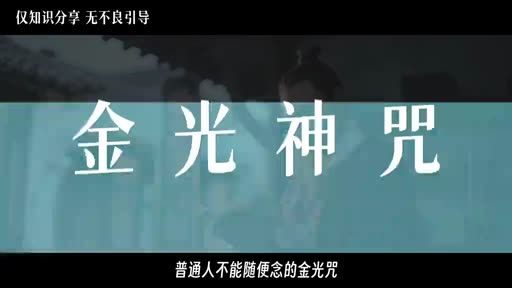
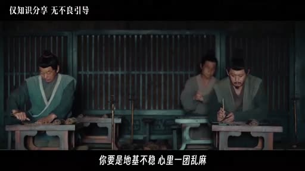
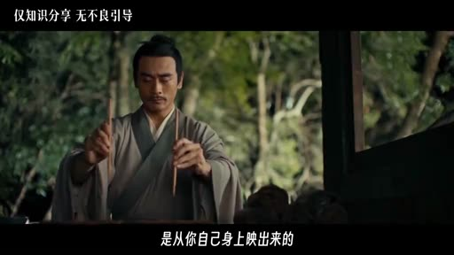
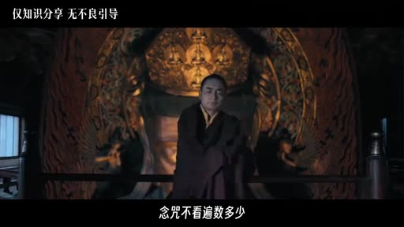
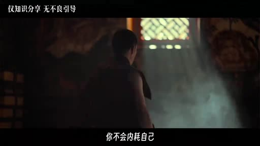

# 為什麼普通人不能隨便念金光咒？你本就自帶光芒，別向外討認可

- 來源：https://vm.tiktok.com/ZSgjqTfMy/
- 平台 / 上傳者：TikTok / tony760205
- 長度：06:48 (407.5s)
- 逐字稿來源：whisper (groq)
- 更新日期：2026-10-17
- **關鍵字：** #金光神咒 #道教八大神咒 #本自具足 #向內求 #道德經 #內耗 #定心 #真人 #口唸心不念

## 摘要與名詞說明

**一句話重點：** 講者（TikTok @tony760205）以心理與《道德經》的角度解讀道教金光神咒，主張咒的重點是「向內找回本自具足的光」，而不是向外求護身，因此口唸心不念、或當成護身符都是念反了。以下皆為講者主張，未查證。

| 時間 | 重點 |
|---|---|
| 00:00 | 開場：說明純屬知識分享，不涉宗教信仰；主題是金光咒如何對治內耗 |
| 00:22 | 講者主張金光咒為道教八大神咒之首，各派入門先學，是修道的「馬步」與地基 |
| 00:54 | 「體有金光，覆映吾身」：講者解讀為光從自己身上映出，被欲望、胡思亂想、在意他人眼光蓋住；連到「本自具足」與《道德經》「為道日損」 |
| 02:02 | 逐句解讀：天地玄宗、萬炁本根；廣修萬劫、證吾神通；三界內外、惟道獨尊（三界＝自己身心，本心才是主人）；視之不見、聽之不聞對應《道德經》第14章 |
| 03:19 | 受持萬遍；鬼妖精怪＝貪嗔痴慢疑，雷神＝內在定力；覆護真人＝真正醒著的人 |
| 04:13 | 為什麼不能隨便念：①口唸心不念，「念咒不看遍數多少，只看心念專不專一」；②當成向外討好處的護身符，會強化「安穩靠外面給」 |
| 05:11 | 用處：不能發財擋災，但能定心、不被他人評價帶著走、把「我好不好的評判權」收回自己手裡；結尾提醒理性看待、相信科學 |

## 名詞說明
- **金光神咒**：講者稱為道教八大神咒之首；引用句以畫面字幕為準（frame_0016）。
- **本自具足**：講者用語，指光、力量本來就在自己身上。
- **為道日損**：《道德經》用語，講者用來說明修行是「減」而非「加」。

## 轉錄校正備註
- 逐字稿來源：Groq Whisper（`whisper (groq)`），偵測語言 zh，已轉繁體；本片不是講座類，未去語助詞。
- 依畫面校正：天地玄宗、萬炁本根、廣修萬劫、證吾神通、惟道獨尊、覆映吾身。
- 依語意推測校正（記在 `known_asr_errors`）：神霄派、向外求、意象、評判權、掐訣、向外借的、覆護真人、唸咒不看遍數多少、受持萬遍、身有光明。
- 未詞典化：此影片是道教內容，不適用 ai-video 詞典，故未載入任何領域詞典。

## 圖文對照（畫面 + 逐字稿）

### 投影片 1：開場：普通人不能隨便念的金光咒（00:00–00:22）

**重點：** 講者說明內容是知識分享、不涉及宗教信仰，主題是金光咒如何對治內耗。

**標籤：** #金光神咒 #內耗

普通人不能隨便唸的金光咒，你知道是什麼嗎？知道的朋友可以評論區打出你印象最深的一句。今天的內容不涉及封建迷信，也不傳播什麼宗教信仰，純做知識分享，帶大家瞭解道教八大神咒裡排在第一位的金光咒，它能解決我們的很多內耗問題。點贊收藏，我們直接開講，有的朋友也可以開睡了。

### 投影片 2：金光咒的來頭：修道的馬步（00:22–00:54）

**重點：** 講者主張金光咒為道教八大神咒之首，正一、全真、神霄各派入門先學，是地基而非威力最猛的法門。

**標籤：** #八大神咒 #地基 #修心

先說金光咒的來頭，道教八大神咒裡金光咒排第一，不管是正一派，全真派，還是神霄派，入門都得先學它，早晚功課都拿它開篇，因為道教講究修法先修心，就像學武的人，學再花哨的招式，也得先扎馬步，金光咒就是修道的那個馬步，它不是威力最猛的，它是地基，你要是地基不穩，心裡一團亂麻，再厲害的法門你也接不住，所以第一步，永遠是先讓自己的心安穩下來。

### 投影片 3：「體有金光，覆映吾身」：光本來就在你身上（00:54–02:02）

**重點：** 講者將金光解讀為「覆映」而非「覆降」，光是本自具足、被欲望與他人眼光遮住；並連到《道德經》「為道日損」。

**標籤：** #覆映吾身 #本自具足 #為道日損

我們先看這個名字，它叫金光神咒，很多人一聽金光，想到的是電影電視劇那種，天上刷的降下一道金光，把人罩住，從此百邪不侵，其實不是啊，經文原話叫，體有金光，覆映吾身，這裡講的是覆映而不是覆降，也就是說，這道光是從你自己身上映出來的，是你本來就有的，不是外面賜給你的，只不過現在，它被你的慾望，你的胡思亂想，你對別人眼光的在意，給蓋住了而已，這就通到一個詞裡叫，本自具足，你要的那道光，你生下來就有，不用向外求，我們唸金光咒，也不是去求一道外來的光而是拿塊布把附在你心裡的那些灰一點點擦掉這就像老子在《道德經》裡講的復歸於嬰兒為道日損修行不是往身上加東西，是往下減，減掉那些多餘的執念，偏見和標籤，你越減，你本來的那道光就越亮，這就是金光咒和《道德經》一脈相承的地方，真正的力量向內求，不向外要。

### 投影片 4：逐句解讀：天地玄宗到惟道獨尊（02:02–03:19）

**重點：** 講者將「三界」解讀為自己的身心、「惟道獨尊」為本心作主；視之不見、聽之不聞對應《道德經》第14章。

**標籤：** #天地玄宗 #證吾神通 #惟道獨尊 #本心

金光咒總共一百來字，開篇是天地玄宗，萬炁本根，你和天地共用同一個根，我們生來就和天地相通，這句對應的正是道德經那句，玄之又玄，眾妙之門，萬物的源頭，你也是從裡頭生發出來的，金光咒後面一句是，廣修萬劫，證吾神通，注意這裡用的是證不是求，它不是讓我們去外面求一身本事，是把我們長大過程中一點點丟掉的東西重新找回來，認回來，三界內外，惟道獨尊，這裡我們可以把這三界放在我們自己身上，不講什麼天上人間地下，講我們自己的身心，這麼一來，惟道獨尊就是坐在你身心最中央的那個本心，才是唯一的主人，如果你為別人的一句話就亂了心神，那就相當於你把你自己做主的權利讓給了別人，再往下就是視之不見聽之不聞，這八個字和道德經第14章講的意思差不多，他在說，真正決定你這一生的東西，你的眼睛看不見，耳朵聽不到，比如你對自己根本的看法，比如你一次次掉進去的那套模式，你看不見了，但他卻一直在替你做主。

### 投影片 5：受持萬遍、鬼妖喪膽與覆護真人（03:19–04:13）

**重點：** 講者將鬼妖精怪解讀為貪嗔痴慢疑，雷神為內在定力；真人即真正醒著的人。

**標籤：** #受持萬遍 #貪嗔痴慢疑 #真人

我們再看一句叫受持萬遍，身有光明。萬遍是說我們把一個道理反覆琢磨反覆內化直到它成為我們的認知到那個程度，光自然就透出來了，再往後有一句，鬼妖喪膽，精怪亡形，內有霹靂，雷神隱名，聽著像想要除魔，其實全是意象，鬼妖精怪，可以看作是我們心裡的貪嗔痴慢疑，霹靂雷神，是我們內在的那股定力和決斷，這一整句從個人的角度，我的理解是，當你內在足夠清明堅定的時候，那些亂七八糟的念頭自然就散了，到最後金光速現，覆護真人，那道本來被遮蔽的光透體而出，覆護的是真人，道家說真人就是真正醒著的人，而我們大多數人都還在別人的評價，和自己的胡思亂想裡睡著呢。

### 投影片 6：為什麼不能隨便念：口唸心不念與向外討好處（04:13–05:11）

**重點：** 講者指出兩個原因：心亂念萬遍也白念；把咒當護身符會強化「安穩靠外面給」。

**標籤：** #口唸心不念 #護身符 #向內立柱

這其實不是金光神咒的全文，因為我是挑著裡面幾句，能解決我們內耗的話來講的，而且我前面說了，金光神咒不能隨便念，一方面是因為大多數人唸的時候是，口唸心不念，就是嘴在動，腦子裡胡思亂想，正統裡有句話，唸咒不看遍數多少，只看心念專不專一，你心亂如麻念上一萬遍，也是白念，把心定下來，一遍勝過萬遍，還有一個原因，有的朋友念金光咒，是把它當成一個向外討好處的護身符來唸，這樣一來你不但白念，還在反覆給自己灌輸一個念頭，就是我的安穩得靠外面給。你越念越強化，凡是靠外面的慣性，把自己越念越虛。所以不能隨便念，是怕你把一件本該讓你向內立柱的事，念成了讓你更依賴外面的迷信，這才是是真正念反了那金光咒在生活裡到底有什麼用呢我先說清楚。

### 投影片 7：生活中的用處與正確用法（05:11–06:48）

**重點：** 講者主張它不能發財擋災，但能定心、把評判權收回自己手裡；結尾提醒理性看待、相信科學。

**標籤：** #定心 #評判權 #本自具足

它不能幹什麼，它不能幫你發財，不能替你擋災，但它能讓你定心，比如別人說你一句不好的話，你不會內耗自己，因為你知道他不是在評價你，而是在評價他眼裡的你，或者說是他自己，遇到事，你不會等著別人救，而是自己找辦法去自救，看見別人的光鮮時刻，你不會覺得自己一無是處，而是知道自己身上也有光，只是我在此處，它的日用說白了就是，把我好不好的評判權，從別人手裡收回到自己手裡的日常功夫，那怎麼用才對呢，正宗練是要掐訣的，但是我們沒到那個地步，我們得先修心，就是身體放鬆，心先靜下來，等我們什麼時候把，我本自具足，我不必向外討這個念頭，確認成，我們遇事的第一反應了，心也就定下來了，其實金光神咒一百來字，從天地講到鬼神，從雷霆講到金光，對於我們普通人來說，關鍵還是在自己的內心狀態，你內在是什麼狀態，會自然寫在你的臉上，你的氣場，你待人接物的方式裡，別人怎麼對你，很多時候只是你內在的一面鏡子，所有你以為向外借來的力量，本質上都是你內在狀態的外化，向外借的總有還完、靠不住的一天，只有從你本心裡生出來的才永遠是你的，最後還是要說一句，理性看待，相信科學，今天的內容就到這裡，朋友們記得早點睡覺，不要熬夜，不要生氣，你本自具足，我們下期繼續。

## 已知轉錄錯誤

| 時間 | 聽成 | 應為 |
|---|---|---|
| 00:26 | 神消派 | 神霄派（已修正；道教派別，推測） |
| 01:33 | 不用向外逃 | 不用向外求（推測，已修正） |
| 02:31 | （章節） | 「證吾神通」依畫面 frame_0016 確認；「萬炁本根」「覆映吾身」同 |
| 03:39 | 全是異象 | 全是意象（推測，已修正） |
| 05:35 | 只是我在此處 | 可能是「只是我不自知」之類，語意不確定，未修改（推測） |
| 05:39 | 平盤犬 | 評判權（推測，已修正） |
| 06:27 | 向外界的總有還完 | 向外借的總有還完（推測，已修正） |
