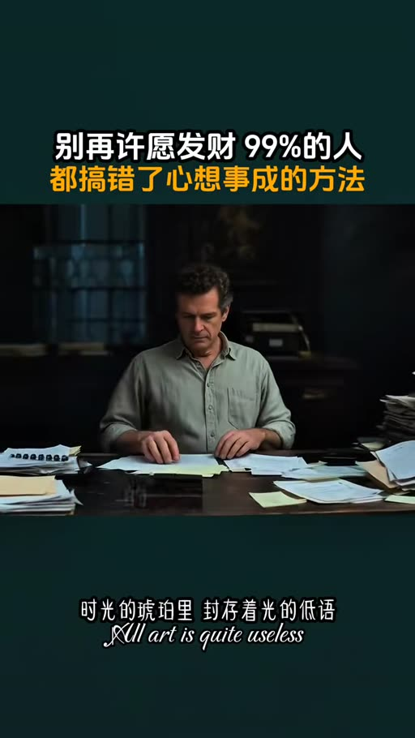
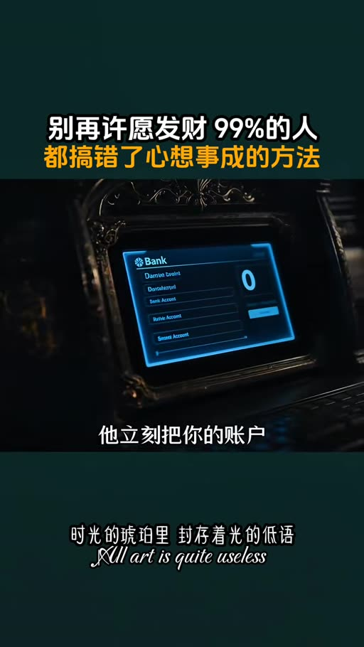
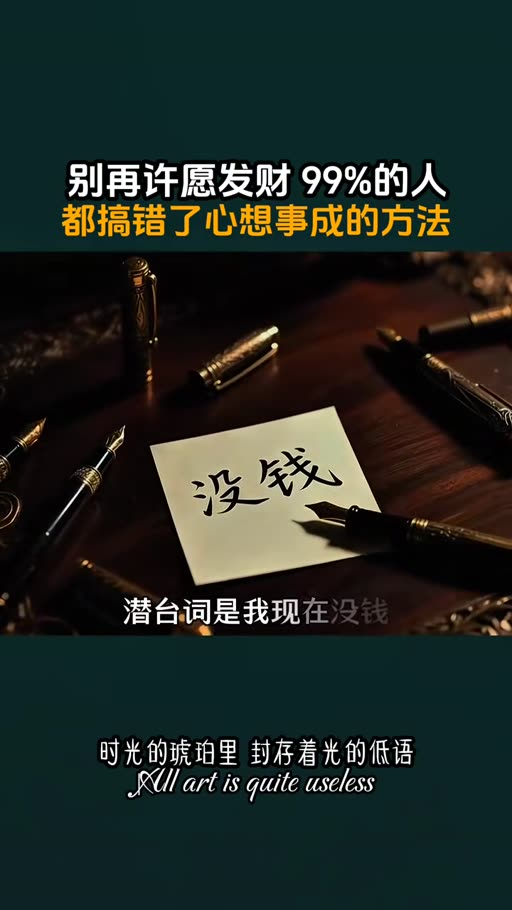
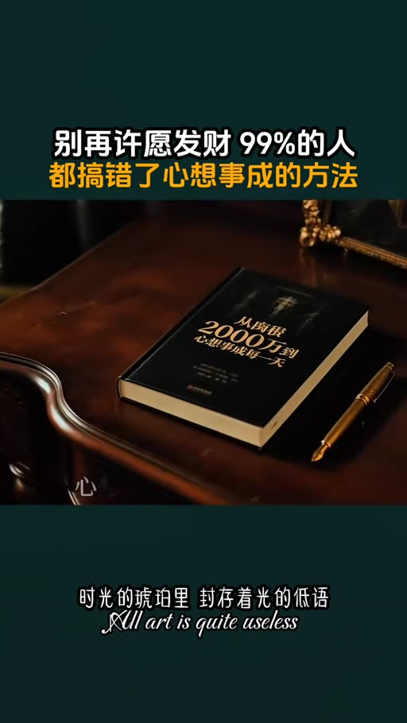

# 負債兩千萬到心想事成：完成式話術與謝謝

- 來源：https://vm.tiktok.com/ZSgMHMLbw/
- 平台 / 上傳者：TikTok / pindurensheng
- 長度：05:11 (310.5s)
- 逐字稿來源：whisper (groq)
- 更新日期：2026-10-18
- **關鍵字：** #心想事成 #完成式話術 #謝謝 #宇宙下單 #滯後效應 #負債2000萬 #財富自由 #自我暗示

## 摘要與名詞說明

**一句話重點：** 講者（TikTok @pindurensheng）介紹《從負債2000萬到心想事成每一天》，主張把「我沒錢、我好難」改成完成式的「債務已清零，謝謝」，再動手做宇宙派來的小事，才是心想事成的完整做法。以下皆為講者主張，未查證。影片畫面為 AI 風格插圖與燒錄字幕，標題卡寫「別再許願發財 99%的人都搞錯了心想事成的方法」。

| 時間 | 重點 |
|---|---|
| 00:00 | 開場：講者稱書中的日本大叔欠債2000多萬，靠每天說話走出催收壓力（講者主張，未查證） |
| 00:24 | 比喻：宇宙是倉庫管理員，你說什麼它發什麼貨；「我沒錢」等於把帳戶凍結在沒錢的頻道 |
| 01:06 | 第二課：別用「希望」下單（隱含現在沒有）；改用完成式，如「債務已清零，謝謝」，「謝謝」是確認收貨的按鈕；口頭禪像自動駕駛系統的程式碼，改口像刷機 |
| 02:16 | 滯後效應：改口後會有看不到結果的空窗期；講者稱作者的第一單工作又瑣碎又不賺錢，認真做完後被陌生人注意而得到新機會 |
| 03:18 | 講者稱作者說了五萬次謝謝；完整公式＝完成式話術下訂單＋動手做小事＋等待期穩住測試 |
| 04:05 | 「設定人生難度的人就是自己」；注意自己的語言；推薦把書放床頭 |

## 名詞說明
- **完成式話術**：把願望說成已經發生，如「我已收到心動的 offer」。
- **滯後效應**：講者用語，指改變語言與看到結果之間的時間差。
- 書名與作者名：畫面書封為「從負債2000萬到心想事成每一天」；畫面字幕作者為「小時浩」，實名可能是小池浩（推測，未查證）。

## 備註
- 本片屬自我成長／吸引力法則類主張，宇宙「發貨」之說沒有科學證據，數字（欠債金額、五萬次）皆為講者說法，未查證。
- 逐字稿：Groq Whisper，zh，已轉繁體；非講座類，未去語助詞。未載入領域詞典（此片非 AI 影片）。
- 校正記錄見 `meta.json.known_asr_errors`。

## 圖文對照（畫面 + 逐字稿）

### 投影片 1：開場：欠債2000萬的日本大叔靠「說話」翻身（00:00–00:24）

**重點：** 講者介紹《從負債2000萬到心想事成每一天》，主張改變口頭禪可以走出越努力越倒楣的循環。

**標籤：** #負債 #口頭禪

你敢相信嗎？一個欠了2000多萬，連覺都睡不安穩的日本中年大叔，就靠每天對著空氣自言自語，硬生生把自己從催收電話的狂轟濫炸裡撈了出來。不是中彩票，不是有人拉他一把，就是說話。今天講的從負債2000萬到心想事成每一天這本書，可能會讓困在越努力越倒黴怪圈裡的你，找到那把開啟死局的鑰匙。

### 投影片 2：宇宙是倉庫管理員：你說什麼它發什麼貨（00:24–01:06）

**重點：** 講者比喻：說「我沒錢」就像把帳戶凍結在沒錢的頻道上，抱怨是自己填的收貨地址。

**標籤：** #倉庫管理員 #口頭禪

小時浩當年欠著2000萬的債，每天被催收電話追著跑，嘴裡翻來覆去就那幾句，完蛋了，我這輩子就這樣了，為什麼倒楣的總是我，他以為這不過是發洩情緒，殊不知，宇宙就像一個老實巴交的倉庫管理員，你嘴裡說什麼，他就給你發什麼貨，你說我好難，他立馬打包一整箱更難的事送上門，你說我沒錢，他立刻把你的賬戶凍結在沒錢的頻道上，這不是什麼玄學，這是你親手填的收貨地址，書裡有句話特別扎心，如果你對現實不滿，宇宙只會說啥，那是你自己說的啊，我只是忠實照辦而已，怪我咯。

### 投影片 3：第二課：別用「希望」下單，改用完成式＋謝謝（01:06–02:16）

**重點：** 講者主張「希望有錢」隱含「現在沒錢」；改說「債務已清零，謝謝」，並用電腦「刷機」比喻改口。

**標籤：** #完成式 #希望 #謝謝

那有人要問了，難道天天喊我有錢就能暴富？這麼理解，就掉進更大的坑裡了，小時浩在書裡反覆強調的第二課就是千萬別用希望這詞下單。為什麼？希望有錢的潛臺詞是我現在沒錢。你對著宇宙喊希望，它接收到的關鍵詞只有兩個字，沒錢。你說氣不氣？真正會玩的高手用的是完成式。我想要個好工作換成我已收到心動的offer。謝謝，我想還清債務，換成債務已清零。謝謝，那個謝謝不是客氣，是確認收貨的按鈕。我知道你現在腦子裡肯定在想，這不就是自欺欺人嗎？我明明窮的叮噹響，讓我說我很寬裕。別急，打個比方，你的大腦就像一輛車的自動駕駛系統。你的口頭禪是寫入系統的程式碼，你說了20年的我，不行我沒錢。這套程式碼早就把你的人生鎖死在了原地打轉的軌道上。現在讓你改口說謝謝，我已擁有，不是騙自己，是在給系統刷機，剛開始會卡頓，會發熱，但你不刷，就永遠只能在那條爛路上顛簸。

### 投影片 4：滯後效應與宇宙的送貨方式（02:16–03:18）

**重點：** 講者說改口後有看不到結果的空窗期，是終極測試；第一單瑣碎的工作讓他被陌生人注意而得到新機會。

**標籤：** #滯後效應 #空窗期 #小事

小時浩還講了一個特別扎心的概念，叫滯後效應，很多人改了三天就放棄，因為他們以為今天改口，明天賬戶就該多幾個零，你想想，網上下單個冰箱，還得等兩三天配送呢你想改寫人生劇本宇宙就不能花點時間給你，那段什麼都看不到的空窗期，就是宇宙給你的終極測試在完全看不到結果的時候，你還信不信自己，更絕的是宇宙送貨的方式。小時浩說過，他下了債務清零的訂單之後，宇宙給他派來的第一單活，又瑣碎又不賺錢，換成誰都想罵人，但他忍住了，認認真真把手裡的事做完。後來正是那件不起眼的小事，讓他在過程中被一個陌生人注意到了，對方看到了他的踏實和韌勁，給他介紹了一個全新的機會，你看，宇宙給你的快遞外面裹的可能是個破紙箱，但裡面裝的是你下單的寶貝，你嫌箱子難看拒收，就永遠收不到貨。

### 投影片 5：說五萬次謝謝與三步公式（03:18–04:05）

**重點：** 講者稱作者決定說五萬次謝謝；完整公式：完成式話術下訂單、動手做小事、等待期穩住測試。

**標籤：** #五萬次謝謝 #三步公式

書裡還有個細節讓我印象特別深，小時浩說，光是嘴上說謝謝不夠，他做了個狠的決定說五萬次，在那些最看不到希望的日子裡，哪怕只是吃了一碗熱麵，他都會認真地說一句謝謝，他說，這兩個字有一種特殊的力量，能把累積在身心的負面能量，一點點轉化成正面能量，不是念咒語，是讓感恩變成你身體的本能反應，所以你看，所謂的心想事成從來不是躺著許願掉餡餅它的完整公式是用完成式話術下對訂單然後動手去做宇宙派來的每一件不起眼的小事，在什麼都看不到的等待期裡穩穩的接住每一次測試，三步一步都不能少。

### 投影片 6：設定人生難度的人是自己：結語（04:05–05:11）

**重點：** 講者提醒注意自己的語言，推薦把書放床頭；書中尚有情緒暫停、把倒楣事轉成成長訊號等方法。

**標籤：** #麥克風 #語言 #書

這本書裡有個概念特別打動我，叫設定人生遊戲難度的人就是你自己，過去你可能拿錯了劇本，一直在演那個越努力越倒楣的悲情角色，但你的麥克風一直在你自己手裡，每一次開口都是在給人生後臺輸入指令，你是想繼續輸入我好難我好累我好窮，還是從今天開始輸入謝謝，我已收到我準備好了，影片時長有限，我只能把從負債2000萬到心想事成每一天，這本書裡最核心的心法拆給你看，書裡還有更多具體的實操方法，怎麼在情緒崩潰的瞬間按下暫停鍵，怎麼把倒黴事翻譯成成長的訊號，怎麼在低谷期給自己充電？如果你已經受夠了現在這個劇本，我建議你把這本書放在床頭，下次當完蛋了又要脫口而出的時候，翻一翻它，它會給你一個溫柔而堅定的提醒，注意你的語言，因為那就是你正在活成的人生，願你的每一次開口都是好運的開始，謝謝。

## 已知轉錄錯誤

| 時間 | 聽成 | 應為 |
|---|---|---|
| 00:24 | 小時號／小石浩（Whisper 多種聽法） | 小時浩（依畫面字幕 frame_0020）；作者實名可能是「小池浩」（推測，未查證） |
| 01:05 | 怪我哥 | 怪我咯（推測，已修正） |
| 01:06 | 就能報復 | 就能暴富（依畫面 frame_0019「有錢能暴富」，已修正） |
| 03:15 | 巨瘦 | 拒收（推測，已修正） |
| 02:28 | 宇宙就不能花點時間給你 | 可能漏「備貨」（推測，未補） |
