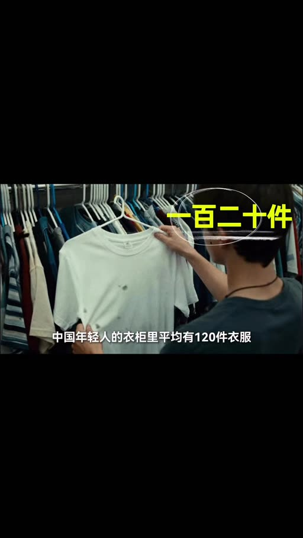
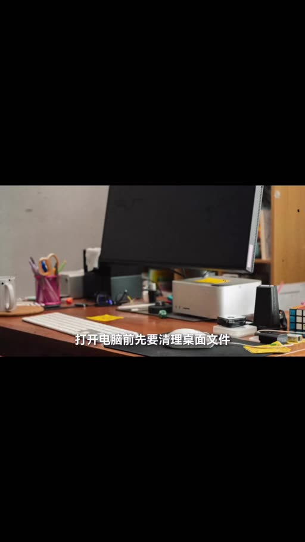
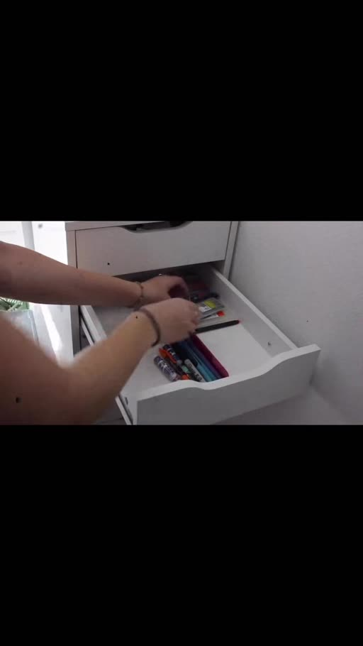
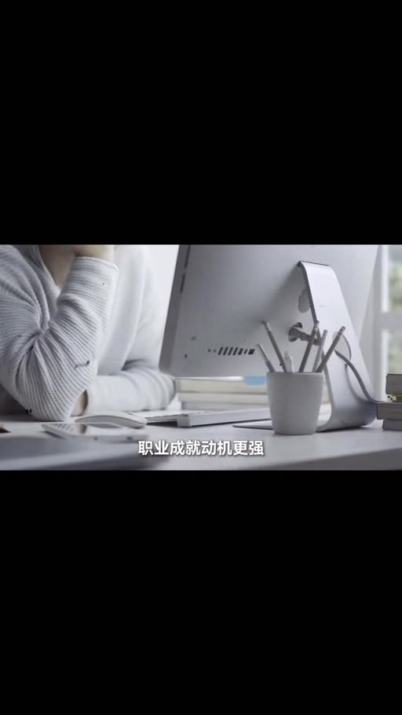
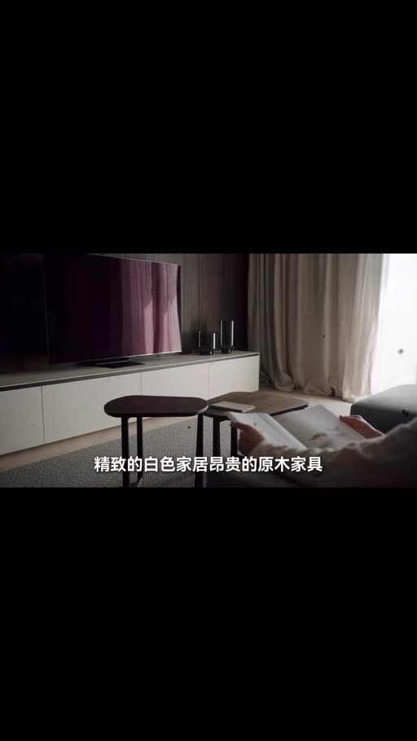

# 斷捨離2.0：重新定義什麼叫必要

- 來源：https://www.facebook.com/share/v/1KHcSPuXRR/
- 平台 / 上傳者：Facebook / 思維日記
- 長度：08:08 (488.1s)
- 逐字稿來源：whisper (groq)
- 更新日期：2026-10-19
- **關鍵字：** #斷捨離 #極簡主義 #認知負荷 #決策疲勞 #具身認知 #補償性消費 #生命意義感 #內驅力 #選擇過載 #講者主張

## 摘要與名詞說明

**一句話重點**：思維日記主張，斷捨離的本質不是丟東西，而是丟掉「被慾望驅動、被廣告定義、被社交裹挾的過去的自己」；極簡主義是重新定義「必要」的自由實踐，而非新的消費主義。（影片中的研究、百分比與案例均為講者主張，未查證。）

| 時間 | 重點 |
|---|---|
| 00:00 | 開場：閒置物品消耗大腦認知資源，主張雜亂使皮質醇上升 20%、相當每天三杯濃縮咖啡的焦慮感（講者主張，未查證） |
| 01:00 | 第一章 被物品綁架的現代人：問題是過剩而非匱乏；補償性消費（列斐伏爾）形成死迴圈；山下英子自稱「物品的僕人」；刪除＝承認決策錯誤，所以囤積 |
| 02:12 | 第二章 斷捨離的認知重啟：從筆筒開始逐一拿起感受（具身認知）；囤積本質是對未來的焦慮；視覺雜亂降低資訊處理能力→決策疲勞；扔掉電視後兩年減重 36 斤的案例 |
| 03:55 | 第三章 極簡主義的工作悖論：需求由「物質驅動」轉為「自我實現」；主張極簡者生命意義感高 32%、工作滿意度隨之上升 45%；自我評價由外部轉向內部 |
| 05:09 | 第四章 生命意義的重新錨定：陷阱＝把極簡當新消費主義；三問篩選（沒有它不便？更好？無法替代的情感？）；選擇過載與主動設限 |
| 06:44 | 第五章 一場關於自由的實踐：每次斷捨離是一次自我探查；引羅素之語；「需求越少，自由越多」；結語「美好生活不在更多裡，而在剛剛好裡」 |

## 名詞說明
- **斷捨離**：山下英子提出的整理與生活哲學（影片稱「斷捨離 2.0」為講者自稱的延伸說法）。
- **補償性消費**：影片歸於列斐伏爾，指工作被掏空後以購物補償。
- **具身認知（embodied cognition）**：影片用以說明「觸摸物品、重啟與物品的真實關係」。
- **決策疲勞／選擇過載**：選擇多、認知成本累積導致決策變難。

## 轉錄校正備註
- 逐字稿為 Groq 轉錄；畫面有燒錄的簡體字幕與章節標題，據此核對（內驅力、生命意義感、章節名等）。
- 校正：具深認知→具身認知、列斐福爾→列斐伏爾、生命意感→生命意義感、類趨利→內驅力、觸控物品→觸摸物品、高階感→高級感、更多里→更多裡；「斷舍離」統一為「斷捨離」。
- 標題為自訂（原標題「重新定义什么叫必要 断舍离2.0:不是扔东西,是扔掉过去的自己」＋一串 #標籤），原始標題在 `meta.json.title_raw`。

## 圖文對照（畫面 + 逐字稿）

### 投影片 1：開場：被閒置物品佔領（00:00–01:00）

**重點：** 講者主張：閒置物品持續消耗認知資源，雜亂使皮質醇上升20%（講者主張，未查證）。

**標籤：** #認知資源

你家裡有多少東西從沒用過卻捨不得扔的，那個兩年沒穿的外套，買了從沒開啟的書，囤了三套的備用充電線，據說中國年輕人的衣櫃裡平均有120件衣服，但常穿的不超過20件，這不是節儉，而是一場靜悄悄的佔領，我們以為自己是物品的主人，但神經科學研究發現，每多一件閒置物品，你的大腦就要為它分配認知資源，雜亂的空間會持續消耗你的注意力，讓皮質醇水平上升20%，相當於每天喝三杯濃縮咖啡的焦慮感，說白了，你不是在擁有東西，是東西在消耗你，這就是為什麼斷捨離在全球掀起風暴，豆瓣上40萬人組建極簡小組，不是因為窮，而是因為他們發現了一個殘酷真相，接下來我們就來看看，為什麼那些捨不得扔的每件東西，都在榨乾你做決策的能力，那些極簡主義者扔掉的根本不是物品，而是你想象不到的東西，先說說你可能正在經歷的場景。

### 投影片 2：第一章：被物品綁架的現代人（01:00–02:12）

**重點：** 過剩而非匱乏、補償性消費的死迴圈；山下英子自述曾是「物品的僕人」；刪除意味著承認決策錯誤。

**標籤：** #補償性消費 #山下英子

週末想在家工作，開啟電腦前先要清理桌面，檔案杯子沒拆的快遞，不知道哪來的小票，光是整理就花了20分鐘，等坐下來時腦子已經亂了，這不是你一個人的困境，社會學家研究發現，當代人面臨的核心問題不是匱乏而是過剩，列斐伏爾提出一個概念叫補償性消費，說的就是你在工作中被掏空，週末瘋狂購物來補償，買完又被物品淹沒，繼續被掏空，這是個死迴圈，日本主婦山下英子提出斷捨離之前，家裡堆滿了打折時，囤的鍋碗促銷買的衣服，覺得可能有用的小物件，她形容自己的狀態是物品的僕人，每天起床第一件事，不是想今天要做什麼，而是想這些東西該怎麼收拾，中國一項針對研究生的調查顯示，80%的人承認自己囤積了大量學術資料，幾千篇論文躺在硬碟裡從沒開啟過，但就是刪不掉，為什麼，因為刪除意味著承認當初的決策是錯的這個心理成本太高於是物品越來越多空間越來越窄而你對生活的掌控感正在以肉眼不可見的速度流失，更弔詭的是，這種被物品綁架的狀態，正是消費主義最想看到的結局。

### 投影片 3：第二章：斷捨離的認知重啟（02:12–03:55）

**重點：** 從筆筒開始，逐一拿起感受（具身認知）；囤積源於對未來的焦慮；雜亂降低資訊處理能力、導致決策疲勞；扔電視的案例。

**標籤：** #具身認知 #決策疲勞

那些真正開始斷捨離的人，第一步都不是從衣櫃開始，山下英子的方法論裡有個很實用的建議，從最簡單的抽屜開始，比如筆筒，把所有筆攤在桌上，拿起每一支感受它，寫得出來嗎，喜歡這個握感嗎，留著它是因為需要，還是因為怕浪費，這個過程在心理學上叫具身認知，透過觸摸物品啟用你和它的真實關係，一位踐行者分享，他整理桌面時發現，每天真正用的東西只佔20%，剩下80%是因為對未來的擔憂而留著，這句話擊中要害，囤積的本質是對未來的過度焦慮，你用物品構建安全感的幻覺，但這個幻覺反過來鎖死了你的當下，神經科學給出了更硬核的解釋，普林斯頓大學研究發現，視覺雜亂會直接降低大腦處理資訊的能力，因為前額葉皮層要不斷處理這些無關刺激，導致決策疲勞，簡單說就是你的桌子越亂，做選擇就越難，拖延症就越嚴重，而那些完成斷捨離的人，90%報告了一個共同變化，他們從覺得還有15分鐘什麼也幹不了，變成了還有15分鐘可以做點什麼，這不是雞湯，這是認知負荷降低後，執行功能被啟用的生理反應，有個案例更離譜，一位中年男性，扔掉家裡的電視後，夫妻倆開始面對面吃飯聊天，他堅持帶蔬菜湯當午餐，兩年減重36斤，體檢從C級升到A級，扔掉一臺電視，連健康都改善了，因為電視消失後，那些被動接收資訊的時間，變成了主動選擇的時間，但這裡藏著一個更深的秘密，那些扔掉物品的人，真正扔掉的根本不是東西，你可能覺得。

### 投影片 4：第三章：極簡主義的工作悖論（03:55–05:15）

**重點：** 主張極簡者工作動機反而更強：需求由物質驅動轉為自我實現；生命意義感高32%、工作滿意度上升45%（講者主張，未查證）。

**標籤：** #內驅力 #生命意義感

極簡主義者既然減少了物慾，應該會躺平擺爛，降低工作投入吧錯得離譜研究團隊調查了數百名極簡主義踐行者後震驚地發現他們的工作努力程度反而更高職業成就動機更強，這個悖論怎麼解釋，核心在於需求的置換，普通人工作是為了買更大的房子，更貴的車，更多的名牌，這叫物質驅動，但當物質需求被壓縮到極簡狀態後，工作的意義發生了質變，變成了自我實現的通道，心理學裡有個概念叫生命意義感，指的是你能否從日常活動中感知到價值和目標，研究資料顯示，極簡主義者的生命意義感得分比普通人高32%，而生命意義感每提升一個單位，工作滿意度就上升45%，說白了，他們不再為了買東西而工作，而是為了證明自己創造價值，獲得掌控感而工作，這種內驅力比物質獎勵持久得多，更有意思的是主觀社會地位的變化，當一個人不再透過消費來定義自己時，他的自我評價標準就從外部轉向內部，從比較性轉向建設性，一位受訪者說的很直接，以前買名牌包是為了讓別人覺得我混得好，現在我做好專案解決難題，這種滿足感是包包給不了的，但這裡有個巨大的陷阱，如果你誤解了極簡主義的核心，可能會走向另一個極端。

### 投影片 5：第四章：生命意義的重新錨定（陷阱與三問）（05:15–07:06）

**重點：** 別把極簡變成審美消費；三問篩選法（不便？更好？無法替代的情感？）；選擇過載、巴里·施瓦茨「選擇超過七個幸福感下降」（講者主張）。

**標籤：** #三問篩選 #選擇過載

那個陷阱就是把極簡當成新的消費主義，你去看社交平臺上的極簡博主，精緻的白色家居，昂貴的原木傢俱，所謂高級感的生活方式，這不叫極簡，這叫審美消費的升級版，真正的極簡主義，不是讓你買更貴的東西，而是重新定義什麼叫必要，一位踐行者的方法很實用，他用三個問題篩選物品，沒有它我會感到不便嗎，它能讓我的生活更好嗎，它承載著無法替代的情感嗎，只有三個問題都回答是，才留下，這個標準過濾掉的不只是物品，還有那些偽裝成夢想的慾望，偽裝成人脈的無效社交，偽裝成充實的資訊過載，豆瓣上有個極簡小組成員分享，他清理微信公眾號時發現，關注了50個科研相關的號但半年沒開啟過取關後反而焦慮減少了因為不再有看不完就落後的壓力這揭示了一個更深層的問題現代人的痛苦很多來自選擇過載，心理學家巴里·施瓦茨說，當選擇超過七個，幸福感開始下降，因為每次選擇都是認知成本的消耗，極簡主義做的就是主動給選擇設限，把精力聚焦在真正重要的20%上，研究證實，踐行極簡生活的人，主觀幸福感提升，焦慮指數下降，生活滿意度顯著提高，一個有意思的資料是，那些從高消費轉向極簡的人，普遍報告了更強的生活掌控感，和更清晰的人生方向，他們不是變窮了，而是從物品的奴隸變回了生活的主人，但最關鍵的轉變發生在更隱秘的地方，那些扔掉物品的人，其實是在扔掉過去的自己，那個被慾望驅動，被廣告定義，被社交裹挾的自己，每一次斷捨離都是一次自我探查，你在問自己，這個東西代表的我，還是我想成為的人嗎，當答案是否定時，你扔掉的不是物品，是那個不再適合你的身份標籤。

### 投影片 6：第五章：一場關於自由的實踐（07:06–08:08）

**重點：** 扔掉的是過去被慾望與廣告定義的自己；極簡不是貧窮美學；需求越少、自由越多；「不在更多裡，而在剛剛好裡」。

**標籤：** #自由 #真實自我

極簡主義不是貧窮美學，不是自我懲罰，不是對抗消費的道德姿態，它是一場關於自由的實踐，關於如何在物質過剩的時代裡，重新奪回對生活的定義權，哲學家羅素說過，幸福的要素是我們的生活方式，必須源於自己深邃的衝動，而非鄰居的慾望，當你不再需要透過購買來證明自己，當你的空間只留下真正有用和喜愛的物品，當你的時間不再被無效社交和資訊噪音佔據，你會發現一個悖論，需求越少，自由越多，物品越少，生命越重，那些真正完成斷捨離的人，他們獲得的不是空蕩蕩的房間，而是沉甸甸的生命意義感，這才是極簡主義最大的秘密，它不是在做減法，而是在幫你找到那個被慾望遮蔽太久的真實自我，而當你找到那個自我時，你會明白，所謂的美好生活從來不在更多裡，而在剛剛好裡，今天的分享就到這裡，我們下期再見。
